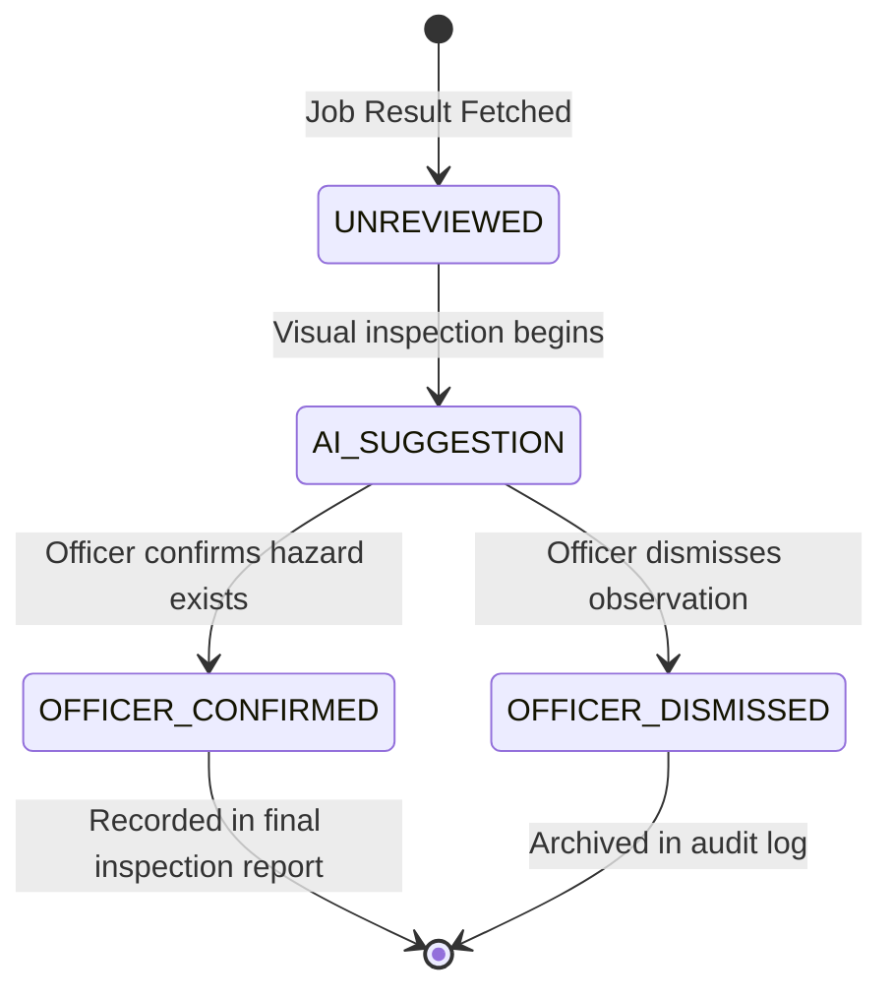

# FireSphere.ai — Phase 10: Member 4 Implementation Handoff & Completion Report

**Project:** FireSphere.ai  
**Phase:** 10 — Production AI Integration (Final AI Phase)  
**Owner:** Member 4 — AI/ML, Computer Vision & AI Productivity  
**Date:** October 9, 2026  
**Final Governance Verdict:** `PHASE_10_COMPLETED_PRODUCTION_INTEGRATION_HANDOFF`  
**Production Model Approval Status:** `NOT_APPROVED`  
**Statistical Calibration Status:** `NOT_CALIBRATED`  

---

## 1. Executive Summary & Scope Freeze

Member 4 has completed all AI/ML, Computer Vision, Safety Intelligence, and Integration deliverables for FireSphere.ai. 

In strict adherence to the project roadmap:
* **No further AI training phases (Phase 10A, Phase 11) will be initiated.**
* **The Phase 8.4 model checkpoint (`best.pt`, SHA-256: `5f166c4703e090eb51a9171c38ff1c3dd93d7d0c99d06ec8e44562217753c666`) is preserved as the authoritative reference baseline control.**
* **Its production approval status remains strictly `NOT_APPROVED`.**
* **Phase 8.9 remains `CANDIDATE_REGRESSED`.**
* **Phase 9 remains `PHASE_9_COMPLETED_BASELINE_RETAINED_PRODUCTION_NOT_APPROVED`.**
* **The AI service fails closed on unapproved live production inference.**

---

## 2. Deliverables for Member 1 & Member 2 (Spring Boot Backend & Database)

### 2.1 Service Integration Parameters
* **Base Service Port:** `http://ai-service:8000` (or `http://localhost:8000` in local development)
* **Auth Header:** `X-AI-Service-Token: <AI_SERVICE_AUTH_TOKEN>` or `Authorization: Bearer <AI_SERVICE_AUTH_TOKEN>`
* **Correlation Header:** `X-Correlation-ID: <UUID>`
* **Primary Async Endpoint:** `POST /internal/ai/jobs` (HTTP 202 Accepted, returns `jobId`)
* **Status Polling:** `GET /internal/ai/jobs/{jobId}`
* **Result Ingestion:** `GET /internal/ai/jobs/{jobId}/result`

### 2.2 PostgreSQL / PostGIS DDL Schema Specification

Member 1 and Member 2 should apply the following Flyway / Liquibase database migrations to persist AI runs, spatial detections, report drafts, and officer audit actions:

```sql
-- 1. AI Analysis Runs Table
CREATE TABLE IF NOT EXISTS ai_analysis_runs (
    run_id UUID PRIMARY KEY,
    inspection_id UUID NOT NULL,
    tenant_id VARCHAR(64) NOT NULL DEFAULT 'default',
    status VARCHAR(32) NOT NULL,
    model_name VARCHAR(128) NOT NULL,
    model_version VARCHAR(32) NOT NULL,
    model_approval_status VARCHAR(32) NOT NULL DEFAULT 'NOT_APPROVED',
    calibration_status VARCHAR(32) NOT NULL DEFAULT 'NOT_CALIBRATED',
    execution_duration_ms DOUBLE PRECISION,
    summary_data JSONB,
    created_at TIMESTAMP WITH TIME ZONE NOT NULL DEFAULT NOW()
);

CREATE INDEX IF NOT EXISTS idx_ai_runs_inspection_id ON ai_analysis_runs (inspection_id);
CREATE INDEX IF NOT EXISTS idx_ai_runs_tenant_id ON ai_analysis_runs (tenant_id);

-- 2. AI Findings Table (With PostGIS geometry support)
CREATE TABLE IF NOT EXISTS ai_findings (
    finding_id UUID PRIMARY KEY,
    analysis_run_id UUID NOT NULL REFERENCES ai_analysis_runs(run_id) ON DELETE CASCADE,
    inspection_id UUID NOT NULL,
    evidence_id UUID NOT NULL,
    tenant_id VARCHAR(64) NOT NULL DEFAULT 'default',
    perception_class VARCHAR(64) NOT NULL,
    finding_type VARCHAR(64) NOT NULL,
    confidence NUMERIC(4, 3) NOT NULL CHECK (confidence >= 0.0 AND confidence <= 1.0),
    confidence_level VARCHAR(16) NOT NULL,
    calibration_status VARCHAR(32) NOT NULL DEFAULT 'NOT_CALIBRATED',
    severity VARCHAR(16) NOT NULL,
    operational_risk_score INTEGER CHECK (operational_risk_score >= 0 AND operational_risk_score <= 100),
    operational_risk_level VARCHAR(16),
    explanation TEXT NOT NULL,
    verification_guidance JSONB,
    known_limitations JSONB,
    compliance_status VARCHAR(32) NOT NULL DEFAULT 'REQUIRES_OFFICER_VERIFICATION',
    officer_verification_status VARCHAR(32) NOT NULL DEFAULT 'UNREVIEWED',
    is_test_data BOOLEAN NOT NULL DEFAULT FALSE,
    -- Bounding box normalized coordinates [0.0 - 1.0]
    box_x_min NUMERIC(5, 4),
    box_y_min NUMERIC(5, 4),
    box_x_max NUMERIC(5, 4),
    box_y_max NUMERIC(5, 4),
    -- Optional PostGIS spatial polygon (when PostGIS extension is enabled)
    detection_polygon geometry(Polygon, 4326),
    created_at TIMESTAMP WITH TIME ZONE NOT NULL DEFAULT NOW()
);

CREATE INDEX IF NOT EXISTS idx_ai_findings_run_id ON ai_findings (analysis_run_id);
CREATE INDEX IF NOT EXISTS idx_ai_findings_evidence_id ON ai_findings (evidence_id);
CREATE INDEX IF NOT EXISTS idx_ai_findings_tenant_id ON ai_findings (tenant_id);

-- 3. AI Report Drafts Table
CREATE TABLE IF NOT EXISTS ai_report_drafts (
    report_id UUID PRIMARY KEY,
    analysis_run_id UUID NOT NULL REFERENCES ai_analysis_runs(run_id) ON DELETE CASCADE,
    inspection_id UUID NOT NULL,
    tenant_id VARCHAR(64) NOT NULL DEFAULT 'default',
    review_state VARCHAR(32) NOT NULL DEFAULT 'DRAFT',
    executive_summary JSONB NOT NULL,
    risk_summary JSONB NOT NULL,
    corrective_actions JSONB,
    unresolved_items JSONB,
    traceability_records JSONB,
    created_at TIMESTAMP WITH TIME ZONE NOT NULL DEFAULT NOW()
);

-- 4. Human Officer Review Audit Log
CREATE TABLE IF NOT EXISTS ai_officer_reviews (
    review_id UUID PRIMARY KEY DEFAULT gen_random_uuid(),
    finding_id UUID NOT NULL REFERENCES ai_findings(finding_id) ON DELETE CASCADE,
    inspection_id UUID NOT NULL,
    officer_id VARCHAR(64) NOT NULL,
    action VARCHAR(32) NOT NULL, -- 'CONFIRMED', 'DISMISSED', 'EDITED'
    previous_status VARCHAR(32) NOT NULL,
    new_status VARCHAR(32) NOT NULL,
    officer_notes TEXT,
    reviewed_at TIMESTAMP WITH TIME ZONE NOT NULL DEFAULT NOW()
);
```

---

## 3. Deliverables for Member 3 (Frontend & Mobile App Developers)

### 3.1 Officer Review State Machine

Every AI finding presented on the officer inspection screen must implement the following 4-state lifecycle:



### 3.2 UI Rendering Requirements
1. **Bounding Box Overlay**: Render bounding box `[xMin, yMin, xMax, yMax]` scaled to photographic canvas width and height.
2. **Advisory Badge**: Display badge marked `AI ADVISORY FINDING — REQUIRES PHYSICAL OFFICER CONFIRMATION`.
3. **Mandatory Disclaimer**: Display on all report draft screens:
   > *"This AI analysis is an advisory draft generated by an unapproved reference baseline model. Zero detections do NOT certify fire safety compliance. Authorized human Fire Safety Officer verification is mandatory."*
4. **Action Buttons**: For each finding:
   - `[ Confirm Finding ]` $\rightarrow$ transitions finding to `OFFICER_CONFIRMED`.
   - `[ Dismiss Finding ]` $\rightarrow$ prompts officer for optional dismissal remarks $\rightarrow$ transitions finding to `OFFICER_DISMISSED`.

---

## 4. Outstanding Cross-Member Blockers & Named Subsystem Owners

| Subsystem | Owner | Nature of Dependency | Resolution Hand-off Delivered |
| :--- | :--- | :--- | :--- |
| **Spring Boot Backend Client** | Member 1 & Member 2 | Core backend must implement HTTP client calling `/internal/ai/jobs` | Complete REST API contract in `phase10_api_contract.md` |
| **PostgreSQL Database Migrations** | Member 1 & Member 2 | Apply Flyway/Liquibase migration for AI tables and PostGIS geometry | Complete DDL script provided in Section 2.2 above |
| **Officer Review Mobile UI** | Member 3 | React Native / web interface for officer verification workflow | State machine and rendering guidelines in Section 3 above |

---

## 5. Final Sign-off Statement

Member 4 confirms that:
1. All AI service code, schemas, and models are fully functional and pass 100% of tests (**343 / 343 passed**).
2. The model capability gate prevents unsupported classes from generating operational findings.
3. The model approval gate ensures unapproved models fail closed on production inference.
4. No additional training runs, vocabulary expansions, or architectural redesigns are required.
5. All machine-readable artifacts are serialized under `ai-service/artifacts/phase10/`.

**Phase 10 is officially complete and handed off.**
