# FireSphere.ai — Phase 10: Security, Privacy & Failure Handling

**Document Version:** `1.0.0-phase10`  
**Owner:** Member 4 — AI/ML, Computer Vision & AI Productivity  
**Target Audience:** DevOps, SecOps, Backend Engineers, Compliance Auditors  

---

## 1. Security Architecture & Threat Model

```mermaid
graph LR
    Client[Spring Boot Core] -->|HTTPS + Token| AuthGuard[Auth Guard: Constant-Time Digest]
    AuthGuard -->|Tenant Scope| Validation[Payload & Schema Validation]
    Validation -->|Tenant Prefix| StorageClient[S3 Storage Guard: SHA-256 Checksum]
    StorageClient -->|Safe Array| Preprocessor[OpenCV Preprocessor: Max 20MB]
    Preprocessor -->|Letterbox Tensor| ModelGate[Model Capability & Approval Gate]
    ModelGate -->|Fail Closed| Worker[CV Inference Worker]
```



---

## 2. Service Authentication & Secret Isolation

1. **Constant-Time Verification**:
   The service uses Python's standard `hmac.compare_digest` to verify tokens, eliminating timing side-channel attacks:
   ```python
   is_valid = hmac.compare_digest(provided_token.encode("utf-8"), configured_token.encode("utf-8"))
   ```
2. **Zero Hardcoded Secrets**:
   No API keys, database credentials, or S3 secret keys are committed to Git. All configuration is injected via `.env` or container environment variables using Pydantic `BaseSettings`.
3. **No Sensitive Data in Logs**:
   Authentication tokens, raw cryptographic passwords, and citizen personal data are strictly excluded from structured log statements and metric labels.
4. **Internal-Only Endpoints**:
   The `/internal/ai/*` API surface is protected from direct public internet exposure and accessible only to trusted internal microservices within the VPC.

---

## 3. Storage Security & Path Traversal Prevention

1. **Path Sanitization**:
   All incoming object keys are checked by `sanitize_key()` in `S3CompatibleStorageProvider`. Any key containing directory traversal operators (`..`), absolute root paths (`/`), or URL schemes (`http://`, `https://`) raises an immediate validation exception.
2. **Multi-Tenant Key Namespace**:
   Objects are strictly compartmentalized using deterministic tenant-scoped prefixes:
   $$\text{tenants}/\{\text{tenantId}\}/\text{evidence}/\{\text{evidenceId}\}$$
   No tenant can access evidence stored under another tenant's namespace.
3. **Cryptographic Integrity Verification**:
   All downloaded image files are hashed with SHA-256 and verified against the expected storage digest prior to OpenCV decoding. Payload tampering immediately raises `IntegrityCheckException`.
4. **Payload Constraints**:
   A strict 20 MB size limit (`AI_MAX_IMAGE_SIZE_BYTES`) is enforced before file memory allocation to prevent denial-of-service (DoS) via decompression bombs or unbounded memory exhaustion.

---

## 4. Failure Classification & Retry Policy

Errors are strictly classified into **Retryable** (transient) and **Non-Retryable** (fatal) errors:

| Error Code | HTTP Status | Retryable? | Failure Mode / Handling |
| :--- | :--- | :--- | :--- |
| `UNAUTHORIZED_SERVICE` | `401` | No | Reject immediately; check `AI_SERVICE_AUTH_TOKEN`. |
| `INVALID_REQUEST` | `422` | No | Schema validation failure; client must fix payload. |
| `EVIDENCE_NOT_FOUND` | `404` | No | Key does not exist in bucket; re-upload required. |
| `INTEGRITY_CHECK_FAILED`| `422` | No | Checksum mismatch; re-upload evidence photograph. |
| `UNSUPPORTED_INPUT` | `415` | No | Corrupted image or unsupported MIME type. |
| `STORAGE_UNAVAILABLE` | `503` | **Yes** | Transient network or MinIO outage; backoff and retry. |
| `TIMEOUT` | `504` | **Yes** | Storage download or worker timeout; retry up to 3x. |
| `INTERNAL_ERROR` | `500` | Conditional| Retried only if classified as transient connection fault. |

### Bounded Exponential Backoff
$$\text{delay} = \min\left(30.0, 1.0 \times 2^{(\text{attempt} - 1)}\right) \pm \text{random\_jitter}$$
Retries are capped at `maxAttempts = 3`. Infinite retry loops are strictly prohibited.

---

## 5. Fail-Closed Model Gating Policy

If a request is received in production mode (`testMode=False`) without an approved model in the `ModelRegistry`:
* **The service fails closed.**
* Detections returned: `[]` (empty list).
* Detections fabricated: `0`.
* Summary narrative states explicitly:
  > *"All AI findings are advisory visual observations. The AI system does NOT approve or reject Fire NOC applications. Authorized Fire Officer on-site verification is required."*
* Under no circumstances does the service invent detections to make the dashboard look active.
