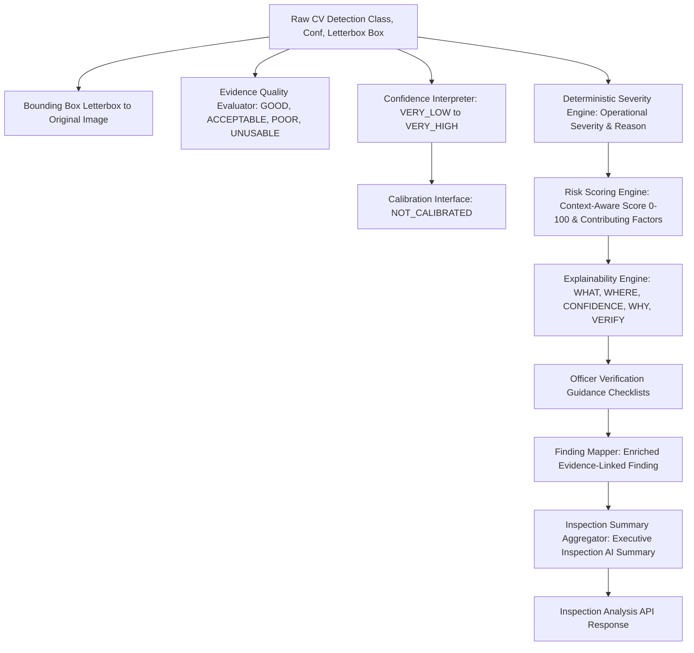

# FireSphere.ai — Phase 4: AI Findings, Confidence, Severity, Risk & Explainability

**Document Version**: 0.4.0-phase4  
**Author / Role**: Member 4 — AI/ML, Computer Vision & AI Productivity  
**System**: FireSphere.ai Production AI Service  

> [!IMPORTANT]
> **Strict Governance & Compliance Rule:**  
> The Phase 4 risk score is an AI-assisted operational prioritization score and is NOT a legally binding fire-safety or regulatory classification.  
> The AI service **NEVER autonomously approves or rejects a Fire NOC (No Objection Certificate)**.  
> All findings, risk metrics, and narratives are advisory, evidence-linked visual observations requiring authorized human Fire Safety Officer on-site verification.

---

## 1. Phase 4 Intelligence Architecture

The Phase 4 intelligence layer transforms raw computer-vision detections into structured, explainable, and officer-reviewable AI inspection findings:



---

## 2. Confidence Interpretation & Validation

1. **Validation**: Raw confidence scores are validated within $[0.0, 1.0]$. Negative scores or values exceeding 1.0 raise `ValueError`.
2. **Qualitative Categories**:
   - `VERY_LOW`: $\text{confidence} < 0.30$
   - `LOW`: $0.30 \le \text{confidence} < 0.50$
   - `MEDIUM`: $0.50 \le \text{confidence} < 0.70$
   - `HIGH`: $0.70 \le \text{confidence} < 0.85$
   - `VERY_HIGH`: $\text{confidence} \ge 0.85$
3. **Regulatory Distinction**: Model confidence represents visual feature activation strength of the neural network, **NOT regulatory compliance certainty**. High confidence (e.g. 0.88) does not denote an 88% probability of a fire code violation; it signifies that visual patterns resemble the specified defect class.

---

## 3. Confidence Calibration Architecture

* **Current Status**: `calibrationStatus = "NOT_CALIBRATED"`.
* **Honest Governance**: Because no annotated validation dataset currently exists in the repository, calibration coefficients are **not manufactured**.
* **Prepared Extensible Interfaces**:
  - `BaseConfidenceCalibrator`: Abstract base class.
  - `UncalibratedPassThroughCalibrator`: Active baseline returning raw score with status `"NOT_CALIBRATED"`.
  - `TemperatureScalingCalibrator`: Prepared for post-hoc temperature scaling once validation data is established.
  - `IsotonicRegressionCalibrator`: Prepared for non-parametric reliability calibration.

---

## 4. Deterministic Fire-Safety Severity Model

The severity engine assigns standardized operational severity ratings (`INFORMATIONAL`, `LOW`, `MEDIUM`, `HIGH`, `CRITICAL`) with detailed reasoning and stated operational assumptions:

| Defect Class | Base Severity | Operational Reasoning | Assumptions |
| :--- | :--- | :--- | :--- |
| `EMERGENCY_EXIT_OBSTRUCTED` | **CRITICAL** | Directly impedes occupant evacuation during fire or smoke spread. | Flagged door or corridor serves as active egress route. |
| `ELECTRICAL_PANEL_HAZARD` | **CRITICAL** | Exposed wiring or combustible inventory near electrical switchgear. | Panel carries active service voltage without physical separation. |
| `FIRE_EXTINGUISHER_MISSING` | **HIGH** | Deprives occupants of first-response incipient fire control. | Wall bracket designates an active first-aid firefighting post. |
| `FIRE_EXTINGUISHER_BLOCKED` | **HIGH** | Obstacles impede access within 1m clearance envelope. | Obstruction restricts immediate physical retrieval. |
| `SPRINKLER_HEAD_DEFECT` | **HIGH** | Corroded, bent, painted, or obstructed automatic sprinkler heads. | System is active and head provides primary overhead coverage. |
| `MANUAL_CALL_POINT_BLOCKED` | **HIGH** | Obstructed alarm pull boxes delay evacuation broadcast and dispatch. | Call point connects to active building alarm notification. |
| `HOSE_REEL_OBSTRUCTED` | **HIGH** | Inaccessible cabinet prevents deployment of secondary water stream. | Cabinet connects to pressurized fire mains. |
| `FIRE_EXTINGUISHER_EXPIRED` | **MEDIUM** | Depressurized gauge or overdue maintenance tag indicates failure risk. | Visual gauge is in recharge zone or tag is overdue. |
| `EXIT_SIGNAGE_MISSING` | **MEDIUM** | Missing or dark exit signs impair directional guidance in smoke. | Location requires illuminated marking under building codes. |
| `COMBUSTIBLE_MATERIAL_HAZARD`| **MEDIUM** | Elevated fuel load stored near potential ignition points. | Materials are flammable and near heat sources. |
| `GENERIC_FIRE_SAFETY_DEFECT` | **INFORMATIONAL** | Advisory visual observation flagged for officer attention. | Visual observation requires preliminary officer appraisal. |

*Confidence Adjustment*: If detection confidence is marginal ($< 0.60$), base `CRITICAL` or `HIGH` severity is adjusted to `MEDIUM` to avoid premature risk escalation.

---

## 5. Context-Aware Operational Risk Scoring

The `RiskScoringEngine` computes an `AI_OPERATIONAL_RISK_SCORE` ($0 - 100$) and categorizes it into `LOW`, `MEDIUM`, `HIGH`, or `CRITICAL`. Every score exposes transparent contributing factors:

$$\text{RiskScore} = \text{SeverityContribution} + \text{ConfidenceContribution} + \text{EvidenceQualityContribution} + \text{OccupancyContribution}$$

### Factor Breakdown:
1. **Finding Severity** (Max 50 points): `CRITICAL`=50, `HIGH`=40, `MEDIUM`=25, `LOW`=15, `INFORMATIONAL`=5.
2. **Model Confidence** (Max 25 points): $\text{round}(\text{confidence} \times 25)$.
3. **Evidence Quality** (Max 15 points): `GOOD`=15, `ACCEPTABLE`=10, `POOR`=5, `UNUSABLE`=0.
4. **Occupancy Context** (Max 10 points): `HAZARDOUS`=10, `ASSEMBLY`/`INDUSTRIAL`=8, `COMMERCIAL`/`EDUCATIONAL`=5, `RESIDENTIAL`=2. Defaults to `UNKNOWN` (0 points) when not supplied.
5. **Historical Context**: Documented when available; defaults to `UNAVAILABLE` without arbitrary score inflation.

---

## 6. Evidence-Grounded Explainability Engine

The `ExplainabilityEngine` answers five fundamental questions grounded exclusively in factual detection data:
* **WHAT**: What visual condition was detected (e.g., vacant fire extinguisher mounting bracket)?
* **WHERE**: Spatial location in the image (quadrant e.g. "upper-left", "center", and normalized bounding box coordinates)?
* **CONFIDENCE**: Detection score and qualitative level (e.g. `0.88 (HIGH)`) with disclaimer that confidence reflects feature activation, not legal non-compliance certainty.
* **WHY**: Visual feature characteristics justifying the classification.
* **VERIFY**: Key physical checks the inspecting Fire Officer should perform on site.

---

## 7. Officer Verification Guidance Checklists

For every cataloged defect class, [verification.py](file:///c:/Users/athar/OneDrive/Desktop/Firesphere.ai/ai-service/app/intelligence/verification.py) provides actionable checklists detailing:
1. Physical on-site verification steps.
2. Potential visual ambiguities or camera perspective artifacts (e.g., angle hiding tag, temporary cart vs permanent fixture).
3. Required documentation checks (hydrostatic test stamps, maintenance logs, alarm panel records).

---

## 8. Compliance Safety Boundary

* **Enforced States**: `complianceStatus` is restricted to:
  - `REQUIRES_OFFICER_VERIFICATION`
  - `NOT_ASSESSED`
  - `AI_ASSISTED_ONLY`
* **Forbidden States**: Setting `complianceStatus` to `AI_APPROVED` or `AI_REJECTED` raises a validation error.
* **Zero Autonomous NOC Authority**: The AI service never approves, rejects, or calculates legally binding penalties for Fire NOC applications.

---

## 9. Evidence Quality Integration

Phase 2's `ImageQualityReport` is mapped to standardized quality ratings:
* **GOOD**: No warnings, sharp Laplacian focus, normal lighting.
* **ACCEPTABLE**: Minor lighting or aspect ratio variation, but fully interpretable.
* **POOR**: Suboptimal focus (Laplacian blur score $< 15.0$) or extreme lighting ($< 20$ or $> 245$).
* **UNUSABLE**: Low resolution ($< 64\times 64$) or corrupted/null image.

Quality directly influences operational risk weighting and executive summary reporting while remaining distinct from raw model confidence.

---

## 10. Future SHAP / LIME Architecture

The architecture prepares for future feature attribution on tabular risk models:
* `BaseExplainer`: Core interface.
* `VisionExplanationProvider`: Active visual evidence explainer.
* `RiskModelExplainer`: Extensible hook for tabular risk models returning `explainerStatus="NOT_AVAILABLE"` until a tabular model is trained. Zero fake SHAP values are fabricated.

---

## 11. API Contract Enhancements

`POST /internal/ai/inspection-analysis` returns enriched findings and an executive `summary`:

```json
{
  "runId": "4fa85f64-5717-4562-b3fc-2c963f66afa6",
  "status": "COMPLETED",
  "findings": [
    {
      "findingId": "d3b4e672-1a2b-4c3d-8e5f-9a0b1c2d3e4f",
      "evidenceId": "c3b88b22-8239-4d69-a1b9-87cfa90f1d3e",
      "findingType": "EMERGENCY_EXIT_OBSTRUCTED",
      "confidence": 0.88,
      "confidenceLevel": "HIGH",
      "calibrationStatus": "NOT_CALIBRATED",
      "severity": "CRITICAL",
      "severityReason": "Assigned operational severity: CRITICAL. Reason: Obstructed emergency egress directly impedes occupant evacuation...",
      "operationalRiskScore": 88,
      "operationalRiskLevel": "CRITICAL",
      "riskFactors": [
        {"factor": "finding_severity", "contribution": 50, "description": "Base operational weight for CRITICAL severity."},
        {"factor": "model_confidence", "contribution": 22, "description": "Detection activation confidence contribution (88.0%)."},
        {"factor": "evidence_quality", "contribution": 10, "description": "Photographic quality rating 'ACCEPTABLE'."},
        {"factor": "occupancy_context", "contribution": 5, "description": "Occupancy context 'COMMERCIAL'."}
      ],
      "explanation": "WHAT: The computer-vision inspection model identified apparent obstruction in emergency exit passage or door. WHERE: Detected in the upper-left of the image... CONFIDENCE: Detection score is 0.88 (HIGH)... WHY: Visual features exhibit patterns characteristic of exit blockage. VERIFY: The inspecting Fire Safety Officer should physically examine the premises...",
      "verificationGuidance": [
        "Inspect the full width of the exit corridor, doorway, and stairwell for physical blockage.",
        "Determine whether the apparent blockage consists of temporary stored goods or fixed construction.",
        "Verify that exit door hardware opens freely from inside without key or special knowledge."
      ],
      "evidenceQuality": "ACCEPTABLE",
      "complianceStatus": "REQUIRES_OFFICER_VERIFICATION",
      "occupancyContext": "COMMERCIAL",
      "historicalContext": "UNAVAILABLE",
      "model": "firesphere-inspection-cv",
      "modelVersion": "0.3.0-phase3",
      "boundingBox": {"xMin": 0.1, "yMin": 0.1, "xMax": 0.4, "yMax": 0.5},
      "isTestData": true,
      "createdAt": "2026-10-05T22:30:00Z"
    }
  ],
  "summary": {
    "totalFindings": 1,
    "uniqueFindingTypes": 1,
    "highestSeverity": "CRITICAL",
    "highestRiskLevel": "CRITICAL",
    "highestRiskScore": 88,
    "evidenceCount": 1,
    "requiresOfficerReview": true,
    "findingsRequiringOfficerReview": 1,
    "confidenceSummary": {
      "distribution": {"HIGH": 1},
      "averageConfidence": 0.88
    },
    "evidenceQualitySummary": {"ACCEPTABLE": 1},
    "calibrationStatus": "NOT_CALIBRATED",
    "complianceDecisionNote": "All AI findings are advisory visual observations. The AI system does NOT approve or reject Fire NOC applications. Authorized Fire Officer on-site verification is required."
  },
  "model": "firesphere-inspection-cv",
  "modelVersion": "0.3.0-phase3",
  "executionDurationMs": 24.5
}
```

---

## 12. Automated Test Suite

Run full suite:
```powershell
.\ai-service\.venv\Scripts\pytest -v ai-service/tests
```
**Results**: 82 passed in 1.29s (53 baseline + 29 new Phase 4 tests, 0 failures).

---

## 13. Known Limitations & Roadmap to Phase 5

1. **Model Weights Still Required**: Real inspection photographs continue producing `findings: []` until fine-tuned weights are trained and loaded.
2. **Test Mode Exclusivity**: Synthetic findings are strictly restricted to `testMode=true` and tagged `isTestData=true`.
3. **Tabular Explainers Prepared**: SHAP / LIME features remain prepared as future interfaces until tabular risk models are deployed.
4. **Phase 5 Scope**: AI-assisted inspection narrative and report drafting will be implemented in Phase 5.
