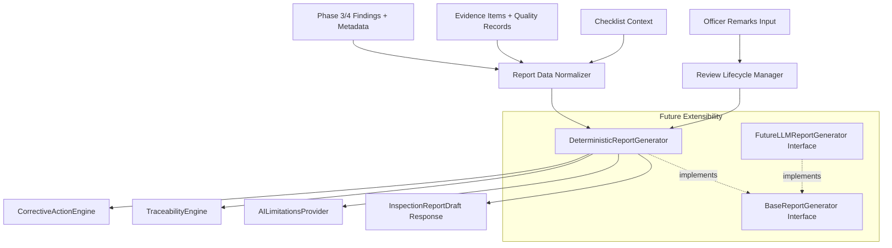

# FireSphere.ai — Phase 5: AI Inspection Report Drafting & Officer Productivity

**Document Version**: 0.5.0-phase5  
**Author / Role**: Member 4 — AI/ML, Computer Vision & AI Productivity  
**System**: FireSphere.ai Production AI Service (`ai-service/`)  

> [!IMPORTANT]
> **Strict Governance & Regulatory Boundary:**  
> 1. The inspection report draft generated by the AI service is an **advisory draft for an authorized human Fire Safety Officer**.  
> 2. The AI service **NEVER autonomously approves or rejects a Fire NOC (No Objection Certificate)**.  
> 3. AI outputs do **NOT constitute a statutory or legal compliance decision**. Forbidden compliance states (`AI_APPROVED`, `AI_REJECTED`, `AI_NOC_APPROVED`, `AI_NOC_REJECTED`) are blocked by programmatic schema validators.  
> 4. The AI system **NEVER fabricates fire safety regulations, code numbers, acts, penalties, statutory deadlines, building dimensions, water tank capacities, or unobserved site facts**.

---

## 1. Phase 5 Objective

Phase 5 introduces a production-ready **AI-assisted inspection report drafting capability** that synthesizes the structured detection and intelligence outputs from Phases 1–4 into an auditable, traceable, officer-reviewable inspection report draft (`InspectionReportDraft`).

The operational lifecycle is:

```text
    AI Analysis (Phase 3 CV + Phase 4 Intelligence)
                      ↓
    Structured Findings, Risk Metrics & Verification Guidance
                      ↓
    Report Data Normalization
                      ↓
    Deterministic Report Draft Generator
                      ↓
    Statement-Level Evidence Traceability
                      ↓
    Officer Review & Human-in-the-Loop Edits
                      ↓
    Final Human Decision by Authorized Fire Safety Officer
```

---

## 2. Logical Architecture

The report drafting subsystem is organized into distinct, testable modules under `app/reporting/`:



---

## 3. Report Domain Model & Schema

Defined in [`app/schemas/report.py`](file:///c:/Users/athar/OneDrive/Desktop/Firesphere.ai/ai-service/app/schemas/report.py), the report schema enforces complete structure:

| Model | Purpose |
| :--- | :--- |
| `InspectionReportDraft` | Top-level document containing all report sections, audit metadata, and lifecycle state. |
| `ReportStatus` | `DRAFT`, `FINAL`. |
| `ReviewState` | `DRAFT`, `UNDER_REVIEW`, `OFFICER_EDITED`, `OFFICER_ACCEPTED`, `SUPERSEDED`. |
| `ReportModelInfo` | Model name, version, calibration status, and execution duration. |
| `ReportExecutiveSummary` | Deterministic overview of findings count, unique classes, highest severity, highest risk, and officer notes. |
| `ReportEvidenceItem` | Evidence ID, photographic quality, processing status, warnings, and linked finding IDs. |
| `ReportFindingItem` | Evidence-linked finding preserving confidence, severity, risk score, explanation, and bounding box. |
| `ReportRiskSummary` | Risk distribution, highest severity, highest operational score, and verification requirements. |
| `ReportVerificationAction` | Specific on-site check instructions and ambiguity verification for the inspecting officer. |
| `ReportCorrectiveAction` | Generic operational safety recommendation without fabricated statutory citations or penalties. |
| `ReportUnresolvedItem` | Explicit logging of uncalibrated models, marginal confidence, poor evidence, or missing context. |
| `TraceabilityRecord` | Statement-level lineage connecting every report sentence to its source finding, evidence, and field. |
| `ReportAuditMetadata` | Audit identifiers, generation timestamp, model version, and synthetic test flags. |

---

## 4. Human-in-the-Loop Review Lifecycle

The review lifecycle is managed by `ReviewLifecycleManager` (`app/reporting/review.py`):

1. **Initial Generation**: AI outputs draft with `reviewState = "DRAFT"` and `requiresOfficerReview = True`.
2. **Review Transitions**:
   - `DRAFT`: Newly generated AI draft awaiting officer inspection.
   - `UNDER_REVIEW`: Officer is examining visual evidence and findings.
   - `OFFICER_EDITED`: Officer has amended remarks, findings, or recommendations.
   - `OFFICER_ACCEPTED`: Officer has reviewed and confirmed the draft for downstream administrative use.
   - `SUPERSEDED`: Replaced by a subsequent inspection run or re-inspection.
3. **Forbidden States**: Attempting to set `AI_APPROVED`, `AI_REJECTED`, `APPROVED`, or `REJECTED` raises a validation error. The AI system has `aiDecisionAuthority = "NONE (ADVISORY_DRAFT_ONLY)"`.

---

## 5. Deterministic Report Generation

Phase 5 enforces **100% deterministic report generation**:
- Identical inputs (findings, evidence, context, remarks) always yield identical draft narratives.
- Findings are sorted deterministically by:
  1. Operational severity weight (`CRITICAL` > `HIGH` > `MEDIUM` > `LOW` > `INFORMATIONAL`)
  2. Operational risk score descending
  3. Prediction confidence descending
  4. Finding category string alphabetically
  5. Finding UUID string
- **Zero random temperature**, zero stochastic sampling, and zero external network calls.

---

## 6. Statement-Level Evidence Traceability

Every sentence generated in the draft is registered as a `TraceabilityRecord` with a unique identifier (`stmt-001`, `stmt-002`, ...):

```json
{
  "statementId": "stmt-003",
  "reportSection": "FINDINGS",
  "statementText": "Finding 7d9cd7a9... (FIRE_EXTINGUISHER_MISSING): AI analysis detected possible missing fire extinguisher.",
  "sourceType": "FINDING",
  "sourceId": "7d9cd7a9-b31a-4d76-805c-15a00a293675",
  "evidenceId": "572b8a20-5b51-4bca-8c00-99b4ba8da8fa",
  "findingId": "7d9cd7a9-b31a-4d76-805c-15a00a293675",
  "sourceField": "description"
}
```

This guarantees end-to-end auditability from final report text back to the exact photograph and neural network detection box.

---

## 7. AI Operational Risk Summary

The report preserves Phase 4 risk scoring and aggregates:
- Total findings count
- Highest operational severity (`CRITICAL`, `HIGH`, `MEDIUM`, `LOW`, `INFORMATIONAL`)
- Highest operational risk score ($[0, 100]$) and level
- Complete risk distribution breakdown across findings
- Explicit labeling: `"AI Operational Risk Summary — Advisory Only"`.

---

## 8. Verification Actions

Draws from Phase 4 verification guidance to supply the inspecting officer with targeted physical checks:
- Confirm physical presence or absence of the detected safety equipment.
- Evaluate whether obstructions (e.g. at exit routes) are transient or permanent fixtures.
- Inspect maintenance collar tags, pressure gauges, and physical accessibility.
- Check against official municipal checklists and building plans.

---

## 9. Corrective Action Suggestions

Generated by `CorrectiveActionEngine` (`app/reporting/corrective_actions.py`):
- Suggests practical physical corrections (e.g. *"Clear all stored goods from exit pathways; maintain minimum 1.2m clear width"*).
- **Explicit Safety Boundary**: Labeled `"AI SUGGESTED CORRECTIVE ACTION (ADVISORY — SUBJECT TO OFFICER APPROVAL)"`.
- **Zero Hallucination Safeguard**: Does not reference unsupplied sections of the National Building Code (NBC), local Fire Acts, fines, or statutory remediation timelines.

---

## 10. Human Review Boundary & Officer Remarks

- Officer remarks can be provided as input to the drafting endpoint.
- Remarks are cleanly preserved and explicitly tagged:
  ```text
  [OFFICER REMARKS — HUMAN AUTHORED]: Front corridor clear, rear storage requires cleanup.
  ```
- Officer remarks are strictly separated from AI-generated narratives to prevent attribution confusion.

---

## 11. Compliance Safety Boundary

| System Action | Permitted? | Rationale |
| :--- | :--- | :--- |
| Generate visual hazard observations | **YES** | Core computer-vision advisory capability. |
| Calculate operational risk score | **YES** | Helps officers prioritize high-hazard items. |
| Suggest verification checks | **YES** | Standardizes inspection thoroughness. |
| Autonomously issue Fire NOC | **FORBIDDEN** | Statutory authority rests exclusively with human officers. |
| Autonomously reject Fire NOC | **FORBIDDEN** | Legal determinations require human verification. |
| Fabricate acts, fines, or deadlines | **FORBIDDEN** | Hallucination poses severe legal liability. |

---

## 12. Test-Mode Handling & Synthetic Data Safety

When a report is generated under `testMode=True` or contains test findings (`isTestData=True`):
- `dataClassification`: `"TEST_DATA"`
- `isTestData`: `True`
- Prominent Warning:
  ```text
  TEST DATA — NOT FOR OPERATIONAL OR COMPLIANCE USE.
  ```
- An explicit unresolved item is added: `"Analysis was conducted under testMode with synthetic test fixtures; discard for operational use."`

---

## 13. Tailored AI Limitations

`AILimitationsProvider` (`app/reporting/limitations.py`) dynamically attaches relevant caveats based on the actual run:
1. **Human Verification Mandatory**: Visual findings are advisory observations; physical inspection is legally required.
2. **Confidence vs Certainty**: Model confidence denotes visual pattern match, not statutory compliance certainty.
3. **Operational vs Statutory Risk**: Risk scores are operational triage metrics, not statutory fire ratings.
4. **Calibration Caveat**: Appended whenever `calibrationStatus == "NOT_CALIBRATED"`.
5. **Image Quality Degradation**: Appended if any evidence item exhibits `POOR` or `UNUSABLE` quality.
6. **Class Boundaries**: The model assesses only cataloged fire safety classes.

---

## 14. Future LLM Abstraction

Phase 5 defines an extensible architecture via `BaseReportGenerator`:
- `DeterministicReportGenerator`: The **only active implementation** in Phase 5.
- `FutureLLMReportGenerator`: An architectural interface placeholder raising `NotImplementedError`.
- If an LLM is introduced in future phases, it must adhere to the same `InspectionReportDraft` schema and statement traceability constraints, preventing uncontrolled hallucination.

---

## 15. API Endpoints

### `POST /internal/ai/inspection-report-draft`
Generates a structured, auditable report draft.

#### Request Schema (`InspectionReportDraftRequest`)
```json
{
  "inspectionId": "4a72d3f9-7128-4447-bcf4-74ea0fca446e",
  "runId": "9b12e6d1-4c12-4217-a021-ef788a101b12",
  "findings": [],
  "evidenceIds": ["572b8a20-5b51-4bca-8c00-99b4ba8da8fa"],
  "officerRemarks": "Rear exit corridor obstructed by temporary delivery pallets.",
  "testMode": true,
  "occupancyContext": "COMMERCIAL"
}
```

#### Response Structure
Returns `200 OK` with full `InspectionReportDraft` JSON object containing `summary`, `evidenceReviewed`, `findings`, `riskSummary`, `verificationActions`, `correctiveActions`, `unresolvedItems`, `aiLimitations`, `traceability`, and `auditMetadata`.

---

## 16. Empty Findings Semantics

When zero findings are detected, the report does **not** state that the premises is compliant:
> *"AI analysis completed across 2 submitted evidence item(s). No AI findings were generated from the submitted evidence. Note: The absence of AI detections indicates only that no supported visual defects were recognized by the computer vision model; it does NOT certify that the building is compliant or free of fire hazards. Mandatory human Fire Officer physical inspection is required before any regulatory compliance decision."*

---

## 17. Testing & Verification

The Phase 5 test suite is implemented in [`tests/test_report_drafting.py`](file:///c:/Users/athar/OneDrive/Desktop/Firesphere.ai/ai-service/tests/test_report_drafting.py) covering 19 test cases.

Full suite command:
```powershell
.\ai-service\.venv\Scripts\pytest -v ai-service/tests
```

**Result**:
- **101 passed, 0 failures, 8 deprecation warnings in 1.85s**.
- Preserves all 82 baseline tests from Phases 1–4.
- Adds 19 comprehensive Phase 5 tests.

---

## 18. Known Limitations

1. **Confidence Calibration**: The underlying CV model remains uncalibrated (`NOT_CALIBRATED`) pending annotated field datasets.
2. **Scope of Detections**: Detection is limited to cataloged visual defect classes; invisible hazards (e.g. gas leakage, pressure decay) cannot be assessed by computer vision.
3. **No External LLM**: Report narratives are deterministically templated; natural conversational variation will be enabled in future phases.

---

## 19. Phase 6 Dependencies

Phase 6 will consume the structured draft produced by Phase 5:
- Spring Boot backend integration for persistence and authentication.
- Redis / Celery async job queue for background report compilation.
- MinIO integration for long-term document and PDF export storage.
- Real-time notification to the Fire Officer's mobile client.
