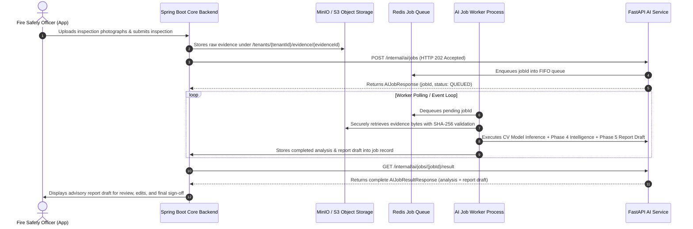

# FireSphere.ai — Spring Boot Backend to AI Service Integration Contract

**Document Version:** `1.0.0-phase6`  
**Target Consumer:** FireSphere Core Engineering / Backend Team (Member 1 & Member 2: Spring Boot)  
**AI Service Provider:** Member 4 (AI/ML, Computer Vision & AI Productivity)  
**Applicable Service Version:** `0.6.0-phase6`

---

## 1. Overview & Service Boundary

The **FireSphere AI Service** provides asynchronous Computer Vision defect detection and AI-assisted fire inspection report drafting for the Spring Boot core backend.

### Strict Governance & Regulatory Boundaries
1. **Advisory Drafts Only**: All AI outputs are advisory inspection drafts requiring explicit review and confirmation by an authorized human Fire Safety Officer (`reviewState: DRAFT`, `requiresOfficerReview: true`).
2. **Zero Autonomous NOC Authority**: The AI service **never** approves, rejects, or sanctions a Fire No Objection Certificate (NOC). The programmatic states `AI_APPROVED`, `AI_REJECTED`, `AI_NOC_APPROVED`, and `AI_NOC_REJECTED` are strictly rejected by programmatic schema validators.
3. **No Hallucinated Code/Dimensions**: The AI service never invents building dimensions, fire regulations, act numbers, or penalties.
4. **Authentication & Tenant Isolation**: Spring Boot manages citizen/officer authentication, authorization, and tenant policies. The AI service acts as a trusted internal service verifying service tokens (`X-AI-Service-Token` or `Authorization: Bearer <token>`) and propagates tenant context (`tenantId`) across all job records and storage keys.

---

## 2. End-to-End Processing Workflow



---

## 3. Service-to-Service Authentication

All requests from Spring Boot to the AI Service must be authenticated. The AI service supports both header styles using constant-time comparison (`hmac.compare_digest`):

* **Custom Service Header:**
  ```http
  X-AI-Service-Token: <AI_SERVICE_AUTH_TOKEN>
  ```
* **Standard Authorization Header:**
  ```http
  Authorization: Bearer <AI_SERVICE_AUTH_TOKEN>
  ```

> [!NOTE]
> In production environments (`AI_SERVICE_ENV=production`), missing or mismatched service tokens immediately yield `HTTP 401 Unauthorized`. The service token is never logged.

---

## 4. Correlation & Tenant Headers

For distributed tracing and multi-tenant auditability, Spring Boot should provide:

| Header | Description | Default / Fallback |
| :--- | :--- | :--- |
| `X-Correlation-ID` | Unique request correlation identifier across services | Auto-generated UUID |
| `X-AI-Service-Token` | Shared service-to-service secret token | Configured environment token |

---

## 5. API Endpoints Specification

### 5.1 Enqueue AI Job

**Endpoint:** `POST /internal/ai/jobs`  
**HTTP Status:** `202 Accepted`  
**Description:** Asynchronously schedules an inspection for AI CV detection, risk scoring, and report drafting. Supports deterministic client-supplied `idempotencyKey` to prevent duplicate processing.

#### Request Headers:
```http
POST /internal/ai/jobs HTTP/1.1
Host: ai-service.internal:8000
Content-Type: application/json
X-AI-Service-Token: your-configured-shared-token
X-Correlation-ID: 7a8c3d52-11ee-48bb-b892-9382103fca91
```

#### Request Body Schema:
```json
{
  "inspectionId": "3fa85f64-5717-4562-b3fc-2c963f66afa6",
  "evidenceIds": [
    "c8a14b30-e67d-411a-8e2b-10f8a846c921",
    "9d5e3f12-b13c-4d56-8a90-332145e6f7a8"
  ],
  "operation": "INSPECTION_ANALYSIS_AND_REPORT",
  "tenantId": "mumbai-fire-zone-04",
  "occupancyContext": "COMMERCIAL",
  "historicalContext": "PAST_VIOLATIONS",
  "officerRemarks": "Inspecting basement fire pumps and emergency escape corridor.",
  "checklistData": {
    "electrical_panel_covered": true,
    "clearance_maintained": false
  },
  "idempotencyKey": "insp-3fa85f64-ev-v1-analysis",
  "testMode": false
}
```

#### Response Body (`202 Accepted`):
```json
{
  "jobId": "b1a23c4d-5e6f-7a8b-9c0d-1e2f3a4b5c6d",
  "inspectionId": "3fa85f64-5717-4562-b3fc-2c963f66afa6",
  "tenantId": "mumbai-fire-zone-04",
  "status": "QUEUED",
  "operation": "INSPECTION_ANALYSIS_AND_REPORT",
  "attempt": 1,
  "maxAttempts": 3,
  "idempotencyKey": "insp-3fa85f64-ev-v1-analysis",
  "correlationId": "7a8c3d52-11ee-48bb-b892-9382103fca91",
  "modelName": "firesphere-inspection-cv",
  "modelVersion": "0.3.0-phase3",
  "serviceVersion": "0.6.0-phase6",
  "createdAt": "2026-10-05T18:15:30.123456Z",
  "startedAt": null,
  "completedAt": null,
  "analysisRunId": null,
  "reportId": null,
  "errorCode": null,
  "errorMessage": null
}
```

---

### 5.2 Poll Job Status

**Endpoint:** `GET /internal/ai/jobs/{jobId}`  
**HTTP Status:** `200 OK`  
**Description:** Retrieves execution status, attempt counts, and lifecycle timestamps.

#### Response Body:
```json
{
  "jobId": "b1a23c4d-5e6f-7a8b-9c0d-1e2f3a4b5c6d",
  "inspectionId": "3fa85f64-5717-4562-b3fc-2c963f66afa6",
  "tenantId": "mumbai-fire-zone-04",
  "status": "COMPLETED",
  "operation": "INSPECTION_ANALYSIS_AND_REPORT",
  "attempt": 1,
  "maxAttempts": 3,
  "idempotencyKey": "insp-3fa85f64-ev-v1-analysis",
  "correlationId": "7a8c3d52-11ee-48bb-b892-9382103fca91",
  "modelName": "firesphere-inspection-cv",
  "modelVersion": "0.3.0-phase3",
  "serviceVersion": "0.6.0-phase6",
  "createdAt": "2026-10-05T18:15:30.123456Z",
  "startedAt": "2026-10-05T18:15:30.201456Z",
  "completedAt": "2026-10-05T18:15:30.345678Z",
  "analysisRunId": "9b8a7c6d-5e4f-3a2b-1c0d-9e8f7a6b5c4d",
  "reportId": "4f5e6d7c-8b9a-0e1f-2a3b-4c5d6e7f8a9b",
  "errorCode": null,
  "errorMessage": null
}
```

---

### 5.3 Retrieve Complete Job Result

**Endpoint:** `GET /internal/ai/jobs/{jobId}/result`  
**HTTP Status:** `200 OK`  
**Description:** Returns complete structured analysis and deterministic inspection report draft for ingestion into Spring Boot databases.

#### Response Body:
```json
{
  "jobId": "b1a23c4d-5e6f-7a8b-9c0d-1e2f3a4b5c6d",
  "inspectionId": "3fa85f64-5717-4562-b3fc-2c963f66afa6",
  "tenantId": "mumbai-fire-zone-04",
  "status": "COMPLETED",
  "analysisRunId": "9b8a7c6d-5e4f-3a2b-1c0d-9e8f7a6b5c4d",
  "reportId": "4f5e6d7c-8b9a-0e1f-2a3b-4c5d6e7f8a9b",
  "createdAt": "2026-10-05T18:15:30.123456Z",
  "completedAt": "2026-10-05T18:15:30.345678Z",
  "analysis": {
    "runId": "9b8a7c6d-5e4f-3a2b-1c0d-9e8f7a6b5c4d",
    "status": "COMPLETED",
    "model": "firesphere-inspection-cv",
    "modelVersion": "0.3.0-phase3",
    "executionDurationMs": 144.2,
    "findings": [
      {
        "findingId": "e1f2a3b4-5c6d-7e8f-9a0b-1c2d3e4f5a6b",
        "evidenceId": "c8a14b30-e67d-411a-8e2b-10f8a846c921",
        "className": "FIRE_EXTINGUISHER_BLOCKED",
        "confidence": 0.88,
        "confidenceLevel": "HIGH",
        "severity": "HIGH",
        "complianceStatus": "NON_COMPLIANT",
        "explanation": {
          "what": "Detected obstructed fire extinguisher with 0.88 confidence.",
          "where": "Located at normalized coordinates [x: 0.12, y: 0.35, w: 0.40, h: 0.55].",
          "why": "Clear floor access is essential for rapid fire suppression.",
          "verify": "Verify at least 1.0 meter unobstructed radial clearance."
        }
      }
    ]
  },
  "report": {
    "reportId": "4f5e6d7c-8b9a-0e1f-2a3b-4c5d6e7f8a9b",
    "inspectionId": "3fa85f64-5717-4562-b3fc-2c963f66afa6",
    "analysisRunId": "9b8a7c6d-5e4f-3a2b-1c0d-9e8f7a6b5c4d",
    "status": "DRAFT",
    "reviewState": "DRAFT",
    "summary": {
      "totalFindings": 1,
      "criticalHazards": 0,
      "highHazards": 1,
      "mediumHazards": 0,
      "lowHazards": 0,
      "operationalRiskScore": 58.5,
      "riskCategory": "MODERATE_RISK",
      "requiresOfficerReview": true
    },
    "officerRemarks": "[OFFICER REMARKS — HUMAN AUTHORED]:\nInspecting basement fire pumps and emergency escape corridor."
  },
  "errorCode": null,
  "errorMessage": null
}
```

---

## 6. Error Handling & Standardized Error Codes

When errors occur, responses conform to a structured JSON format without leaking internal paths or stack traces:

```json
{
  "status": "FAILED",
  "errorCode": "JOB_NOT_FOUND",
  "message": "AI job '...' was not found in job registry."
}
```

### Standard Error Code Catalog

| Error Code | HTTP Status | Description | Recommended Spring Boot Action |
| :--- | :--- | :--- | :--- |
| `UNAUTHORIZED_SERVICE` | `401` | Missing or invalid service token | Check `AI_SERVICE_AUTH_TOKEN` secret |
| `JOB_NOT_FOUND` | `404` | Requested jobId does not exist | Verify jobId exists in local database |
| `EVIDENCE_NOT_FOUND` | `404` | Evidence file not present in S3/MinIO | Ensure file upload completed before enqueue |
| `INVALID_REQUEST` | `422` | Request schema validation failure | Fix payload schema (UUIDs, required fields) |
| `INTEGRITY_CHECK_FAILED` | `422` | SHA-256 checksum mismatch | Re-upload evidence photograph |
| `STORAGE_UNAVAILABLE` | `503` | MinIO/S3 cluster unreachable | AI service will retry automatically |
| `TIMEOUT` | `504` | Inference execution timeout | Allow bounded retry or log alert |
| `INTERNAL_ERROR` | `500` | Unhandled processing fault | Inspect AI service logs |

---

## 7. Recommended Spring Boot Client Configuration

* **Connection Pool**: 20 connections max per instance.
* **HTTP Connect Timeout**: 2,000 ms.
* **HTTP Read Timeout**: 5,000 ms (job submission is async and returns immediately).
* **Job Polling Strategy**: Exponential backoff with jitter starting at 500 ms up to 3 seconds, or listen on backend completion webhook if enabled.
