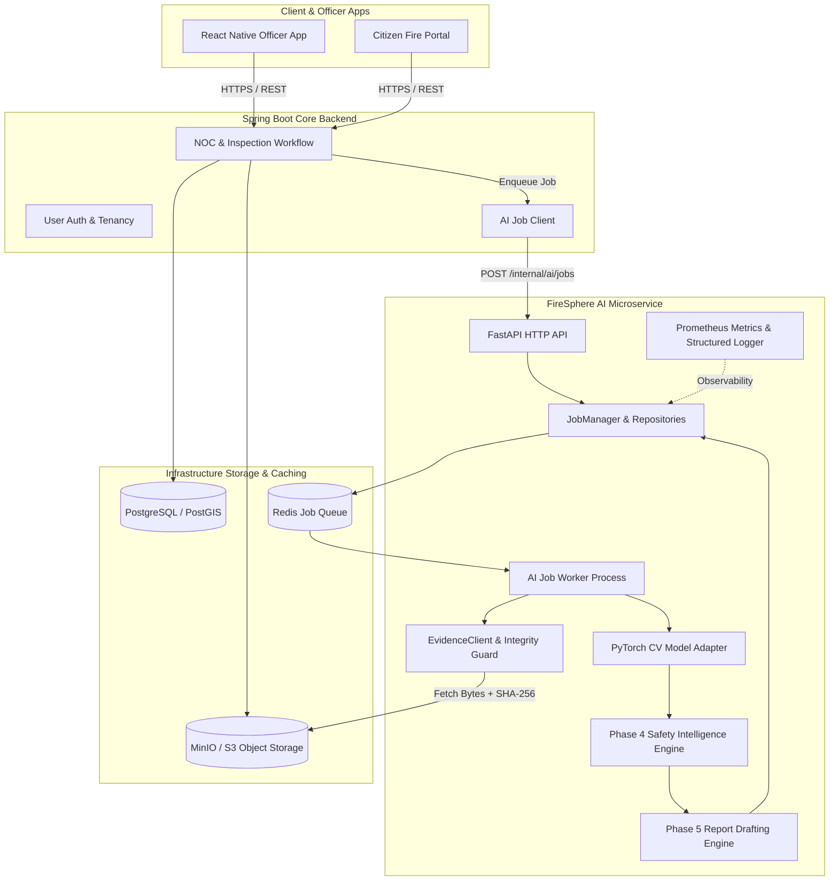

# FireSphere.ai — Phase 6: Production AI Backend Integration, Async Job Execution & Production Hardening

**Document Version:** `1.0.0-phase6`  
**Status:** Complete  
**Service Version:** `0.6.0-phase6`  
**Target Audience:** Core Architects, Backend Engineers, DevOps, & Security Auditors

---

## 1. Production Architecture Overview

Phase 6 hardens the FireSphere AI service into an enterprise-grade, observable, multi-tenant, and asynchronous microservice integrated with the FireSphere SaaS ecosystem.



---

## 2. AI Job Lifecycle & Identity Separation

The AI job lifecycle is strictly confined to processing states. It **never** represents statutory NOC approval or rejection.

```
       [Client Request]
              ↓
           QUEUED  ←──────────────┐
              ↓                   │
           RUNNING                │ Bounded Retry with
          ↙       ↘               │ Exponential Backoff
   COMPLETED       RETRYING ──────┘
                      ↓ (Max Attempts Exceeded)
                    FAILED
```

### Supported Job Statuses
* `QUEUED`: Job is accepted and placed in the FIFO queue.
* `RUNNING`: Worker has dequeued the job and is executing inference and report compilation.
* `COMPLETED`: Successful analysis and draft report generated and persisted.
* `RETRYING`: Transient error occurred; job is scheduled for another bounded attempt.
* `FAILED`: Non-retryable error occurred, or maximum retries (`maxAttempts`) were exhausted.
* `CANCELLED`: Administratively aborted prior to completion.

### Identity Separation
To ensure auditable lineage, identifiers remain decoupled:
$$\text{inspectionId} \neq \text{jobId} \neq \text{analysisRunId} \neq \text{reportId}$$
* `inspectionId`: Physical inspection session created by the Spring Boot backend.
* `jobId`: Asynchronous queue execution unit.
* `analysisRunId`: Specific computer vision inference run.
* `reportId`: Deterministic inspection draft generated from the run findings.

---

## 3. Queue & Worker Architecture

Heavy computer vision model execution is completely decoupled from the asynchronous FastAPI HTTP event loop.

* **API Process**: Handles request ingestion, header/token authentication, idempotency lookup, and queue insertion with immediate `HTTP 202 Accepted` response.
* **Worker Process**:
  * Dequeues jobs sequentially or with configurable concurrency (`AI_WORKER_CONCURRENCY`).
  * Fetches evidence via `EvidenceClient` using private bucket paths.
  * Runs CV inference under `torch.inference_mode()`.
  * Generates Phase 4 findings and Phase 5 report drafts.
  * Records status and error codes back to the repository.

---

## 4. Redis Job Coordination

Redis acts as both the distributed FIFO queue and the fast job state repository.

* **Queue**: Backed by Redis Lists using `LPUSH` for enqueuing and blocking `BRPOP` for dequeue with timeout.
* **Job State Repository**: Stored under `firesphere:ai:jobs:{jobId}` as serialized JSON with an 86,400s (24 hour) TTL.
* **Idempotency Index**: Stored under `firesphere:ai:idempotency:{key}` mapping directly to `jobId`.
* **Graceful Standalone Fallback**: In local development or test suites where Redis is not configured, the service falls back automatically to `InMemoryJobQueue` and `InMemoryJobRepository`.

---

## 5. MinIO / S3 Object Storage & Security

Evidence photographs are securely retrieved from S3-compatible storage through `S3CompatibleStorageProvider`.

### Security Protections:
1. **No Arbitrary URL Downloads**: The AI service never accepts external or unauthenticated public URLs.
2. **Path Traversal Defense**: All object keys are sanitized; attempts to include `..`, absolute root paths `/`, or protocol schemes `http://` raise immediate exceptions.
3. **Multi-Tenant Key Isolation**: Evidence is compartmentalized under:
   `tenants/{tenantId}/evidence/{evidenceId}`
4. **Cryptographic Checksum Verification**: Downloaded bytes are hashed with SHA-256 and verified using constant-time comparison (`hmac.compare_digest`). Mismatched payloads trigger `IntegrityCheckException` and reject the file.

---

## 6. Service-to-Service Authentication

The AI service verifies internal callers using a pre-shared secret token:
* Header: `X-AI-Service-Token` or `Authorization: Bearer <token>`
* Verification: Constant-time digest comparison.
* Security: Tokens are never written to disk, returned in error messages, or printed in logs.
* Mandatory in Production: Missing tokens reject requests with `HTTP 401 Unauthorized` (`UNAUTHORIZED_SERVICE`).

---

## 7. Multi-Tenant Context Propagation

`tenantId` is a required metadata attribute across the entire stack:
1. Supplied by Spring Boot in `AIJobCreateRequest`.
2. Encoded in `AIJobRecord`.
3. Propagated into object storage path prefixes (`tenants/{tenantId}/evidence/...`).
4. Embedded into Prometheus metrics labels (`ai_jobs_total{tenant="mumbai-fire-04"}`).
5. Preserved in `AIJobResponse` and `AIJobResultResponse`.

---

## 8. Idempotency Strategy

Clients may supply an optional `idempotencyKey` (e.g. `insp-{id}-ver-{ver}`).
* If an existing job matches the key, the existing job metadata is returned immediately without duplicate queuing.
* Duplicate inference is prevented, protecting GPU/CPU resources from burst traffic.

---

## 9. Bounded Retry Policy

Errors are strictly classified into retryable and non-retryable categories:

* **Non-Retryable (Fail-Fast)**:
  * Deterministic validation errors (`INVALID_REQUEST`)
  * Unauthorized service callers (`UNAUTHORIZED_SERVICE`)
  * Corrupted evidence or SHA-256 mismatch (`INTEGRITY_CHECK_FAILED`)
  * Unsupported media types or malformed image headers (`UNSUPPORTED_INPUT`, `IMAGE_DECODE_FAILED`)
* **Retryable (Transient)**:
  * Object storage connection outage (`STORAGE_UNAVAILABLE`)
  * Redis queue or network timeouts (`TIMEOUT`, `ConnectionError`, `OSError`)

### Exponential Backoff with Jitter:
$$\text{delay} = \min\left(\text{max\_seconds}, \text{base\_seconds} \times 2^{(\text{attempt} - 1)}\right) \pm \text{jitter}$$
Bounded by `AI_MAX_RETRIES` (default: 3). Infinite retry loops are impossible.

---

## 10. Failure Codes & Error Contract

Structured error responses never leak stack traces or system filepaths:

```json
{
  "status": "FAILED",
  "errorCode": "STORAGE_UNAVAILABLE",
  "message": "Object storage service is temporarily unavailable."
}
```

Catalog of error codes:
* `INVALID_REQUEST`
* `UNAUTHORIZED_SERVICE`
* `JOB_NOT_FOUND`
* `EVIDENCE_NOT_FOUND`
* `EVIDENCE_INVALID`
* `INTEGRITY_CHECK_FAILED`
* `STORAGE_UNAVAILABLE`
* `MODEL_NOT_AVAILABLE`
* `MODEL_LOAD_FAILED`
* `INFERENCE_FAILED`
* `TIMEOUT`
* `INTERNAL_ERROR`

---

## 11. Model Loading Lifecycle & GPU Memory Safety

1. **Process-Level Caching**: Model weights are loaded once during FastAPI application startup (`lifespan`). Models are **never** reloaded per request.
2. **Zero Automatic Downloads**: Model weights must exist locally at `AI_MODEL_WEIGHTS_PATH`. If absent, the service defaults to honest Case C baseline mode.
3. **Device Configuration & CPU Fallback**:
   * Configured via `AI_INFERENCE_DEVICE` (`auto`, `cuda`, `cpu`).
   * If `cuda` is requested but unavailable, the service safely falls back to CPU when `AI_GPU_FALLBACK_TO_CPU=true`.
4. **Memory Safety**:
   * Inference executes within `torch.inference_mode()`, preventing gradient graph allocation.
   * Intermediate tensors are released immediately after prediction.
5. **Warmup**:
   * When `AI_MODEL_WARMUP=true`, a synthetic forward pass executes on startup to initialize CUDA kernels.

---

## 12. Observability, Structured Logging, & Metrics

### Structured Logging
All logs emit structured contextual metadata without sensitive data:
* `AI_JOB_STARTED | jobId=... | inspectionId=... | tenantId=... | attempt=1/3`
* `AI_JOB_COMPLETED | jobId=... | runId=... | reportId=... | duration=0.14s`
* `AI_JOB_RETRIED | jobId=... | nextAttempt=2/3 | backoffDelay=2.0s`
* `AI_JOB_FAILED | jobId=... | errorCode=...`

### Prometheus Metrics (`GET /metrics`)
* `ai_jobs_total{tenant="..."}`: Total AI jobs submitted.
* `ai_jobs_completed_total{tenant="..."}`: Successfully completed jobs.
* `ai_jobs_failed_total{tenant="..."}`: Terminally failed jobs.
* `ai_jobs_retried_total{tenant="..."}`: Retried executions.
* `ai_inference_duration_seconds`: Histogram of model forward-pass latencies.
* `ai_report_generation_duration_seconds`: Report drafting compilation duration.
* `ai_job_duration_seconds`: End-to-end job duration.

---

## 13. Docker & Local Development Setup

A development `docker-compose.dev.yml` is provided for running local Redis and MinIO storage:

```powershell
docker-compose -f docker-compose.dev.yml up -d
```

### Running Locally (Without Docker):
The service operates completely out-of-the-box using built-in in-memory fallback queues and repositories:

```powershell
.\ai-service\.venv\Scripts\uvicorn app.main:app --app-dir ai-service --reload --host 0.0.0.0 --port 8000
```

---

## 14. Automated Test Suite Verification

Phase 6 introduces 17 automated tests verifying identity separation, idempotency, FIFO queues, bounded retries, MinIO storage with SHA-256 verification, path sanitization, service tokens, multi-tenancy, and metrics.

```
Total Test Suite: 118 passed, 0 failures, 0 errors in 1.90s
- Phase 1-5 Baseline: 101 tests passed
- Phase 6 Hardening: 17 tests passed
```
