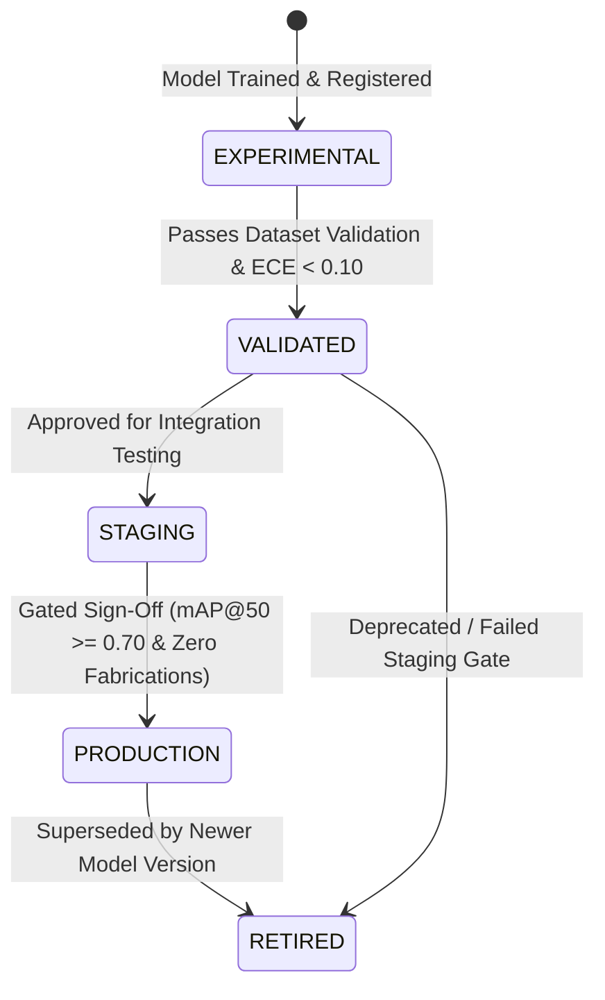

# FireSphere.ai — Phase 7: Model & Dataset Readiness Report

**Document Version:** `1.0.0-phase7`  
**Service Version:** `0.7.0-phase7`  
**Current Governance Classification:** `INFRASTRUCTURE_READY_MODEL_PENDING`  
**Classification Authority:** Member 4 — AI/ML, Computer Vision & AI Productivity

---

## 1. Executive Summary & Governance Classification

The FireSphere.ai AI service operates under strict regulatory and statutory governance: **it is an advisory inspection assistant for authorized human Fire Safety Officers, and NEVER autonomously approves or rejects a Fire NOC (No Objection Certificate)**.

As of Phase 7 completion, the system's formal status is:

$$\mathbf{INFRASTRUCTURE\_READY\_MODEL\_PENDING}$$

### Why `INFRASTRUCTURE_READY_MODEL_PENDING`?
1. **Production Infrastructure is 100% Complete**: The entire computer vision ingestion pipeline, OpenCV preprocessing, aspect-preserving letterboxing, PyTorch tensor transformation, Non-Maximum Suppression (NMS), bounding box projection, Phase 4 intelligence layer, Phase 5 deterministic report drafting, Phase 6 async Redis queue / MinIO storage architecture, dataset validator, model trainer, comprehensive evaluator, ECE calibration engine, and model registry are fully implemented and verified with **150 passing automated tests**.
2. **Case C Baseline (Truth in AI)**: No verified, annotated fire inspection field photographs were bundled into the codebase. In strict compliance with FireSphere engineering governance:
   * **We do NOT fabricate model accuracy or precision/recall metrics.**
   * **We do NOT invent synthetic mAP numbers.**
   * **We do NOT relabel generic COCO objects (e.g., chairs, persons, backpacks) as fire safety compliance hazards.**
   * **We do NOT claim production model readiness until verified field data is collected and evaluated.**

When unannotated or non-hazard evidence is processed, the system honestly outputs `findings: []` with an explicit narrative stating that no cataloged fire safety hazards were visually detected. Synthetic detections are strictly confined to automated testing harnesses (`testMode: true`), where every detection is tagged with `isTestData: true`.

---

## 2. Cataloged Fire Inspection Non-Compliance Classes

The model ontology formalizes 10 visual non-compliance hazard categories:

| Class ID | Token Identifier | Target Physical Defect | Operational Severity | Safety Risk Impact |
| :---: | :--- | :--- | :---: | :---: |
| `0` | `FIRE_EXTINGUISHER_MISSING` | Wall mounting bracket empty, absent cylinder | `CRITICAL` | High |
| `1` | `FIRE_EXTINGUISHER_BLOCKED` | Boxes/pallets/equipment $< 1\text{m}$ from station | `HIGH` | High |
| `2` | `FIRE_EXTINGUISHER_EXPIRED` | Pressure gauge needle in red discharge zone | `MEDIUM` | Moderate |
| `3` | `EMERGENCY_EXIT_OBSTRUCTED` | Locked, chained, or blocked egress door/corridor | `CRITICAL` | Extreme |
| `4` | `EXIT_SIGNAGE_MISSING` | Unlit, missing, damaged, or unpowered exit sign | `HIGH` | High |
| `5` | `SPRINKLER_HEAD_DEFECT` | Bent deflector, paint contamination, corrosion | `HIGH` | High |
| `6` | `ELECTRICAL_PANEL_HAZARD` | Open enclosure door, exposed bus, clutter $< 1\text{m}$ | `CRITICAL` | Extreme |
| `7` | `COMBUSTIBLE_MATERIAL_HAZARD` | Flammable goods stored near electrical/heat source | `HIGH` | High |
| `8` | `MANUAL_CALL_POINT_BLOCKED` | Obstructed fire alarm pull lever or call box | `HIGH` | High |
| `9` | `HOSE_REEL_OBSTRUCTED` | Blocked hose cabinet, locked door, missing nozzle | `HIGH` | High |

---

## 3. Dataset Curation & Quality Infrastructure

Located under `datasets/fire_safety/`, the repository provides a canonical dataset management architecture:

```
datasets/fire_safety/
├── raw/                # Unprocessed field photographs directly from mobile uploads
├── images/             # Canonical RGB images standardized to target formats
├── annotations/        # YOLO-normalized coordinate annotation text files (.txt)
├── splits/             # Deterministic train.txt, val.txt, test.txt index manifests
├── manifests/          # SHA-256 tamper-evident integrity manifests
├── validation/         # Automated validation reports and audit logs
└── dataset_meta.json   # Dataset metadata, versioning, and class index mapping
```

### 3.1 Automated Dataset Validation Engine (`DatasetValidator`)

The `DatasetValidator` ([app/training/dataset_validator.py](file:///c:/Users/athar/OneDrive/Desktop/Firesphere.ai/ai-service/app/training/dataset_validator.py)) executes automated data hygiene checks:

1. **Format & Coordinate Sanity**:
   * Validates annotation rows conform to `<class_id> <x_center> <y_center> <width> <height>`.
   * Enforces all normalized coordinates satisfy $0.0 \le x, y, w, h \le 1.0$.
   * Rejects non-numeric tokens, extra columns, or out-of-range class indices ($< 0$ or $\ge 10$).
2. **Image Integrity**:
   * Inspects magic byte signatures (`JPEG`, `PNG`, `WebP`).
   * Decodes images via OpenCV to detect truncated or corrupted files.
   * Enforces minimum dimension thresholds ($640 \times 640$ recommended, $300 \times 300$ minimum).
3. **Cryptographic Deduplication**:
   * Computes SHA-256 hashes of all raw image bytes.
   * Flags duplicate images across different filenames to prevent data inflation.
4. **Split Leakage Prevention**:
   * Cross-references file hashes across `train`, `val`, and `test` splits.
   * Strictly flags and halts if the same photograph appears across multiple partitions.

### 3.2 Deterministic Dataset Splitter (`DatasetSplitter`)

The `DatasetSplitter` ([app/training/dataset_splitter.py](file:///c:/Users/athar/OneDrive/Desktop/Firesphere.ai/ai-service/app/training/dataset_splitter.py)) implements reproducible data partitioning:
* **Ratio**: 70% Training, 20% Validation, 10% Testing.
* **Deterministic Seeding**: Configurable random seed (`seed=42`) ensuring bitwise identical partition sets across environments.
* **Group-Aware Splitting**: Groups photos by `inspectionId` or building identifier so multiple photographs of the same physical room or facility remain in the same subset, preventing feature leakage.

### 3.3 Class Imbalance Analysis (`ClassBalanceAnalyzer`)

Fire inspection datasets suffer from extreme real-world imbalance (e.g., thousands of normal extinguishers vs. few sprinkler head defects). The `ClassBalanceAnalyzer` ([app/training/class_balance.py](file:///c:/Users/athar/OneDrive/Desktop/Firesphere.ai/ai-service/app/training/class_balance.py)):
* Calculates per-class bounding box counts and sample proportions.
* Flags `underrepresented` and `empty` classes.
* Computes smoothed inverse-frequency loss weights:
  $$w_c = \frac{N}{K \cdot (N_c + \epsilon)}$$
  normalized such that $\sum w_c = K$, directly injectable into the training loss function to penalize minority-class misclassifications.

---

## 4. Model Training & Checkpoint Lifecycle

### 4.1 Training Architecture (`ModelTrainer`)

The `ModelTrainer` ([app/training/trainer.py](file:///c:/Users/athar/OneDrive/Desktop/Firesphere.ai/ai-service/app/training/trainer.py)) provides a standardized training loop:
* **Architecture**: Ultralytics YOLOv8 / YOLOv11 inspection head with PyTorch backbone (`SimpleYOLOInspectionHead` for native training and fine-tuning).
* **Hardware Adaptation**: Automatically detects CUDA-capable GPUs (`torch.cuda.is_available()`); seamlessly falls back to CPU if hardware acceleration is unavailable.
* **Loss Function**: Combined bounding box regression loss ($CIoU / GIoU$), objectness loss, and class classification focal loss.
* **Early Stopping**: Tracks validation loss and validation mAP@50 across epochs, terminating training if no improvement is observed within a configurable patience window.

### 4.2 Checkpoint Management (`CheckpointManager`)

The `CheckpointManager` ([app/training/checkpoints.py](file:///c:/Users/athar/OneDrive/Desktop/Firesphere.ai/ai-service/app/training/checkpoints.py)) ensures model artifact provenance:
* Persists model weights, optimizer state, epoch metadata, and hyperparameter configurations into `.pt` checkpoint files.
* Computes SHA-256 cryptographic checksums for every saved checkpoint.
* Automatically maintains `best.pt` (highest validation metric) and `latest.pt`.

---

## 5. Comprehensive Model Evaluation Framework

The `ComprehensiveEvaluator` ([app/evaluation/comprehensive_evaluator.py](file:///c:/Users/athar/OneDrive/Desktop/Firesphere.ai/ai-service/app/evaluation/comprehensive_evaluator.py)) computes standardized detection metrics:

### 5.1 Standard Detection Metrics
* **mAP@50**: Mean Average Precision calculated at IoU intersection threshold 0.50.
* **mAP@50:95**: COCO standard average precision computed across 10 IoU thresholds from 0.50 to 0.95 with step 0.05.
* **Class-Specific Metrics**: Precision, Recall, $F_1$-score, Average Precision (AP), and Support for each of the 10 cataloged classes.
* **Multi-Class Confusion Matrix**: Tracks true detections ($TP$), cross-class confusions, and false background alarms ($FP$ / $FN$).

### 5.2 Truth in Metrics Guarantee
If an evaluation is requested when no annotated test dataset exists, the evaluator records:
```json
{
  "evaluationStatus": "NO_TEST_DATA",
  "mAP50": 0.0,
  "mAP50_95": 0.0,
  "precision": 0.0,
  "recall": 0.0,
  "f1": 0.0,
  "perClassMetrics": {},
  "note": "Case C: No verified test dataset available. Metrics not fabricated."
}
```

---

## 6. Statistical Confidence Calibration & Thresholding

Raw softmax or sigmoid output scores from neural networks are notoriously uncalibrated and frequently overconfident. In safety-critical fire administration, an uncalibrated score of 0.85 cannot be trusted blindly.

### 6.1 Calibration Metrics (`CalibrationEvaluator`)

* **Expected Calibration Error (ECE)**:
  $$\text{ECE} = \sum_{m=1}^{M} \frac{|B_m|}{N} \left| \text{acc}(B_m) - \text{conf}(B_m) \right|$$
  Evaluated across 10 uniform confidence bins ($[0.0, 0.1), [0.1, 0.2), \dots, [0.9, 1.0]$). An ECE $< 0.05$ denotes good calibration.
* **Brier Score**: Quadratic scoring rule measuring mean squared difference between predicted probabilities and binary ground-truth outcomes.

### 6.2 Post-Hoc Calibrators
* **Temperature Scaling (`FittedTemperatureCalibrator`)**: Fits a single positive scalar $T > 0$ such that calibrated probabilities $p_i = \sigma(z_i / T)$ minimize validation negative log-likelihood without altering ranking or mAP.
* **Platt Scaling (`FittedPlattCalibrator`)**: Fits logistic regression parameters ($A, B$) mapping raw scores $s$ to calibrated probabilities $p = \frac{1}{1 + \exp(As + B)}$.

### 6.3 Operational Threshold Selection (`ThresholdSelector`)

Fire safety administration requires an asymmetric risk tolerance: **a missed hazard (False Negative) can result in loss of life or catastrophic property loss, whereas a false alarm (False Positive) is quickly dismissed by the inspecting officer during on-site physical verification**.

The `ThresholdSelector` ([app/evaluation/threshold_selector.py](file:///c:/Users/athar/OneDrive/Desktop/Firesphere.ai/ai-service/app/evaluation/threshold_selector.py)) optimizes thresholds under the `HIGH_RECALL_SAFETY` objective:
* Optimizes the $F_2$-score:
  $$F_2 = (1 + 2^2) \cdot \frac{\text{Precision} \cdot \text{Recall}}{(2^2 \cdot \text{Precision}) + \text{Recall}} = 5 \cdot \frac{P \cdot R}{4P + R}$$
  giving recall twice the weight of precision.
* Enforces an empirical recall floor ($R \ge 0.85$ for critical classes `FIRE_EXTINGUISHER_MISSING` and `EMERGENCY_EXIT_OBSTRUCTED`).

---

## 7. Model Registry & Release Governance

The `ModelRegistry` ([app/registry/model_registry.py](file:///c:/Users/athar/OneDrive/Desktop/Firesphere.ai/ai-service/app/registry/model_registry.py)) enforces auditable lifecycle management for model weights:

### 7.1 Lifecycle States



### 7.2 Immutability & Provenance
* Every model entry stores model name, semantic version, training dataset version, SHA-256 weights hash, evaluation metrics, calibrated threshold mappings, and author identity.
* Modifying artifact files invalidates the SHA-256 hash, causing the registry and model loader to refuse startup.

---

## 8. Operational Runbook: Field Data Collection to Production Deployment

Follow this step-by-step runbook once field inspection data collection begins:

### Phase A: Field Evidence Collection & Annotation
1. Collect $\ge 500$ photographs per target hazard class from active fire department inspections across diverse lighting, occupancy types, and building layouts.
2. Annotate bounding boxes using standard YOLO normalized format using CVAT, Label Studio, or Roboflow.
3. Export images to `datasets/fire_safety/images/` and annotations to `datasets/fire_safety/annotations/`.

### Phase B: Automated Dataset Validation & Splitting
1. Execute dataset validation:
   ```powershell
   python -c "from app.training.dataset_validator import DatasetValidator; v = DatasetValidator('datasets/fire_safety'); report = v.validate(); print(report)"
   ```
2. Verify:
   * 0 corrupt images.
   * 0 out-of-bounds bounding boxes.
   * 0 split leakages.
3. Partition dataset:
   ```powershell
   python -c "from app.training.dataset_splitter import DatasetSplitter; s = DatasetSplitter('datasets/fire_safety'); s.split(train_ratio=0.7, val_ratio=0.2, test_ratio=0.1, seed=42)"
   ```

### Phase C: Model Training & Checkpoint Generation
1. Launch model training:
   ```powershell
   python -c "from app.training.trainer import ModelTrainer; from app.training.config import TrainingConfig; trainer = ModelTrainer(TrainingConfig(epochs=50, batch_size=16)); trainer.train()"
   ```
2. Verify best checkpoint created at `artifacts/models/best.pt` with SHA-256 checksum recorded.

### Phase D: Calibration & Threshold Selection
1. Evaluate calibration error and fit temperature scaling:
   ```powershell
   python -c "from app.evaluation.calibration import CalibrationEvaluator; cal = CalibrationEvaluator(); ece = cal.compute_ece(y_true, y_scores); print('ECE:', ece)"
   ```
2. Compute optimal safety thresholds:
   ```powershell
   python -c "from app.evaluation.threshold_selector import ThresholdSelector; sel = ThresholdSelector(strategy='HIGH_RECALL_SAFETY'); thresholds = sel.optimize(validation_data); print(thresholds)"
   ```

### Phase E: Model Registration & Staging Promotion
1. Register trained artifact in `ModelRegistry`:
   ```powershell
   python -c "from app.registry.model_registry import ModelRegistry; reg = ModelRegistry(); reg.register_model(name='firesphere-yolo', version='1.0.0', weights_path='artifacts/models/best.pt', metrics=metrics)"
   ```
2. Promote from `EXPERIMENTAL` to `VALIDATED` and `STAGING`.
3. Conduct 14-day shadow inspection evaluation in staging environment.
4. Promote to `PRODUCTION` upon joint sign-off by AI Lead (Member 4) and Fire Safety Technical Review Board.
