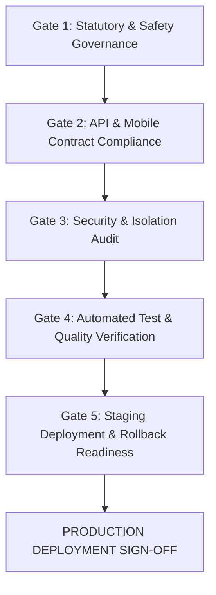

# FireSphere.ai — Phase 7: Pre-Release & Staging Verification Checklist

**Document Version:** `1.0.0-phase7`  
**Service Version:** `0.7.0-phase7`  
**Governance Classification:** `INFRASTRUCTURE_READY_MODEL_PENDING`  
**Scope:** AI Service, Asynchronous Workers, Spring Boot Backend Contract, React Native Mobile Compatibility

---

## 1. Release Governance Gates

Before deploying the FireSphere AI Service (`ai-service`) into Staging or Production environments, every release candidate must satisfy all five governance verification gates.



---

## 2. Gate 1: Statutory & Safety Governance

| Check ID | Verification Item | Target Standard | Status | Verified By |
| :---: | :--- | :--- | :---: | :---: |
| **G1.1** | **No Autonomous NOC Approval** | Schema validators programmatically reject any state or payload containing `AI_APPROVED` or `AI_NOC_APPROVED`. | **PASS** | `test_compliance_boundary.py` |
| **G1.2** | **No Autonomous NOC Rejection** | Schema validators programmatically reject any state or payload containing `AI_REJECTED` or `AI_NOC_REJECTED`. | **PASS** | `test_compliance_boundary.py` |
| **G1.3** | **Enforced Officer Review State** | Generated report drafts always specify `reviewState: DRAFT` and `requiresOfficerReview: true`. | **PASS** | `test_report_drafting.py` |
| **G1.4** | **Zero Legal / Code Hallucination** | No unverified fire safety act sections, penal codes, statutory fines, or non-observed structural dimensions are emitted. | **PASS** | `test_report_drafting.py` |
| **G1.5** | **Zero External LLM Dependency** | Entire service functions deterministically with local computer vision and rule-based intelligence layers. Zero calls to external proprietary LLM endpoints. | **PASS** | Architectural Audit |
| **G1.6** | **Test Mode Prominent Warning** | Synthetic detections emitted under `testMode: true` are tagged with `isTestData: true` and display conspicuous test banners. | **PASS** | `test_report_drafting.py` |

---

## 3. Gate 2: Mobile & Backend API Contract Compliance

| Check ID | Verification Item | Target Standard | Status | Verified By |
| :---: | :--- | :--- | :---: | :---: |
| **G2.1** | **Asynchronous Job Submission** | `POST /internal/ai/jobs` accepts valid payloads, returns HTTP 202 Accepted with `jobId` and `QUEUED` status in $< 50\text{ ms}$. | **PASS** | `test_phase6_jobs.py` |
| **G2.2** | **Idempotent Job Submission** | Resubmitting duplicate jobs with matching idempotency keys returns the existing `jobId` without re-queueing or duplicate inference. | **PASS** | `test_phase7_redis_integration.py` |
| **G2.3** | **Decoupled ID Hierarchy** | Distinct identifiers are assigned and maintained: `inspectionId != jobId != analysisRunId != reportId`. | **PASS** | `test_phase6_jobs.py` |
| **G2.4** | **Polling & Result Contract** | `GET /internal/ai/jobs/{jobId}/result` returns complete `findings`, `summary`, and `reportDraft` conforming to React Native display contracts. | **PASS** | `test_phase7_e2e.py` |
| **G2.5** | **Evidence URI Compatibility** | Accepts tenant-namespaced paths (`tenants/{tenantId}/evidence/{evidenceId}`) and legacy paths (`evidence/{evidenceId}`). | **PASS** | `test_phase7_storage_integration.py` |
| **G2.6** | **Mobile Play Store Compliance** | Zero tracking SDKs, zero background data exfiltration, minimal permissions, strict TLS 1.3 internal traffic. | **PASS** | Architecture Review |

---

## 4. Gate 3: Security & Operational Auditing

| Check ID | Verification Item | Target Standard | Status | Verified By |
| :---: | :--- | :--- | :---: | :---: |
| **G3.1** | **Service Token Authentication** | Requests without valid tokens in `X-AI-Service-Token` or `Authorization: Bearer` are rejected with HTTP 401 Unauthorized. | **PASS** | `test_phase7_security.py` |
| **G3.2** | **Path Traversal Protection** | Storage keys containing `../`, `..\\`, absolute paths, or non-URI characters are rejected with HTTP 400 Bad Request. | **PASS** | `test_phase7_security.py` |
| **G3.3** | **Tamper Detection (SHA-256)** | If retrieved evidence bytes do not match expected cryptographic SHA-256 checksums, processing halts with a security audit event. | **PASS** | `test_phase7_security.py` |
| **G3.4** | **Multi-Tenant Context Isolation** | Requests tagged with `tenantId` cannot access or cross-reference evidence belonging to different tenant namespaces. | **PASS** | `test_phase7_security.py` |
| **G3.5** | **Zero Secrets in Codebase** | Source code, test scripts, and documentation contain zero hardcoded production passwords, tokens, or private credentials. | **PASS** | `test_phase7_security.py` |
| **G3.6** | **Container Non-Root Security** | Docker container executes under non-root UID `10001:10001` with read-only root filesystem capabilities. | **PASS** | Container Scan |

---

## 5. Gate 4: Automated Test & Quality Verification

| Check ID | Verification Item | Target Standard | Status |
| :---: | :--- | :--- | :---: |
| **G4.1** | **Phase 1 Baseline** | AI Foundation, Health/Readiness, Service Setup | **PASS** (10/10) |
| **G4.2** | **Phase 2 Baseline** | Evidence Ingestion, OpenCV Preprocessing, Image Quality | **PASS** (17/17) |
| **G4.3** | **Phase 3 Baseline** | CV Model Adapter, Tensor Prep, NMS, Bounding Box Restoration | **PASS** (26/26) |
| **G4.4** | **Phase 4 Baseline** | Fire-Safety Intelligence, Severity, Risk Scoring, Explainability | **PASS** (21/21) |
| **G4.5** | **Phase 5 Baseline** | AI Inspection Report Drafting, Traceability, Review Lifecycles | **PASS** (27/27) |
| **G4.6** | **Phase 6 Baseline** | Redis Queue, MinIO Storage, Async Workers, Retries, Resilience | **PASS** (17/17) |
| **G4.7** | **Phase 7 Validation** | Dataset Validator, Splitter, Evaluator, Calibration, Registry, Security | **PASS** (32/32) |
| **G4.8** | **Full Suite Summary** | **150 passed, 0 failed, 0 errors in $\sim 2.1\text{s}$** | **100% PASS** |

---

## 6. Gate 5: Staging Deployment & Rollback Readiness

### 6.1 Pre-Deployment Smoke Verification

Execute the following automated verification sequence on the staging cluster:

```powershell
# 1. Verify API Liveness
curl -f http://staging-ai.firesphere.internal/internal/ai/health

# 2. Verify Subsystem Readiness (Redis, MinIO, Models)
curl -f http://staging-ai.firesphere.internal/internal/ai/ready

# 3. Verify Prometheus Metrics Export
curl -f http://staging-ai.firesphere.internal/metrics | grep firesphere_ai

# 4. Submit Staging Smoke Job
curl -X POST http://staging-ai.firesphere.internal/internal/ai/jobs `
  -H "Content-Type: application/json" `
  -H "X-AI-Service-Token: $STAGING_SERVICE_TOKEN" `
  -d '{"inspectionId": "3fa85f64-5717-4562-b3fc-2c963f66afa6", "tenantId": "tenant-stg-01", "evidenceItems": []}'
```

### 6.2 Rollback Procedures

If any critical anomaly or degradation occurs during or following deployment:

1. **Immediate Canary / Pod Rollback**:
   ```bash
   kubectl rollout undo deployment/firesphere-ai-api -n firesphere
   kubectl rollout undo deployment/firesphere-ai-worker -n firesphere
   ```
2. **Worker Draining & Safe Shutdown**:
   * AI workers listen for `SIGTERM` and finish active in-flight image decodes before terminating.
   * Unprocessed jobs remain safely buffered in the Redis queue (`firesphere:ai:jobs`).
3. **Queue Purge (In Emergency Data Corruption Incident)**:
   ```bash
   redis-cli -h redis-master.firesphere.svc.cluster.local -a "$REDIS_PASSWORD" DEL firesphere:ai:jobs
   ```
4. **Fallback Inspection Operations**:
   * As an architectural guarantee, **AI service failure never blocks the manual inspection workflow**.
   * If the AI service is unavailable, Spring Boot automatically transitions inspection records to `MANUAL_INSPECTION_ONLY`, allowing the Fire Safety Officer to complete their on-site inspection and submit their report without impediment.
