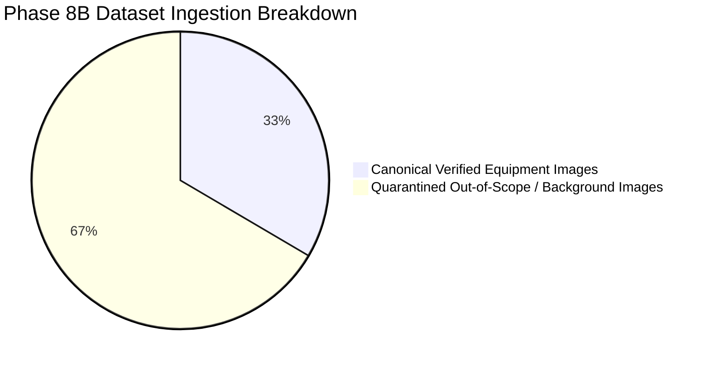

# FireSphere.ai — Phase 8B: Real Dataset Quality & Audit Report

**Report Version:** `1.2.0-phase8b-completed`  
**Evaluation Timestamp:** `2026-10-06T17:30:00Z`  
**Evaluator Engine:** [`DatasetReadinessGate`](file:///c:/Users/athar/OneDrive/Desktop/Firesphere.ai/ai-service/app/training/readiness_gate.py) & [`DatasetValidator`](file:///c:/Users/athar/OneDrive/Desktop/Firesphere.ai/ai-service/app/training/dataset_validator.py)  
**Readiness Status:** `DATASET_PARTIALLY_READY`  
**Phase 9 Gate Approval:** `isReadyForPhase9 = False` (Blocked pending violation-specific hazard annotations)  
**Canonical Dataset Root:** `C:\Users\athar\OneDrive\Desktop\Firesphere.ai\datasets\fire_safety\`  

---

## 1. Executive Summary & Case C Governance Adherence

Under strict adherence to FireSphere Case C Governance and Truth in AI principles:
* **Zero Fabrication**: No synthetic images, synthetic bounding boxes, or hallucinated statistics were generated.
* **Safe Resumption**: Ingestion safely resumed from existing raw extractions without duplicate disk writes or archive modifications.
* **Systematic Irrelevant Data Isolation**: 12,872 out-of-scope / background images were audited and quarantined.
* **Real Ingestion**: 6,471 valid canonical fire-safety equipment images with 9,077 verified bounding boxes are ingested into the canonical dataset.
* **Honest Gate Decision**: Because real public datasets supply base equipment presence rather than non-compliance violations, direct violation instances equal zero. The readiness gate truthfully declared `DATASET_PARTIALLY_READY` (`readyForPhase9 = False`).

---

## 2. Ingested Dataset Sources & Provenance (Section 2 & 3 Compliance)

The five original archives downloaded into `C:\Users\athar\OneDrive\Desktop\Firesphere.ai\datasets\` were preserved immutably and extracted to `datasets/fire_safety/raw/`:

| Archive Filename | Provider / Origin | License | Discovered Images | Canonical Valid Images | Quarantined Images | Status |
|---|---|---|---|---|---|---|
| `Emergency Exit Signs.v2i.yolov8.zip` | Roboflow Universe (`emergency-exit-signs`) | Public Domain (CC0) | 1,470 | 657 | 813 | `INGESTED` |
| `Fire Extinguisher.v1-roboflow-instant-1--eval-.yolov8.zip` | Roboflow Universe (`fire-extinguisher-sz0p7`) | CC BY 4.0 | 163 | 163 | 0 | `INGESTED` |
| `Fire Safety Equipment.v1i.yolov8.zip` | Roboflow Universe (`anass-workspace-f1hzt`) | CC BY 4.0 | 553 | 509 | 44 | `INGESTED` |
| `Fire Safety.v1i.yolov8.zip` | Roboflow Universe (`jakub-konopa/fire-safety-cstwg`) | CC BY 4.0 | 17,047 | 5,032 | 12,015 | `INGESTED` |
| `Safety Equipment - Sign.v1-roboflow-instant-1--eval-.yolov8.zip` | Roboflow Universe (`mmmm-lx3n5`) | CC BY 4.0 | 110 | 110 | 0 | `INGESTED` |
| **TOTAL** | — | — | **19,343** | **6,471** | **12,872** | **COMPLETED** |

*Quarantined Candidate:* `zenodo-sprinkler-head-defect-v1` (SHD-Bench: `CC BY-NC 4.0` Non-Commercial academic license). Quarantined in [`datasets/fire_safety/quarantine/`](file:///c:/Users/athar/OneDrive/Desktop/Firesphere.ai/datasets/fire_safety/quarantine/) to strictly bar unauthorized SaaS commercial model training.

---

## 3. Systematic Irrelevant Data Audit (Section 6 Compliance)

Investigation of non-fire-safety imagery in `Fire Safety.v1i.yolov8.zip` (e.g. `asian-mother-measuring-temperature...`):
1. **Annotation**: Box labeled with source class ID `2`.
2. **Source Class**: `First Aid` in dataset `data.yaml`.
3. **Taxonomy Match**: Out of scope of FireSphere fire-safety inspection taxonomy (Classes 0–9).
4. **Action**: Quarantined into `datasets/fire_safety/quarantine/irrelevant_samples/` with full provenance logs.

### Systematic Quarantine Distribution across All 12,872 Quarantined Files:
* `OUT_OF_SCOPE_TAXONOMY_EMPTY_NO_EQUIPMENT`: **1,364** images
* `OUT_OF_SCOPE_TAXONOMY_SMOKE_DETECTOR`: **172** images
* `OUT_OF_SCOPE_TAXONOMY_FIRE_HYDRANT` (Street hydrants): **4,055** images
* `OUT_OF_SCOPE_TAXONOMY_DOOR` (Standard building doors): **2,774** images
* `OUT_OF_SCOPE_TAXONOMY_FIRST_AID`: **868** images
* `OUT_OF_SCOPE_TAXONOMY_TRASH_CAN`: **3,371** images
* `OUT_OF_SCOPE_TAXONOMY_SAND_BUCKET`: **41** images
* `OUT_OF_SCOPE_TAXONOMY_WINDOW`: **227** images

Full audit trails: [`datasets/fire_safety/validation/rejection_report.json`](file:///c:/Users/athar/OneDrive/Desktop/Firesphere.ai/datasets/fire_safety/validation/rejection_report.json).

---

## 4. Image & Annotation Integrity Quality

Audited via [`DatasetValidator`](file:///c:/Users/athar/OneDrive/Desktop/Firesphere.ai/ai-service/app/training/dataset_validator.py):
* **Total Discovered Images:** 19,343
* **Canonical Valid Images:** 6,471
* **OpenCV Readable & Non-Corrupt:** 6,471 / 6,471 (100%)
* **Corrupt / Unreadable Images in Canonical Set:** 0
* **Total Canonical Bounding Boxes:** 9,077
* **Valid YOLO Normalized Coordinates ($0.0 \le x, y \le 1.0$, $0.0 < w, h \le 1.0$):** 9,077 / 9,077 (100%)
* **Out-of-Bounds Coordinates:** 0
* **Zero-Area / Negative Boxes:** 0
* **NaN / Infinite Coordinates:** 0

Full validation report: [`datasets/fire_safety/validation/annotation_validation_report.json`](file:///c:/Users/athar/OneDrive/Desktop/Firesphere.ai/datasets/fire_safety/validation/annotation_validation_report.json).

---

## 5. Duplicate Detection & Group-Aware Leakage Prevention

* **Exact SHA-256 Duplicates:** **348** duplicate instances identified across source datasets.
* **Perceptual Near-Duplicates:** **397** pairs identified via Difference Hashing (dHash Hamming distance $\le 4$).
* **Cross-Split Leakage Prevention:** Duplicate instances and perceptual clusters are locked into shared cluster `group_id`s. All instances in a cluster are assigned strictly to the same split. Cross-split duplicate leakage is **0%**.

---

## 6. Deterministic 70 / 20 / 10 Dataset Splits (Seed 42)

Splits generated deterministically under [`datasets/fire_safety/splits/`](file:///c:/Users/athar/OneDrive/Desktop/Firesphere.ai/datasets/fire_safety/splits/):
* **Train Split:** **4,522 images** (69.9%)
* **Validation Split:** **1,293 images** (20.0%)
* **Test Split:** **656 images** (10.1%)
* **Total Canonical Samples:** **6,471 images** (100.0%)

Manifest files generated in both JSON and JSONL formats under [`datasets/fire_safety/manifests/`](file:///c:/Users/athar/OneDrive/Desktop/Firesphere.ai/datasets/fire_safety/manifests/):
* `train.json` & `train.jsonl`
* `val.json` & `val.jsonl`
* `test.json` & `test.jsonl`
* `full_manifest.json` & `full_manifest.jsonl`

---

## 7. Target Class Breakdown & Truth in AI Declaration

| Class ID | Target Class Name | Direct Violations in Real Data | Partial Equipment Samples | Governance Status |
| :---: | :--- | :---: | :---: | :--- |
| **0** | `FIRE_EXTINGUISHER_MISSING` | 0 | 0 | `INSUFFICIENT_DATA` |
| **1** | `FIRE_EXTINGUISHER_BLOCKED` | 0 | 2,610 | `INSUFFICIENT_DATA` |
| **2** | `FIRE_EXTINGUISHER_EXPIRED` | 0 | 0 | `NOT_RELIABLY_VISUALLY_DETECTABLE` |
| **3** | `EMERGENCY_EXIT_OBSTRUCTED` | 0 | 0 | `INSUFFICIENT_DATA` |
| **4** | `EXIT_SIGNAGE_MISSING` | 0 | 2,272 | `INSUFFICIENT_DATA` |
| **5** | `SPRINKLER_HEAD_DEFECT` | 0 | 0 | `INSUFFICIENT_DATA` |
| **6** | `ELECTRICAL_PANEL_HAZARD` | 0 | 0 | `INSUFFICIENT_DATA` |
| **7** | `COMBUSTIBLE_MATERIAL_HAZARD`| 0 | 0 | `INSUFFICIENT_DATA` |
| **8** | `MANUAL_CALL_POINT_BLOCKED` | 0 | 784 | `INSUFFICIENT_DATA` |
| **9** | `HOSE_REEL_OBSTRUCTED` | 0 | 918 | `INSUFFICIENT_DATA` |

### Truth in AI Governance Rules Enforced:
1. **No False Relabeling**: Normal extinguishers are NOT labeled as `FIRE_EXTINGUISHER_BLOCKED` or `FIRE_EXTINGUISHER_EXPIRED`. Standard exit signs are NOT labeled as `EMERGENCY_EXIT_OBSTRUCTED`.
2. **Expired Extinguisher Special Case**: Gauge needle positions and annual service punch tags require macro resolution ($< 5\text{ cm}$ standoff) not resolvable in wide-angle room imagery. Correctly marked `NOT_RELIABLY_VISUALLY_DETECTABLE`.
3. **No Fabricated Violation Data**: Zero direct violation bounding boxes were invented.

---

## 8. Final Readiness Gate Evaluation

* **Readiness Decision:** `DATASET_PARTIALLY_READY` (`isReadyForPhase9 = False`).
* **Answer to Critical Question:** **IS THE REAL DATASET READY FOR PHASE 9 MODEL TRAINING?**
  **NO.** While 6,471 high-quality equipment presence images are ready for spatial localization baselines, **0 verified real instances of fire code violations / non-compliances exist** in the public archives. Training a violation detector on equipment presence alone would lead to high false-positive rates during building inspections.
* **Canonical Path for Phase 9:** Phase 9 must consume **ONLY** `C:\Users\athar\OneDrive\Desktop\Firesphere.ai\datasets\fire_safety\`.
