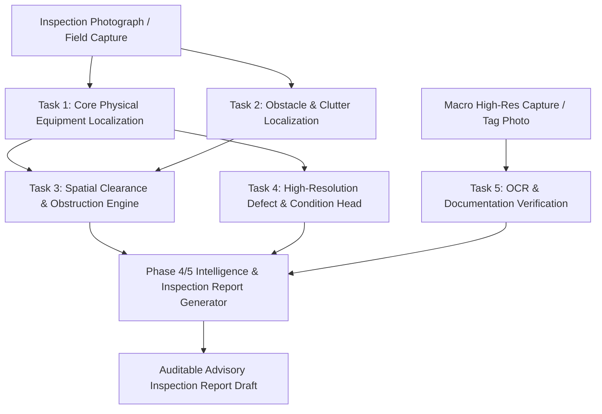

# FireSphere.ai — Phase 8: Model Task Decomposition & Architecture Recommendation

**Document Version:** `1.0.0-phase8`  
**Service Version:** `0.8.0-phase8`  
**Classification:** `ARCHITECTURE_ANALYSIS`  
**Target Implementation:** Phase 9 Model Training & Pipeline Refinement

---

## 1. Executive Problem Statement

The FireSphere catalog defines 10 statutory fire safety compliance defect classes:

```text
0: FIRE_EXTINGUISHER_MISSING       5: SPRINKLER_HEAD_DEFECT
1: FIRE_EXTINGUISHER_BLOCKED       6: ELECTRICAL_PANEL_HAZARD
2: FIRE_EXTINGUISHER_EXPIRED       7: COMBUSTIBLE_MATERIAL_HAZARD
3: EMERGENCY_EXIT_OBSTRUCTED       8: MANUAL_CALL_POINT_BLOCKED
4: EXIT_SIGNAGE_MISSING            9: HOSE_REEL_OBSTRUCTED
```

### The Pitfall of Monolithic Single-Model Ingestion
Attempting to force all 10 classes directly into a single monolithic 1-stage object detection model (e.g., standard YOLOv8/v11 predicting 10 bounding box classes) creates catastrophic training and operational failures:

1. **Ill-Posed "Absence" Detection**:
   Classes `FIRE_EXTINGUISHER_MISSING` and `EXIT_SIGNAGE_MISSING` require detecting the *non-existence* of an object. Standard bounding box detectors predict objects where pixels exist. Asking a neural network to draw a bounding box around "empty air on a wall" causes extreme false positives on every blank wall, coat hook, or doorway.
2. **Resolution & Optical Scale Disparities**:
   An emergency exit door or blocked corridor occupies $400 \times 500$ pixels on a $640 \times 640$ canvas. A sprinkler head or manual pull station occupies $20 \times 20$ pixels. A pressure gauge dial needle (`FIRE_EXTINGUISHER_EXPIRED`) is $< 3$ pixels wide. A single network feature pyramid struggles to resolve both macro-corridor layouts and sub-millimeter needle deflections simultaneously.
3. **Compound Semantics vs. Atomic Objects**:
   An obstruction (`FIRE_EXTINGUISHER_BLOCKED`, `EMERGENCY_EXIT_OBSTRUCTED`) is not an atomic visual object. It is a **spatial relationship** between two distinct entities: a piece of safety equipment and an obstacle (boxes, pallets, carts) violating a 1-meter clearance perimeter. Direct bounding box labeling creates contradictory supervision: does the bounding box enclose the extinguisher, the obstacle, or both?
4. **Non-Visual / OCR Dependency**:
   `FIRE_EXTINGUISHER_EXPIRED` is fundamentally a temporal and documentation attribute, not an object class. It requires OCR reading of stamped inspection tags or high-resolution gauge dial segmentation, backed by municipal maintenance records.

---

## 2. Logical Task Decomposition

To achieve high accuracy, robust explainability, and regulatory auditability, the 10 target compliance requirements are decomposed into four distinct computational tasks:



### Task 1: Core Equipment & Infrastructure Localization (Object Detection)
* **Goal**: Detect physical fire safety equipment and egress fixtures.
* **Classes**:
  - `extinguisher` (cylinder)
  - `extinguisher_bracket` (empty wall mounting bracket / stand)
  - `exit_door` (egress door / frame)
  - `exit_sign` (illuminated / non-illuminated signage)
  - `sprinkler_head` (ceiling fixture)
  - `electrical_panel` (enclosure door / cabinet)
  - `manual_call_point` (pull station / break-glass box)
  - `hose_reel_cabinet` (hose drum / cabinet)
* **Model Type**: Fast 1-stage object detector (YOLOv8/11 Small, input $640 \times 640$).

### Task 2: Obstacle & Combustible Clutter Localization (Object Detection)
* **Goal**: Detect physical objects commonly causing egress blockages or fire hazards.
* **Classes**:
  - `cardboard_boxes_clutter`
  - `wooden_pallet`
  - `furniture_obstruction`
  - `flammable_storage_drum`
* **Model Type**: Shared backbone or unified head with Task 1.

### Task 3: Spatial Clearance & Obstruction Engine (Geometric Intelligence)
* **Goal**: Calculate spatial clearance violations deterministically.
* **Mechanism**:
  - Bounding box proximity and intersection-over-union (IoU).
  - Ground-plane perspective heuristics (estimating frontal 1-meter access cone).
  - If `extinguisher` intersects or is adjacent to `cardboard_boxes_clutter` within threshold $\to$ triggers `FIRE_EXTINGUISHER_BLOCKED`.
  - If `exit_door` intersects `furniture_obstruction` $\to$ triggers `EMERGENCY_EXIT_OBSTRUCTED`.
  - If `electrical_panel` intersects `cardboard_boxes_clutter` $\to$ triggers `ELECTRICAL_PANEL_HAZARD`.

### Task 4: Condition & Defect Classification (Crop-Level Classification)
* **Goal**: Evaluate physical degradation of detected equipment.
* **Mechanism**:
  - Crop detected `sprinkler_head` bounding box $\to$ evaluate condition classifier (`normal`, `corroded`, `painted`, `bent`) $\to$ triggers `SPRINKLER_HEAD_DEFECT`.
  - Crop detected `electrical_panel` $\to$ evaluate door state classifier (`closed_secure`, `open_exposed_wires`) $\to$ triggers `ELECTRICAL_PANEL_HAZARD`.

### Task 5: OCR & Document Verification (Non-Vision Wide-Angle)
* **Goal**: Verify expiration and maintenance validity.
* **Mechanism**:
  - High-resolution close-up photo capture in mobile app.
  - OCR extraction of maintenance tag punch date and QR code certificate.
  - Gauge dial segmentation (needle angle in red vs. green zone).
  - Triggers `FIRE_EXTINGUISHER_EXPIRED`.

---

## 3. Class-by-Class Architecture Mapping

| Class ID | Target Non-Compliance Class | Primary Computational Model | Secondary Verification Mechanism |
| :---: | :--- | :--- | :--- |
| `0` | `FIRE_EXTINGUISHER_MISSING` | Task 1: `extinguisher_bracket` detector | Spatial check (no co-located `extinguisher`) + Floor plan schedule |
| `1` | `FIRE_EXTINGUISHER_BLOCKED` | Task 1 (`extinguisher`) + Task 2 (`obstacle`) | Task 3 Spatial Clearance Engine + Officer depth confirmation |
| `2` | `FIRE_EXTINGUISHER_EXPIRED` | Task 5: Mobile Macro OCR & Gauge Reader | Maintenance database cross-reference + Physical tag inspection |
| `3` | `EMERGENCY_EXIT_OBSTRUCTED` | Task 1 (`exit_door`) + Task 2 (`obstacle`) | Task 3 Spatial Clearance Engine + Egress width check |
| `4` | `EXIT_SIGNAGE_MISSING` | Task 1: `exit_door` detector | Spatial check (no co-located `exit_sign` on lintel) + Officer review |
| `5` | `SPRINKLER_HEAD_DEFECT` | Task 1 (`sprinkler_head`) detector | Task 4 Crop Condition Classifier (corrosion/paint) |
| `6` | `ELECTRICAL_PANEL_HAZARD` | Task 1 (`electrical_panel`) detector | Task 4 Open Door Classifier + Task 3 Clutter Proximity |
| `7` | `COMBUSTIBLE_MATERIAL_HAZARD`| Task 2 (`combustible_clutter`) detector | Room occupancy context + Proximity to electrical/heat sources |
| `8` | `MANUAL_CALL_POINT_BLOCKED` | Task 1 (`manual_call_point`) + Task 2 | Task 3 Spatial Clearance Engine |
| `9` | `HOSE_REEL_OBSTRUCTED` | Task 1 (`hose_reel_cabinet`) + Task 2 | Task 3 Spatial Clearance Engine |

---

## 4. Dataset Organization Strategy for Phase 8

In accordance with this decomposition, Phase 8 dataset acquisition and annotation must structure datasets into two layers:

### Layer 1: Canonical Base Detection Dataset
The primary dataset under `datasets/fire_safety/` focuses on verifiable physical fixtures and observable violations:
* Detectable objects: `extinguisher`, `empty_bracket`, `exit_door`, `exit_sign`, `sprinkler_head`, `electrical_panel`, `manual_call_point`, `hose_reel`, `obstruction_clutter`, `combustible_hazard`.
* Direct violations: `obstructed_exit`, `open_electrical_panel`, `corroded_sprinkler`.

### Layer 2: Metadata & Spatial Relationship Annotation
* Multi-box annotations in images where both an equipment item and an obstructing object are co-present.
* Image-level context flags (`occupancy_type`, `inspection_view_type`: wide-angle room vs. close-up equipment).

---

## 5. Phase 9 Training Strategy Recommendations

When Phase 9 commences:
1. **Train Base YOLO Detector** on the Layer 1 annotated physical fixtures.
2. **Integrate Spatial Clearance Rules** into the existing Phase 4 Intelligence Layer (`app.intelligence`), transforming raw detections into the 10 statutory defect findings.
3. **Keep Expiration Verification Independent**: Isolate `FIRE_EXTINGUISHER_EXPIRED` to the mobile high-res tag reader and officer manual checklist, preventing model degradation from noisy gauge annotations.
4. **Retain Case C Safety Boundaries**: Never predict legal compliance autonomously; every decomposed finding remains an advisory alert with explicit explainability and officer verification guidance.
