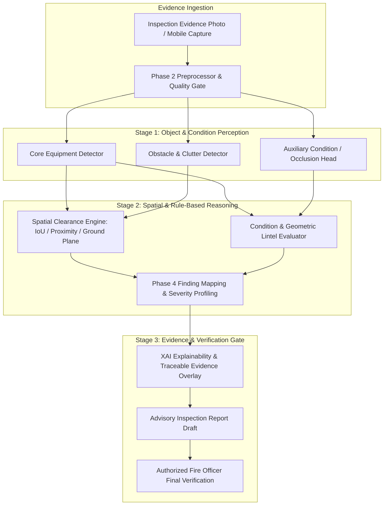

# FireSphere.ai — Phase 8.1: Production AI Scope Freeze

**Document Version:** `1.0.0-phase8.1`  
**Classification:** `ARCHITECTURE_GOVERNANCE_SPECIFICATION`  
**Lifecycle Status:** `FROZEN`  
**Target Release:** FireSphere.ai Production MVP (M4 Computer Vision & AI Service)  
**Author:** Member 4 — AI/ML, Computer Vision & AI Productivity  
**Date:** 2026-10-08  

---

## 1. Executive Purpose & Operational Context

FireSphere.ai is a production-oriented, cloud-native fire-safety administration platform engineered for real-world deployment across municipal fire departments, commercial facilities, citizen reporting channels, and authorized field inspections. It is designed for eventual deployment on Google Play and production web environments. 

**This is NOT an academic proof-of-concept or a synthetic benchmark prototype.** In life-safety engineering and statutory fire code enforcement (NFPA 1, NFPA 10, NFPA 72, NFPA 101, OSHA 1910.37/157, and local municipal fire prevention codes), incorrect automated classifications have severe consequences:
1. **False Negatives (Missed Hazards):** Obstructed escape routes or missing fire extinguishers left unflagged can lead to loss of life and catastrophic structural loss during egress events.
2. **False Positives / Hallucinated Violations:** Issuing erroneous citations, invalid clearance violations, or fabricated expiration dates degrades officer trust, generates legal liability, and subjects building owners to unwarranted enforcement actions.

To ensure deterministic reliability, regulatory auditability, and legal compliance, **Phase 8.1 formally freezes the Production AI Scope**. It establishes an immutable boundary between:
* What the computer vision and reasoning engine **must perform in the Production MVP**;
* What capabilities are deferred to **Phase 2 / Future Releases**; and
* What hazard types are **Strictly Unsupported by Automated Vision** and must remain exclusively within manual officer inspection checklists.

---

## 2. Production AI Philosophy: Perception vs. Reasoning

A fundamental architectural pitfall in naive computer vision systems is the **monolithic violation detector fallacy**: attempting to train a single 1-stage object detector (e.g., standard YOLO) to predict high-level statutory violation labels directly from raw pixels (e.g., training a bounding box class called `FIRE_EXTINGUISHER_BLOCKED` or `EXIT_SIGNAGE_MISSING`).

FireSphere.ai rejects this approach based on empirical evidence and mathematical rigor:
* **Absence is not an object:** Bounding box detectors require local pixel features. Predicting the non-presence of an extinguisher or sign on an arbitrary section of wall leads to uncontrolled false alarms on every blank architectural surface.
* **Violations are compound spatial relationships:** An obstruction is not a single entity; it is a geometric relationship between a piece of life-safety equipment and an encroaching obstacle violating a clearance envelope (e.g., 36 inches / 0.9 meters under NFPA 10).
* **Condition and maintenance are multi-modal:** Checking whether an extinguisher has expired is an inspection-tag OCR, pressure-gauge needle deflection, or maintenance database verification task—not a wide-angle bounding box task.

### The Standard FireSphere 2-Stage Pipeline

1. **Stage 1: Object Perception**: Fast, robust convolutional or transformer models localize physical fixtures (`FIRE_EXTINGUISHER`, `EXIT_DOOR`, `EXIT_SIGN`) and physical obstacles (`OBSTACLE` such as boxes, pallets, carts, furniture).
2. **Stage 2: Spatial & Rule Reasoning**: Deterministic mathematical routines calculate bounding-box intersections, proximity thresholds, ground-plane depth proxies, and architectural clearances.
3. **Stage 3: Advisory Finding Generation**: The reasoning engine synthesizes statutory findings (`FIRE_EXTINGUISHER_BLOCKED`, `EMERGENCY_EXIT_OBSTRUCTED`), assigns deterministic severity, computes operational risk, and produces XAI visual explanations.
4. **Stage 4: Officer Verification**: Every finding is routed to an authorized officer. The AI never issues autonomous legal judgements.

---

## 3. Scope Categorization: MVP vs. Future vs. Unsupported

| Finding ID | Statutory Finding Type | Production Scope Tier | Primary Implementation Method | Current Status |
| :---: | :--- | :---: | :--- | :---: |
| `0` | `FIRE_EXTINGUISHER_MISSING` | **PHASE 2 / FUTURE** | Expected-Location & Absence Reasoning | Partially Supported |
| `1` | `FIRE_EXTINGUISHER_BLOCKED` | **PRODUCTION MVP** | Object Perception + Spatial Clearance Reasoning | Directly Supported |
| `2` | `FIRE_EXTINGUISHER_EXPIRED` | **PHASE 2 / FUTURE** | Dedicated Macro Crop + OCR Date Intelligence | Partially Supported |
| `3` | `EMERGENCY_EXIT_OBSTRUCTED` | **PRODUCTION MVP** | Direct Violation + Object + Spatial Reasoning | Directly Supported |
| `4` | `EXIT_SIGNAGE_MISSING` | **PHASE 2 / FUTURE** | Lintel Proximity Reasoning + Egress Schedule | Partially Supported |
| `5` | `SPRINKLER_HEAD_DEFECT` | **NOT SUPPORTED** | Manual Officer Physical Checklist Only | Excluded (License & Optical) |
| `6` | `ELECTRICAL_PANEL_HAZARD` | **PHASE 2 / FUTURE** | Equipment Perception + Door State Condition Head | Insufficient Data |
| `7` | `COMBUSTIBLE_MATERIAL_HAZARD`| **PHASE 2 / FUTURE** | Clutter Perception + Room Occupancy Context | Insufficient Data |
| `8` | `MANUAL_CALL_POINT_BLOCKED` | **PHASE 2 / FUTURE** | Object Perception + Spatial Clearance Reasoning | Insufficient Data |
| `9` | `HOSE_REEL_OBSTRUCTED` | **PHASE 2 / FUTURE** | Object Perception + Spatial Clearance Reasoning | Insufficient Data |

---

## 4. Production MVP AI Capabilities (Frozen Scope)

The Production MVP is strictly constrained to two high-confidence, empirically verifiable capabilities:

### Capability 1: `EMERGENCY_EXIT_OBSTRUCTED` (Class 3)
* **Operational Goal:** Detect physical objects (boxes, pallets, carts, furniture, structural debris) obstructing egress doors, escape corridors, or emergency exit pathways.
* **Perception Requirements:**
  - Direct obstruction bounding boxes (trained on verified Dataset 6 violation annotations: `blocked emergency exit`, `boxes blocking exit`, `exit block violation`, `objects blocked emergency exit`).
  - Secondary equipment perception: `EXIT_DOOR` and `OBSTACLE`.
* **Reasoning Mechanism:** Spatial clearance calculation evaluating obstacle encroachment within the egress corridor or door swing envelope.
* **Trustworthy Data Foundation:** **Dataset 6 (`blocked emergency exit.v1i.yolov8.zip`)** provides 120 verified images with 126 genuine violation annotations under CC BY 4.0.
* **Operational Readiness:** High. Empirically audited and validated.

### Capability 2: `FIRE_EXTINGUISHER_BLOCKED` (Class 1)
* **Operational Goal:** Identify fire extinguishers whose mandatory 36-inch (0.9 m) operational clearance envelope is compromised by foreground or adjacent obstacles.
* **Perception Requirements:**
  - `FIRE_EXTINGUISHER` (cylinder body, mounting cradle).
  - `OBSTACLE` (boxes, furniture, equipment, storage crates).
  - Auxiliary condition input: Modal vs. Amodal segmentation mask ratios from Dataset 8 (`FireSafetyNet Condition Check`) indicating physical foreground occlusion.
* **Reasoning Mechanism:** 2D bounding-box IoU overlap, lower-edge ground-plane proximity, and spatial clearance heuristics in the Phase 4 Intelligence Layer (`app.intelligence.spatial`).
* **Trustworthy Data Foundation:** Canonical dataset contains 2,610 verified `FIRE_EXTINGUISHER` instances; Dataset 8 provides 2,363 unique physical images with modal/amodal occlusion masks; Dataset 6 provides verified obstacle patterns.
* **Operational Readiness:** High. Provides robust advisory alerts without risky monolithic labels.

---

## 5. Phase 2 / Future AI Capabilities

These capabilities address critical fire-safety requirements but are deliberately deferred from MVP automated execution due to dataset limitations, optical scale challenges, or multi-modal dependencies:

1. **`FIRE_EXTINGUISHER_MISSING` (Class 0):**
   - *Why Deferred:* While Dataset 7 provides 50 verified empty cabinet annotations, all 50 originate from a single video sequence (`Sna54U5CjZHZECx9dyDf_2`). Training on one physical scene creates catastrophic overfitting. Standalone wall-absence detection yields unacceptable false positive rates on plain walls.
   - *Future Solution:* Acquire multi-scene empty-bracket datasets and integrate architectural floor plan schedules before enabling automated alerting.

2. **`FIRE_EXTINGUISHER_EXPIRED` (Class 2):**
   - *Why Deferred:* Requires reading maintenance punch cards, certification stamps, and needle positions on pressure gauges. Normal inspection photos lack optical resolution for micro-text.
   - *Future Solution:* Introduce a dedicated mobile macro workflow with high-resolution close-up capture, local OCR (PaddleOCR/Tesseract), and municipal maintenance database synchronization.

3. **`EXIT_SIGNAGE_MISSING` (Class 4):**
   - *Why Deferred:* Requires distinguishing emergency egress doors (which legally require illuminated exit signs) from utility closets, restrooms, and private offices (which do not). Vision alone without architectural schedules generates false alarms on every un-signed interior door.
   - *Future Solution:* Pair vision detection with building BIM models or floor-plan egress route schedules.

4. **`ELECTRICAL_PANEL_HAZARD` (Class 6), `COMBUSTIBLE_MATERIAL_HAZARD` (Class 7), `MANUAL_CALL_POINT_BLOCKED` (Class 8), `HOSE_REEL_OBSTRUCTED` (Class 9):**
   - *Why Deferred:* Current datasets provide generic presence of equipment (e.g., 784 manual call points, 918 hose reels) but lack verified co-occurring obstacle pairs or verified open electrical cabinet hazard imagery.
   - *Future Solution:* Collect curated paired-equipment obstruction datasets in Phase 9.

---

## 6. Strictly Unsupported Capabilities

### `SPRINKLER_HEAD_DEFECT` (Class 5)
* **Status:** **STRICTLY EXCLUDED FROM COMPUTER VISION PIPELINE.**
* **Mandatory Rationale:**
  1. **Commercial Licensing Barrier:** The primary external dataset (SHD-Bench on Zenodo) is licensed under `CC BY-NC 4.0` (Non-Commercial). Using it in a commercial SaaS platform violates software licensing governance.
  2. **Optical Scale Disparity:** In standard wide-angle room photos ($640 \times 640$ to $1920 \times 1080$), a ceiling-mounted sprinkler head occupies roughly $15 \times 15$ to $30 \times 30$ pixels. Detecting corrosion, paint loading, bent deflector plates, or bulb fluid levels requires sub-millimeter optical resolution that wide-angle cameras cannot provide.
* **Inspection Protocol:** Sprinkler head integrity must be evaluated exclusively via manual physical inspection checklists by authorized fire safety personnel.

---

## 7. Safety, Legal, and Governance Boundaries

Under FireSphere Case C Governance, Truth in AI mandates, and Section 12 requirements:

### Explicit Legal Boundaries (What the AI Must NEVER Do)
* The AI must **NEVER** autonomously approve an inspection report or grant statutory clearance.
* The AI must **NEVER** autonomously reject a facility or issue an unverified citation.
* The AI must **NEVER** issue legal certificates, occupancy permits, or insurance waivers.
* The AI must **NEVER** claim statutory compliance without active, documented fire officer sign-off.
* The AI must **NEVER** invent or hallucinate fire-code numbers, minimum clearance dimensions, or pressure values.
* The AI must **NEVER** invent fines, legal deadlines, or compliance cure periods.
* The AI must **NEVER** fabricate missing evidence or synthesize unobserved defects.

### The Null-Finding Safety Boundary
> **CRITICAL RULE:** An inspection image resulting in zero AI detections or zero findings does **NOT** mean: *"The premises are fire-safe and compliant."*  
> It means strictly: *"No automated non-compliance patterns were identified by the computer vision model within the provided optical field of view."*

---

## 8. Environmental and Optical Limitations

Field inspection photographs are subject to severe real-world noise:
1. **Perspective Distortion & Depth Ambiguity:** A 2D photograph collapses 3D space. An object that appears adjacent to an extinguisher may actually be positioned 2 meters in front of or behind it. The spatial engine must flag this limitation and instruct officers to verify physical clearance.
2. **Extreme Lighting & Glare:** Backlit emergency exit signs, dark utility corridors, and specular reflections on stainless steel extinguishers degrade feature extraction.
3. **Motion Blur & Field-of-View Truncation:** Citizen-submitted photos often truncate equipment bases or obscure mounting brackets.
4. **Resolution Deficits:** Inspection tags captured from greater than 1 meter distance cannot be resolved by OCR.

---

## 9. Phase 8.1 Completion Criteria

Phase 8.1 is formally achieved and frozen when:
1. Production AI scope is explicitly categorized into MVP, Future, and Unsupported tiers.
2. The Minimum Sufficient Perception Vocabulary is defined and strictly decoupled from finding classes.
3. Every audited dataset has a documented provenance, license, and usage decision.
4. Canonical datasets remain 100% byte-for-byte immutable with zero training commenced.
5. Officer-in-the-loop governance boundaries are codified into architectural specifications.
