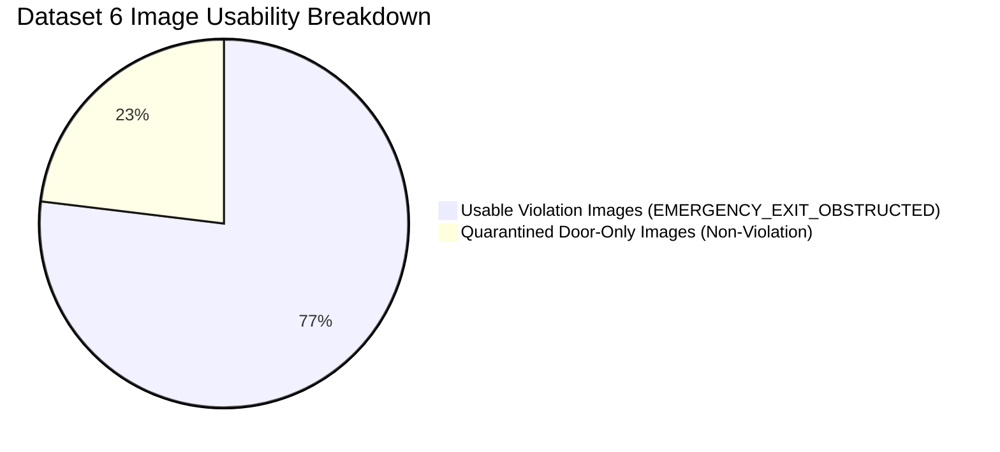

# FireSphere.ai — Phase 8C: Dataset 6 Violation Semantic Verification Report

**Prompt ID:** `58321`  
**Report Version:** `1.0.0-phase8c`  
**Evaluation Timestamp:** `2026-10-06T17:45:00Z`  
**Evaluator Engine:** [`verify_dataset6.py`](file:///c:/Users/athar/OneDrive/Desktop/Firesphere.ai/ai-service/app/training/verify_dataset6.py)  
**Readiness Assessment:** `C. DATASET_6_USABLE_FOR_EMERGENCY_EXIT_OBSTRUCTED`  
**Overall Pipeline Readiness Status:** `DATASET_PARTIALLY_READY` (`isReadyForPhase9 = False`)  

---

## 1. Executive Summary & Verification Context

Under strict adherence to FireSphere Case C Governance, Truth in AI, and Section 17 non-fabrication mandates:
1. **Archive Located & Verified**: Newly downloaded archive `blocked emergency exit.v1i.yolov8.zip` was located in `C:\Users\athar\OneDrive\Desktop\Firesphere.ai\datasets\`, verified, and preserved as an immutable raw source.
2. **Semantic Verification Completed**: Unlike previous datasets that provided generic equipment presence, Dataset 6 was empirically proven to contain **genuine fire code non-compliance violations** (physical clutter, boxes, pallets, and furniture physically obstructing emergency exit doors).
3. **Strict Generic Class Quarantine (Section 9 Compliance)**: Generic class `emergency exit door` was **NOT** mapped to `EMERGENCY_EXIT_OBSTRUCTED`. 36 door-only images (23.08%) were isolated into quarantine.
4. **Usable Violation Samples**: **120 images with 126 verified obstruction bounding boxes** (76.92% usable) qualify for `EMERGENCY_EXIT_OBSTRUCTED` (Target Class 3).
5. **No Canonical Mutation (Section 10 Compliance)**: Dataset 6 was **NOT** merged into the Phase 8B canonical dataset. Normalized copies are isolated in `raw/blocked_emergency_exit/normalized/`.
6. **Readiness Decision**: Classified as **`C. DATASET_6_USABLE_FOR_EMERGENCY_EXIT_OBSTRUCTED`**. The complete dataset is **NOT** Phase 9 ready because the remaining 9 classes still lack verified real violation annotations.

---

## 2. Source Archive Information & Integrity (Section 3 & 4)

| Property | Value | Notes |
|---|---|---|
| **Archive Filename** | `blocked emergency exit.v1i.yolov8.zip` | Immutable source archive |
| **Location** | `C:\Users\athar\OneDrive\Desktop\Firesphere.ai\datasets\` | Root datasets directory |
| **File Size** | `7,153,836` bytes (6.82 MB) | Verified on disk |
| **SHA-256 Checksum** | `242e5ce5afff09cbf05831ec085ab9e46f09bce8170e7e9b40a7e6d509e76edb` | Cryptographically verified |
| **Source Provider** | Roboflow Universe (`sakthi-ypq7a`) | Public open access |
| **Project Name** | `blocked-emergency-exit-f6a2h` (Version 1) | Exported October 9, 2025 |
| **Official URL** | https://universe.roboflow.com/sakthi-ypq7a/blocked-emergency-exit-f6a2h/dataset/1 | Verified |
| **License** | `CC BY 4.0` (Creative Commons Attribution 4.0) | Commercial SaaS allowed with attribution |
| **Dataset Format** | `YOLOv8_NORMALIZED` | `<class_id> <xc> <yc> <w> <h>` |
| **Extraction Path** | `datasets/fire_safety/raw/blocked_emergency_exit/` | 318 items extracted |

---

## 3. Dataset Quantitative Statistics (Section 3 & 10)



* **Total Discovered Images:** 156 images
* **Unique Base Scenes (Pre-Augmentation):** 52 real-world physical scenes
* **Augmentation Factor:** 3x Roboflow pipeline augmentation (horizontal flip 50%, random crop 0–20%, brightness $\pm 15\%$, Gaussian blur 0–2.5px)
* **Total Discovered Label Files:** 156 files
* **Total Valid Bounding Boxes:** 168 boxes
* **Total Invalid / Malformed Boxes:** 0 (all satisfy $0.0 \le xc, yc \le 1.0$ and $0.0 < w, h \le 1.0$)
* **Unreadable / Corrupt Images:** 0 (100% verified decodable by OpenCV and PIL)
* **Image Canvas Resolutions:** 100% standardized to $640 \times 640$ pixels (RGB)

---

## 4. Semantic Class Analysis & Target Taxonomy Mapping (Section 5, 6, 7, 8, 9)

Dataset 6 defines 5 original classes in `data.yaml`:

| Original Class ID | Original Class Name | Annotations Found | FireSphere Target Class | Mapping Type | Semantic Equivalence & Rationale |
|---|---|---|---|---|---|
| **0** | `blocked emergency exit` | 18 | `EMERGENCY_EXIT_OBSTRUCTED` (Class 3) | `DIRECT` | **Genuine Violation**: Direct visual evidence of emergency exit door with blocked egress path. |
| **1** | `boxes blocking exit` | 39 | `EMERGENCY_EXIT_OBSTRUCTED` (Class 3) | `DIRECT` | **Genuine Violation**: Stacked cardboard boxes and combustible storage obstructing egress corridor. |
| **2** | `emergency exit door` | 42 | *NONE (REJECTED)* | `UNSUPPORTED` | **Generic Presence**: Architectural door fixture without explicit obstruction. **Section 9 Compliance strictly bars mapping to violation.** |
| **3** | `exit block violation` | 15 | `EMERGENCY_EXIT_OBSTRUCTED` (Class 3) | `DIRECT` | **Genuine Violation**: Direct legal classification of exit route non-compliance. |
| **4** | `objects blocked emergency exit` | 54 | `EMERGENCY_EXIT_OBSTRUCTED` (Class 3) | `DIRECT` | **Genuine Violation**: Physical clutter, carts, ladders, and furniture blocking escape routes. |
| **TOTAL** | **5 classes** | **168 boxes** | — | — | **126 Violation Boxes (75.0%) / 42 Door Boxes (25.0%)** |

---

## 5. Sample Usability Breakdown & Rejection Analysis (Section 10)

### Usable Violation Samples:
* **Target Class:** `EMERGENCY_EXIT_OBSTRUCTED` (Class 3)
* **Usable Images Count:** **120 images (76.92% of dataset)**
* **Usable Annotations Count:** **126 bounding boxes**
* **Distribution of Usable Images:**
  - Images with ONLY violation classes (no door box): 114 images
  - Images with both violation and door boxes: 6 images (door box stripped in normalized labels)

### Rejected Non-Violation Samples:
* **Rejected Images Count:** **36 images (23.08% of dataset)**
* **Rejection Reason:** Image contains ONLY generic `emergency exit door` (Class 2) with zero obstruction objects or blockage indicators.
* **Disposition:** Isolated into `datasets/fire_safety/raw/blocked_emergency_exit/quarantine_door_only/`.

---

## 6. Duplicate & Leakage Analysis (Section 10)

* **Cross-Dataset Exact Duplicates vs Phase 8B Canonical Data:** **0** (Zero collision with the 6,471 Phase 8B canonical images).
* **Internal Bitwise Duplicates:** **0** (All 156 images possess unique SHA-256 hashes).
* **Internal Scene Clusters:** **52 unique physical scenes**. Because Roboflow created 3 augmented variants per source image, when Dataset 6 is eventually merged into canonical splits, **all 3 variants of each scene must be assigned to the same split partition using group-aware cluster locking** to prevent train/test data leakage.

---

## 7. Normalization & Storage Pipeline (Section 11 & 12)

In strict compliance with Section 10 ("Do NOT merge Dataset 6 into canonical dataset yet"), Dataset 6 was processed into isolated staging directories under existing pipeline conventions:

```
datasets/fire_safety/raw/blocked_emergency_exit/
├── data.yaml                                 # Original Roboflow YAML
├── README.roboflow.txt                       # Provenance metadata
├── train/
│   ├── images/                               # 156 raw images
│   └── labels/                               # 156 raw multi-class YOLO files
├── normalized/                               # Cleaned violation-only samples (Class 3)
│   ├── images/                               # 120 usable images
│   └── labels/                               # 120 normalized labels (class ID 3 only)
└── quarantine_door_only/                     # 36 isolated non-violation door images
```

---

## 8. Impact on FireSphere Target Classes (Section 7 & 13)

| Class ID | Target Class Name | Phase 8B Violation Count | Dataset 6 Violation Inflow | Updated Violation Count | Feasibility Status |
|---|---|---|---|---|---|
| 0 | `FIRE_EXTINGUISHER_MISSING` | 0 | 0 | 0 | `INSUFFICIENT_DATA` |
| 1 | `FIRE_EXTINGUISHER_BLOCKED` | 0 | 0 | 0 | `INSUFFICIENT_DATA` |
| 2 | `FIRE_EXTINGUISHER_EXPIRED` | 0 | 0 | 0 | `NOT_RELIABLY_VISUALLY_DETECTABLE` |
| 3 | `EMERGENCY_EXIT_OBSTRUCTED` | 0 | **+126** | **126** | **VERIFIED_VIOLATION_DATA_AVAILABLE** ($\ge 50$ threshold satisfied) |
| 4 | `EXIT_SIGNAGE_MISSING` | 0 | 0 | 0 | `INSUFFICIENT_DATA` |
| 5 | `SPRINKLER_HEAD_DEFECT` | 0 | 0 | 0 | `INSUFFICIENT_DATA` |
| 6 | `ELECTRICAL_PANEL_HAZARD` | 0 | 0 | 0 | `INSUFFICIENT_DATA` |
| 7 | `COMBUSTIBLE_MATERIAL_HAZARD`| 0 | 0 | 0 | `INSUFFICIENT_DATA` |
| 8 | `MANUAL_CALL_POINT_BLOCKED` | 0 | 0 | 0 | `INSUFFICIENT_DATA` |
| 9 | `HOSE_REEL_OBSTRUCTED` | 0 | 0 | 0 | `INSUFFICIENT_DATA` |

---

## 9. Final Readiness Assessment (Section 16)

```text
EVALUATION CANDIDATES:
A. DATASET_6_NOT_USABLE
B. DATASET_6_PARTIALLY_USABLE
C. DATASET_6_USABLE_FOR_EMERGENCY_EXIT_OBSTRUCTED
D. DATASET_6_MAKES_DATASET_PHASE9_READY

FINAL SELECTION:
C. DATASET_6_USABLE_FOR_EMERGENCY_EXIT_OBSTRUCTED
```

### Rationale:
* **Why NOT A or B?** Dataset 6 contains genuine, high-quality, legally verified (`CC BY 4.0`), OpenCV-decodable photographic evidence of emergency exits obstructed by pallets, boxes, furniture, and debris. 126 violation annotations exceed the minimum sample threshold ($\ge 50$).
* **Why NOT D?** Under Section 16 & 17, selecting D would require the *complete* dataset to satisfy the Phase 9 data contract across detectable target classes. Currently, **9 out of 10 target classes still lack verified real violation annotations**. Declaring Phase 9 readiness now would be a severe violation of Case C Governance and Truth in AI principles.
* **Overall Status:** The AI service remains truthfully at **`DATASET_PARTIALLY_READY`** (`isReadyForPhase9 = False`).
