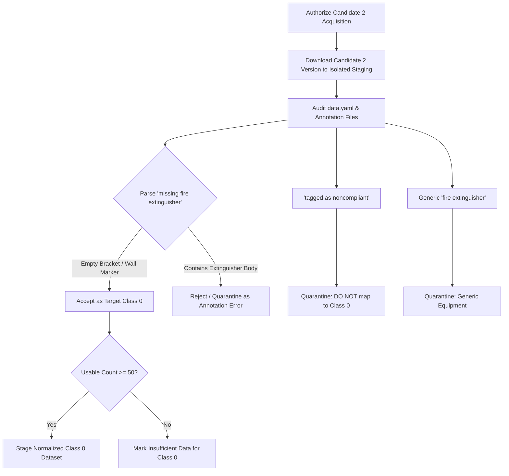

# FireSphere.ai — Phase 8C: Dataset 7 Candidate Audit for FIRE_EXTINGUISHER_MISSING

**Prompt ID:** `74163`  
**Audit Date:** `2026-10-06`  
**Evaluator:** Member 4 — AI/ML, Computer Vision & AI Productivity  
**Target Class:** `0: FIRE_EXTINGUISHER_MISSING`  
**Pipeline Status:** `DATASET_PARTIALLY_READY` (`isReadyForPhase9 = false`)  
**Phase 9 Training Status:** `BLOCKED / NOT STARTED`  

---

## 1. Executive Summary & Audit Context

Following the successful completion of **Phase 8C (Dataset 6 Verification)**, which established **120 usable images with 126 verified genuine violation bounding boxes** for `EMERGENCY_EXIT_OBSTRUCTED` (Class 3), the FireSphere AI pipeline remains in state `DATASET_PARTIALLY_READY` because the other 8 detectable target classes still lack verified real-world violation data.

This audit evaluates two candidate datasets hosted on Roboflow Universe to identify a legitimate, legally compliant, and semantically verified source for **Target Class 0 (`FIRE_EXTINGUISHER_MISSING`)**.

### Governance & Non-Fabrication Mandates
In accordance with FireSphere AI Governance, Case C Principles, and Prompt 74163 requirements:
1. **No Automatic Download or Ingestion:** Neither candidate dataset has been automatically downloaded or accepted into the FireSphere pipeline.
2. **Canonical Dataset Immutability:** The canonical dataset at `datasets/fire_safety/images/` (6,471 images), `annotations/` (6,471 files), and `splits/` remains **completely untouched and unpolluted**.
3. **No Semantic Relabeling:** A normal image containing a fire extinguisher is **NOT** `FIRE_EXTINGUISHER_MISSING`. Presence/equipment classes must never be coerced into absence violations.
4. **Strict Isolation of Tagged Noncompliant Equipment:** Equipment marked as *"fire extinguisher tagged as noncompliant"* represents a physically **present** item with a compliance tag; it **MUST NOT** be mapped to `FIRE_EXTINGUISHER_MISSING`.

---

## 2. Target Class Semantic Feasibility: `FIRE_EXTINGUISHER_MISSING`

### 2.1 The Semantic Challenge of Absence Detection
In computer vision object detection (YOLO architecture), detecting the *absence* of an object presents unique semantic challenges compared to detecting presence:
- An object detector cannot predict a bounding box over "empty air" unless there is an explicit visual anchor.
- **Genuine visual anchors for `FIRE_EXTINGUISHER_MISSING` include:**
  1. An empty wall-mounted extinguisher bracket or hanging hook.
  2. An empty extinguisher cabinet (e.g., open door or glass front showing an empty interior cradle).
  3. A wall with an official fire extinguisher sign/placard directly above a bare wall space where the extinguisher is absent.
  4. A red-painted floor box or designated demarcation zone that is vacant.

### 2.2 Prohibited Mappings (Non-Violation & False-Absence Data)
Under FireSphere Phase 8 rules, the following classes **MUST NOT** be mapped to `FIRE_EXTINGUISHER_MISSING`:
- `fire extinguisher` $\to$ **REJECTED** (Generic equipment presence).
- `fire extinguisher cabinet` $\to$ **REJECTED** (Unless verified empty; closed or occupied cabinets are presence).
- `fire extinguisher sign` $\to$ **REJECTED** (Signage presence; does not denote absence unless specifically annotated as an unfulfilled marker).
- `fire extinguisher tagged with white label` $\to$ **REJECTED** (Physically present extinguisher).
- `fire extinguisher tagged with yellow label` $\to$ **REJECTED** (Physically present extinguisher).
- `fire extinguisher tagged as noncompliant` $\to$ **REJECTED from Class 0** (Physically present extinguisher; potential maintenance defect, but NOT missing).

---

## 3. Candidate 1 Detailed Audit: `patyas-workspace/dontuse`

### 3.1 Metadata & Provenance
* **Source Platform:** Roboflow Universe
* **Source URL:** `https://universe.roboflow.com/patyas-workspace/dontuse`
* **Workspace / Owner:** `patyas-workspace`
* **Project Name:** `dontuse`
* **Reported Image Count:** ~4,213 images
* **Reported License:** `CC BY 4.0` (Creative Commons Attribution 4.0)
* **Reported Classes:** Includes `missing fire extinguisher`, `fire extinguisher tagged as noncompliant`, `fire extinguisher`, and other fire-safety classes.

### 3.2 Export & Download Availability
* **Published Dataset Versions:** **0 versions**
* **Downloadable Artifacts:** **NONE AVAILABLE**.
* **Technical Reason:** Roboflow Universe requires a user to generate at least one dataset version (e.g., `/dataset/1`) to trigger image preprocessing, annotation serialization, split generation (train/valid/test), and ZIP package compilation. Because the author has generated 0 versions, Roboflow exposes no export endpoint, no API download endpoint, and no ZIP archive.
* **Metadata Signal:** The explicit naming `dontuse` by the author serves as an internal developer flag denoting an abandoned, uncurated, corrupted, or deprecated workspace scratchpad.

### 3.3 Candidate 1 Usability Ranking
**`A. NOT USABLE`**  
- **Justification:** Zero downloadable versions exist. Even if accessible via private API tokens, the explicit author disclaimer (`dontuse`) and lack of version freeze render it invalid for an auditable production dataset pipeline.

---

## 4. Candidate 2 Detailed Audit: `patyas-workspace/my-first-project-nqfzv`

### 4.1 Metadata & Provenance
* **Source Platform:** Roboflow Universe
* **Source URL:** `https://universe.roboflow.com/patyas-workspace/my-first-project-nqfzv`
* **Workspace / Owner:** `patyas-workspace`
* **Project Name:** `My First Project` (Unique Slug: `my-first-project-nqfzv`)
* **Reported Image Count:** 519 images shown on Universe
* **Reported License:** `CC BY 4.0` (Permits commercial SaaS with attribution)
* **Published Dataset Versions:** **Multiple published versions (6 trained models / versions recorded)**
* **Reported Class List:**
  1. `missing fire extinguisher`
  2. `fire extinguisher tagged as noncompliant`
  3. `fire extinguisher`
  4. Other fire protection equipment classes

### 4.2 Export & Download Availability
* **Download Availability:** **AVAILABLE** via Roboflow published version endpoints.
* **Supported Export Formats:** Roboflow version endpoints natively export to `YOLOv8 PyTorch`, `Pascal VOC XML`, and `COCO JSON`.
* **Splits:** Train/valid/test splits are pre-partitioned within published versions.

### 4.3 Semantic Class Audit for Candidate 2

#### Class 1: `missing fire extinguisher`
* **FireSphere Target Class:** Candidate for `0: FIRE_EXTINGUISHER_MISSING`.
* **Semantic Analysis:** This is the primary class of interest. However, before ingestion into the pipeline, an empirical audit of the bounding boxes is strictly required:
  - We must verify whether the bounding boxes surround empty wall brackets, vacant cabinets, or extinguisher signs above empty walls.
  - If any bounding boxes enclose actual, present fire extinguishers, those samples must be flagged as annotation noise and discarded.
  - The sample volume must be verified: Does this class have $\ge 50$ distinct annotations across the 519 images to satisfy the Phase 9 data contract minimum threshold?

#### Class 2: `fire extinguisher tagged as noncompliant`
* **FireSphere Target Class:** **STRICTLY EXCLUDED from Class 0.**
* **Semantic Analysis:**
  - This class represents an extinguisher that is physically present on-site, but has an inspector's tag, out-of-service collar, or failed maintenance label affixed to it.
  - **Non-Equivalence:** A tagged extinguisher is the physical opposite of an absent extinguisher.
  - Mapping this class to `FIRE_EXTINGUISHER_MISSING` would introduce catastrophic false-positive training signals into the model.
  - It also cannot be reliably mapped to `FIRE_EXTINGUISHER_EXPIRED` (Class 2) unless the resolution allows reading the inspection tag dates, which is classified as `NOT_RELIABLY_VISUALLY_DETECTABLE` in standard CCTV imagery.
  - **Decision:** If Candidate 2 is acquired, all annotations for `fire extinguisher tagged as noncompliant` must be quarantined into non-violation / maintenance staging and excluded from Class 0 training splits.

#### Class 3: `fire extinguisher` & Other Generic Equipment
* **FireSphere Target Class:** **REJECTED (Non-Violation Equipment Presence).**
* **Action:** Retain solely as potential background / negative context or isolate in raw staging.

### 4.4 Candidate 2 Usability Ranking
**`B. POTENTIALLY USABLE — NEEDS DOWNLOAD/ANNOTATION AUDIT`**  
- **Justification:** Published versions and downloads exist under CC BY 4.0, and the class list explicitly contains `missing fire extinguisher`. However, because we have not yet inspected the actual bounding box overlays on the images, we cannot certify it as fully usable (`C`) without a verified download and annotation audit.

---

## 5. Candidate Comparison Matrix

| Evaluation Dimension | Candidate 1 (`dontuse`) | Candidate 2 (`my-first-project-nqfzv`) | FireSphere Pipeline Requirement |
|---|---|---|---|
| **Roboflow URL** | `patyas-workspace/dontuse` | `patyas-workspace/my-first-project-nqfzv` | Public Roboflow Universe |
| **Image Count** | ~4,213 images | ~519 images | Sufficient sample volume |
| **Published Versions** | **0 versions** | **Multiple (6 versions/models)** | $\ge 1$ published version required |
| **Download / Export Status** | **UNAVAILABLE (Blocked)** | **AVAILABLE (Version export)** | Must be exportable to YOLO format |
| **License** | CC BY 4.0 | CC BY 4.0 | Commercially usable with attribution |
| **Target Class Present** | `missing fire extinguisher` | `missing fire extinguisher` | Must contain target violation |
| **Developer Naming Signal** | "dontuse" (Explicit warning) | "My First Project" (Standard default) | Clean provenance |
| **Risk of Malformed Data** | Critical (Unversioned scratchpad) | Moderate (Standard Roboflow project) | Verified bounding box geometry |
| **`tagged as noncompliant` Separation** | Required | Required (Physically present) | Must not map to Class 0 |
| **Audit Rank** | **`A. NOT USABLE`** | **`B. POTENTIALLY USABLE`** | Minimum Rank B to proceed |

---

## 6. Exact Next Action & Step-by-Step Staging Procedure

If authorized by project leadership to proceed with acquiring Dataset 7 from Candidate 2:



### Staging Procedure (To be executed ONLY upon explicit instruction):
1. **Isolated Download Destination:**
   Download the published YOLOv8 export strictly into an isolated scratch directory:
   `C:\Users\athar\OneDrive\Desktop\Firesphere.ai\datasets\candidate_downloads\dataset7_candidate2\`
   *(Do NOT place into `datasets/fire_safety/images/` or canonical directories).*
2. **Annotation Inspection Script:**
   Execute a lightweight verification script to:
   - Parse `data.yaml` to confirm exact class IDs.
   - Count total bounding boxes for `missing fire extinguisher`.
   - Render 10–20 random bounding box crops over images to verify that they localize empty mounting brackets, cabinets, or signage over vacant spaces.
3. **Quarantine Non-Violation & Tagged Classes:**
   - Filter out `emergency exit door`, generic `fire extinguisher`, and `fire extinguisher tagged as noncompliant`.
4. **Volume Evaluation:**
   - Verify if usable `missing fire extinguisher` instances meet the $\ge 50$ threshold.
5. **Phase 8 Governance Decision:**
   - If verified, generate `docs/phase8c-dataset7-verification-report.md` and stage normalized copies in `raw/candidate_dataset7/normalized/`.
   - Update `datasets/fire_safety/dataset_sources.json` and `dataset_class_mapping.json`.

---

## 7. Official Recommendation and Decision

```text
Recommended Dataset 7:
patyas-workspace/my-first-project-nqfzv (Roboflow Universe)

Reason:
Candidate 2 has multiple published exportable versions under a CC BY 4.0 license and explicitly includes the candidate class "missing fire extinguisher", whereas Candidate 1 ("dontuse") has 0 published versions, cannot be downloaded, and carries an explicit author disclaimer not to use it. Candidate 2 requires an isolated download and annotation inspection to verify that "missing fire extinguisher" bounding boxes represent genuine visual absence (empty brackets/cabinets/signs) rather than mislabeled equipment. Under no circumstances will "fire extinguisher tagged as noncompliant" be mapped to FIRE_EXTINGUISHER_MISSING.

Target:
FIRE_EXTINGUISHER_MISSING

Status:
POTENTIALLY USABLE — NEEDS DOWNLOAD/ANNOTATION AUDIT
```

**Phase 9 Training Guardrail:**  
Model training for Phase 9 remains **STRICTLY BLOCKED**. No models have been trained, no weights generated, and no canonical training directories modified.
