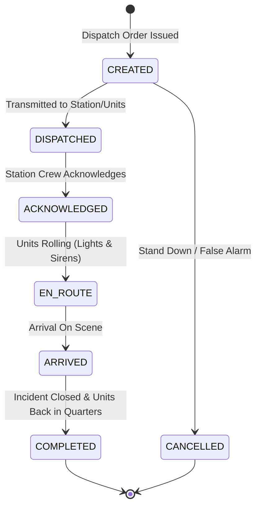

# FireSphere.ai — Member 5: Emergency Dispatch Module
**Document Version:** 1.0.0  
**Phase:** 3 — Emergency Dispatch Management Module  
**Status:** Implemented, Tested & Verified  
**Runtime:** Java 21 LTS | Spring Boot 3.3.4 | PostgreSQL + PostGIS / H2 (Test)  

---

## 1. Purpose

The Emergency Dispatch Management module coordinates operational turnout orders linked to emergency incidents. It provides complete operational tracking from initial turnout order creation, apparatus assignment reference tracking, responder assignments, sequential status transitions, and timestamp logging, through to terminal closeout or cancellation, accompanied by an immutable audit history.

Key design principles:
* **Strict Incident Boundary**: Dispatch orders reference incidents via UUID. Creating or modifying a dispatch order **never** silently alters the underlying incident lifecycle status.
* **Deterministic Recommendations**: A rule-based turnout recommendation engine suggests apparatus combinations and staffing profiles based on incident severity and hazard type without calling AI models or live telemetry.
* **Duplicate Active Dispatch Protection**: Prevents assigning the same apparatus or issuing redundant active turnout orders for the same station on an active incident.
* **Tenant Isolation**: Guarantees zero cross-tenant visibility or mutation leaks across all dispatch queries, actions, and history records.

---

## 2. Architecture & Layering

The Emergency Dispatch module strictly enforces the standard layered architecture:

$$\text{DispatchController} \longrightarrow \text{DispatchService} \longrightarrow \begin{cases} \text{DispatchOrderRepository} \\ \text{DispatchStatusHistoryRepository} \\ \text{IncidentService (Validation Boundary)} \end{cases}$$

* **Controller Layer ([`DispatchController`](file:///c:/Users/ROHAN%20NAVSEKAR/OneDrive/Desktop/Industry%20M5/src/main/java/ai/firesphere/dispatch/controller/DispatchController.java))**: Exposes REST endpoints under `/api/v1/dispatch`. Enforces Bean Validation (`@Valid`) and returns standardized HTTP status codes (`201 Created`, `200 OK`, `400 Bad Request`, `404 Not Found`, `422 Unprocessable Entity`).
* **Service Layer ([`DispatchServiceImpl`](file:///c:/Users/ROHAN%20NAVSEKAR/OneDrive/Desktop/Industry%20M5/src/main/java/ai/firesphere/dispatch/service/DispatchServiceImpl.java))**: Encapsulates transaction boundaries (`@Transactional`), tenant context resolution (`TenantContext`), lifecycle state validation, duplicate dispatch protection, and audit logging.
* **Repository Layer ([`DispatchOrderRepository`](file:///c:/Users/ROHAN%20NAVSEKAR/OneDrive/Desktop/Industry%20M5/src/main/java/ai/firesphere/dispatch/repository/DispatchOrderRepository.java))**: Spring Data JPA repository extending `JpaSpecificationExecutor` for dynamic, tenant-isolated multi-criteria filtering.
* **Domain Model Layer ([`DispatchOrder`](file:///c:/Users/ROHAN%20NAVSEKAR/OneDrive/Desktop/Industry%20M5/src/main/java/ai/firesphere/dispatch/model/DispatchOrder.java))**: JPA entities extending `BaseAuditableEntity` with optimistic locking, UUID primary keys, and operational timestamps.
* **DTO Layer ([`ai.firesphere.dispatch.dto`](file:///c:/Users/ROHAN%20NAVSEKAR/OneDrive/Desktop/Industry%20M5/src/main/java/ai/firesphere/dispatch/dto))**: Strict isolation preventing domain entity leakage across API boundaries.

---

## 3. Domain Model

### 3.1 Entities

* **[`DispatchOrder`](file:///c:/Users/ROHAN%20NAVSEKAR/OneDrive/Desktop/Industry%20M5/src/main/java/ai/firesphere/dispatch/model/DispatchOrder.java)**:
  * `id`: UUID (Primary Key)
  * `tenantId`: UUID (Multi-tenant partition)
  * `incidentId`: UUID (Referenced incident)
  * `stationId`: UUID (Station assigned to turnout)
  * `dispatchCode`: String(32) (Unique human-readable reference, format `DSP-YYYYMMDD-XXXXX`)
  * `status`: `DispatchStatus` (`CREATED`, `DISPATCHED`, `ACKNOWLEDGED`, `EN_ROUTE`, `ARRIVED`, `COMPLETED`, `CANCELLED`)
  * `priority`: `DispatchPriority` (`LOW`, `MEDIUM`, `HIGH`, `CRITICAL`)
  * `assignedVehicleIds`: List of UUIDs (References to fleet apparatus)
  * `assignedResponderIds`: List of UUIDs (References to personnel/crews)
  * `dispatchedAt`: Instant (Timestamp when order was transmitted)
  * `acknowledgedAt`: Instant (Timestamp when station/crew acknowledged)
  * `enRouteAt`: Instant (Timestamp when apparatus departed station)
  * `arrivedAt`: Instant (Timestamp when units arrived on scene)
  * `completedAt`: Instant (Timestamp when units finished and returned)
  * `cancelledAt`: Instant (Timestamp if order cancelled)
  * `cancellationReason`: String(500) (Reason if cancelled)
  * `operationalNotes`: String(1000) (Operational logs and instructions)

* **[`DispatchStatusHistory`](file:///c:/Users/ROHAN%20NAVSEKAR/OneDrive/Desktop/Industry%20M5/src/main/java/ai/firesphere/dispatch/model/DispatchStatusHistory.java)**:
  * `id`: UUID (Primary Key)
  * `tenantId`: UUID (Multi-tenant partition)
  * `dispatchOrderId`: UUID (Foreign key to `dispatch_orders`)
  * `previousStatus`: `DispatchStatus` (nullable for initial creation)
  * `newStatus`: `DispatchStatus`
  * `transitionedAt`: Instant
  * `transitionedBy`: String (Officer/dispatcher username or `DISPATCHER`)
  * `reason`: String(500) (Transition remarks or notes)

---

## 4. Dispatch Lifecycle State Machine

### 4.1 Permitted Lifecycle Transitions



### 4.2 State Machine Matrix

| Current State | Allowed Next State | Disallowed Transitions (Rejected with 422 `BUSINESS_RULE_VIOLATION`) |
| :--- | :--- | :--- |
| `CREATED` | `DISPATCHED`, `CANCELLED` | `ACKNOWLEDGED`, `EN_ROUTE`, `ARRIVED`, `COMPLETED` |
| `DISPATCHED` | `ACKNOWLEDGED` | `CREATED`, `EN_ROUTE`, `ARRIVED`, `COMPLETED`, `CANCELLED` |
| `ACKNOWLEDGED` | `EN_ROUTE` | `CREATED`, `DISPATCHED`, `ARRIVED`, `COMPLETED`, `CANCELLED` |
| `EN_ROUTE` | `ARRIVED` | `CREATED`, `DISPATCHED`, `ACKNOWLEDGED`, `COMPLETED`, `CANCELLED` |
| `ARRIVED` | `COMPLETED` | `CREATED`, `DISPATCHED`, `ACKNOWLEDGED`, `EN_ROUTE`, `CANCELLED` |
| `COMPLETED` | *None (Terminal)* | All state changes rejected. Immutable. |
| `CANCELLED` | *None (Terminal)* | All state changes rejected. Immutable. |

---

## 5. API Endpoints

All endpoints are hosted under `/api/v1/dispatch`:

| Method | Endpoint | Description | Expected Status |
| :--- | :--- | :--- | :--- |
| `POST` | `/api/v1/dispatch/orders` | Create a new dispatch order linked to an active incident | `201 Created` |
| `GET` | `/api/v1/dispatch/orders/{id}` | Get dispatch order details by UUID for current tenant | `200 OK` |
| `GET` | `/api/v1/dispatch/orders` | Paginated search with filtering (`status`, `priority`, `incidentId`, `stationId`) | `200 OK` |
| `GET` | `/api/v1/dispatch/orders/incident/{incidentId}` | Retrieve all dispatch orders associated with an incident | `200 OK` |
| `PUT` | `/api/v1/dispatch/orders/{id}` | Update mutable metadata (`priority`, `stationId`, `notes`, `vehicles`, `responders`) | `200 OK` |
| `POST` | `/api/v1/dispatch/orders/{id}/status` | Transition dispatch lifecycle status with audit recording | `200 OK` |
| `GET` | `/api/v1/dispatch/orders/{id}/history` | Retrieve complete auditable state transition timeline | `200 OK` |
| `POST` | `/api/v1/dispatch/recommendations` | Get deterministic apparatus and staffing recommendations | `200 OK` |

---

## 6. Request & Response DTOs

### 6.1 `DispatchCreateRequest`
```json
{
  "incidentId": "3fa85f64-5717-4562-b3fc-2c963f66afa6",
  "stationId": "7cb85f64-5717-4562-b3fc-2c963f66afa7",
  "priority": "HIGH",
  "assignedVehicleIds": ["9ab85f64-5717-4562-b3fc-2c963f66afa8"],
  "assignedResponderIds": ["1cb85f64-5717-4562-b3fc-2c963f66afa9"],
  "operationalNotes": "First alarm structural response"
}
```

### 6.2 `DispatchResponseDTO`
```json
{
  "id": "e9a0c929-288c-4a12-9d3e-3c471e6e8105",
  "incidentId": "3fa85f64-5717-4562-b3fc-2c963f66afa6",
  "stationId": "7cb85f64-5717-4562-b3fc-2c963f66afa7",
  "dispatchCode": "DSP-20261005-48192",
  "status": "CREATED",
  "priority": "HIGH",
  "assignedVehicleIds": ["9ab85f64-5717-4562-b3fc-2c963f66afa8"],
  "assignedResponderIds": ["1cb85f64-5717-4562-b3fc-2c963f66afa9"],
  "dispatchedAt": "2026-10-05T17:30:00Z",
  "acknowledgedAt": null,
  "enRouteAt": null,
  "arrivedAt": null,
  "completedAt": null,
  "cancelledAt": null,
  "cancellationReason": null,
  "operationalNotes": "First alarm structural response",
  "createdAt": "2026-10-05T17:30:00Z",
  "updatedAt": "2026-10-05T17:30:00Z"
}
```

### 6.3 `DispatchStatusUpdateRequest`
```json
{
  "status": "DISPATCHED",
  "statusNotes": "Order transmitted over station radio channel"
}
```

### 6.4 `DispatchUpdateRequest`
```json
{
  "priority": "CRITICAL",
  "stationId": "7cb85f64-5717-4562-b3fc-2c963f66afa7",
  "assignedVehicleIds": ["9ab85f64-5717-4562-b3fc-2c963f66afa8"],
  "assignedResponderIds": ["1cb85f64-5717-4562-b3fc-2c963f66afa9"],
  "operationalNotes": "Escalated priority based on second alarm"
}
```

---

## 7. Validation & Business Invariants

1. **Mandatory Fields**: `incidentId`, `stationId`, and `priority` are required (`@NotNull`).
2. **Incident Existence & Tenant Boundary**: Validates incident exists in the current tenant via `IncidentService.getIncident(incidentId)`. Cross-tenant access is rejected with `404 Not Found`.
3. **Closed Incident Guard**: Dispatch orders cannot be created against an incident in `CLOSED` status (`422 Unprocessable Entity`).
4. **Duplicate Active Dispatch Protection**:
   * If vehicles are specified: Rejects assigning any vehicle that is already assigned to an active dispatch order (`CREATED`, `DISPATCHED`, `ACKNOWLEDGED`, `EN_ROUTE`, `ARRIVED`) for that incident (`422 Unprocessable Entity`).
   * If no vehicles are specified: Rejects duplicate active orders for the same station without vehicles (`422 Unprocessable Entity`).
5. **Terminal State Immutability**: Dispatch orders in `COMPLETED` or `CANCELLED` status cannot be updated (`PUT`) or transitioned (`POST /status`).

---

## 8. Tenant Isolation

* The tenant ID is strictly resolved from `TenantContext.getTenantId()`.
* It is never accepted from the request payload or URL path.
* Database queries enforce tenant scoping (`findByIdAndTenantId`, `Specification` with `tenantId` predicate).
* Cross-tenant resource lookups or mutations return `404 Not Found` (`RESOURCE_NOT_FOUND`) to prevent resource existence enumeration.

---

## 9. Dispatch Recommendation Contract

The endpoint `POST /api/v1/dispatch/recommendations` provides deterministic, mockable rule-based turnout recommendations.
> [!NOTE]
> The apparatus quotas and staffing configurations below represent a **development/demo baseline assumption**, NOT statutory fire-service policy. Production deployments will parameterize these via jurisdictional standard operating procedures (SOPs).

* **`CRITICAL` Severity**: 2 Pumper Engines, 1 Aerial Ladder, 1 Water/Hazmat Tender, 14 responders, estimated response 300s.
* **`HIGH` Severity**: 1 Pumper Engine, 1 Water Tender (or Rescue Tender for rescue operations), 8 responders, estimated response 420s.
* **`MEDIUM` Severity**: 1 Pumper Engine, 5 responders, estimated response 480s.
* **`LOW` Severity**: 1 First Response Unit, 3 responders, estimated response 600s.
* **Explicit Disclaimer**: Every response carries the rationale label:
  `"RECOMMENDATION ONLY (Development Baseline Assumption): Deterministic turnout sizing based on severity <severity> and incident type <type>. Subject to municipal authority SOPs; does not auto-dispatch or reserve fleet apparatus."`

---

## 10. Auditable Status History

Status changes record an entry in `dispatch_status_history`:
* Records previous status, new status, transitioning actor, timestamp, and notes.
* History is retrieved via `GET /api/v1/dispatch/orders/{id}/history`.
* Read-only and strictly tenant-isolated.

---

## 11. Database & Migrations

### Flyway Migration: `V3__dispatch_management.sql`
1. Adds `priority VARCHAR(30) DEFAULT 'MEDIUM' NOT NULL` to `dispatch_orders`.
2. Adds `en_route_at`, `cancelled_at`, and `cancellation_reason` to `dispatch_orders`.
3. Creates index `idx_dispatch_tenant_priority` on `(tenant_id, priority)`.
4. Creates table `dispatch_status_history` with foreign key cascade to `dispatch_orders(id)`.
5. Creates index `idx_dispatch_history_order` and `idx_dispatch_history_tenant_time`.

---

## 12. Error Handling & HTTP Status Codes

| Error Condition | Exception | HTTP Code | Error Code |
| :--- | :--- | :--- | :--- |
| Missing required fields | `MethodArgumentNotValidException` | `400 Bad Request` | `VALIDATION_FAILED` |
| Order / Incident not found | `ResourceNotFoundException` | `404 Not Found` | `RESOURCE_NOT_FOUND` |
| Cross-tenant access attempt | `ResourceNotFoundException` | `404 Not Found` | `RESOURCE_NOT_FOUND` |
| Invalid state transition | `BusinessRuleViolationException` | `422 Unprocessable Entity` | `BUSINESS_RULE_VIOLATION` |
| Dispatch to closed incident | `BusinessRuleViolationException` | `422 Unprocessable Entity` | `BUSINESS_RULE_VIOLATION` |
| Duplicate active dispatch | `BusinessRuleViolationException` | `422 Unprocessable Entity` | `BUSINESS_RULE_VIOLATION` |
| Mutation of terminal order | `BusinessRuleViolationException` | `422 Unprocessable Entity` | `BUSINESS_RULE_VIOLATION` |

---

## 13. Testing Coverage

The module is verified with 3 comprehensive test suites:
1. **[`DispatchServiceTest`](file:///c:/Users/ROHAN%20NAVSEKAR/OneDrive/Desktop/Industry%20M5/src/test/java/ai/firesphere/dispatch/DispatchServiceTest.java)** (Unit tests with Mockito):
   * Creation success, tenant injection, code generation
   * Missing incident (404), closed incident guard (422)
   * Duplicate active vehicle and duplicate active station protection (422)
   * Independent multi-dispatch with different vehicles
   * Retrieval, specification filtering, pagination
   * Metadata update (PUT), terminal state rejection
   * Full linear lifecycle progression (`CREATED` $\to$ `DISPATCHED` $\to$ `ACKNOWLEDGED` $\to$ `EN_ROUTE` $\to$ `ARRIVED` $\to$ `COMPLETED`)
   * Cancellation from `CREATED`
   * Invalid transition rejection matrix (7 invalid transition paths)
   * Audit history recording and deterministic recommendations
2. **[`DispatchControllerTest`](file:///c:/Users/ROHAN%20NAVSEKAR/OneDrive/Desktop/Industry%20M5/src/test/java/ai/firesphere/dispatch/DispatchControllerTest.java)** (WebMvc slice tests):
   * Validates all HTTP status codes, request serialization, and error response envelopes
3. **[`DispatchIntegrationTest`](file:///c:/Users/ROHAN%20NAVSEKAR/OneDrive/Desktop/Industry%20M5/src/test/java/ai/firesphere/dispatch/DispatchIntegrationTest.java)** (Full SpringBootTest with H2 PostgreSQL dialect):
   * End-to-end incident $\leftrightarrow$ dispatch integration
   * Verifies incident status is **never** silently mutated by dispatch actions
   * Verifies cross-tenant isolation (Tenant B cannot read or mutate Tenant A dispatch orders)
   * Verifies closed incident dispatch block

---

## 14. Explicit Phase 4+ Boundaries

To preserve strict separation of concerns, the following boundaries are defined:
* **Phase 4: Fleet / Vehicle Management**:
  * Vehicle entities, vehicle CRUD, readiness states (`AVAILABLE`, `MAINTENANCE`), telematics GPS ingestion, and vehicle location histories belong to Phase 4.
  * Phase 3 stores apparatus references (`assignedVehicleIds`) purely as UUID identifiers.
* **Phase 5: Fire Store / Inventory Management**:
  * Equipment SKU catalog, station stock pools, consumable tracking (foam, PPE), issues (`/issue`), and returns (`/return`) belong to Phase 5.
* **Phase 6: GIS Operational Services**:
  * PostGIS spatial hydrants, hazard zones, and turn-by-turn emergency routing belong to Phase 6. No real GIS routing is performed in Phase 3.
* **Later Phases: Notifications & External Integrations**:
  * Push notifications (FCM), SMS alerting, WhatsApp, AI computer vision findings, and municipal 112/911 CAD integrations belong to later phases. No external network transmissions occur in Phase 3.
