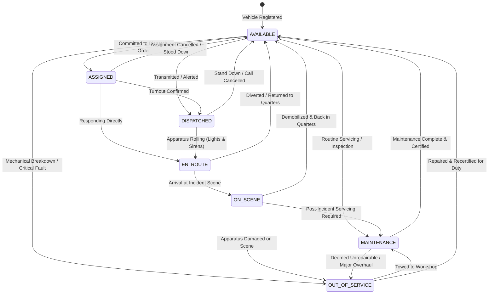

# FireSphere.ai — Member 5: Fleet / Vehicle Management Module
**Document Version:** 1.0.0  
**Phase:** 4 — Fleet / Vehicle Management Module  
**Status:** Implemented, Tested & Verified  
**Runtime:** Java 21 LTS | Spring Boot 3.3.4 | PostgreSQL + PostGIS / H2 (Test)  

---

## 1. Purpose

The Fleet / Vehicle Management module serves as the authoritative source of truth for fire-service apparatus, emergency response vehicles, and special equipment. It provides complete operational lifecycle tracking from initial vehicle intake and station assignment, capacity profiling, readiness determination, and operational status transitions through to workshop maintenance and decommissioned out-of-service states, backed by an immutable audit history.

Key design principles:
* **Authoritative Fleet State**: Fleet owns the authoritative operational state of every vehicle. Dispatch orders merely reference vehicles by identifier; dispatch actions do not overwrite Fleet state.
* **Deterministic Readiness**: Operational readiness is database-backed and determined deterministically from the authoritative status (`AVAILABLE` $\to$ `OPERATIONAL_READY`, deployed states $\to$ `DEPLOYED`, etc.) without reliance on live GPS or IoT hardware.
* **Clean Inter-Module Contract**: Inter-module inquiries are decoupled via [`VehicleAvailabilityContract`](file:///c:/Users/ROHAN%20NAVSEKAR/OneDrive/Desktop/Industry%20M5/src/main/java/ai/firesphere/contracts/fleet/VehicleAvailabilityContract.java) and its adapter, preventing circular dependencies between Dispatch and Fleet.
* **Zero Automatic Vehicle Assignment**: Fleet exposes vehicle state and availability queries; it does not automatically allocate apparatus, predict arrival times, or execute turnout dispatch.
* **Strict Tenant Isolation**: All vehicle registrations, queries, updates, status transitions, and history records enforce multi-tenant isolation via [`TenantContext`](file:///c:/Users/ROHAN%20NAVSEKAR/OneDrive/Desktop/Industry%20M5/src/main/java/ai/firesphere/common/tenant/TenantContext.java).

---

## 2. Fleet Architecture & Layering

The Fleet module strictly implements standard enterprise layering:

$$\text{FleetController} \longrightarrow \text{FleetService} \longrightarrow \begin{cases} \text{VehicleRepository} \\ \text{VehicleStatusHistoryRepository} \end{cases}$$

$$\text{Other Modules (e.g. Dispatch)} \longrightarrow \text{VehicleAvailabilityContract} \longrightarrow \text{FleetVehicleAvailabilityAdapter} \longrightarrow \text{VehicleRepository}$$

* **Controller Layer ([`FleetController`](file:///c:/Users/ROHAN%20NAVSEKAR/OneDrive/Desktop/Industry%20M5/src/main/java/ai/firesphere/fleet/controller/FleetController.java))**: Exposes REST endpoints under `/api/v1/fleet/vehicles`. Validates request bodies with Bean Validation (`@Valid`) and maps business exceptions to standardized HTTP responses (`201 Created`, `200 OK`, `400 Bad Request`, `404 Not Found`, `409 Conflict`, `422 Unprocessable Entity`).
* **Service Layer ([`FleetServiceImpl`](file:///c:/Users/ROHAN%20NAVSEKAR/OneDrive/Desktop/Industry%20M5/src/main/java/ai/firesphere/fleet/service/FleetServiceImpl.java))**: Encapsulates transaction boundaries (`@Transactional`), tenant isolation, state machine transition rules, registration normalization, and status history recording.
* **Repository Layer ([`VehicleRepository`](file:///c:/Users/ROHAN%20NAVSEKAR/OneDrive/Desktop/Industry%20M5/src/main/java/ai/firesphere/fleet/repository/VehicleRepository.java))**: Spring Data JPA repository extending `JpaSpecificationExecutor` for dynamic, tenant-isolated criteria filtering and text search.
* **Domain Model Layer ([`Vehicle`](file:///c:/Users/ROHAN%20NAVSEKAR/OneDrive/Desktop/Industry%20M5/src/main/java/ai/firesphere/fleet/model/Vehicle.java))**: JPA entities extending `BaseAuditableEntity` with optimistic locking (`version`), unique constraints, and operational metadata.
* **DTO Layer ([`ai.firesphere.fleet.dto`](file:///c:/Users/ROHAN%20NAVSEKAR/OneDrive/Desktop/Industry%20M5/src/main/java/ai/firesphere/fleet/dto))**: DTO records preventing domain model leakage across HTTP endpoints.

---

## 3. Vehicle Domain Model

### 3.1 `Vehicle` Entity
* `id`: UUID (Primary Key)
* `tenantId`: UUID (Multi-tenant partition)
* `registrationNumber`: String(32) (Unique official vehicle registration number, normalized to uppercase)
* `callSign`: String(50) (Radio operational call sign, e.g., `ENGINE-1`, `LADDER-2`)
* `vehicleType`: `VehicleType` (Apparatus classification)
* `status`: `VehicleStatus` (Current operational state)
* `assignedStationId`: UUID (Home fire station reference)
* `make`: String(50) (Chassis manufacturer, e.g., Rosenbauer, Tata, Volvo)
* `model`: String(50) (Apparatus model, e.g., Commander, Ultra Fire)
* `manufactureYear`: Integer (Year of commissioning)
* `waterCapacityLiters`: Integer (On-board water tank capacity in liters)
* `foamCapacityLiters`: Integer (On-board foam concentrate capacity in liters)
* `pumpCapacityLpm`: Integer (Rated fire pump output in liters per minute)
* `currentLatitude`: Double (Mock telematics coordinate)
* `currentLongitude`: Double (Mock telematics coordinate)
* `fuelPercent`: Double (Tank fuel level percentage)
* `waterLevelPercent`: Double (On-board water level percentage)
* `operationalNotes`: String(1000) (Operational briefing and maintenance notes)

### 3.2 `VehicleStatusHistory` Entity
* `id`: UUID (Primary Key)
* `tenantId`: UUID
* `vehicleId`: UUID (Foreign key to `fleet_vehicles`)
* `previousStatus`: `VehicleStatus` (null for initial registration)
* `newStatus`: `VehicleStatus`
* `transitionedAt`: Instant
* `transitionedBy`: String (Officer username or `FLEET_OFFICER`)
* `reason`: String(500) (Transition remarks or work order notes)

---

## 4. Vehicle Types

The module supports controlled fire-service vehicle classifications via [`VehicleType`](file:///c:/Users/ROHAN%20NAVSEKAR/OneDrive/Desktop/Industry%20M5/src/main/java/ai/firesphere/fleet/model/VehicleType.java):

| Vehicle Type | Operational Role | Typical Equipment Profile |
| :--- | :--- | :--- |
| `PUMPER_ENGINE` | Primary structural fire attack | 3,000–4,500L water tank, 3,000 LPM pump, attack hoses |
| `AERIAL_LADDER` | Elevated rescue & master stream attack | 30–50m hydraulic turntable ladder / platform |
| `WATER_TANKER` | Bulk water supply in unhydranted areas | 10,000–16,000L water tank, booster pump |
| `HEAVY_RESCUE` | Vehicle extrication & structural collapse | Hydraulic cutters, spreaders, lifting bags, air shoring |
| `HAZMAT_TENDER` | Chemical, biological & radiation response | Decon showers, level-A suits, absorption booms |
| `FOAM_CARRIER` | Industrial & petrochemical hydrocarbon fires | 5,000–10,000L Class-B foam concentrate, foam proportioners |
| `COMMAND_UNIT` | Mobile incident command post | Communications array, tactical planning displays |
| `AMBULANCE` | Emergency medical transport & triage | Advanced life support (ALS) medical equipment |

> [!NOTE]
> The apparatus types above represent the authoritative Phase-1 model foundation (`ai.firesphere.fleet.model.VehicleType`) and have been preserved without inventing arbitrary non-standard categories.

---

## 5. Vehicle Status Lifecycle & State Machine

### 5.1 Lifecycle State Machine Diagram



### 5.2 Transition Validation Matrix

| Current State | Permitted Next States | Disallowed Jumps (Rejected with HTTP 422 `BUSINESS_RULE_VIOLATION`) |
| :--- | :--- | :--- |
| `AVAILABLE` | `ASSIGNED`, `DISPATCHED`, `MAINTENANCE`, `OUT_OF_SERVICE` | `EN_ROUTE`, `ON_SCENE` |
| `ASSIGNED` | `DISPATCHED`, `EN_ROUTE`, `AVAILABLE`, `MAINTENANCE`, `OUT_OF_SERVICE` | `ON_SCENE` |
| `DISPATCHED` | `EN_ROUTE`, `AVAILABLE`, `MAINTENANCE`, `OUT_OF_SERVICE` | `ASSIGNED`, `ON_SCENE` |
| `EN_ROUTE` | `ON_SCENE`, `AVAILABLE`, `MAINTENANCE`, `OUT_OF_SERVICE` | `ASSIGNED`, `DISPATCHED` |
| `ON_SCENE` | `AVAILABLE`, `MAINTENANCE`, `OUT_OF_SERVICE` | `ASSIGNED`, `DISPATCHED`, `EN_ROUTE` |
| `MAINTENANCE` | `AVAILABLE`, `OUT_OF_SERVICE` | `ASSIGNED`, `DISPATCHED`, `EN_ROUTE`, `ON_SCENE` |
| `OUT_OF_SERVICE` | `AVAILABLE`, `MAINTENANCE` | `ASSIGNED`, `DISPATCHED`, `EN_ROUTE`, `ON_SCENE` |

---

## 6. API Endpoints

All endpoints are hosted under `/api/v1/fleet/vehicles`:

| Method | Endpoint | Description | Success Status |
| :--- | :--- | :--- | :--- |
| `POST` | `/api/v1/fleet/vehicles` | Register a new vehicle apparatus with station assignment | `201 Created` |
| `GET` | `/api/v1/fleet/vehicles` | Paginated search with filtering (`status`, `vehicleType`, `stationId`, text `search`) | `200 OK` |
| `GET` | `/api/v1/fleet/vehicles/{id}` | Get vehicle operational details by UUID for current tenant | `200 OK` |
| `PUT` | `/api/v1/fleet/vehicles/{id}` | Update mutable vehicle metadata (call sign, station, make, capacities) | `200 OK` |
| `POST` | `/api/v1/fleet/vehicles/{id}/status` | Transition operational vehicle status with audit logging | `200 OK` |
| `GET` | `/api/v1/fleet/vehicles/{id}/history` | Retrieve chronological status transition audit timeline | `200 OK` |
| `GET` | `/api/v1/fleet/vehicles/{id}/readiness` | Query operational availability and readiness classification | `200 OK` |

---

## 7. DTO Contracts

### 7.1 `VehicleRegisterRequest`
```json
{
  "registrationNumber": "MH-01-FS-501",
  "callSign": "ENGINE-5",
  "vehicleType": "PUMPER_ENGINE",
  "assignedStationId": "7cb85f64-5717-4562-b3fc-2c963f66afa7",
  "make": "Rosenbauer",
  "model": "Commander 4000",
  "manufactureYear": 2023,
  "waterCapacityLiters": 4500,
  "foamCapacityLiters": 500,
  "pumpCapacityLpm": 3000,
  "operationalNotes": "Primary pumper engine for station 1"
}
```

### 7.2 `VehicleResponseDTO`
```json
{
  "id": "e9a0c929-288c-4a12-9d3e-3c471e6e8105",
  "registrationNumber": "MH-01-FS-501",
  "callSign": "ENGINE-5",
  "vehicleType": "PUMPER_ENGINE",
  "status": "AVAILABLE",
  "assignedStationId": "7cb85f64-5717-4562-b3fc-2c963f66afa7",
  "make": "Rosenbauer",
  "model": "Commander 4000",
  "manufactureYear": 2023,
  "waterCapacityLiters": 4500,
  "foamCapacityLiters": 500,
  "pumpCapacityLpm": 3000,
  "currentLatitude": null,
  "currentLongitude": null,
  "fuelPercent": 100.0,
  "waterLevelPercent": 100.0,
  "operationalNotes": "Primary pumper engine for station 1",
  "available": true,
  "createdAt": "2026-10-05T17:45:00Z",
  "updatedAt": "2026-10-05T17:45:00Z"
}
```

### 7.3 `VehicleStatusUpdateRequest`
```json
{
  "status": "MAINTENANCE",
  "reason": "Scheduled 10,000km chassis & pump service"
}
```

### 7.4 `VehicleReadinessDTO`
```json
{
  "vehicleId": "e9a0c929-288c-4a12-9d3e-3c471e6e8105",
  "registrationNumber": "MH-01-FS-501",
  "callSign": "ENGINE-5",
  "vehicleType": "PUMPER_ENGINE",
  "status": "AVAILABLE",
  "available": true,
  "readinessState": "OPERATIONAL_READY",
  "assignedStationId": "7cb85f64-5717-4562-b3fc-2c963f66afa7"
}
```

---

## 8. Validation & Business Invariants

1. **Mandatory Attributes**: `registrationNumber`, `callSign`, `vehicleType`, and `assignedStationId` are required (`@NotBlank` / `@NotNull`).
2. **Normalized Registration Uniqueness**: Registration numbers are trimmed and normalized to uppercase. Registering an existing registration number within the same tenant is rejected with HTTP `409 Conflict` (`STATE_CONFLICT`).
3. **Immutable Identifiers**: `registrationNumber`, `tenantId`, and `id` cannot be modified via `PUT /api/v1/fleet/vehicles/{id}`.
4. **Lifecycle Boundary**: Vehicle status cannot be modified via `PUT`; it must transition explicitly through `POST /api/v1/fleet/vehicles/{id}/status`.
5. **State Transition Safety**: Out-of-service or in-maintenance apparatus cannot jump straight into emergency operations (`EN_ROUTE`, `DISPATCHED`, `ON_SCENE`). They must return to `AVAILABLE` first.

---

## 9. Tenant Isolation

* Multi-tenancy is enforced through [`TenantContext.getTenantId()`](file:///c:/Users/ROHAN%20NAVSEKAR/OneDrive/Desktop/Industry%20M5/src/main/java/ai/firesphere/common/tenant/TenantContext.java).
* Client-provided `tenantId` in request bodies is discarded.
* All database queries incorporate tenant scoping:
  * Single-entity lookups call `findByIdAndTenantId`.
  * Dynamic filtering calls `VehicleSpecification.withFilters` with `cb.equal(root.get("tenantId"), tenantId)`.
* Cross-tenant resource queries return HTTP `404 Not Found` (`RESOURCE_NOT_FOUND`) to prevent resource existence enumeration.

---

## 10. Vehicle Status History & Audit Trails

Every state transition records an auditable record in `vehicle_status_history`:
* Captures previous status, new status, transitioning user/actor, timestamp, and optional reason.
* Retrieved via `GET /api/v1/fleet/vehicles/{id}/history`.
* Read-only and strictly tenant-isolated.

---

## 11. Operational Readiness Model

Fleet defines deterministic, database-backed operational readiness derived directly from the vehicle's persisted state:

| Vehicle Status | `available` Boolean | `readinessState` Label | Description |
| :--- | :--- | :--- | :--- |
| `AVAILABLE` | `true` | `OPERATIONAL_READY` | Apparatus in quarters, inspected, and ready for dispatch |
| `ASSIGNED` | `false` | `DEPLOYED` | Committed to an active dispatch turnout order |
| `DISPATCHED` | `false` | `DEPLOYED` | Alerted and preparing to roll |
| `EN_ROUTE` | `false` | `DEPLOYED` | Responding with emergency lights & sirens |
| `ON_SCENE` | `false` | `DEPLOYED` | Actively operating at incident scene |
| `MAINTENANCE` | `false` | `UNDER_MAINTENANCE` | Under workshop inspection, repair, or routine service |
| `OUT_OF_SERVICE`| `false` | `OUT_OF_SERVICE` | Grounded due to critical fault or decommissioning |

> [!NOTE]
> **Development Baseline Assumption**: Any operational readiness heuristics or secondary telemetry levels (e.g. fuel or water levels) are strictly development baseline assumptions and configurable future operational policies, not official municipal fire department standards. Readiness remains deterministic and backed entirely by the persistent database state without external runtime dependencies.

---

## 12. Database Migrations

### Flyway Migration: `V4__fleet_vehicle_management.sql`
1. Adds `make VARCHAR(50)`, `model VARCHAR(50)`, `manufacture_year INTEGER`, and `operational_notes VARCHAR(1000)` to `fleet_vehicles`.
2. Creates performance indexes:
   * `idx_vehicles_tenant_station` on `(tenant_id, assigned_station_id)`
   * `idx_vehicles_tenant_type` on `(tenant_id, vehicle_type)`
3. Creates table `vehicle_status_history` with foreign key cascade to `fleet_vehicles(id)`.
4. Creates indexes `idx_vehicle_history_vehicle` and `idx_vehicle_history_tenant_time`.

---

## 13. Inter-Module Dispatch Boundary

* **Phase 3 Dispatch Remains Locked**: No automatic Fleet $\leftrightarrow$ Dispatch business behavior was activated.
* **Authoritative Ownership**: Fleet is the sole authoritative owner for vehicle state and apparatus metadata.
* **Loose Coupling**: Dispatch orders store apparatus references strictly as a list of UUIDs (`assignedVehicleIds`).
* **Contract Interface**: Inter-module queries utilize [`VehicleAvailabilityContract`](file:///c:/Users/ROHAN%20NAVSEKAR/OneDrive/Desktop/Industry%20M5/src/main/java/ai/firesphere/contracts/fleet/VehicleAvailabilityContract.java) as a future integration boundary, remaining completely inactive at runtime in Phase 3 Dispatch:
  * `isVehicleAvailable(UUID vehicleId)`
  * `getVehicleStatus(UUID vehicleId)`
  * `getAvailableVehiclesByStation(UUID stationId, VehicleType type)`
* **Zero Dispatch Mutation**: Fleet operations do not create, modify, or cancel dispatch orders, and Dispatch operations do not mutate Fleet vehicle state.

---

## 14. Explicit Phase 5+ Boundaries

To preserve strict architectural modularity:
* **No Real Telematics**: No physical GPS/OBD-II/CAN bus ingestion is performed in Phase 4. `VehicleLocationProviderContract` remains an abstraction for future IoT integrations.
* **No GIS Routing**: No spatial travel time, shortest-path calculation, geofencing, or hydrant proximity analysis is executed. (Owned by Phase 6 GIS).
* **No Automatic Dispatch / AI Allocation**: Fleet exposes availability; it never executes automatic vehicle assignments.
* **No Notifications**: No SMS, WhatsApp, or push broadcasts are sent.
* **No External CAD**: No municipal 112/911 network transmissions are performed.
* **Inventory (Phase 5)**: Consumables and equipment SKU tracking (foam, PPE, nozzles) remain in Phase 5.
