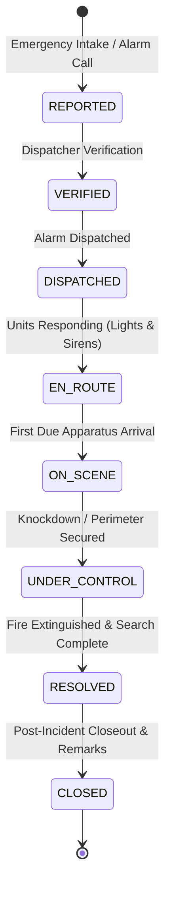

# FireSphere.ai — Member 5: Incident Management Module
**Document Version:** 1.1.0 (Phase 2 Final Alignment)  
**Phase:** 2 — Complete Incident Management Module  
**Status:** Scope Aligned, Implemented, Tested & Verified  
**Runtime:** Java 21 LTS | Spring Boot 3.3.4 | PostgreSQL + PostGIS / H2 (Test)  

---

## 1. Scope Boundaries & Multi-Phase Roadmap

Member 5 owns the operational core of FireSphere.ai across multiple incremental phases. To maintain absolute modularity and prevent premature feature creep, the boundary lines are strictly drawn as follows:

* **Phase 2 (Current Phase): Incident Management ONLY**
  - Incident intake, triage, metadata management, strictly linear lifecycle state progression, controlled closure, tenant isolation, and auditable status transition history.
  - **No automatic dispatch occurs upon incident creation.**
  - `assignedResources` is retained purely as a descriptive metadata reference field (`List<String>`) on the incident record; it does NOT trigger any vehicle dispatch, station selection, or allocation logic.
* **Phase 3 (Next Phase): Emergency Dispatch**
  - Dispatch recommendation engine, turnout orders, vehicle availability checks, crew station allocation, and dispatch status lifecycle.
* **Phase 4: Fleet / Vehicle Management**
  - Apparatus registry, readiness states, maintenance logging, and IoT telematics tracking.
* **Phase 5: Fire Store / Inventory Management**
  - Equipment SKU catalog, station stores, consumable tracking (foam, PPE, breathing air), issue (`/issue`), and return (`/return`).
* **Phase 6: GIS Operational Services**
  - PostGIS spatial hydrants, hazardous material zones, and turn-by-turn emergency routing.
* **Later Phases: Notifications & External Integrations**
  - Push turnout broadcasts (FCM), SMS alerting, AI computer vision findings human-in-the-loop review, and 112/911 CAD integration.

---

## 2. Architecture & Layering

The module follows the production layering pattern:
$$\text{IncidentController} \longrightarrow \text{IncidentService} \longrightarrow \text{IncidentRepository} \longrightarrow \text{PostgreSQL / H2}$$

* **Controller Layer (`ai.firesphere.incident.controller`)**: Exposes REST endpoints under `/api/v1/incidents`. Enforces validation annotations (`@Valid`) and translates results into standard HTTP status codes (`201 Created`, `200 OK`, `400 Bad Request`, `404 Not Found`, `422 Unprocessable Entity`).
* **Service Layer (`ai.firesphere.incident.service`)**: Encapsulates transaction boundaries (`@Transactional`), tenant context resolution (`TenantContext`), lifecycle state validation, and audit history logging.
* **Repository Layer (`ai.firesphere.incident.repository`)**: Spring Data JPA repositories with `JpaSpecificationExecutor` enabling dynamic, tenant-isolated filtering and pagination.
* **Domain Model Layer (`ai.firesphere.incident.model`)**: JPA entities extending [`BaseAuditableEntity`](file:///c:/Users/ROHAN%20NAVSEKAR/OneDrive/Desktop/Industry%20M5/src/main/java/ai/firesphere/common/audit/BaseAuditableEntity.java) with optimistic locking, UUID keys, and operational timestamps.
* **DTO Layer (`ai.firesphere.incident.dto`)**: Strict encapsulation preventing domain entity leakage across API boundaries.

---

## 3. Incident Lifecycle & Transition Rules

### 3.1 Mandated 8-State Linear Progression
The required Phase 2 lifecycle contains **strictly 8 states** with linear progression:

### 3.2 Transition Rule Enforcement
Transitions are enforced through an immutable map (`ALLOWED_TRANSITIONS`):

| Current State | Allowed Next State | Disallowed Transitions (Rejected with 422) |
| :--- | :--- | :--- |
| `REPORTED` | `VERIFIED` | `ON_SCENE`, `DISPATCHED`, `CLOSED`, etc. |
| `VERIFIED` | `DISPATCHED` | `CLOSED`, `ON_SCENE`, `RESOLVED`, etc. |
| `DISPATCHED` | `EN_ROUTE` | `ON_SCENE`, `RESOLVED`, `CLOSED`, etc. |
| `EN_ROUTE` | `ON_SCENE` | `UNDER_CONTROL`, `RESOLVED`, `CLOSED`, etc. |
| `ON_SCENE` | `UNDER_CONTROL` | `DISPATCHED`, `RESOLVED`, `CLOSED`, etc. |
| `UNDER_CONTROL`| `RESOLVED` | `REPORTED`, `ON_SCENE`, `CLOSED`, etc. |
| `RESOLVED` | `CLOSED` | `REPORTED`, `VERIFIED`, `ON_SCENE`, etc. |
| `CLOSED` | *None (Terminal)* | All state changes rejected. Cannot reopen. |

> **Note on `CANCELLED`**: The initial Phase 1 assumption included `CANCELLED`. In this Phase 2 scope alignment, `CANCELLED` was removed to strictly match the 8 mandated lifecycle states. No unauthorized states are permitted without formal company data-dictionary authorization.

---

## 4. Controlled Closure Behavior

Closure (`POST /api/v1/incidents/{id}/close`) is strictly governed:
1. **Prerequisite State**: The incident **must be in `RESOLVED` status**. Attempting to close an incident directly from `REPORTED`, `VERIFIED`, `EN_ROUTE`, or `ON_SCENE` is rejected (`422 Unprocessable Entity`).
2. **Mandatory Remarks**: `remarks` cannot be null, empty, or whitespace-only (`400 Bad Request`).
3. **Idempotency & Immutability**: An already `CLOSED` incident cannot be closed again. Once closed, no further attribute updates (`PUT`) or state transitions (`POST /status`) are permitted.

---

## 5. Domain Models & Database Schema

### 5.1 `incidents` Table
* `id` (`UUID PRIMARY KEY`)
* `tenant_id` (`UUID NOT NULL`)
* `incident_number` (`VARCHAR(32) NOT NULL UNIQUE`) — format: `INC-YYYYMMDD-XXXXX`
* `title` (`VARCHAR(200) NOT NULL`)
* `description` (`VARCHAR(2000)`)
* `incident_type` (`VARCHAR(50) NOT NULL`) — `STRUCTURAL_FIRE`, `WILDLAND_FIRE`, `VEHICLE_FIRE`, `ELECTRICAL_FIRE`, `HAZMAT_LEAK`, `INDUSTRIAL_HAZARD`, `RESCUE_OPERATION`, `FALSE_ALARM`
* `severity` (`VARCHAR(30) NOT NULL`) — `LOW`, `MEDIUM`, `HIGH`, `CRITICAL`
* `status` (`VARCHAR(30) NOT NULL`) — current lifecycle status
* `latitude` (`DOUBLE PRECISION NOT NULL`) — validated $-90.0 \le \text{lat} \le 90.0$
* `longitude` (`DOUBLE PRECISION NOT NULL`) — validated $-180.0 \le \text{lon} \le 180.0$
* `address` (`VARCHAR(500) NOT NULL`)
* `caller_name` (`VARCHAR(100)`)
* `caller_phone` (`VARCHAR(30)`)
* `assigned_station_id` (`UUID`)
* Timestamps: `reported_at`, `verified_at`, `dispatched_at`, `en_route_at`, `on_scene_at`, `under_control_at`, `resolved_at`, `closed_at`
* `closure_remarks` (`VARCHAR(1000)`)
* Audit columns: `created_at`, `updated_at`, `created_by`, `updated_by`, `version`

### 5.2 `incident_status_history` Table
* `id` (`UUID PRIMARY KEY`)
* `tenant_id` (`UUID NOT NULL`)
* `incident_id` (`UUID NOT NULL REFERENCES incidents(id) ON DELETE CASCADE`)
* `previous_status` (`VARCHAR(30)`)
* `new_status` (`VARCHAR(30) NOT NULL`)
* `transitioned_at` (`TIMESTAMP WITH TIME ZONE NOT NULL`)
* `transitioned_by` (`VARCHAR(100) NOT NULL`)
* `reason` (`VARCHAR(500)`)
* Audit columns: `created_at`, `updated_at`, `created_by`, `updated_by`, `version`

---

## 6. REST API Endpoints

All endpoints are scoped under `/api/v1/incidents`:

| Method | Endpoint | Description |
| :--- | :--- | :--- |
| `POST` | `/api/v1/incidents` | Register emergency incident with priority triage |
| `GET` | `/api/v1/incidents` | Paginated search with filtering (status, severity, type, station, date range) and sorting |
| `GET` | `/api/v1/incidents/{id}` | Get operational incident details by UUID |
| `GET` | `/api/v1/incidents/number/{incidentNumber}` | Get incident details by unique reference number |
| `PUT` | `/api/v1/incidents/{id}` | Update mutable incident metadata. Status changes through `PUT` are strictly rejected. |
| `POST` | `/api/v1/incidents/{id}/status` | Execute state machine transition |
| `POST` | `/api/v1/incidents/{id}/close` | Formally close a resolved incident with mandatory remarks |
| `GET` | `/api/v1/incidents/{id}/history` | Retrieve chronological audit timeline of transitions |

---

## 7. Tenant Isolation Guarantees

* **Context Extraction**: Tenant context is obtained via `TenantContext.getTenantId()`.
* **Zero Client Trust**: Any tenant ID supplied in client payloads or headers is ignored.
* **Strict SQL Scoping**: All database operations (`findByIdAndTenantId`, `findByIncidentNumberAndTenantId`, `findAll(Specification)`) enforce `tenant_id = currentTenantId`.
* **Information Leak Prevention**: Operations targeting an incident belonging to another tenant return `404 Not Found` (`RESOURCE_NOT_FOUND`), ensuring Tenant A cannot discover, read, update, or transition Tenant B's data.

---

## 8. Verification & Test Summary

* **Build Tool**: Apache Maven 3.9.9
* **Compilation**: Java 21 LTS
* **Test Framework**: JUnit 5, Mockito, Spring Boot Test / MockMvc
* **Test Database**: In-memory H2 in PostgreSQL compatibility mode
* **Automated Tests**: 46 total tests executed (0 failures, 0 errors, 0 skipped)
