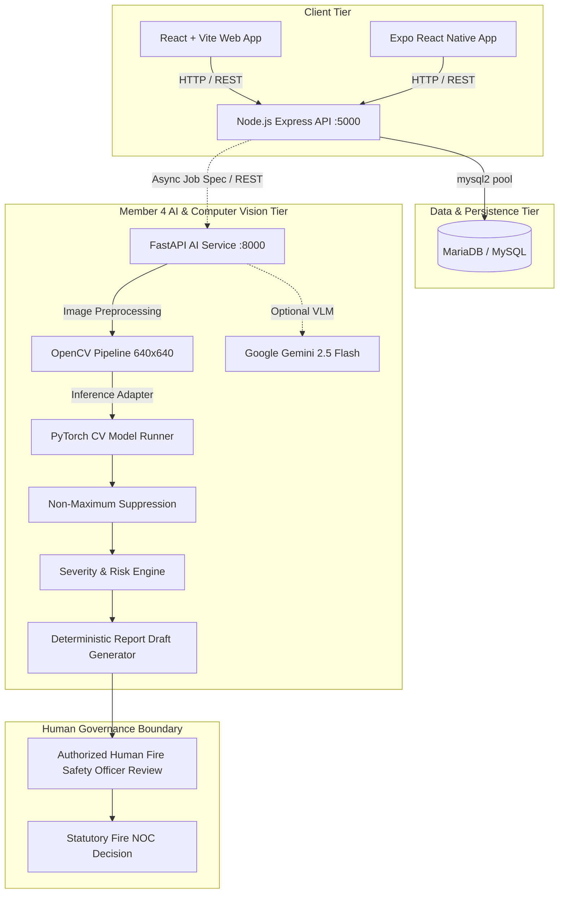

# FireSphere.ai — Enterprise Fire Administration & AI Inspection Platform

[](https://fastapi.tiangolo.com/)
[](https://react.dev/)
[](https://expressjs.com/)
[](https://expo.dev/)
[](https://pytorch.org/)
[](https://mariadb.org/)
[](ai-service/tests)

---

## 1. Project Overview

**FireSphere.ai** is an enterprise multi-tenant SaaS platform built for municipal fire services, smart cities, and industrial safety administrations. The platform streamlines fire safety compliance, incident reporting, facility inspections, and advisory inspection report drafting.

The system combines:
1. **Administrative Web Console & Backend**: Multi-tenant organization onboarding, user roles, incident tracking, and Azure-ready deployment.
2. **Field Mobile Client**: Cross-platform Expo React Native mobile application for on-site personnel and incident submission.
3. **AI & Computer Vision Microservice (Member 4)**: Automated visual hazard detection, OpenCV image validation, grounded explainability, deterministic severity scoring, and advisory report drafting for authorized human Fire Safety Officers.

---

## 2. Key Features

* **Multi-Tenant Administration**: Hierarchical tenant management with organization-level isolation, user roles (Super Admin, Org Admin, Fire Inspector, Guest), and customizable tenant branding.
* **Incident Lifecycle Management**: Report, dispatch, track, and resolve emergency and non-emergency fire incidents.
* **Field Evidence Capture**: Mobile client for taking on-site photographs and submitting safety observations with geographical metadata.
* **Computer Vision Defect Detection**: Visual identification of 10 target fire safety hazards (e.g., missing extinguishers, blocked emergency exits, impaired sprinkler heads) using normalized coordinate projections.
* **Grounded AI Explainability**: Structured reasoning across 5 dimensions (**WHAT**, **WHERE**, **CONFIDENCE**, **WHY**, **VERIFY**) linking every finding to physical visual evidence.
* **Deterministic Report Drafting**: Evidence-traceable advisory inspection report generation that eliminates generative LLM hallucinations and adheres to statutory boundaries.
* **Strict Human-in-the-Loop Governance**: AI drafts are strictly advisory; all regulatory compliance decisions and Fire NOC (No Objection Certificate) approvals require authorized human officer verification.

---

## 3. System Architecture



### Component Responsibilities

* **`frontend/`**: Single-Page Application (SPA) providing dashboards, role management, and operational analytics.
* **`mobile/`**: React Native Expo mobile client for field operations and incident reporting.
* **`backend/`**: Express.js REST API handling tenant auth, session tokens, incident management, and database operations.
* **`ai-service/`**: Python FastAPI microservice executing computer vision models, bounding box transforms, evidence validation, and advisory report drafting.
* **`database/`**: Relational database storage for tenants, users, roles, sessions, and operational records.
* **`infra/`**: Azure App Service Linux single-container hosting configuration.

---

## 4. Repository Structure

```
FireSphere.ai/
├── ai-service/                         # Member 4 FastAPI AI Microservice
│   ├── app/                            # Application source code
│   │   ├── api/                        # REST routes (/health, /ready, /inspection, /jobs, /report, /metrics)
│   │   ├── core/                       # App settings, logging, security, exception hierarchy
│   │   ├── cv/                         # OpenCV decode, letterbox transform, image quality validation
│   │   ├── evaluation/                 # Evaluators, ECE calibration, safety threshold selection
│   │   ├── intelligence/               # Grounded explainability, severity engine, risk scoring
│   │   ├── models/                     # PyTorch CV model adapters, NMS engine, model registry loader
│   │   ├── pipelines/                  # End-to-end inspection and reporting pipelines
│   │   ├── queue/                      # Redis & memory FIFO queue abstractions, retry policies
│   │   ├── registry/                   # Model registry and metadata governance
│   │   ├── reporting/                  # Deterministic report drafting, limitations, review states
│   │   ├── schemas/                    # Pydantic schemas (Finding, Report, Inspection, Job, Run)
│   │   ├── services/                   # Business coordination services
│   │   ├── storage/                    # S3 / MinIO evidence client with SHA-256 validation
│   │   └── training/                   # Dataset validators, splitters, trainers, readiness gates
│   ├── artifacts/                      # Model checkpoints (.pt, .pth), gates, visual sample records
│   ├── datasets/                       # Dataset class mappings, split manifests, validation reports
│   ├── docs/                           # Internal microservice technical documentation
│   ├── tests/                          # Automated pytest suite (424 passing tests)
│   ├── .dockerignore                   # Docker exclusion rules
│   ├── .env.example                    # Safe environment template (placeholders only)
│   ├── Dockerfile                      # Production container specification
│   ├── docker-compose.dev.yml          # Local multi-container development configuration
│   ├── pytest.ini                      # Pytest execution settings
│   ├── README.md                       # Microservice documentation & quickstart
│   └── requirements.txt                # Pinned Python dependencies
├── backend/                            # Node.js Express Backend Service
│   ├── package.json                    # Backend dependencies & npm scripts
│   ├── package-lock.json               # Backend dependency lockfile
│   └── server.js                       # Express application server and MariaDB integration
├── database/                           # Database Migrations & Schemas
│   └── firesphere_ai_mariadb.sql       # MariaDB schema definition file
├── docs/                               # Member 4 Phase 8, 9, 10 Technical Documentation & API Contracts
├── frontend/                           # React + Vite Web Application
│   ├── index.html                      # Single-page HTML entry point
│   ├── package.json                    # Frontend dependencies & scripts
│   ├── package-lock.json               # Frontend dependency lockfile
│   ├── src/                            # React application source (App.jsx, main.jsx, styles.css)
│   └── vite.config.js                  # Vite bundler configuration
├── fsm_door_names.txt                  # Phase 8.8 exit door candidate audit inventory
├── infra/                              # Infrastructure Configuration
│   └── azure-webapp-config.md          # Azure App Service deployment instructions
├── mobile/                             # Expo React Native Mobile Client
│   ├── App.js                          # Mobile application entry point
│   ├── app.json                        # Expo application manifest
│   ├── babel.config.js                 # Babel preset configuration
│   ├── package.json                    # Mobile dependencies & scripts
│   └── src/                            # Screens (Dashboard, Incidents, AIWorkflows, Auth) & navigation
├── .gitignore                          # Merged repository ignore rules
├── package.json                        # Root workspace npm scripts
└── README.md                           # Project documentation (this file)
```

---

## 5. Technology Stack

| Domain | Technology | Version | Purpose |
| :--- | :--- | :--- | :--- |
| **Backend API** | Node.js / Express | Express 4.19+ | Multi-tenant auth, incident management, data serving |
| **Database** | MariaDB / MySQL | Client: mysql2 3.4+ | Relational tenant, user, role, and incident persistence |
| **Frontend Web** | React / Vite | React 18.3+, Vite 5.4+ | Administrative management console & dashboards |
| **Mobile Client** | React Native / Expo | Expo 51.0+, RN 0.74+ | Field inspections and incident submissions |
| **AI Microservice** | Python / FastAPI | FastAPI 0.115+, Uvicorn | Computer Vision inference, explainability & report generation |
| **CV & Deep Learning**| PyTorch / OpenCV | PyTorch 2.1+, OpenCV 4.8+ | Tensor processing, letterbox transforms, NMS suppression |
| **Data Validation** | Pydantic v2 | Pydantic 2.0+ | Strict typed request/response and compliance schemas |
| **Vision-Language** | Google Gemini (Optional) | google-genai 0.1+ | Optional multimodal verification (disabled by default) |
| **Async Queues** | Redis / MinIO | Redis 5.0+, Boto3 | Background job queuing and cryptographically-verified storage |

---

## 6. Frontend Setup

The frontend is a Vite + React Single-Page Application located in `frontend/`.

### Installation & Execution

```bash
# Navigate to repository root
npm run install:frontend

# Start Vite development server
npm run dev --prefix frontend
```
The frontend development server starts on `http://localhost:5173`.

### Production Build

```bash
npm run build
```
This compiles production assets into `frontend/dist`, which the backend Express server serves statically in production.

---

## 7. Mobile Application Setup

The mobile client is built with Expo and React Native located in `mobile/`.

### Installation & Execution

```bash
# Install mobile dependencies
npm run install:mobile

# Start Expo development bundler
npm run dev:mobile
```
From the Expo CLI interface:
* Press `w` to open in a web browser.
* Press `a` to open in a connected Android device / emulator.
* Press `i` to open in an iOS simulator.

### API Endpoint Configuration

The mobile client connects to the backend API via `mobile/src/config.js`. By default, it targets `http://localhost:5000/api` or your local network IP when running on physical devices.

---

## 8. Backend Setup

The backend is an Express application located in `backend/server.js`.

### Installation & Execution

```bash
# Install backend dependencies
npm run install:backend

# Start backend in watch/development mode
npm run dev --prefix backend

# Or start directly
npm run start
```
The server listens on `http://localhost:5000` (or the configured `PORT`).

### Runtime Configuration

Create a `.env` file inside `backend/` or export environment variables:
```env
PORT=5000
DB_HOST=localhost
DB_PORT=3306
DB_USER=firesphere_user
DB_PASSWORD=your_secure_password
DB_NAME=firesphere_ai
```

If MariaDB is unavailable, `backend/server.js` provides graceful fallback demo responses on `/api/dashboard`, `/api/incidents`, and `/api/ai-runs`.

---

## 9. Database Setup

The backend utilizes a **MariaDB / MySQL** relational database connection pool (`mysql2/promise`).

### Connection Parameters

The database connection is configured in `backend/server.js` using standard environment variables:
* `DB_HOST`: Hostname of the database server.
* `DB_PORT`: Database port (default: `3306`).
* `DB_USER`: Database username.
* `DB_PASSWORD`: Database password.
* `DB_NAME`: Database schema name (e.g., `firesphere_ai`).

### Schema Status

* The database schema includes tables for `organizations`, `users`, `user_sessions`, `roles`, `user_roles`, `org_sso_providers`, `org_settings`, `incidents`, `ai_runs`, `ai_agents`, `ai_agent_workflows`, and `inspections`.
* Note: `database/firesphere_ai_mariadb.sql` currently exists as a placeholder in the repository. Full table definitions are operationalized through `backend/server.js` queries and teammate integration specifications.

---

## 10. AI Service Setup (Member 4)

The **AI Service** is a dedicated Python FastAPI microservice located in `ai-service/`.

### Prerequisites

* Python 3.11 or Python 3.13
* Virtual environment (`venv`)

### Installation

```powershell
# From repository root:
python -m venv ai-service/.venv
.\ai-service\.venv\Scripts\activate

# Install pinned production dependencies
pip install -r ai-service/requirements.txt
```

### Running the API Service

```powershell
.\ai-service\.venv\Scripts\uvicorn app.main:app --app-dir ai-service --reload --host 0.0.0.0 --port 8000
```
* **Interactive OpenAPI Docs**: `http://localhost:8000/docs`
* **Liveness Probe**: `http://localhost:8000/health`
* **Readiness Probe**: `http://localhost:8000/ready`
* **Prometheus Metrics**: `http://localhost:8000/metrics`

### Running the Asynchronous Worker Daemon

```powershell
python -m app.worker
```

---

## 11. Environment Configuration

### AI Service Template (`ai-service/.env.example`)

Copy the template to `.env` inside `ai-service/` for local overrides:
```powershell
Copy-Item ai-service/.env.example ai-service/.env
```

| Variable | Default | Purpose / Safety Rule |
| :--- | :--- | :--- |
| `AI_SERVICE_NAME` | `firesphere-ai-service` | Service identifier |
| `AI_SERVICE_ENV` | `development` | Deployment environment |
| `AI_HOST` | `0.0.0.0` | Bind host address |
| `AI_PORT` | `8000` | HTTP service port |
| `AI_LOG_LEVEL` | `INFO` | Logging level |
| `AI_AUTH_ENABLED` | `false` | Internal service token authentication gate |
| `AI_SERVICE_AUTH_TOKEN` | *(placeholder)* | Service-to-service shared bearer token |
| `REDIS_URL` | `redis://localhost:6379/0` | Async FIFO queue broker |
| `S3_ENDPOINT` | `http://localhost:9000` | MinIO / S3 object storage endpoint |
| `S3_BUCKET` | `firesphere-evidence` | Evidence photo bucket |
| `AI_CONFIDENCE_THRESHOLD` | `0.50` | Detection score filter |
| `AI_NMS_IOU_THRESHOLD` | `0.45` | Non-Maximum Suppression overlap threshold |
| `GEMINI_ENABLED` | `false` | **Disabled by default** to preserve fail-closed operation |
| `GEMINI_API_KEY` | *(empty)* | **Never commit real keys.** Configure locally if testing Gemini |
| `GEMINI_MODEL` | `gemini-2.5-flash` | Multimodal model target |
| `GEMINI_TIMEOUT_SECONDS`| `30` | Request timeout |

---

## 12. API and AI Integration

### Current Integration Status

1. **Backend & AI Service Boundary**:
   * The Node.js Express backend (`backend/server.js`) and the FastAPI AI service (`ai-service/`) are currently **decoupled microservices**.
   * Express currently queries local/remote MariaDB tables for `ai_runs` and serves operational endpoints to the web and mobile frontends.
   * Direct service-to-service job dispatching (`POST /internal/ai/jobs` or `/api/v1/inspection/analyze`) is fully specified in `docs/phase10_api_contract.md` and `docs/phase10_handoff.md`. Programmatic invocation of the AI service from Express is an upcoming integration milestone.

2. **Core AI Microservice Endpoints Implemented**:
   * `POST /api/v1/inspection/analyze`: Synchronous image inspection returning normalized bounding boxes, confidence, and explainability narratives.
   * `POST /api/v1/report/draft`: Synchronous advisory report drafting compiling executive summaries, finding tables, and officer verification checklists.
   * `POST /internal/ai/jobs`: Asynchronous job creation for background processing via Redis queue and object storage.
   * `GET /internal/ai/jobs/{id}/result`: Asynchronous job status and advisory draft retrieval.

---

## 13. Testing

### Automated Test Suite Execution

The Member 4 AI service includes an extensive automated test suite covering units, contracts, security rules, OpenCV preprocessing, and model pipelines:

```powershell
# Run all tests using the virtual environment
.\ai-service\.venv\Scripts\pytest -v ai-service/tests
```

### Verified Test Results

* **Total Tests Executed**: **424 passed** (0 failed, 0 errors)
* **Execution Time**: ~2m 40s
* **Key Test Coverage**:
  * `test_health.py`: Liveness and honest readiness probes.
  * `test_cv_preprocessing.py`: OpenCV image decoding, letterbox aspect-ratio preservation, and normalization.
  * `test_evidence_validation.py`: Magic byte file signatures, corrupted payload rejection, and boundary size checks.
  * `test_nms.py`: Non-Maximum Suppression IoU math and cross-class preservation.
  * `test_compliance_boundary.py`: Programmatic blocking of forbidden autonomous states (`AI_APPROVED`, `AI_REJECTED`).
  * `test_explainability.py`: 5-dimension grounded narratives (WHAT, WHERE, CONFIDENCE, WHY, VERIFY).
  * `test_report_drafting.py`: Deterministic report draft generation and officer review state machine.
  * `test_phase6_jobs.py`: Redis FIFO job lifecycle, bounded retry policies, and storage client integration.
  * `test_phase8_*`: Model evaluation, dataset splits, hash reconciliation, and weight provenance.
  * `test_gemini_*`: Gemini client initialization, offline mocking, and token redaction.

---

## 14. Security and AI Safety

### Statutory Safety Boundaries

1. **Zero Autonomous NOC Authority**: The AI service **never** autonomously approves or rejects Fire No Objection Certificates (NOC). The schemas enforce that all AI outputs are advisory drafts (`REQUIRES_OFFICER_VERIFICATION`).
2. **Zero Regulatory Hallucination**: The report generator operates deterministically on verified findings. It never fabricates building codes, acts, legal penalties, water tank requirements, or unobserved site conditions.
3. **Fail-Closed Operations**: If evidence is corrupted, blurred, or missing, the service raises structured exceptions and fails closed without generating speculative findings.
4. **Token & Secret Shielding**: Logs, error handlers, and provider info endpoints automatically redact API keys, tokens, and authorization headers.
5. **Gemini Safe Defaults**: `GEMINI_ENABLED` is strictly `false` by default, allowing the system to run in air-gapped or credential-free environments without runtime errors.

---

## 15. Known Limitations

* **Model Training & Dataset Acquisition**: In accordance with the Phase 8 Model Decision Gate, the system is classified as `DATASET_ACQUISITION_IN_PROGRESS`. Uncalibrated external models are not substituted for statutory fire hazards.
* **Backend HTTP Bridge**: Direct dispatching from Express (`backend/server.js`) to FastAPI (`ai-service/`) is designed via contract specifications but remains to be wired into the Express controllers.
* **MariaDB Schema File**: `database/firesphere_ai_mariadb.sql` is currently 0 bytes in the repository; table schemas are defined in `server.js` and architectural documentation.

---

## 16. Development and Deployment Notes

### Concurrent Local Development (Root)

Run all Node-based services together from the project root:
```bash
# Start backend and web frontend together
npm run dev

# In a separate terminal, start the AI service
.\ai-service\.venv\Scripts\uvicorn app.main:app --app-dir ai-service --reload --port 8000
```

### Azure Web App Deployment Model

Refer to `infra/azure-webapp-config.md` for production deployment details on Azure App Service:
* Single Linux App Service instance hosting Express.
* Built static frontend assets served directly from `frontend/dist`.
* Database credentials stored securely in Azure App Settings (`DB_HOST`, `DB_PORT`, `DB_USER`, `DB_PASSWORD`, `DB_NAME`).
* Recommended startup command:
  ```bash
  npm install --prefix backend && npm install --prefix frontend && npm run build --prefix frontend && npm run start --prefix backend
  ```
