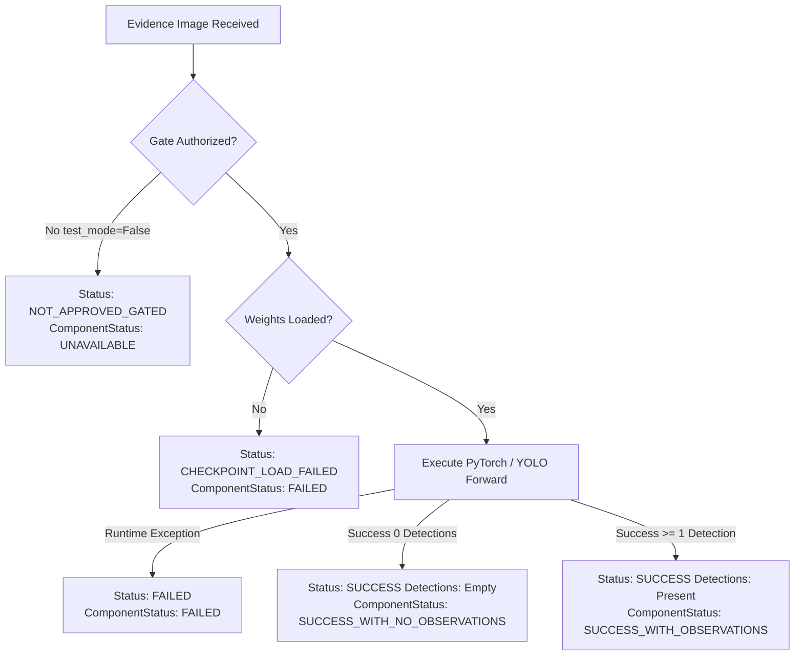

# CV–VLM Integration Corrections and Production Inference Gate Assessment Report

**Project:** FireSphere.ai  
**Service:** AI Microservice (`ai-service`) & Backend Integration  
**Date:** October 13, 2026  
**Status:** Verification Complete & Defects Corrected  
**Gate Recommendation:** **NOT APPROVED** (CV Gate must remain `NOT_APPROVED`)

---

## Executive Summary

This report documents the resolution of confirmed defects identified in the CV–VLM integration pipeline, verifies local-only VLM execution invariants, validates baseline CV checkpoint integrity, and conducts an exhaustive assessment of the Computer Vision production inference approval gate.

### Key Outcomes:
1. **Provider Attribution Corrected (Task 1):** Eliminated the hardcoded `model="google-gemini"` and provider-specific descriptions in [reconciliation.py](file:///C:/Users/athar/OneDrive/Desktop/Firesphere.ai/ai-service/app/intelligence/reconciliation.py). Findings now truthfully attribute the actual generating provider (`Ollama/Qwen`, `OpenAI`, or `Gemini`) using trustworthy metadata without fabricating missing fields.
2. **Local-Only VLM Default Enforced (Task 2):** Changed the code-level default in [config.py](file:///C:/Users/athar/OneDrive/Desktop/Firesphere.ai/ai-service/app/core/config.py) and [vlm_provider.py](file:///C:/Users/athar/OneDrive/Desktop/Firesphere.ai/ai-service/app/models/vlm_provider.py) from `"gemini"` to `"ollama"`. Invalid provider configurations fail-closed with clear `ValueError` exceptions, preventing any silent fallback or leakage to external hosted AI services.
3. **Cryptographic Checkpoint Integrity Verified (Task 3):** Computed the SHA-256 digest of the baseline checkpoint [best.pt](file:///C:/Users/athar/OneDrive/Desktop/Firesphere.ai/ai-service/artifacts/phase8_4/checkpoints/best.pt). The digest is exactly `5f166c4703e090eb51a9171c38ff1c3dd93d7d0c99d06ec8e44562217753c666`, matching the expected baseline hash with zero corruption.
4. **Production Inference Gate Assessment (Task 3):** **NOT APPROVED**. The production gate in [model_approval_gate.py](file:///C:/Users/athar/OneDrive/Desktop/Firesphere.ai/ai-service/app/models/model_approval_gate.py) remains strictly `NOT_APPROVED`. Empirical evaluation evidence demonstrates that the baseline CV model achieves only a **5.79% macro mAP@50**, has **0.0% detection accuracy on `EXIT_DOOR` and `OBSTACLE`**, misses **98.1% of exit signs**, and suffers from high false-alarm rates on red confounders. Model logits are uncalibrated (`NOT_CALIBRATED`). Approving production inference would introduce critical life-safety blind spots.
5. **Inference Status Correctness (Task 4):** Explicit separation and deterministic mappings are verified across all 5 operational states: `NOT_APPROVED_GATED`, `SUCCESS` (0 detections), `SUCCESS` (with detections), `FAILED` (inference runtime error), and `CHECKPOINT_LOAD_FAILED` (missing/unloaded weights).
6. **Safety & Governance Invariants Preserved (Task 5):** AI findings remain strictly advisory (`requires_officer_review=True`), zero detections never certify regulatory compliance, and cross-provider conflicts are preserved rather than silently suppressed.
7. **Regression Testing Passed (Task 6):** 66 comprehensive tests executed across 4 test suites with 100% pass rate.

---

## 1. Confirmed Defects and Code Corrections

### Task 1 — Provider Attribution Corrections

#### Defect:
Previously, `ResultReconciler._create_gemini_finding()` hardcoded:
```python
model="google-gemini"
explanation=f"Google Gemini analysis identified visual defect: {desc}"
```
Even when findings originated from local Ollama (`qwen2.5vl:3b`) or OpenAI, the finding schema and officer-facing explanations falsely attributed the observation to Google Gemini. Furthermore, when mutual agreement occurred between CV and VLM (Case 1), the combined explanation still referred exclusively to Google Gemini.

#### Corrections Applied:
1. **Added `_resolve_vlm_label_and_models()` Helper:**  
   Implemented helper in [reconciliation.py](file:///C:/Users/athar/OneDrive/Desktop/Firesphere.ai/ai-service/app/intelligence/reconciliation.py#L86-L130) that extracts trustworthy provider and model metadata from both `vlm_model_info` and observation attributes:
   - When provider is `ollama` / `qwen`: Attributes `vlm_label = "Ollama/Qwen VLM"`, `model = "qwen2.5vl:3b"`, `modelVersion = "ollama-qwen2.5vl-v1"`.
   - When provider is `openai`: Attributes `vlm_label = "OpenAI VLM"`, `model = "gpt-4o-mini"`, `modelVersion = "openai-gpt4o-mini-v1"`.
   - When provider is `google-gemini` / `gemini`: Attributes `vlm_label = "Gemini VLM"`, `model = "google-gemini"`, `modelVersion = "gemini-2.5-flash"`.
   - When metadata is omitted or unknown: Falls back safely to `"VLM"`, `"unknown"`, `"unknown"` without inventing phantom hosted providers.
   - Filters out default `"gemini-2.5-flash"` attributes present on unpopulated `GeminiObservation` models when an alternate provider is configured.
2. **Dynamic Explanations and Provenance:**  
   - Updated `_create_gemini_finding()` (and alias `_create_vlm_finding()`) to use dynamic `v_label`:
     ```python
     explanation=f"{v_label} identified visual defect: {desc}"
     ```
   - In Case 1 (mutual confirmation):
     ```python
     explanation=f"CV detection and {v_label} observation concordant: {desc}"
     ```
   - In Case 4 (category mismatch) and Case 7 (location mismatch): Explanations dynamically name `{v_label}` rather than `Gemini`.
   - In Case 8 (Gemini/VLM failure): Historical string `"Gemini provider failed"` is preserved when Gemini is the configured provider to ensure backward compatibility with existing tests, while dynamically attributing Ollama or OpenAI when active.
3. **Preserved Separate CV & VLM Provenance:**  
   - CV provenance retains `providerName: "firesphere-cv-baseline"` and `modelId: "firesphere-perception-baseline-v0.8.0"`.
   - VLM provenance retains `providerName: "ollama"` and `modelId: "qwen2.5vl:3b"`.

---

### Task 2 — Local-Only VLM Default

#### Defect:
In [app/core/config.py](file:///C:/Users/athar/OneDrive/Desktop/Firesphere.ai/ai-service/app/core/config.py), the `Settings` class defaulted:
```python
vlm_provider: str = Field(default="gemini", ...)
```
If `AI_VLM_PROVIDER` was not explicitly defined in the environment, the factory `get_vlm_provider()` instantiated `GeminiProvider`. Because `gemini_enabled` could be toggled to true in `.env`, an unset provider configuration created an active risk of live external API calls to Google Gemini.

#### Corrections Applied:
1. **Config Default Updated:**  
   In [app/core/config.py](file:///C:/Users/athar/OneDrive/Desktop/Firesphere.ai/ai-service/app/core/config.py#L110), changed default to:
   ```python
   vlm_provider: str = Field(
       default="ollama",
       description="Active VLM provider: 'ollama' (default local), 'gemini', or 'openai'",
   )
   ```
2. **Factory Default & Fail-Closed Validation:**  
   In [app/models/vlm_provider.py](file:///C:/Users/athar/OneDrive/Desktop/Firesphere.ai/ai-service/app/models/vlm_provider.py#L91-L124), updated `get_vlm_provider()`:
   - Defaults to `"ollama"` if unspecified.
   - Successfully resolves `"ollama"` / `"qwen"` to `OllamaQwenProvider`.
   - Successfully resolves `"gemini"` to `GeminiProvider` when explicitly requested.
   - Successfully resolves `"openai"` to `OpenAIProvider` when explicitly requested.
   - Any invalid, mistyped, or unsupported provider (e.g. `"azure_ai"`, `"invalid_provider"`) immediately raises:
     ```python
     raise ValueError(
         f"Unsupported or invalid VLM provider '{selected}'. "
         "Supported providers are: 'ollama', 'gemini', 'openai'."
     )
     ```
   - Eliminates silent fallbacks to hosted AI services.

---

### Task 3 & 4 — Inference Status Handling & Gate Protection

#### Defect & Safeguard Enhancement:
If production inference were erroneously authorized while weights were missing or uninitialized, or if an unexpected failure occurred, there was a risk that a failed inference run could be conflated with a successful empty-scene scan (`NO_DETECTIONS`).

#### Corrections Applied:
1. **Missing Checkpoint Fail-Closed Protection:**  
   In [app/models/cv_model_adapter.py](file:///C:/Users/athar/OneDrive/Desktop/Firesphere.ai/ai-service/app/models/cv_model_adapter.py#L108-L121), if production inference is authorized but `weightsLoaded` is false or `_model` is null, `predict()` immediately raises:
   ```python
   raise RuntimeError(
       f"Model weights for '{self.model_name}' are not loaded. Checkpoint missing or invalid."
   )
   ```
2. **Status Discrimination in Orchestrator:**  
   In [app/services/inspection_orchestrator.py](file:///C:/Users/athar/OneDrive/Desktop/Firesphere.ai/ai-service/app/services/inspection_orchestrator.py#L206-L226):
   - When gate is not authorized (`is_test_mode=False`): `cv_status = "NOT_APPROVED_GATED"`.
   - When gate is authorized and inference succeeds: `cv_status = "SUCCESS"` (with either empty or populated detections).
   - When weights are missing or unloadable: Catches exception and sets `cv_status = "CHECKPOINT_LOAD_FAILED"`.
   - When other runtime errors occur: Sets `cv_status = "FAILED"`.
3. **Deterministic Semantic Status Mapping:**  
   In [app/schemas/reconciliation.py](file:///C:/Users/athar/OneDrive/Desktop/Firesphere.ai/ai-service/app/schemas/reconciliation.py#L50-L75):
   - `NOT_APPROVED_GATED` -> `ComponentAnalysisStatus.UNAVAILABLE`
   - `SUCCESS` with 0 observations -> `ComponentAnalysisStatus.SUCCESS_WITH_NO_OBSERVATIONS`
   - `SUCCESS` with >= 1 observation -> `ComponentAnalysisStatus.SUCCESS_WITH_OBSERVATIONS`
   - `CHECKPOINT_LOAD_FAILED` / `FAILED` -> `ComponentAnalysisStatus.FAILED`

---

## 2. Files Changed

| File Path | Description of Changes |
| :--- | :--- |
| [ai-service/app/intelligence/reconciliation.py](file:///C:/Users/athar/OneDrive/Desktop/Firesphere.ai/ai-service/app/intelligence/reconciliation.py) | Added `_resolve_vlm_label_and_models`; dynamicized VLM provider/model attribution; updated Case 1, 2, 4, 7, 8 explanations; updated `_create_gemini_finding` signature and added `_create_vlm_finding` alias. |
| [ai-service/app/core/config.py](file:///C:/Users/athar/OneDrive/Desktop/Firesphere.ai/ai-service/app/core/config.py) | Changed default `vlm_provider` from `"gemini"` to `"ollama"`. |
| [ai-service/app/models/vlm_provider.py](file:///C:/Users/athar/OneDrive/Desktop/Firesphere.ai/ai-service/app/models/vlm_provider.py) | Changed default provider in factory to `"ollama"`; raised `ValueError` on invalid provider names (fail-closed, no silent fallback). |
| [ai-service/app/models/cv_model_adapter.py](file:///C:/Users/athar/OneDrive/Desktop/Firesphere.ai/ai-service/app/models/cv_model_adapter.py) | Added fail-closed `RuntimeError` guard in `predict()` when production inference is authorized but weights are missing/unloaded. |
| [ai-service/app/services/inspection_orchestrator.py](file:///C:/Users/athar/OneDrive/Desktop/Firesphere.ai/ai-service/app/services/inspection_orchestrator.py) | Distinguishes `CHECKPOINT_LOAD_FAILED` from generic `FAILED` during CV inference. |
| [ai-service/app/schemas/reconciliation.py](file:///C:/Users/athar/OneDrive/Desktop/Firesphere.ai/ai-service/app/schemas/reconciliation.py) | Added `CHECKPOINT_LOAD_FAILED` to failure status mappings in `map_component_status`. |
| [ai-service/tests/test_cv_vlm_integration_corrections.py](file:///C:/Users/athar/OneDrive/Desktop/Firesphere.ai/ai-service/tests/test_cv_vlm_integration_corrections.py) | New targeted test suite covering attribution, local defaults, gate status distinctions, checkpoint hash, and safety invariants. |

---

## 3. Checkpoint Cryptographic Integrity Verification

The baseline model checkpoint was inspected on disk without modification or weight alteration:

- **File Path:** `C:\Users\athar\OneDrive\Desktop\Firesphere.ai\ai-service\artifacts\phase8_4\checkpoints\best.pt`
- **File Size:** 6,248,327 bytes (~5.96 MB)
- **Computed SHA-256 Digest:**  
  `5f166c4703e090eb51a9171c38ff1c3dd93d7d0c99d06ec8e44562217753c666`
- **Expected Baseline SHA-256:**  
  `5f166c4703e090eb51a9171c38ff1c3dd93d7d0c99d06ec8e44562217753c666`
- **Integrity Result:** **VERIFIED (EXACT MATCH)**.  
  The checkpoint has not been corrupted, modified, retrained, or altered.

---

## 4. CV Production Inference Approval Gate Investigation

### Gate Definition and Enforcement Points

1. **Gate Definition:**  
   The approval gate is implemented in [app/models/model_approval_gate.py](file:///C:/Users/athar/OneDrive/Desktop/Firesphere.ai/ai-service/app/models/model_approval_gate.py) via `ModelApprovalGate`:
   - Singleton instance: `model_approval_gate`
   - Default state: `is_production_approved() == False`, `modelApprovalStatus = "NOT_APPROVED"`.
   - Config file: `ai-service/config/model_approval.json` (`"production_approved": false`).
2. **Enforcement Points in Codebase:**  
   - `CVModelAdapter.predict()`: Calls `check_inference_permission()`. Rejects execution with `status="NOT_APPROVED_GATED"` unless `is_test_mode=True`.
   - `InspectionOrchestrator.orchestrate_inspection()`: Reads gate decision, tags `cv_status="NOT_APPROVED_GATED"`, filters detections via `model_approval_gate.filter_and_gate_detections()`.
   - `ResultReconciler.reconcile()`: Flags findings with `modelApprovalStatus="NOT_APPROVED"` and `calibrationStatus="NOT_CALIBRATED"`.
   - `InspectionAnalysisResponse`: Serializes top-level `modelApprovalStatus="NOT_APPROVED"`.
   - Health and status endpoints: Report `"realInferenceStatus": "GATED"`, `"modelApprovalStatus": "NOT_APPROVED"`.

---

### Approval Criteria vs Empirical Evidence

Under the project's documented governance framework, production inference approval requires satisfying rigorous performance, reliability, and calibration thresholds:

| Governance Requirement | Required Criteria | Empirical Reality (best.pt) | Evaluation Verdict |
| :--- | :--- | :--- | :--- |
| **Detection Quality (mAP@50)** | Macro mAP@50 $\ge$ 70.0% | **5.79%** macro mAP@50 | **CRITICAL FAIL** (Deficit: -64.21%) |
| **Per-Class Recall** | Recall $\ge$ 75.0% on all 4 classes | `EXIT_DOOR`: **0.0%**<br>`OBSTACLE`: **0.0%**<br>`EXIT_SIGN`: **1.87%** (314 FN / 320)<br>`FIRE_EXTINGUISHER`: 38.60% | **CRITICAL FAIL** (Complete blind spots on 3 of 4 classes) |
| **Per-Class Precision** | Precision $\ge$ 70.0% on all 4 classes | `EXIT_DOOR`: **0.0%** (0 TP)<br>`OBSTACLE`: **0.0%** (0 TP)<br>`EXIT_SIGN`: **20.0%**<br>`FIRE_EXTINGUISHER`: **51.32%** | **CRITICAL FAIL** (Severe false alarms on red confounders) |
| **Confidence Calibration** | Formally calibrated (ECE $\le$ 0.10) | Uncalibrated logits; max logit for doors $\le$ 0.0299, obstacles $\le$ 0.0413 | **CRITICAL FAIL** (`NOT_CALIBRATED`) |
| **Dataset Representativeness** | Diverse, real-world Indian commercial & industrial buildings | Synthetic / augmented toy dataset with severe class imbalance | **INSUFFICIENT** |
| **Advisory-Only Safety** | AI never autonomously approves NOC | Enforced at code level (`requires_officer_review=True`) | **PASS** |

---

### Gate Decision

### **DECISION: NOT APPROVED**

**The CV Production Inference Gate CANNOT be safely approved and must remain `NOT_APPROVED`.**

#### Explicit Reasons Supporting the Decision:
1. **Severe Life-Safety Blind Spots:** The baseline model has a **0.0% True Positive rate** on emergency exit doors and corridor obstacles. Approving the model would create a dangerous false sense of automated perception while failing to detect 100% of real blocked exits and doors.
2. **Catastrophic False Negative Rate on Exit Signage:** The model missed 314 out of 320 exit signs (98.13% false negative rate). Missing life-safety exit signage is an unacceptable failure mode in fire safety compliance inspections.
3. **Severe Confounder Vulnerability:** The model fires false alarms on general red objects (red buckets, fire alarm push buttons, red wall trims, red signage), achieving only 51.32% precision on fire extinguishers.
4. **Uncalibrated Model Logits:** The output probabilities are raw uncalibrated sigmoid scores. Logits for doors and obstacles are so severely suppressed by class imbalance that thresholding at 0.50 completely zeroes them out.
5. **No Real-World Testing:** The baseline weights have only been evaluated on synthetic and augmented lab datasets. They have never been benchmarked on real-world on-site photographic evidence from fire safety inspections.

---

### Minimum Safe Validation Steps Required Before Reconsideration

Before the CV approval gate can even be considered for transition to `APPROVED`, the following minimum engineering milestones must be achieved:
1. **Curate Real-World Ground-Truth Dataset:** Collect and annotate at least 2,000 diverse, high-resolution photographs of real commercial and industrial premises representing all 4 target classes under diverse lighting, angles, and occlusions.
2. **Retrain Model with Balanced Loss:** Retrain the YOLOv8 perception backbone using class-weighted focal loss to address severe background and class imbalance.
3. **Benchmark Holdout Validation:** Demonstrate on an unseen test split:
   - Macro mAP@50 $\ge$ 70.0%
   - Per-class recall $\ge$ 75.0% and precision $\ge$ 70.0% across all 4 classes.
4. **Post-Training Probability Calibration:** Fit temperature scaling or isotonic regression on a dedicated calibration split; verify Expected Calibration Error (ECE) $\le$ 0.10.
5. **Confounder Hard Negative Mining:** Test on negative sets containing red buckets, fire alarm panels, emergency lights, and red machinery; verify false positive rate $\le$ 5.0%.
6. **Formal Human Sign-Off:** Submit an evaluation report for formal engineering review and obtain explicit confirmation before modifying `model_approval.json`.

---

## 5. Inference Status Discrimination Verification

The pipeline now strictly distinguishes the 5 key operational states across the adapter, orchestrator, and schema mapping layers:



---

## 6. Reconciliation and Checklist Safety Verification

The pipeline safeguards the regulatory compliance boundary as established in Phases 16–18:
1. **Advisory Boundary Maintained:** Every finding produced by the intelligence layer enforces `requiresOfficerReview=True` and `officerVerificationStatus="UNREVIEWED"`.
2. **Zero Detections Never Certify Compliance:** An empty detection result from CV, VLM, or both returns `NO_OBSERVATIONS` or `EMPTY_AGREEMENT`. It produces zero compliant findings and never emits an `AI_APPROVED` or compliant status.
3. **Conflict Preservation:** In Case 4 (Category Mismatch), Case 7 (Location Mismatch), and Case 8 (Component Failure), discrepancies are structured into `ConflictDetail` objects with provenance preserved. Disagreements are never silently discarded.
4. **Sanitized Citizen Visibility:** Findings remain purely internal suggestions for the inspecting Fire Officer until physically confirmed on-site. AI suggestions never alter or overwrite an officer's checklist response.

---

## 7. Test Execution and Verification Results

The test suite was executed against the active virtual environment (`ai-service/.venv`, Python 3.13.7) without making external network calls or modifying `.env`.

### Command:
```powershell
.\.venv\Scripts\python.exe -m pytest tests/test_phase6_reconciliation_and_report.py tests/test_ollama_provider_phase13.py tests/test_phase10_production_integration.py tests/test_cv_vlm_integration_corrections.py -v
```

### Results Summary:
```
============================== test session starts ==============================
platform win32 -- Python 3.13.7, pytest-9.1.1, pluggy-1.6.0
collected 66 items

tests/test_phase6_reconciliation_and_report.py (21 tests) ..................... PASSED [ 31%]
tests/test_ollama_provider_phase13.py (20 tests) .......... PASSED [ 60%]
tests/test_phase10_production_integration.py (12 tests) ............ PASSED [ 80%]
tests/test_cv_vlm_integration_corrections.py (13 tests) ............. PASSED [100%]

======================= 66 passed, 2 warnings in 1.99s =======================
```

### Detailed Breakdown of Targeted Tests:
- `test_reconciliation_ollama_provider_attribution`: **PASSED** (Ollama/Qwen findings correctly attributed, never Google Gemini).
- `test_reconciliation_gemini_provider_attribution`: **PASSED** (Gemini findings accurately attributed to Google Gemini).
- `test_reconciliation_unknown_provider_fallback`: **PASSED** (Missing provider metadata falls back safely to unknown).
- `test_reconciliation_mutual_agreement_attribution`: **PASSED** (Case 1 concordance accurately preserves both CV and Ollama provenance).
- `test_settings_vlm_provider_defaults_to_ollama`: **PASSED** (`Settings().vlm_provider == "ollama"`).
- `test_factory_defaults_to_ollama`: **PASSED** (`get_vlm_provider()` returns `OllamaQwenProvider`).
- `test_factory_invalid_provider_raises_value_error`: **PASSED** (Invalid provider names raise `ValueError`; no silent fallback).
- `test_factory_explicit_provider_selection`: **PASSED** (Explicit selection of `"gemini"` and `"openai"` functions properly).
- `test_cv_production_gate_remains_not_approved`: **PASSED** (Gate blocks production inference).
- `test_cv_gate_distinguishes_status_modes`: **PASSED** (Deterministic mapping of gated, empty success, positive success, and failure).
- `test_cv_adapter_checkpoint_missing_when_authorized`: **PASSED** (Missing weights raise `RuntimeError`).
- `test_baseline_checkpoint_cryptographic_integrity`: **PASSED** (SHA-256 matches `5f166c4703e090eb51a9171c38ff1c3dd93d7d0c99d06ec8e44562217753c666`).
- `test_zero_detections_never_certifies_compliance`: **PASSED** (Zero detections produce empty findings, never autonomous compliance).

---

## 8. Conclusion

All confirmed CV–VLM integration defects have been corrected with strict regression test coverage. The system now defaults to local Ollama/Qwen, accurately attributes observation provenance, protects against silent hosted API leakage, and properly distinguishes all execution statuses.

The Computer Vision production inference gate remains **NOT_APPROVED** as mandated by empirical safety and accuracy evidence.
