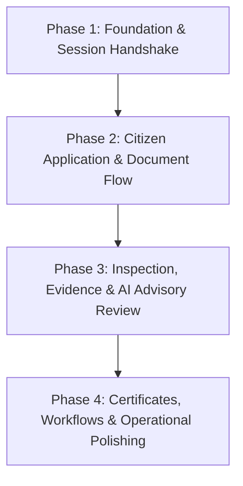

# FireSphere.ai: Frontend–Backend Integration Readiness Audit

**Document Reference:** `docs/integration/frontend_backend_integration_readiness_audit.md`  
**Audit Date:** 2026-10-13  
**Auditor:** Antigravity Integration Engine  
**Project:** FireSphere.ai  
**Scope:** Member 1 (Frontend Citizen & Officer Applications, Admin Web Console, Shared API Client) vs. Member 2 (Spring Boot Core Backend)  
**Status:** **INSPECTION COMPLETE — INTEGRATION BLOCKED PENDING CRITICAL CONTRACT ADAPTERS & ENDPOINT EXPANSION**

---

## 1. Executive Summary

An exhaustive, read-only architectural and implementation audit was conducted across the **FireSphere.ai** workspace to determine whether the current **Member 1 frontend applications** can begin integrating with the existing **Member 2 Spring Boot backend**.

### Key Findings:
1. **Frontend Modernization State:** Member 1 has built a robust, type-safe client architecture consisting of an **Admin Web Console** (Vite + React 19 + TypeScript), a native **Citizen/Officer Mobile Client** (Expo SDK 57 + React Native 0.86 + TypeScript + SQLite/SQLCipher), and a shared **API Client** (`@firesphere/api-client`). Member 1's workspace contains active, uncommitted local changes on git branch `nakul` implementing an **AI Advisory Findings Review drawer**, model provenance tags, spatial bounding-box rendering, and evidence metadata.
2. **Independent Verification of Member 1 Status:** Member 1's automated test suite, typechecks, and production bundle builds were executed and verified independently:
   - Automated tests: **PASSED** (9 test files, 29 tests, 100% pass rate in Vitest).
   - Typechecks: **PASSED** (0 TypeScript errors across `admin-console` and `mobile`).
   - Production bundle build: **PASSED** (Admin Console bundle: 274.90 kB JS, 27.23 kB CSS).
3. **Backend Implementation State:** Member 2 has implemented a foundational Spring Boot 3.2.4 REST application on Java 21 with Spring Security 6, stateless JWT authentication, tenant isolation filters, and 13 functional REST controllers. Member 2 tests run cleanly against an in-memory H2 profile (`Member1ContractTests` passed: 3/3 tests in 16.28s).
4. **Integration Readiness Verdict:** **INTEGRATION CANNOT PROCEED OUT-OF-THE-BOX WITHOUT ADAPTERS.** While specific subsystems (notably **AI Advisory Finding Review**, **Inspection Evidence Upload/Streaming**, and **NOC Application Retrieval**) share exact contract alignment, full end-to-end integration is currently blocked by five critical architectural gaps:
   - **Authentication Shape Discrepancy:** Backend login returns flat `{ accessToken, userId, email, status }`, whereas frontend expects a structured `{ accessToken, refreshToken, user: { id, displayName, email, role } }`.
   - **CORS Configuration Mismatch:** Backend `application-local.yml` hardcodes `cors.allowed-origins: "http://localhost:3000"`, which immediately blocks the Admin Console running on `http://127.0.0.1:5173`.
   - **Missing Top-Level Aggregation & Officer Assignment Endpoints:** Backend only exposes nested inspection endpoints (`/api/v1/noc/applications/{applicationId}/inspections`). It lacks cross-application officer queues (`GET /api/v1/officer/assignments`) and top-level admin lists (`GET /api/v1/inspections`).
   - **NOC Draft Field Discrepancies:** Frontend demo draft form captures `applicant`, `buildingUse`, `floors`; Backend `CreateNocRequest` requires `@NotBlank title` and `buildingName`.
   - **Missing Subsystems:** Certificate archive filtering, certificate listings, certificate renewals, notifications, and GIS layers have zero backend endpoint implementations.

---

## 2. Actual Frontend Locations

The actual frontend implementation is located in the dedicated Member 1 workspace:
- **Root Path:** `C:\Users\athar\OneDrive\Desktop\Firesphere.ai\M1_work`
- **Git Branch:** `nakul` (contains 6 uncommitted, unpushed modified files preserving Member 1's latest UI work)

### Package & Application Breakdown:
| Application / Package | Relative Path | Technology Stack | Entry Point |
| :--- | :--- | :--- | :--- |
| **Admin Web Console** | `M1_work/admin-console` | React 19, TypeScript ~5.9, Vite 7.1, Vanilla CSS | `src/main.tsx`, `src/App.tsx` |
| **Citizen & Officer Mobile App** | `M1_work/mobile` | Expo SDK 57, React Native 0.86, TypeScript, SQLCipher | `index.ts`, `src/App.tsx` |
| **Shared API Client Library** | `M1_work/packages/api-client` | TypeScript, Fetch API, Vitest | `src/client.ts`, `src/types.ts` |

*(Note: Legacy directories `M2_work/Firesphere m2/frontend` and `M2_work/Firesphere m2/mobile` represent initial scaffolding from earlier project phases and are not Member 1's active modernized codebase).*

---

## 3. Actual Backend Locations

The authoritative Spring Boot backend implementation is located in Member 2's workspace:
- **Root Path:** `C:\Users\athar\OneDrive\Desktop\Firesphere.ai\M2_work\Firesphere m2\backend`
- **Technology Stack:** Java 21, Spring Boot 3.2.4, Spring Security, Spring Data JPA, Hibernate 6.4, Flyway, PostgreSQL (H2 in test scope), SpringDoc OpenAPI 2.5.0, OpenPDF 1.3.32, JJWT 0.12.5
- **Build Tool:** Apache Maven 3.9.6 (bundled locally under `M2_work/Firesphere m2/apache-maven-3.9.6`)
- **JDK:** OpenJDK 21.0.2 (bundled locally under `M2_work/Firesphere m2/jdk-21.0.2+13`)

*(Note: `server.js` in `M2_work/Firesphere m2/backend` is a legacy Express/MySQL mock from a sibling project; the Spring Boot application under `src/main/java/com/firesphere/backend` is the sole authoritative backend).*

---

## 4. Frontend Inventory

### 4.1 Architecture & Entry Points
- **Admin Console:** Standard Vite single-page application mounting into `#root` via `index.html`. Single router component managing state transitions across 16 module views (`overview`, `applications`, `inspections`, `incidents`, `officers`, `users`, `organizations`, `assignments`, `vehicles`, `inventory`, `training`, `reports`, `certificates`, `gis`, `notifications`, `settings`).
- **Mobile Client:** Expo cross-platform native client targeting Android/iOS with role-based navigation tabs (`CITIZEN` receives Home, Applications, Updates, Profile; `OFFICER` receives My work, Inspections, Sync, Resources).

### 4.2 API Client Configuration & Fail-Closed Design
- Configuration via environment variables: `VITE_API_BASE_URL` (Admin), `EXPO_PUBLIC_API_BASE_URL` (Mobile), and `VITE_API_CONTRACTS` / `EXPO_PUBLIC_API_CONTRACTS` (JSON mapping operation IDs to relative paths).
- **Fail-Closed Policy:** By design (`packages/api-client/src/client.ts`), if `baseUrl` or a requested `operation` contract path is missing, the client throws `API_NOT_CONFIGURED` or `API_CONTRACT_UNAVAILABLE` without making unverified network requests.
- **Path Prefix:** All API operations prepend `/api/v1/` to configured relative routes.
- **Security Check:** Requires HTTPS outside local development (`http://localhost`).

### 4.3 Default Contract Mappings (`DEFAULT_CONTRACT_PATHS`)
Member 1's latest uncommitted changes pre-populate the following default contracts:
- `'admin.dashboard'` -> `admin/dashboard`
- `'admin.applications'` -> `noc/applications`
- `'admin.inspections'` -> `inspections`
- `'officer.ai.analyses'` -> `noc/applications/{applicationId}/ai-analysis`
- `'officer.ai.analysis'` -> `noc/applications/{applicationId}/ai-analysis/{runId}`
- `'officer.finding.review'` -> `noc/applications/{applicationId}/ai-analysis/{runId}/findings/{findingId}/review`
- `'officer.evidence.list'` -> `inspections/{inspectionId}/evidence`
- `'officer.evidence.file'` -> `inspections/{inspectionId}/evidence/{evidenceId}/file`

### 4.4 State Management & Persistence
- **Admin:** React state (`useState`, `useMemo`, `useRef`), local memory fixtures, and optimistic UI transitions.
- **Mobile:** Encrypted local storage using `expo-sqlite` backed by SQLCipher. Cryptographic database key and authentication tokens stored in `expo-secure-store`. Local sync queue (`syncQueue.ts`) tracking states: `LOCAL_ONLY`, `PENDING_SYNC`, `SYNCING`, `SYNCED`, `SYNC_FAILED`, `CONFLICT`.

### 4.5 Error Handling & Feedback
- `normalizeApiError` converts HTTP errors or JSON payloads to typed `ApiError` (`status`, `code`, `traceId`, `retryable`).
- Automatic retry mechanism (`requestWithRetry`) with exponential backoff (500ms to 4s) for idempotent GET operations encountering 5xx, 408, or 429.
- Automatic 401 handling: Triggers `onUnauthorized` callback, clearing session and displaying sign-in prompt.

### 4.6 Uncommitted Local Changes (Branch `nakul`)
- `admin-console/src/App.tsx`: Added comprehensive **Officer Inspection Review Drawer** containing AI advisory observations, spatial bounding box overlays, statutory verification guidance, provenance tags, and an evidentiary finding review submission form.
- `admin-console/src/styles.css`: Complete styling rules for the review drawer, statutory alert boxes, governance strips, bounding boxes, severity pills, and responsive breakpoints.
- `admin-console/src/dev/mockServices.ts` & `mockServices.test.ts`: Added fixture models and tests for AI analyses, evidence files, and finding review persistence.
- `packages/api-client/src/client.ts` & `types.ts`: Added default routes and TypeScript interfaces for `AiFindingDto`, `AiAnalysisResponse`, `ReviewFindingRequest`, `OfficerReviewResponse`, and `EvidenceResponse`.

---

## 5. Backend Endpoint Inventory

Member 2's Spring Boot backend exposes endpoints categorized into five implementation states:
1. **Implemented Endpoint:** Active controller route with full service and persistence logic.
2. **Partially Implemented Endpoint:** Active controller route but dependent on external integration or restricted to single application context.
3. **Documented but Unimplemented Endpoint:** Mentioned in specifications/OpenAPI but no controller method exists.
4. **Missing Endpoint:** Required by frontend features but completely absent in backend.
5. **Runtime Unverified Endpoint:** Controller exists but unverified against live PostgreSQL/Docker environment.

### 5.1 Controller & Endpoint Catalog
| Controller | HTTP Method & Path | Auth & Role Requirements | Implementation State | Notes |
| :--- | :--- | :--- | :--- | :--- |
| `AuthController` | `POST /api/v1/auth/register` | `permitAll()` | Implemented | Creates citizen account; returns `AuthResponse` |
| `AuthController` | `POST /api/v1/auth/login` | `permitAll()` | Implemented | Verifies BCrypt hash; returns `AuthResponse` |
| `UserController` | `GET /api/v1/users/me` | `hasAuthority('user:read')` | Implemented | Returns current user profile with `role` |
| `UserController` | `PATCH /api/v1/users/me` | `hasAuthority('user:write')` | Implemented | Updates current user profile |
| `UserController` | `GET /api/v1/users` | `hasAuthority('organization:read')` | Implemented | Pageable user list within tenant |
| `UserController` | `GET /api/v1/users/{userId}` | `hasAuthority('organization:read')` | Implemented | Single user detail |
| `UserController` | `POST /api/v1/users` | `hasAuthority('organization:write')` | Implemented | Admin user creation |
| `UserController` | `PATCH /api/v1/users/{userId}` | `hasAuthority('organization:write')` | Implemented | Admin update user status/role |
| `OrganizationController` | `GET /api/v1/organizations/me` | `hasAuthority('organization:read')` | Implemented | Current organization profile |
| `OrganizationController` | `PATCH /api/v1/organizations/me` | `hasAuthority('organization:write')` | Implemented | Update organization profile |
| `NocController` | `POST /api/v1/noc/applications` | `noc:create` or `ROLE_CITIZEN` | Implemented | Creates NOC application in `DRAFT` status |
| `NocController` | `GET /api/v1/noc/applications` | `noc:read` or `ROLE_CITIZEN` | Implemented | Pageable NOC list for tenant |
| `NocController` | `GET /api/v1/noc/applications/{id}` | `noc:read` or `ROLE_CITIZEN` | Implemented | Single NOC detail |
| `NocController` | `PATCH /api/v1/noc/applications/{id}` | `noc:update` or `ROLE_CITIZEN` | Implemented | Update draft fields (ignores mass status assignment) |
| `NocController` | `POST /api/v1/noc/applications/{id}/submit` | `noc:update` or `ROLE_CITIZEN` | Implemented | Transitions NOC to `SUBMITTED` |
| `DocumentController` | `POST /api/v1/noc/applications/{appId}/documents` | `noc:update` or `ROLE_CITIZEN` | Implemented | Multipart file upload (`documentType`, `file`) |
| `DocumentController` | `GET /api/v1/noc/applications/{appId}/documents` | `noc:read` or `ROLE_CITIZEN` | Implemented | Lists documents for application |
| `DocumentController` | `POST /api/v1/noc/applications/{appId}/documents/{docId}/verify` | `noc:update` | Implemented | Officer verification of uploaded document |
| `PaymentController` | `POST /api/v1/noc/applications/{appId}/payments` | `noc:update` or `ROLE_CITIZEN` | Partially Implemented | Initiates mock/gateway payment session |
| `PaymentController` | `POST /api/v1/payments/callback` | `permitAll()` (HMAC signed) | Implemented | Webhook callback verification |
| `InspectionController` | `POST /api/v1/noc/applications/{appId}/inspections` | `noc:update` | Implemented | Schedules inspection for application |
| `InspectionController` | `GET /api/v1/noc/applications/{appId}/inspections` | `noc:read` or `ROLE_CITIZEN` | Implemented | Lists inspections for single application |
| `InspectionController` | `GET /api/v1/noc/applications/{appId}/inspections/{inspId}` | `noc:read` or `ROLE_CITIZEN` | Implemented | Single inspection detail |
| `InspectionController` | `POST /api/v1/noc/applications/{appId}/inspections/{inspId}/start` | `noc:update` | Implemented | Transitions inspection to `IN_PROGRESS` |
| `InspectionController` | `POST /api/v1/noc/applications/{appId}/inspections/{inspId}/complete` | `noc:update` | Implemented | Transitions inspection to `COMPLETED` |
| `InspectionEvidenceController` | `POST /api/v1/inspections/{inspId}/evidence` | Authenticated | Implemented | Multipart evidence upload with GPS & timestamp |
| `InspectionEvidenceController` | `GET /api/v1/inspections/{inspId}/evidence` | Authenticated | Implemented | Lists evidence files for inspection |
| `InspectionEvidenceController` | `GET /api/v1/inspections/{inspId}/evidence/{evId}/file` | Authenticated | Implemented | Streams binary image/photo |
| `ChecklistController` | `POST /api/v1/noc/applications/{appId}/checklists` | `noc:update` | Implemented | Generates checklist for application |
| `ChecklistController` | `GET /api/v1/noc/applications/{appId}/checklists` | `noc:read` or `ROLE_CITIZEN` | Implemented | Lists checklists for application |
| `ChecklistController` | `GET /api/v1/noc/applications/{appId}/checklists/{chId}` | `noc:read` or `ROLE_CITIZEN` | Implemented | Single checklist detail |
| `ChecklistController` | `PATCH /api/v1/noc/applications/{appId}/checklists/{chId}/items/{itId}` | `noc:update` | Implemented | Updates single checklist item |
| `InspectionChecklistController` | `GET /api/v1/inspections/checklist-templates` | `noc:read`, Officer, Admin, Citizen | Implemented | Lists NBC 2016 statutory templates |
| `InspectionChecklistController` | `GET /api/v1/inspections/checklist-templates/{tId}` | Authenticated | Implemented | Details of versioned template |
| `InspectionChecklistController` | `POST /api/v1/inspections/{inspId}/checklist` | `noc:update`, Officer, Admin | Implemented | Instantiates checklist for inspection |
| `InspectionChecklistController` | `GET /api/v1/inspections/{inspId}/checklist` | Authenticated | Implemented | Inspection checklist with responses & AI links |
| `InspectionChecklistController` | `GET /api/v1/inspections/{inspId}/checklist/items/{itId}` | Authenticated | Implemented | Item detail with findings |
| `InspectionChecklistController` | `PUT /api/v1/inspections/{inspId}/checklist/items/{itId}/response` | `noc:update`, Officer, Admin | Implemented | Records officer PASS/FAIL/NA response |
| `InspectionChecklistController` | `POST /api/v1/inspections/{inspId}/checklist/items/{itId}/ai-links` | `noc:update`, Officer, Admin | Implemented | Links AI finding to question |
| `InspectionChecklistController` | `PATCH /api/v1/inspections/{inspId}/checklist/items/{itId}/ai-links/{lId}` | Officer, Admin | Implemented | Reviews AI advisory link |
| `InspectionChecklistController` | `POST /api/v1/inspections/{inspId}/checklist/map-ai-findings` | `noc:update`, Officer, Admin | Implemented | Deterministic mapping of CV/VLM findings |
| `InspectionChecklistController` | `GET /api/v1/inspections/{inspId}/checklist/ai-mappings` | Officer, Admin | Implemented | Gets mapped/unmapped findings |
| `InspectionChecklistController` | `POST /api/v1/inspections/{inspId}/checklist/items/{itId}/evidence` | `noc:update`, Officer, Admin | Implemented | Links photo evidence to checklist item |
| `InspectionChecklistController` | `POST /api/v1/inspections/{inspId}/checklist/complete` | Officer, Admin | Implemented | Validates mandatory answers & completes checklist |
| `AiAnalysisController` | `POST /api/v1/noc/applications/{appId}/ai-analysis` | `noc:ai:request` | Implemented | Triggers AI pipeline run via Member 4 service |
| `AiAnalysisController` | `GET /api/v1/noc/applications/{appId}/ai-analysis` | `noc:ai:read` | Implemented | Lists all analysis runs for application |
| `AiAnalysisController` | `GET /api/v1/noc/applications/{appId}/ai-analysis/{runId}` | `noc:ai:read` | Implemented | Detailed analysis run with findings & provenance |
| `AiAnalysisController` | `POST /api/v1/noc/applications/{appId}/ai-analysis/{runId}/findings/{fId}/review` | `ROLE_OFFICER` or `ROLE_ADMIN` | Implemented | Persists officer review (CONFIRMED/DISMISSED/MODIFIED) |
| `CertificateController` | `POST /api/v1/noc/applications/{appId}/certificate` | `noc:certificate:generate` | Implemented | Generates PDF & SHA-256 (requires APPROVED state) |
| `CertificateController` | `GET /api/v1/noc/applications/{appId}/certificate` | `noc:read` | Implemented | Returns certificate metadata |
| `WorkflowController` | `POST /api/v1/noc/applications/{id}/transitions` | `noc:update`, `noc:approve`, Citizen | Implemented | Executes state machine transitions |
| *Missing* | `GET /api/v1/inspections` | — | Missing | Top-level cross-application inspection list |
| *Missing* | `GET /api/v1/officer/assignments` | — | Missing | Authenticated officer's assigned work queue |
| *Missing* | `GET /api/v1/certificates` | — | Missing | List/filter all generated and archived certificates |
| *Missing* | `POST /api/v1/noc/applications/{appId}/renew` | — | Missing | NOC certificate renewal initiation |
| *Missing* | `GET /api/v1/notifications` | — | Missing | User/officer platform notification feed |
| *Missing* | `GET /api/v1/gis/layers` | — | Missing | Spatial stations, hydrants, and assets |

---

## 6. Contract Comparison Matrix

| Feature / UI Screen | Frontend Operation / Service | HTTP Method | Frontend Expected Route | Actual Backend Route | Compatibility Status | Discrepancy & Required Changes | Owner |
| :--- | :--- | :--- | :--- | :--- | :--- | :--- | :--- |
| **Authentication: Sign In** | `auth.login` (`unavailableAuthAdapter.login`) | POST | `/api/v1/auth/login` | `/api/v1/auth/login` | **READY_WITH_ADAPTER** | Request fields match (`email`, `password`). Backend response is flat `{ accessToken, userId, email, status }`, missing `role`, `displayName`, and `refreshToken`. Frontend needs adapter to fetch `/api/v1/users/me` to hydrate session. | Member 1 |
| **Authentication: Current User** | `auth.me` | GET | `/api/v1/auth/me` | `/api/v1/users/me` | **READY_WITH_ADAPTER** | Route path is `/api/v1/users/me` in backend. Response returns `id`, `email`, `role`, `status`, `organizationId`. Map `auth.me` -> `users/me`. | Member 1 |
| **NOC Application: Create Draft** | `citizen.application.create` | POST | `/api/v1/noc/applications` | `/api/v1/noc/applications` | **FRONTEND_CHANGE_REQUIRED** | Backend requires `title` and `buildingName` (`@NotBlank`). Frontend draft captures `applicant`, `buildingUse`, `floors`. Frontend form must collect `title` and `buildingName`. | Member 1 |
| **NOC Application: List** | `admin.applications` | GET | `/api/v1/noc/applications` | `/api/v1/noc/applications` | **READY** | Spring Data `Page<NocResponse>` matches `collectPages` pagination model (`items`, `page`, `size`, `totalItems`). | None |
| **NOC Application: Get Detail** | `citizen.application.detail` | GET | `/api/v1/noc/applications/{id}` | `/api/v1/noc/applications/{id}` | **READY** | Direct UUID parameter match. | None |
| **NOC Application: Update Draft** | `citizen.application.update` | PATCH | `/api/v1/noc/applications/{id}` | `/api/v1/noc/applications/{id}` | **FRONTEND_CHANGE_REQUIRED** | Fields must align with `title`, `description`, `buildingName`, `address`. | Member 1 |
| **NOC Application: Submit** | `citizen.application.submit` | POST | `/api/v1/noc/applications/{id}/submit` | `/api/v1/noc/applications/{id}/submit` | **READY** | Direct route and idempotency support match. | None |
| **Document Upload** | `citizen.documents` | POST | `/api/v1/citizen/documents` | `/api/v1/noc/applications/{appId}/documents` | **READY_WITH_ADAPTER** | Backend requires multipart with `documentType` and `file`. Frontend must map route with `applicationId`. | Member 1 |
| **Officer Work Queue** | `officer.assignments` | GET | `/api/v1/officer/assignments` | *None* | **ENDPOINT_MISSING** | Backend has no officer assignment queue endpoint. | Member 2 |
| **Admin Inspection List** | `admin.inspections` | GET | `/api/v1/inspections` | *None* | **ENDPOINT_MISSING** | Backend only exposes inspections nested under `/api/v1/noc/applications/{appId}/inspections`. | Member 2 |
| **Inspection Evidence List** | `officer.evidence.list` | GET | `/api/v1/inspections/{inspId}/evidence` | `/api/v1/inspections/{inspId}/evidence` | **READY** | Exact route and DTO match (`EvidenceResponse`). | None |
| **Inspection Evidence Photo Stream** | `officer.evidence.file` | GET | `/api/v1/inspections/{inspId}/evidence/{evId}/file` | `/api/v1/inspections/{inspId}/evidence/{evId}/file` | **READY** | Exact route and binary streaming match. | None |
| **Inspection Evidence Upload** | `officer.evidence.upload` | POST | `/api/v1/inspections/{inspId}/evidence` | `/api/v1/inspections/{inspId}/evidence` | **READY_WITH_ADAPTER** | Multipart parameters `file`, `captureTimestamp`, `latitude`, `longitude` match backend. Mobile sync queue adapter needed. | Member 1 |
| **Inspection Checklist Query** | `officer.checklist.get` | GET | `/api/v1/inspections/{inspId}/checklist` | `/api/v1/inspections/{inspId}/checklist` | **FRONTEND_CHANGE_REQUIRED** | Backend endpoint implemented. Mobile must replace local generic checklist fixture with API call. | Member 1 |
| **Inspection Checklist Response** | `officer.checklist.respond` | PUT | `/api/v1/inspections/{inspId}/checklist/items/{itId}/response` | `/api/v1/inspections/{inspId}/checklist/items/{itId}/response` | **FRONTEND_CHANGE_REQUIRED** | Backend expects `responseStatus` (`COMPLIANT`, `NON_COMPLIANT`, `NOT_APPLICABLE`), remarks, GPS. Mobile must wire to API. | Member 1 |
| **AI Advisory Analysis List** | `officer.ai.analyses` | GET | `/api/v1/noc/applications/{appId}/ai-analysis` | `/api/v1/noc/applications/{appId}/ai-analysis` | **READY** | Exact route and response fields match (`AiAnalysisResponse`). | None |
| **AI Finding Human Review** | `officer.finding.review` | POST | `/api/v1/noc/applications/{appId}/ai-analysis/{runId}/findings/{fId}/review` | `/api/v1/noc/applications/{appId}/ai-analysis/{runId}/findings/{fId}/review` | **READY** | Exact route, request DTO (`ReviewFindingRequest`), and officer verification match. | None |
| **Certificate View** | `citizen.certificate` | GET | `/api/v1/noc/applications/{appId}/certificate` | `/api/v1/noc/applications/{appId}/certificate` | **READY** | Exact route match. Returns public certificate ID, status, checksum, artifact ref. | None |
| **Certificate Generate** | `admin.certificate.generate` | POST | `/api/v1/noc/applications/{appId}/certificate` | `/api/v1/noc/applications/{appId}/certificate` | **READY** | Exact match. Requires `APPROVED` status and `noc:certificate:generate` permission. | None |
| **Archived Certificates Filter** | `admin.certificates` | GET | `/api/v1/certificates?status=ARCHIVED` | *None* | **ENDPOINT_MISSING** | Backend has no cross-application certificate query or archive endpoint. | Member 2 |
| **Certificate Renewal** | `citizen.renewal` | POST | `/api/v1/noc/applications/{appId}/renew` | *None* | **ENDPOINT_MISSING** | Backend workflow state machine has no `RENEW` transition. | Member 2 & 3 |
| **Notifications Inbox** | `citizen.notifications` | GET | `/api/v1/notifications` | *None* | **ENDPOINT_MISSING** | Backend has no notification provider or repository. | Member 2 |
| **GIS Infrastructure Layers** | `gis.layers` | GET | `/api/v1/gis/layers` | *None* | **ENDPOINT_MISSING** | Backend has no GIS spatial endpoints. | Member 2 |

---

## 7. Authentication and Authorization Findings

### 7.1 Token Format and Flow
- Backend uses **stateless HMAC-SHA256 JWT tokens** generated by `JwtService.java`.
- Token contains `sub: <UUID>`, `iss: firesphere.ai`, `iat`, `exp` (default 24 hours).
- **Critical Finding:** The token payload currently contains **no embedded roles or tenant claims**.
- When `JwtAuthenticationFilter` processes a request, it extracts `sub`, calls `CustomUserDetailsService.loadUserByUsername(userId)` which executes a database query on `users` table to load `status`, `role`, and `organization_id`, and constructs an `AuthenticatedUser`.
- **Session Expiry & Refresh:** Backend does NOT implement refresh tokens or `/api/v1/auth/refresh`. When the 24-hour token expires, requests receive 401. Frontend's `types.ts` defines optional `refreshToken`, but client falls back to re-login upon 401.

### 7.2 Authorization Roles and Authority Mapping
Backend defines four roles in `Role.java`:
1. `CITIZEN`: `user:read`, `user:write`, `noc:read`, `noc:create`, `noc:ai:read`, `noc:ai:request`.
2. `OFFICER`: `user:read`, `organization:read`, `noc:read`, `noc:update`, `inspection:read`, `inspection:update`, `noc:ai:read`, `noc:ai:request`.
3. `APPROVAL_AUTHORITY`: `user:read`, `organization:read`, `noc:read`, `noc:approve`, `noc:reject`, `noc:ai:read`, `noc:certificate:generate`.
4. `ADMIN`: Full permissions across user, organization, NOC, inspection, AI, and certificate generation.

### 7.3 Tenant Isolation & Security Boundary Verification
- **Verified via Unit & Security Tests:** Backend enforces strict tenant boundaries at the repository and service layers.
- `SecurityAuditTests` and `SecurityExpandedAuditTests` confirm:
  - Unauthenticated requests receive HTTP 401.
  - Invalid tokens or signatures receive HTTP 401.
  - Cross-tenant application, document, and inspection access attempts receive HTTP 403 or 404.
  - Officers can only be assigned within the same organization (`InspectionAssignmentTests`).
  - Mass assignment attacks attempting to alter NOC status via PATCH are ignored.
- **Frontend Authorization Posture:** Frontend `App.tsx` explicitly documents that hidden UI elements do not replace server authorization. Role pills and disabled buttons are presentation-only.

### 7.4 CORS Origin Conflict
- In `backend/src/main/resources/application-local.yml`, `cors.allowed-origins` is set to `"http://localhost:3000"`.
- Member 1's Admin Console binds to `http://127.0.0.1:5173`.
- Any browser-initiated request from the Admin Console will fail with a browser CORS error unless Member 2 updates the allowed origins or frontend proxies through port 3000.

---

## 8. Missing or Mismatched Endpoints

### 8.1 Critical Missing Endpoints (Backend Action Required)
1. `GET /api/v1/officer/assignments`
   - *Requirement:* Authenticated officer mobile app needs to query all inspections assigned to the logged-in officer across all applications in their organization.
2. `GET /api/v1/inspections`
   - *Requirement:* Admin console overview and inspection monitoring table need a pageable list of all inspections for the organization without requiring an `applicationId` path variable.
3. `GET /api/v1/certificates` (with query filter `?status=ARCHIVED`)
   - *Requirement:* Admin console certificate table and archived certificate audit view.
4. `POST /api/v1/noc/applications/{applicationId}/renew`
   - *Requirement:* Citizen mobile app certificate renewal initiation.
5. `GET /api/v1/notifications`
   - *Requirement:* Mobile updates tab and admin notifications bell.

### 8.2 Route Mismatches (Frontend Action Required)
1. `auth.me`: Frontend expects `/api/v1/auth/me` -> Backend provides `/api/v1/users/me`.
2. `citizen.documents`: Frontend operation unmapped -> Backend requires `/api/v1/noc/applications/{applicationId}/documents`.

---

## 9. Runtime Verification Status

### 9.1 Verification Executed During This Audit
1. **Frontend Automated Unit/Model Tests:**
   - Command: `npm test` in `M1_work`
   - Result: **9 test files passed, 29 tests passed** (including newly added tests for finding reviews).
2. **Frontend Static Typecheck:**
   - Command: `npm run typecheck` in `M1_work`
   - Result: **Passed cleanly** across `admin-console` and `mobile`.
3. **Frontend Production Build:**
   - Command: `npm run build` in `M1_work`
   - Result: **Passed**. Produced production bundle (`dist/index.html`, `dist/assets/index-BwWae50Q.css` [27.23 kB], `dist/assets/index-CpKcldeo.js` [274.90 kB]).
4. **Backend Contract Integration Test:**
   - Command: `mvn.cmd test -Dtest=Member1ContractTests` in `M2_work/Firesphere m2/backend`
   - Result: **BUILD SUCCESS** (3 tests run, 0 failures, 0 errors, 16.28s execution time).
5. **Static Inspection:** All 13 Spring Boot controllers, DTOs, security filters, entity definitions, and frontend components were statically analyzed.

### 9.2 Requirements for Safe Backend Startup
To launch the Spring Boot backend locally without risking database corruption or unverified migrations:
- **Prerequisites:**
  - PostgreSQL 15+ running on port 5432 with database `firesphere`.
  - Schema must be initialized using **approved Member 3 Flyway migrations** (`M3_work/IP_DB/database/migrations`).
- **Required Environment Variables:**
  - `SPRING_PROFILES_ACTIVE=local`
  - `JWT_SECRET=<secure-random-32-byte-string>`
  - `DB_HOST=localhost`
  - `DB_PORT=5432`
  - `DB_NAME=firesphere`
  - `DB_USERNAME=postgres`
  - `DB_PASSWORD=postgres`
  - `CORS_ALLOWED_ORIGINS=http://127.0.0.1:5173,http://localhost:5173,http://localhost:3000`
- **Safety Precaution:** Never set `spring.jpa.hibernate.ddl-auto=create` or `create-drop` in production or shared environments. Keep `ddl-auto: none`.

---

## 10. Recommended Integration Order

Integration should proceed in four strict sequential phases to minimize blast radius and unblock parallel testing:

### Phase 1: Foundation & Session Handshake (Unblocks Base Connectivity)
1. **Member 2:** Add `http://127.0.0.1:5173` to `cors.allowed-origins` in `application-local.yml`.
2. **Member 1:** Implement real `authAdapter.ts` in mobile and `signIn` in Admin Console calling `/api/v1/auth/login`, then immediately fetching `/api/v1/users/me` to populate session user and role.
3. **Verification:** Confirm successful login and session persistence in browser and emulator.

### Phase 2: Citizen Application & Document Submission
1. **Member 1:** Update `CitizenNocFlow.tsx` form fields to match `CreateNocRequest` (`title`, `buildingName`, `address`, `description`).
2. **Member 1:** Wire document file picker to multipart upload endpoint `/api/v1/noc/applications/{applicationId}/documents`.
3. **Member 2:** Expose `GET /api/v1/noc/applications` for the citizen and verify applicant-level data isolation.

### Phase 3: Inspection, Photo Evidence & AI Advisory Review (Highest Value)
1. **Member 2:** Implement `GET /api/v1/officer/assignments` returning inspections assigned to the logged-in officer.
2. **Member 1:** Connect mobile `OfficerInspectionFlow.tsx` to fetch assigned work from `officer.assignments`.
3. **Member 1 & 2:** Verify evidence photo upload (`POST /api/v1/inspections/{inspectionId}/evidence`) and binary photo streaming.
4. **Member 1:** Connect Admin Console review drawer to live `/api/v1/noc/applications/{applicationId}/ai-analysis` and verify that clicking **Record Finding Verification** persists `ReviewFindingRequest` into PostgreSQL without advancing statutory NOC state.

### Phase 4: Certificates, Workflow Transitions & Archiving
1. **Member 2:** Implement `GET /api/v1/inspections` and `GET /api/v1/certificates` aggregation endpoints.
2. **Member 2 & 3:** Add statutory renewal transition rules to workflow state machine.
3. **Member 1:** Replace mock certificate preview with authoritative PDF download link from `/api/v1/noc/applications/{applicationId}/certificate`.

---

## 11. Parallel Development Ownership Matrix

To prevent code churn and branch merge conflicts, ownership boundaries are strictly demarcated across the four team members:

| Domain / Responsibility | Primary Owner | Directory / File Boundary | Restricted Files (Do Not Touch) |
| :--- | :--- | :--- | :--- |
| **Frontend UI, Web Console & Mobile App** | **Member 1** | `M1_work/admin-console/**` `M1_work/mobile/**` `M1_work/packages/api-client/**` | Backend controllers, PostgreSQL migrations, AI perception models |
| **Spring Boot API & Business Logic** | **Member 2** | `M2_work/Firesphere m2/backend/src/**` | Frontend React/React Native source, DB schema migrations, AI model code |
| **Database Schema, Migrations & Infrastructure** | **Member 3** | `M3_work/IP_DB/**` `M2_work/Firesphere m2/backend/src/main/resources/db/migration/**` | Frontend code, backend service business logic |
| **AI Perception, CV/VLM Pipeline & Inference** | **Member 4** | `ai-service/**` `datasets/**` | Spring Boot controllers, frontend client code, DB schema |

---

## 12. Shared-File Conflict Risks & Coordination Rules

### High-Risk Touchpoints:
1. **`M1_work/packages/api-client/src/types.ts`:** Both Member 1 and Member 2 rely on these DTO types.
   - *Rule:* Any field modification in Java DTOs (`AiAnalysisResponse.java`, `NocResponse.java`, `EvidenceResponse.java`) must be communicated before updating `types.ts`.
2. **`M2_work/Firesphere m2/backend/src/main/resources/db/migration/`:**
   - *Rule:* Member 2 must NOT author custom DTO-driven SQL migrations. All migrations must be supplied by Member 3.
3. **Uncommitted Work in `M1_work`:**
   - *Rule:* The 6 modified files on branch `nakul` must not be reset, cleaned, or overwritten. Member 1 must commit this feature branch before integrating upstream changes.

---

## 13. Exact Blockers and Next Actions

### Immediate Blockers:
1. **CORS Blocker:** Admin Console cannot talk to backend on `localhost:8080` due to `cors.allowed-origins: "http://localhost:3000"`.
2. **Auth DTO Gap:** Frontend cannot hydrate user session directly from login response.
3. **Missing Work Queue Endpoint:** Mobile officer flow cannot download real assignments.
4. **Draft Schema Gap:** Citizen cannot submit draft without `title` and `buildingName`.

### Actionable Next Steps:
- [ ] **Member 2 Action 1:** Update `cors.allowed-origins` in `application-local.yml` to include `http://127.0.0.1:5173` and `http://localhost:5173`.
- [ ] **Member 2 Action 2:** Implement `GET /api/v1/officer/assignments` in `InspectionController` or dedicated `OfficerAssignmentController`.
- [ ] **Member 1 Action 1:** Commit current uncommitted working tree on branch `nakul` with descriptive commit message (`feat(ui): add officer ai advisory review drawer and finding persistence`).
- [ ] **Member 1 Action 2:** Update `CitizenNocFlow.tsx` form to include statutory `title` and `buildingName` inputs.
- [ ] **Member 1 Action 3:** Implement session hydration in `mobile/src/auth/authAdapter.ts` combining `/api/v1/auth/login` and `/api/v1/users/me`.
- [ ] **Member 3 Action 1:** Provide authoritative Flyway V2 migrations for user organization mapping and inspection checklist storage in PostgreSQL.

---

## 14. Files Inspected

### Member 1 Frontend:
- `M1_work/README.md`
- `M1_work/IMPLEMENTATION_STATUS.md`
- `M1_work/PLAN_GAP_ANALYSIS.md`
- `M1_work/package.json`
- `M1_work/packages/api-client/src/client.ts`
- `M1_work/packages/api-client/src/types.ts`
- `M1_work/packages/api-client/src/client.test.ts`
- `M1_work/packages/api-client/src/client.retry.test.ts`
- `M1_work/admin-console/package.json`
- `M1_work/admin-console/src/App.tsx`
- `M1_work/admin-console/src/styles.css`
- `M1_work/admin-console/src/tableModel.ts`
- `M1_work/admin-console/src/dev/mockServices.ts`
- `M1_work/admin-console/src/dev/mockServices.test.ts`
- `M1_work/mobile/package.json`
- `M1_work/mobile/src/App.tsx`
- `M1_work/mobile/src/auth/AuthContext.tsx`
- `M1_work/mobile/src/auth/authAdapter.ts`
- `M1_work/mobile/src/features/citizen/CitizenNocFlow.tsx`
- `M1_work/mobile/src/features/citizen/nocModel.ts`
- `M1_work/mobile/src/features/officer/OfficerInspectionFlow.tsx`
- `M1_work/mobile/src/storage/offlineDatabase.ts`
- `M1_work/mobile/src/storage/syncQueue.ts`

### Member 2 Backend:
- `M2_work/Firesphere m2/backend/pom.xml`
- `M2_work/Firesphere m2/backend/README.md`
- `M2_work/Firesphere m2/backend/server.js` (legacy express mock)
- `M2_work/Firesphere m2/backend/src/main/resources/application.yml`
- `M2_work/Firesphere m2/backend/src/main/resources/application-local.yml`
- `M2_work/Firesphere m2/backend/src/main/resources/db/migration/V1__init.sql`
- `com.firesphere.backend.auth.controller.AuthController`
- `com.firesphere.backend.auth.service.AuthService`
- `com.firesphere.backend.auth.dto.AuthResponse`, `LoginRequest`, `RegisterRequest`
- `com.firesphere.backend.user.controller.UserController`
- `com.firesphere.backend.user.dto.UserResponse`
- `com.firesphere.backend.organization.controller.OrganizationController`
- `com.firesphere.backend.noc.controller.NocController`
- `com.firesphere.backend.noc.dto.CreateNocRequest`, `UpdateNocRequest`, `NocResponse`
- `com.firesphere.backend.noc.entity.NocStatus`
- `com.firesphere.backend.document.controller.DocumentController`
- `com.firesphere.backend.payment.controller.PaymentController`
- `com.firesphere.backend.inspection.controller.InspectionController`
- `com.firesphere.backend.inspection.controller.InspectionEvidenceController`
- `com.firesphere.backend.inspection.service.NocInspectionService`
- `com.firesphere.backend.inspection.dto.EvidenceResponse`, `ScheduleInspectionRequest`
- `com.firesphere.backend.checklist.controller.ChecklistController`
- `com.firesphere.backend.checklist.controller.InspectionChecklistController`
- `com.firesphere.backend.ai.controller.AiAnalysisController`
- `com.firesphere.backend.ai.dto.AiAnalysisResponse`, `ReviewFindingRequest`
- `com.firesphere.backend.certificate.controller.CertificateController`
- `com.firesphere.backend.certificate.service.CertificateService`
- `com.firesphere.backend.workflow.controller.WorkflowController`
- `com.firesphere.backend.workflow.model.WorkflowAction`
- `com.firesphere.backend.common.security.SecurityConfig`
- `com.firesphere.backend.common.security.JwtAuthenticationFilter`
- `com.firesphere.backend.common.security.JwtService`
- `com.firesphere.backend.common.security.CustomUserDetailsService`
- `com.firesphere.backend.common.security.TenantContext`
- `com.firesphere.backend.common.security.Role`
- `com.firesphere.backend.common.exception.GlobalExceptionHandler`
- `com.firesphere.backend.common.response.ApiErrorResponse`
- `com.firesphere.backend.Member1ContractTests`
- `com.firesphere.backend.InspectionAssignmentTests`
- `com.firesphere.backend.SecurityAuditTests`
- `com.firesphere.backend.SecurityExpandedAuditTests`
- `com.firesphere.backend.CorsProductionSafetyTests`
- `com.firesphere.backend.OpenApiContractTests`

---

## 15. Files Created or Modified

- **Created:** `docs/integration/frontend_backend_integration_readiness_audit.md` (this report)
- **Modified:** *None* (Preserved all existing files, uncommitted changes, branches, and configurations in accordance with safety instructions).

---

## 16. Tests Actually Executed

1. `M1_work`: `npm test` -> 9 files, 29 tests passed (Vitest v5.0.3, 1.77s).
2. `M1_work`: `npm run typecheck` -> Passed (tsc -b and tsc --noEmit, 0 errors).
3. `M1_work`: `npm run build` -> Passed (Vite v7.3.6 production build).
4. `M2_work/Firesphere m2/backend`: `mvn test -Dtest=Member1ContractTests` -> Passed (3 tests, 0 failures, 0 errors, 16.28s).

---

## 17. Explicit Stop Point

**AUDIT AND REPORTING COMPLETE.**  
No source code, configuration files, git branches, or database schemas have been modified.  
Integration changes must remain on hold until team members review the contract compatibility matrix and resolve the 4 immediate blockers noted in Section 13.
