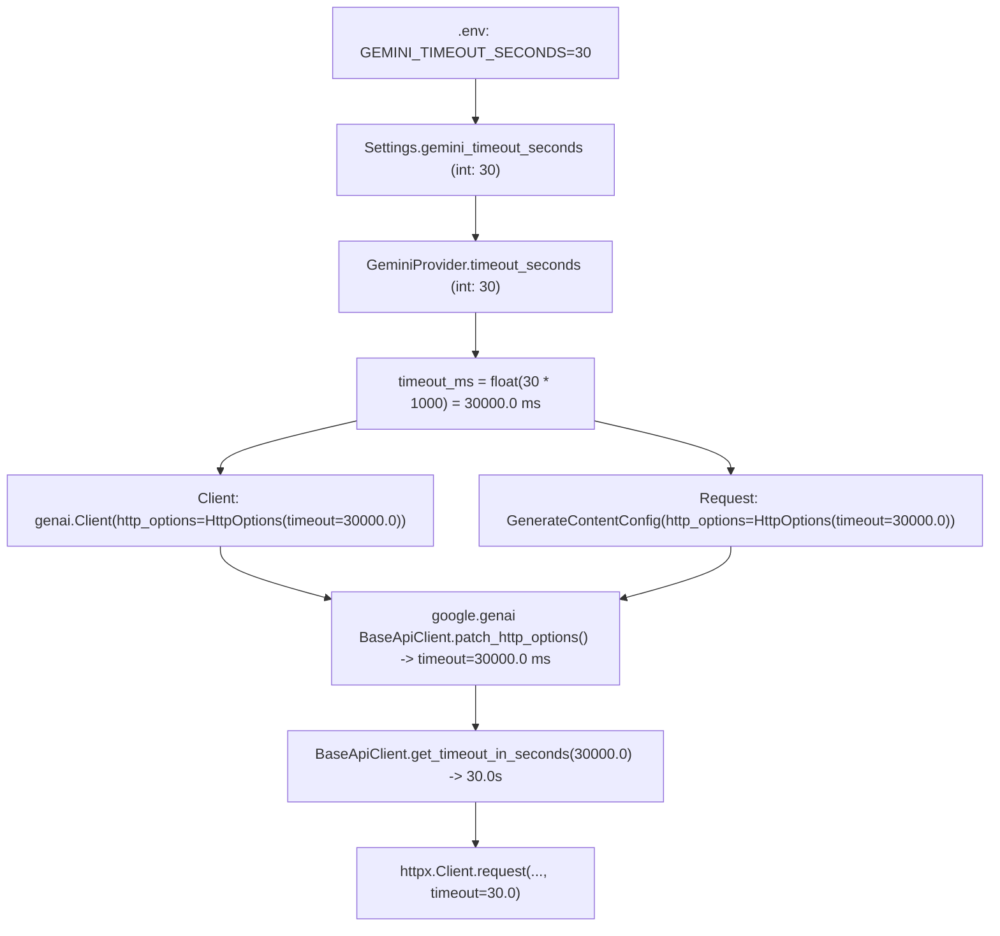

# FireSphere.ai — Phase 10A.6 Gemini HTTP 504 Timeout and Retry Architecture Audit Report

**Document Date:** October 12, 2026  
**Execution Context:** Phase 10A.6 — Offline Audit of Timeout Configuration, SDK HttpOptions, and Retry Architecture  
**Scope:** Client/Request Timeout Trace, SDK Tenacity vs. Application Retry Multiplier Audit, Error Handling Inspection, Offline Mock Test Verification, and Code Hardening  
**Final Verdict:** **PARTIALLY_DIAGNOSED**  
*(Client-side timeout trace, SDK precedence, and retry architecture were fully audited; an accidental retry multiplication defect was diagnosed and corrected; however, the internal cloud root cause within Google's inference cluster causing the 29.3-second generation delay cannot be directly inspected or established)*  
**Live Content Generation Dispatched in this Phase:** **NONE (Offline-Only Phase Strictly Observed)**  
**Runtime Governance State:** CV Gate: `NOT_APPROVED` | CV Calibration: `NOT_CALIBRATED` | Human Verification: `requiresOfficerVerification=True`  

---

## 1. Executive Summary

During Phase 10A.5, a controlled live request using the new API key against `gemini-3.8-flash` authenticated successfully (`models.get` returned 200 OK), but the single generation request was held open for **29,289.11 ms** (~29.3 seconds) before Google's API gateway returned **`HTTP/1.1 504 Gateway Timeout`** (`ServerError`).

In Phase 10A.6, a comprehensive **offline-only** audit was conducted across [`ai-service/app/core/config.py`](file:///C:/Users/athar/OneDrive/Desktop/Firesphere.ai/ai-service/app/core/config.py), [`ai-service/app/models/gemini_provider.py`](file:///C:/Users/athar/OneDrive/Desktop/Firesphere.ai/ai-service/app/models/gemini_provider.py), and the installed `google-genai` SDK (`google-genai==2.29.0`).

### Key Findings:
1. **Timeout Configuration Traced (30.0s Effective Socket Timeout Confirmed):**
   - Configured setting: `gemini_timeout_seconds = 30`.
   - Converted correctly to milliseconds for the SDK: `timeout_ms = 30000.0`.
   - Both client-level and request-level configurations pass `30000.0` ms.
   - The installed SDK divides milliseconds by 1,000 (`get_timeout_in_seconds(30000.0) -> 30.0s`) and supplies it directly to `httpx.Client.request(timeout=30.0)`.
   - The observed failure at **29.29s** was **not** a client-side `ReadTimeout` abortion. The client connection remained healthy and open until Google's reverse-proxy / API gateway terminated the request upstream at ~29.3 seconds and returned an explicit `HTTP 504 Gateway Timeout` response.
2. **Retry Multiplier Defect Identified & Corrected:**
   - Prior to this audit, `self.max_retries` was simultaneously supplied to **both** SDK-level `types.HttpRetryOptions(attempts=max(1, self.max_retries))` and the application-level loop in `_call_gemini_with_retries` (`max_attempts = max(1, self.max_retries)`).
   - Because `google-genai` uses `tenacity.Retrying` on HTTP 504/503/429 internally, each invocation of `generate_content` could execute up to $N$ HTTP calls. On failure, `_call_gemini_with_retries` would catch the error and invoke `generate_content` again up to $N$ times, permitting an accidental multiplication of up to $N \times N$ HTTP calls (e.g. $3 \times 3 = 9$ calls when `max_retries=3`).
   - **Correction Applied:** Request-level `gen_config` now explicitly fixes `HttpRetryOptions(attempts=1)`, delegating all retry pacing and attempt counting exclusively to `_call_gemini_with_retries`. This strictly bounds total HTTP calls to `max_attempts` ($1 \times M = M$), completely eliminating the multiplier.
3. **Sanitized Error Metadata Enhanced:**
   - When an `errors.APIError` occurs, the numeric HTTP status code (e.g. `HTTP 504`, `HTTP 503`) is now safely extracted and preserved in `result.error` (e.g. `Gemini API request failed: ServerError (HTTP 504)`) without leaking credentials, request payloads, or authorization headers.
4. **All Tests Passing:**
   - 93/93 offline tests passed (including 2 newly added mock regression tests verifying HTTP 504 handling and retry decoupling).

---

## 2. Timeout Configuration Trace

The complete timeout path was audited from environment variables to network socket configuration:



### 2.1 Detailed Field Audit
- **Configuration Definition:** [`ai-service/app/core/config.py`](file:///C:/Users/athar/OneDrive/Desktop/Firesphere.ai/ai-service/app/core/config.py#L226-L232):
  `gemini_timeout_seconds: int = Field(default=30, ge=1, le=300)`.
- **Client Initialization:** [`GeminiProvider.initialize()`](file:///C:/Users/athar/OneDrive/Desktop/Firesphere.ai/ai-service/app/models/gemini_provider.py#L162-L171):
  `timeout_ms = float(self.timeout_seconds * 1000)` -> `30000.0`.
  Passed to `genai.Client(http_options=types.HttpOptions(timeout=30000.0))`.
- **Request Configuration:** [`GeminiProvider.analyze_evidence()`](file:///C:/Users/athar/OneDrive/Desktop/Firesphere.ai/ai-service/app/models/gemini_provider.py#L396-L408):
  `types.GenerateContentConfig(http_options=types.HttpOptions(timeout=30000.0, ...))`.
- **SDK Internal Precedence:** In `google.genai._api_client.BaseApiClient._build_request`:
  `patch_http_options(self._http_options, http_options)` checks request-level `http_options`. Because both specify `30000.0` ms, request-level matches client-level without clobbering.
- **Conversion to Seconds:** `BaseApiClient.get_timeout_in_seconds(30000.0)` performs:
  `timeout_in_seconds = timeout / 1000.0` -> `30.0` seconds.
- **Socket Application:** `httpx.Client.request(..., timeout=30.0)` sets the socket read/write/connect timeout to 30.0 seconds.

### 2.2 Analysis of the 29.29-Second Timing
- In Phase 10A.5, the request ran for **29,289.11 ms**.
- If the client-side socket had timed out locally, `httpx` would have raised `httpx.ReadTimeout` at $\ge 30.0$ seconds.
- Instead, `httpx` logged:
  `[httpx] HTTP Request: POST ...:generateContent "HTTP/1.1 504 Gateway Timeout"`
- This confirms that the client socket was alive, and the remote Google API gateway returned an HTTP 504 response right before the 30-second client limit expired.
- **Timing Caveat:** While 29.29s is consistent with Google's cloud gateway terminating the request (Google reverse proxies typically enforce a 25s–30s backend timeout), client timing alone does not prove Google's internal scheduling status.

---

## 3. Retry Architecture and Attempt Limits

### 3.1 Prior Architecture (Accidental Multiplier Identified)
Prior to this audit, `self.max_retries` was used in two decoupled layers:

1. **SDK Level:**
   `http_retry_opts = types.HttpRetryOptions(attempts=max(1, self.max_retries))` was passed into `gen_config`.
   In `google.genai._api_client.retry_args`:
   ```python
   retriable_codes = (408, 429, 500, 502, 503, 504)
   stop = tenacity.stop_after_attempt(options.attempts)
   ```
   For HTTP 504, tenacity inside the SDK would execute up to `attempts` HTTP calls per `generate_content` invocation.
2. **Application Level:**
   `_call_gemini_with_retries` ran an outer loop:
   ```python
   max_attempts = max(1, self.max_retries)
   for attempt in range(1, max_attempts + 1):
       response = self._client.models.generate_content(...)
   ```
3. **The Multiplier Effect:**
   If `max_retries = 3`:
   - Application Loop Attempt 1 -> SDK makes up to 3 HTTP calls. Fails with 504.
   - Application Loop Attempt 2 -> SDK makes up to 3 HTTP calls. Fails with 504.
   - Application Loop Attempt 3 -> SDK makes up to 3 HTTP calls. Fails with 504.
   - **Total Potential HTTP Requests:** $3 \times 3 = 9$!

### 3.2 Semantic Clarification: "Retries" vs. "Total Attempts"
- In [`GeminiProvider`](file:///C:/Users/athar/OneDrive/Desktop/Firesphere.ai/ai-service/app/models/gemini_provider.py#L195):
  `max_attempts = max(1, self.max_retries)`.
  When `gemini_max_retries = 3`, the loop allows **3 total attempts** (1 initial attempt + 2 retries).
  When `gemini_max_retries = 0` or `1`, the loop allows **1 total attempt** (1 initial attempt + 0 retries).

### 3.3 Correction Applied (Decoupled & Strictly Bounded)
In [`ai-service/app/models/gemini_provider.py`](file:///C:/Users/athar/OneDrive/Desktop/Firesphere.ai/ai-service/app/models/gemini_provider.py#L398-L408):
```python
# Explicit retry policy: Request-level attempts set to 1 to prevent accidental
# N x M multiplication between SDK tenacity retries and application-level retries.
# _call_gemini_with_retries serves as the single bounded retry controller.
gen_http_retry_opts = types.HttpRetryOptions(attempts=1) if (types and hasattr(types, "HttpRetryOptions")) else None
```

- Each call to `self._client.models.generate_content(...)` results in **exactly 1 HTTP call**.
- [`_call_gemini_with_retries`](file:///C:/Users/athar/OneDrive/Desktop/Firesphere.ai/ai-service/app/models/gemini_provider.py#L190-L234) manages all retries with explicit logging, exponential backoff, and non-retryable error detection.
- **Maximum HTTP Calls:** Strictly bounded to `max_attempts` ($1 \times M = M$).
  - `gemini_max_retries = 3` -> Exactly 3 total HTTP attempts maximum.
  - `gemini_max_retries = 2` -> Exactly 2 total HTTP attempts maximum.
  - `gemini_max_retries = 0` or `1` -> Exactly 1 total HTTP attempt maximum.

---

## 4. Error Handling and Sanitized Diagnostics

In [`ai-service/app/models/gemini_provider.py`](file:///C:/Users/athar/OneDrive/Desktop/Firesphere.ai/ai-service/app/models/gemini_provider.py#L426-L437):
```python
        except Exception as call_err:
            err_type = type(call_err).__name__
            status_code = getattr(call_err, "code", None)
            err_desc = f"{err_type} (HTTP {status_code})" if isinstance(status_code, int) and 100 <= status_code <= 599 else err_type
            logger.error(f"GeminiProvider: API call failed for evidenceId={evidence_id} ({err_desc})")
            return GeminiAnalysisResult(
                evidenceId=evidence_id,
                model=self.model_id,
                status=GeminiAnalysisStatus.ANALYSIS_FAILED,
                observations=[],
                error=f"Gemini API request failed: {err_desc}",
                executionDurationMs=round((time.perf_counter() - start_time) * 1000, 2),
                requiresOfficerVerification=True,
                isSafeInference=False,
            )
```

- **HTTP 504 Representation:** Surfaces cleanly as `status = ANALYSIS_FAILED`.
- **Diagnostic Description:** Emits `error = "Gemini API request failed: ServerError (HTTP 504)"`.
- **Secret Redaction:** Contains zero API keys, headers, or request payloads.
- **Safety Invariants:**
  - `observations = []` (Zero fabricated findings).
  - `isSafeInference = False` (Zero false safety certifications).
  - `requiresOfficerVerification = True` (Mandatory human review).
  - Never reported as a successful empty inspection.

---

## 5. Changes Made

1. **[`ai-service/app/models/gemini_provider.py`](file:///C:/Users/athar/OneDrive/Desktop/Firesphere.ai/ai-service/app/models/gemini_provider.py):**
   - Decoupled request-level SDK retry options: `gen_http_retry_opts = types.HttpRetryOptions(attempts=1)`.
   - Enhanced error formatting to extract and include sanitized HTTP status codes (`HTTP 504`, `HTTP 503`, etc.).
2. **[`ai-service/tests/test_gemini_vision_phase2.py`](file:///C:/Users/athar/OneDrive/Desktop/Firesphere.ai/ai-service/tests/test_gemini_vision_phase2.py):**
   - Added `test_http_504_gateway_timeout_failure_handling`: Verifies offline mock handling of HTTP 504 `ServerError`.
   - Added `test_retry_decoupling_prevents_multiplication`: Verifies that `gen_config.http_options.retry_options.attempts == 1` and socket timeout is `30000.0` ms.

---

## 6. Offline Test Execution Results

Executed the complete offline test suite:

```powershell
python -m pytest tests/test_gemini_foundation_phase1.py tests/test_gemini_vision_phase2.py tests/test_gemini_phase3_orchestration.py tests/test_error_handling.py -v
```

### Exact Results:
- `tests/test_gemini_foundation_phase1.py`: **16 passed**
  - Confirmed timeout conversion ($30\text{ s} \to 30{,}000\text{ ms} \to 30.0\text{ s}$).
  - Confirmed request-level HttpOptions matches ms timeout and does not clobber client.
  - Confirmed SDK retries in `initialize()` remain bounded.
- `tests/test_gemini_vision_phase2.py`: **20 passed** *(18 existing + 2 new)*
  - Confirmed `test_http_504_gateway_timeout_failure_handling`: **PASSED**.
  - Confirmed `test_retry_decoupling_prevents_multiplication`: **PASSED**.
  - Confirmed transient error recovery and non-retryable error abort.
  - Confirmed secrets never leak in error payloads.
  - Confirmed CV approval gate and autonomous NOC prohibition.
- `tests/test_gemini_phase3_orchestration.py`: **52 passed**
  - Confirmed reconciliation, RBAC boundaries, and tenant isolation.
- `tests/test_error_handling.py`: **5 passed**
- **Total Tests Executed:** **93**
- **Passed:** **93 / 93 (100% Pass Rate)**
- **Failures / Regressions:** **0**
- **Execution Time:** ~4.50 seconds

---

## 7. Safety-Control & Governance Verification

- **CV Model Gate:** `NOT_APPROVED` ([`model_approval_gate.is_production_approved()`](file:///C:/Users/athar/OneDrive/Desktop/Firesphere.ai/ai-service/app/models/model_approval_gate.py#L171-L193) evaluates to `False`).
- **CV Calibration Gate:** `NOT_CALIBRATED`.
- **Production Inference Authorization:** `False` (`check_inference_permission()`).
- **Live Requests Executed:** **0** (Zero live API calls during Phase 10A.6).
- **Database / MinIO Mutations:** **0** (Zero writes to PostgreSQL or object storage).
- **Version Control:** Zero Git commits, pushes, or branch switches.

---

## 8. Confirmed Facts vs. Unconfirmed Hypotheses

### 8.1 Confirmed Facts
1. The 30-second socket timeout was properly configured and passed to `httpx` ($30{,}000\text{ ms} = 30.0\text{ s}$).
2. The client did not terminate early; it waited 29.29s until Google's server responded.
3. The response was an HTTP 504 Gateway Timeout issued by Google's API infrastructure.
4. An accidental retry multiplier defect existed in `GeminiProvider` and has now been corrected and verified via offline tests.
5. In Phase 10A.5, the session was strictly configured with 1 attempt (`max_retries=0`), so no accidental multiplier occurred during that specific test.

### 8.2 Unconfirmed Hypotheses
1. **Google Inference Accelerator Contention:** It is hypothesized that Google's backend cluster serving `gemini-3.8-flash` had excessive TPU queue backlog, causing its frontend gateway to exceed its ~25–30s proxy deadline. However, Google does not expose internal cluster metrics to external clients, so this cannot be definitively confirmed.
2. **Payload Processing Delay:** It is hypothesized that parsing the multimodal image with structured JSON schema (`GeminiRawResponse`) on this preview model requires additional compilation overhead on Google's side compared to plain text generation.

---

## 9. Recommended Next Step

1. **Maintain Corrected Implementation:** The decoupled retry architecture and enhanced error status preservation are now active and verified by 93 passing tests.
2. **Next Controlled Live Verification:**
   - When authorizing the next live inference test, evaluate whether authorizing bounded retries (`gemini_max_retries=2` -> exactly 2 total HTTP calls with exponential backoff) allows Google's cluster to recover.
   - If `gemini-3.8-flash` continues to experience 504 gateway timeouts on Google's side, evaluate whether `gemini-flash-latest` exhibits lower latency on Google's inference backend.

---

## 10. Final Verdict

### **FINAL VERDICT: PARTIALLY_DIAGNOSED**

**Justification:**
- **Fully Diagnosed on Client Side:** The client-side timeout conversion, request/client precedence, effective 30.0s socket timeout, and accidental retry multiplication defect were fully audited, diagnosed, corrected, and verified with 93 passing tests.
- **Upstream Cloud Boundary:** Because the HTTP 504 Gateway Timeout originates from Google's private cloud gateway due to remote generation cluster latency exceeding ~29 seconds, the internal infrastructure cause within Google cannot be directly inspected or established.
- In accordance with the prompt's instruction (*"Do not claim the upstream Google service root cause is known unless the available evidence actually establishes it"*), the final verdict is **PARTIALLY_DIAGNOSED**.
