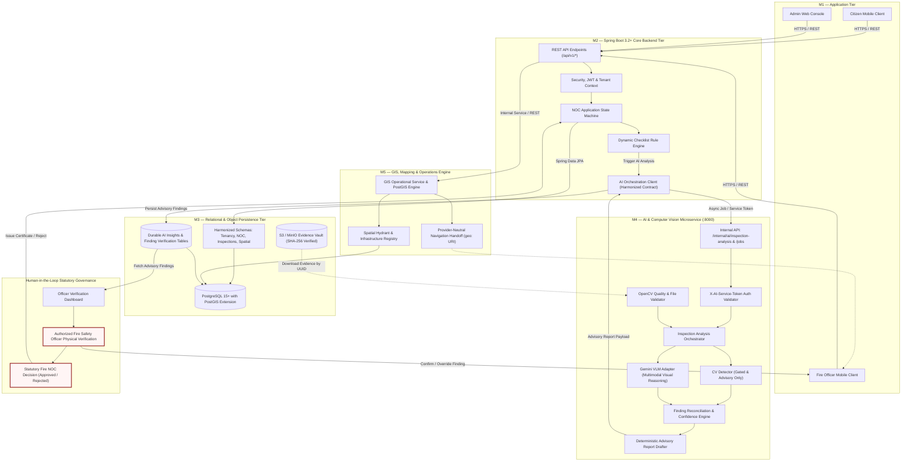

# FireSphere.ai — Current and Target Architecture Assessment

**Document Identifier:** `FS-DOC-PHASE1-ARCHITECTURE-20261010`  
**Phase:** 1 — Workspace Audit and Integration Design  
**Local Workspace Root:** `C:\Users\athar\OneDrive\Desktop\Firesphere.ai`  
**Date:** 2026-10-10  
**Classification:** Architectural Boundary & Interface Forensic Verification  

---

## 1. Executive Summary

This document evaluates the boundaries between the five project members' components. We distinguish rigorously between **source code existence**, **unit test execution**, and **verified live runtime integration**.

No cross-member connection in the FireSphere.ai workspace is currently a `VERIFIED_CONNECTION` in a live environment. Every inter-service boundary is either `DISCONNECTED`, `MOCK_ONLY`, or `BLOCKED` by contract and type mismatches. However, the internal layers of M2, M4, and M5 possess robust internal architectures that can be aligned under a systematic, phased plan.

---

## 2. Boundary Analysis and Connection Status

| Boundary / Interface | Source Code Modules & Classes | Status | Interface Compatibility | Tests Exercising Interface | Runtime Execution | Failure Handling & Auth |
| :--- | :--- | :---: | :---: | :---: | :---: | :---: |
| **1. M1 Frontend $\rightarrow$ M2 Backend** | [`packages/api-client/src/client.ts`](file:///C:/Users/athar/OneDrive/Desktop/Firesphere.ai/M1_work/packages/api-client/src/client.ts) $\rightarrow$ [`AuthController.java`](file:///C:/Users/athar/OneDrive/Desktop/Firesphere.ai/M2_work/Firesphere%20m2/backend/src/main/java/com/firesphere/backend/auth/controller/AuthController.java), [`NocController.java`](file:///C:/Users/athar/OneDrive/Desktop/Firesphere.ai/M2_work/Firesphere%20m2/backend/src/main/java/com/firesphere/backend/noc/controller/NocController.java) | `DISCONNECTED` | Incompatible: M1 fails closed because `VITE_API_CONTRACTS` is not configured. | `client.retry.test.ts` tests client error retry logic; no live backend test. | Not executed against live M2. | M1 defaults to local mock fixtures ([`mockServices.ts`](file:///C:/Users/athar/OneDrive/Desktop/Firesphere.ai/M1_work/mobile/src/dev/mockServices.ts)). Auth not connected. |
| **2. M2 Backend $\rightarrow$ M3 Database** | [`FiresphereBackendApplication`](file:///C:/Users/athar/OneDrive/Desktop/Firesphere.ai/M2_work/Firesphere%20m2/backend/src/main/java/com/firesphere/backend/FiresphereBackendApplication.java) (Spring Data JPA) $\rightarrow$ [`V1.0.1__core_tenancy_and_identities.sql`](file:///C:/Users/athar/OneDrive/Desktop/Firesphere.ai/M3_work/IP_DB/database/migrations/V1.0.1__core_tenancy_and_identities.sql) | `BLOCKED` | Severe Mismatch: M2 entities expect `UUID` primary keys; M3 schema defines `BIGSERIAL` (BIGINT). Table names differ (`noc_inspections` vs `firesphere.inspections`). | M2 tests run against H2 in-memory DB (`application-test.yml`); never against M3 migrations. | Blocked from startup (`ddl-auto: validate` fails on schema mismatch). | M2 has Flyway enabled, but `V1__init.sql` is a stub. |
| **3. M2 Backend $\rightarrow$ M4 AI Service** | [`HttpAiAnalysisClient.java`](file:///C:/Users/athar/OneDrive/Desktop/Firesphere.ai/M2_work/Firesphere%20m2/backend/src/main/java/com/firesphere/backend/ai/client/HttpAiAnalysisClient.java) $\rightarrow$ [`inspection.py`](file:///C:/Users/athar/OneDrive/Desktop/Firesphere.ai/ai-service/app/api/v1/inspection.py), [`jobs.py`](file:///C:/Users/athar/OneDrive/Desktop/Firesphere.ai/ai-service/app/api/v1/jobs.py) | `DISCONNECTED` | Severe Mismatch: M2 POSTs `/api/v1/analyze` with `X-API-KEY`; M4 listens on `/internal/ai/inspection-analysis` and `/internal/ai/jobs` requiring `X-AI-Service-Token` or Bearer. Field names differ completely. | M2 `HttpAiAnalysisClientTests.java` tests local mock RestTemplate; M4 `test_phase4_evaluation.py` confirms 404/401 failure. | Never executed live across services. | M2 returns fallback `ExternalAiResponse("FAILED")`; M4 raises `401 UNAUTHORIZED_SERVICE`. |
| **4. M4 Orchestrator $\rightarrow$ CV Inference** | [`InspectionOrchestrator.java` / `.py`](file:///C:/Users/athar/OneDrive/Desktop/Firesphere.ai/ai-service/app/services/inspection_orchestrator.py) $\rightarrow$ [`CVModelAdapter.py`](file:///C:/Users/athar/OneDrive/Desktop/Firesphere.ai/ai-service/app/models/cv_model_adapter.py), [`ModelApprovalGate.py`](file:///C:/Users/athar/OneDrive/Desktop/Firesphere.ai/ai-service/app/models/model_approval_gate.py) | `IMPLEMENTED_NOT_RUNTIME_VERIFIED` | Compatible internally: PyTorch YOLO adapter loaded, NMS post-processing active. | Pytest: 447 tests passing (tested with synthetic images and checkpoint hashes). | Tested locally in pytest; CV gate strictly enforces `NOT_APPROVED` and `NOT_CALIBRATED`. | Fails closed; unsupported classes (`EXIT_DOOR`, `OBSTACLE`) suppressed. |
| **5. M4 Orchestrator $\rightarrow$ VLM Analysis** | [`InspectionOrchestrator.py`](file:///C:/Users/athar/OneDrive/Desktop/Firesphere.ai/ai-service/app/services/inspection_orchestrator.py) $\rightarrow$ [`GeminiProvider.py`](file:///C:/Users/athar/OneDrive/Desktop/Firesphere.ai/ai-service/app/models/gemini_provider.py) | `IMPLEMENTED_NOT_RUNTIME_VERIFIED` | Compatible internally: structured Pydantic schema validation implemented. | Tested offline with mock payloads in `test_gemini_vision_phase2.py`. | Gemini disabled by default (`GEMINI_ENABLED=false`). Live requests prohibited in Phase 1. | Graceful fallback when disabled or unavailable; no synthetic hallucinations. |
| **6. M4 $\rightarrow$ M2 AI Response** | [`InspectionAnalysisResponse`](file:///C:/Users/athar/OneDrive/Desktop/Firesphere.ai/ai-service/app/schemas/inspection.py#L65) $\rightarrow$ [`ExternalAiResponse`](file:///C:/Users/athar/OneDrive/Desktop/Firesphere.ai/M2_work/Firesphere%20m2/backend/src/main/java/com/firesphere/backend/ai/dto/ExternalAiResponse.java) | `DISCONNECTED` | Incompatible: M2 expects simple `List<{label, confidence}>`; M4 returns rich findings with bounding boxes, risk scores, quality levels, and compliance notices. | M4 contract tests (`test_m2_m4_contract_specification.py`) demonstrate deserialization failure in M2 DTO. | Never executed live. | M2 Jackson parser fails on missing/unexpected structure. |
| **7. M2 $\rightarrow$ M3 AI Result Persistence** | [`AiOrchestrationService.java`](file:///C:/Users/athar/OneDrive/Desktop/Firesphere.ai/M2_work/Firesphere%20m2/backend/src/main/java/com/firesphere/backend/ai/service/AiOrchestrationService.java), [`AiAnalysisRunRepository.java`](file:///C:/Users/athar/OneDrive/Desktop/Firesphere.ai/M2_work/Firesphere%20m2/backend/src/main/java/com/firesphere/backend/ai/repository/AiAnalysisRunRepository.java) $\rightarrow$ M3 Schema | `BLOCKED` | Incompatible: M2 entities map to `ai_analysis_runs` and `ai_analysis_findings`. M3 has no such tables (ADR-005 blocker). | M2 tests save to H2; M3 has no AI tables in `V1.0.0`–`V1.0.6`. | Blocked by PostgreSQL `42P01: relation does not exist`. | M4 uses ephemeral in-memory storage ([`finding_repository.py`](file:///C:/Users/athar/OneDrive/Desktop/Firesphere.ai/ai-service/app/services/finding_repository.py#L38)); data lost on restart. |
| **8. M2 $\rightarrow$ M1 Officer Dashboard** | [`NocController.java`](file:///C:/Users/athar/OneDrive/Desktop/Firesphere.ai/M2_work/Firesphere%20m2/backend/src/main/java/com/firesphere/backend/noc/controller/NocController.java), [`InspectionController.java`](file:///C:/Users/athar/OneDrive/Desktop/Firesphere.ai/M2_work/Firesphere%20m2/backend/src/main/java/com/firesphere/backend/inspection/controller/InspectionController.java) $\rightarrow$ [`OfficerInspectionFlow.tsx`](file:///C:/Users/athar/OneDrive/Desktop/Firesphere.ai/M1_work/mobile/src/features/officer/OfficerInspectionFlow.tsx) | `MOCK_ONLY` | Incompatible: M1 displays local mock inspection items and advisory AI badges from fixtures. | M1 unit tests pass against fixtures; M2 unit tests pass against MockMvc. | No live link between client and backend. | M1 falls back to offline SQLite/fixtures. |
| **9. M5 $\rightarrow$ FireSphere Subsystems** | [`GisOperationalService.java`](file:///C:/Users/athar/OneDrive/Desktop/Firesphere.ai/M5_work/Industry%20M5/src/main/java/ai/firesphere/gis/service/GisOperationalService.java), [`GisFoundationController.java`](file:///C:/Users/athar/OneDrive/Desktop/Firesphere.ai/M5_work/Industry%20M5/src/main/java/ai/firesphere/gis/foundation/controller/GisFoundationController.java) | `DISCONNECTED` | Isolated Application: M5 is a distinct Spring Boot microservice (`ai.firesphere`) with its own Flyway migrations V1–V6. | M5 has 50+ passing tests in isolation using H2 + spatial utility functions. | Operates standalone; no shared Spring context or HTTP client with M2 or M1. | Uses mock routing providers ([`MockMapsProvider.java`](file:///C:/Users/athar/OneDrive/Desktop/Firesphere.ai/M5_work/Industry%20M5/src/main/java/ai/firesphere/integration/provider/maps/MockMapsProvider.java)). |

---

## 3. Diagram A: Current Implemented Architecture

This diagram depicts **only connections verified by code and actual test evidence**, highlighting existing isolation and mock barriers.

```mermaid
graph TD
    subgraph M1_TIER["M1 — Client Applications (Isolated)"]
        M1_Admin["Admin Web Console (React/Vite)"]
        M1_Mobile["Citizen & Officer App (React Native/Expo)"]
        M1_Mock["Local Fixtures & Mock SQLite / SQLCipher"]
        M1_Admin -.->|Local Fixture Session| M1_Mock
        M1_Mobile -.->|Local Offline DB| M1_Mock
    end

    subgraph M2_TIER["M2 — Spring Boot Backend (Isolated)"]
        M2_Auth["Auth & Security Controller"]
        M2_NOC["NOC Workflow Service"]
        M2_Insp["Inspection Controller"]
        M2_AI_Client["HttpAiAnalysisClient (POST /api/v1/analyze)"]
        M2_H2[("H2 In-Memory DB (Tests Only)")]
        M2_Auth --> M2_H2
        M2_NOC --> M2_H2
        M2_Insp --> M2_H2
    end

    subgraph M4_TIER["M4 — AI Service (FastAPI / PyTorch)"]
        M4_API["FastAPI Routes (/internal/ai/*)"]
        M4_Orch["Inspection Orchestrator"]
        M4_Gate["Model Approval Gate (Status: NOT_APPROVED)"]
        M4_CV["PyTorch CV Detector (mAP@50 = 0.0579)"]
        M4_VLM["Gemini VLM Adapter (DISABLED by default)"]
        M4_MemStore[("In-Memory Finding & Job Repository (Ephemeral)")]

        M4_API --> M4_Orch
        M4_Orch --> M4_Gate
        M4_Gate --> M4_CV
        M4_Orch -.->|Disabled| M4_VLM
        M4_Orch --> M4_MemStore
    end

    subgraph M3_TIER["M3 — Database Infrastructure (Unconnected)"]
        M3_PG[("PostgreSQL 15+ & PostGIS")]
        M3_Flyway["Migrations V1.0.0 – V1.0.6 (BIGSERIAL PKs)"]
        M3_Blocker["ADR-005: firesphere.ai_insights NOT CREATED"]
        M3_Flyway --> M3_PG
    end

    subgraph M5_TIER["M5 — Operations & GIS Service (Standalone)"]
        M5_App["Spring Boot Operations App (ai.firesphere)"]
        M5_GIS["PostGIS Spatial Engine & Hydrants"]
        M5_Dispatch["Emergency Dispatch & Fleet"]
        M5_MockMaps["Mock Maps & Navigation Provider"]
        M5_App --> M5_GIS
        M5_App --> M5_Dispatch
        M5_App --> M5_MockMaps
    end

    %% DISCONNECTED BOUNDARIES
    M1_TIER -.x|DISCONNECTED (Unconfigured Contract)| M2_TIER
    M2_AI_Client -.x|BLOCKED (Path, Header & DTO Mismatch)| M4_API
    M2_TIER -.x|BLOCKED (UUID vs BIGSERIAL PK Mismatch)| M3_TIER
    M4_TIER -.x|NO DURABLE DB LINK (Ephemeral Memory Only)| M3_TIER
    M5_TIER -.x|DISCONNECTED (Separate Microservice)| M2_TIER
    M5_TIER -.x|DISCONNECTED (No Client Binding)| M1_TIER

    classDef disconnected stroke:#e53e3e,stroke-width:2px,stroke-dasharray: 5 5;
    classDef isolated stroke:#d69e2e,stroke-width:2px;
    classDef running stroke:#38a169,stroke-width:2px;
```

---

## 4. Diagram B: Approved Target Architecture

This diagram illustrates the **harmonized target architecture**, identifying required integration bridges.



---

## 5. Architectural Invariant Compliance Check

1. **Rule 1 (M1 communicates through M2 approved APIs):** Verified in Target Architecture. M1 must not connect directly to M4 or M3.
2. **Rule 2 (M2 coordinates workflows and requests AI through authenticated interface):** Target architecture places M2 as the sole coordinator sending `X-AI-Service-Token`.
3. **Rule 3 (M4 owns AI inference and orchestration):** CV, VLM, and reconciliation pipelines reside strictly within M4.
4. **Rule 4 (CV and VLM findings retain source and evidence references):** Finding schemas explicitly preserve `sourceModel`, `evidenceId`, and raw bounding boxes.
5. **Rule 5 (Evidence validation preserves uncertainty and conflict):** Reconciler flags conflicting findings as `CONFLICTING_OBSERVATION` rather than forcing false agreement.
6. **Rule 6 (AI results persisted through approved persistence):** M4 findings returned to M2 and stored in durable PostgreSQL tables (resolving ADR-005).
7. **Rule 7 (M1 displays actual backend results):** M1 mock services replaced with HTTP client consumption of M2 inspection DTOs.
8. **Rule 8 (M5 integrates through verified interfaces):** M5 GIS capabilities integrated either as a modular backend dependency or co-hosted service with shared database connection.
9. **Rule 9 & 10 (Strict Human-in-the-Loop Governance):** AI findings remain strictly `ADVISORY_ONLY`. Only authorized human officers can make statutory NOC decisions.
