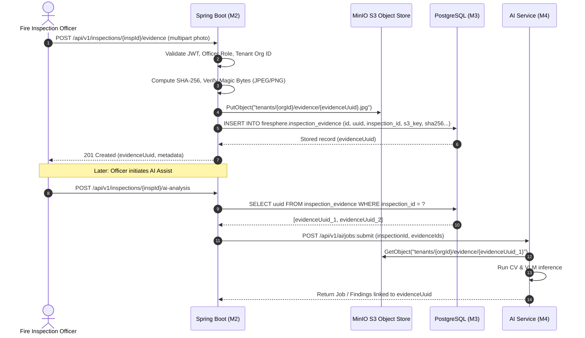

# FireSphere.ai — Phase 3A: Evidence Resolution and Storage Audit & Design

**Author**: Senior Database Architect, Spring Boot Persistence Engineer, AI Service Integration Engineer  
**Status**: APPROVED DESIGN / AUDIT REPORT  
**Date**: October 2026  
**Phase**: Phase 3A (Database and Persistence Integration Audit)  

---

## 1. Executive Summary

In Phase 2, the M2–M4 API contract was formally established, requiring M2 to supply `inspectionId` (UUID) and `evidenceIds` (List of UUIDs) when triggering batch AI inference (`POST /api/v1/ai/jobs:submit` or `POST /api/v1/ai/analyze`).

This audit investigated whether M2 can **legitimately resolve stored inspection evidence to durable evidence IDs** under the current codebase.

### Key Audit Finding
> [!CAUTION]
> **M2 currently CANNOT legitimately resolve inspection evidence to evidence IDs.**
> 1. **No Inspection Evidence Table in M3**: M3 migrations (`V1.0.0`–`V1.0.6`) include `building_documents` (architectural blueprints) and `incident_evidence` (emergency dispatch recordings), but **completely lack an `inspection_evidence` table** for physical on-site inspection photos.
> 2. **No Inspection Evidence Entity in M2**: M2 defines `NocDocument` (for citizen application documents) and `NocInspection` (for scheduling inspections), but has **zero model, repository, or service for inspection photographic evidence**.
> 3. **Dummy Storage Implementation**: M2 uses `DummyDocumentStorageService`, which synthesizes strings formatted as `"mock-storage-ref/" + UUID + "/" + filename` in memory without writing to MinIO, S3, or local disk.
> 4. **Synthetic Test Data**: The `evidenceIds` transmitted during Phase 2 contract tests were ad-hoc `UUID.randomUUID()` values injected by test harnesses, not durable references to physical files.

---

## 2. Comparison of Document Models vs. Evidence Models

A common source of confusion in Phase 1 was conflating **Building Documents** with **Inspection Evidence**. They have fundamentally different lifecycles, schemas, and security requirements:

| Dimension | Citizen Application Documents (`noc_documents`) | Inspection Field Evidence (`inspection_evidence` - PROPOSED) |
| :--- | :--- | :--- |
| **Primary Actor** | Citizen / Applicant | Fire Safety Officer (Field Inspector) |
| **Workflow Stage** | NOC Application Submission (`SUBMITTED`) | On-site Physical Inspection (`IN_PROGRESS`) |
| **Data Nature** | Building layouts, architectural PDFs, structural clearances | Photographic JPEG/PNG files of equipment, exits, alarms, panels |
| **Existing M3 Table** | `firesphere.building_documents` (approx. equivalent) | **DOES NOT EXIST** (Only `incident_evidence` exists for CAD dispatch) |
| **Existing M2 Entity** | `com.firesphere.backend.document.entity.NocDocument` | **DOES NOT EXIST** |
| **Storage Key Convention** | `applications/{appId}/docs/{docId}_{filename}` | `tenants/{tenantId}/inspections/{inspId}/evidence/{evidenceId}.jpg` |
| **AI Inference Target** | Blueprint compliance (Future Phase) | Real-time CV/VLM Defect Detection (M4 Phase 2/3 Target) |

> [!IMPORTANT]
> Document IDs and Evidence IDs are **NOT interchangeable**. Conflating them would violate municipal compliance rules and corrupt workflow integrity.

---

## 3. Storage and Object Access Analysis

### 3.1 M4 Object Storage Capabilities (Current Implementation)
M4 contains a production-ready storage abstraction in `ai-service/app/storage/`:
- **`EvidenceClient` (`app/storage/evidence_client.py`)**:
  - Encapsulates retrieval of binary payloads and metadata.
  - Prevents path traversal (`..`), protocol injection (`http://`, `file://`), and credential leakage.
  - Computes and verifies SHA-256 cryptographic checksums (`hmac.compare_digest`).
  - Implements tenant-scoped S3 keys:
    $$\text{Key} = \texttt{tenants/\{tenantId\}/evidence/\{evidenceId\}}$$
  - Provides a safe local mock generator (`_generate_synthetic_evidence_image`) when `ENABLE_MOCK_EVIDENCE_LOADER=true` for testing without live MinIO.
- **`S3StorageProvider` (`app/storage/s3_storage.py`)**:
  - Connects to MinIO / AWS S3 using Boto3.
  - Validates file size limits (`MAX_IMAGE_SIZE_BYTES = 10,485,760`).
  - Checks binary magic bytes (JPEG: `\xFF\xD8\xFF`, PNG: `\x89PNG\r\n\x1a\n`, WebP: `RIFF....WEBP`).

### 3.2 M2 Storage Capabilities (Current Implementation)
M2 currently lacks production storage:
- `DocumentStorageService.java`: Minimal interface with a single method:
  ```java
  String storeDocument(String filename, String contentType, InputStream data);
  ```
- `DummyDocumentStorageService.java`:
  ```java
  @Override
  public String storeDocument(String filename, String contentType, InputStream data) {
      return "mock-storage-ref/" + UUID.randomUUID() + "/" + filename;
  }
  ```
- **Object Storage Client**: Neither AWS SDK (`software.amazon.awssdk`) nor MinIO Java SDK is present in M2's `pom.xml`.

---

## 4. Evidence Identity Lifecycle and Resolution Design

To support end-to-end AI analysis, evidence must follow a deterministic lifecycle:



### 4.1 Proposed `inspection_evidence` Table Schema (for Flyway `V1.0.7`)

```sql
CREATE TABLE IF NOT EXISTS firesphere.inspection_evidence (
    id BIGSERIAL PRIMARY KEY,
    uuid UUID NOT NULL DEFAULT gen_random_uuid() UNIQUE,
    org_id BIGINT NOT NULL REFERENCES firesphere.organizations(id) ON DELETE RESTRICT,
    inspection_id BIGINT NOT NULL REFERENCES firesphere.inspections(id) ON DELETE CASCADE,
    file_name VARCHAR(255) NOT NULL,
    content_type VARCHAR(100) NOT NULL,
    file_size_bytes BIGINT NOT NULL,
    storage_bucket VARCHAR(100) NOT NULL DEFAULT 'firesphere-evidence',
    storage_key VARCHAR(500) NOT NULL UNIQUE,
    sha256_hash VARCHAR(64) NOT NULL,
    capture_timestamp TIMESTAMPTZ,
    gps_latitude NUMERIC(10, 7),
    gps_longitude NUMERIC(10, 7),
    captured_by_user_id BIGINT NOT NULL REFERENCES firesphere.users(id),
    status VARCHAR(50) NOT NULL DEFAULT 'ACTIVE',
    created_at TIMESTAMPTZ NOT NULL DEFAULT CURRENT_TIMESTAMP,
    updated_at TIMESTAMPTZ NOT NULL DEFAULT CURRENT_TIMESTAMP,
    
    CONSTRAINT chk_evidence_content_type CHECK (
        content_type IN ('image/jpeg', 'image/png', 'image/webp')
    ),
    CONSTRAINT chk_evidence_file_size CHECK (
        file_size_bytes > 0 AND file_size_bytes <= 10485760
    )
);

CREATE INDEX idx_inspection_evidence_org ON firesphere.inspection_evidence (org_id);
CREATE INDEX idx_inspection_evidence_insp ON firesphere.inspection_evidence (inspection_id);
CREATE INDEX idx_inspection_evidence_uuid ON firesphere.inspection_evidence (uuid);
```

---

## 5. Legitimate Evidence Resolution: Step-by-Step Mechanism

When M2 resolves evidence IDs for an AI request:

1. **Input**: `inspectionId` (UUID) from the client request.
2. **Tenant Verification**:
   - `TenantContext.getCurrentOrganizationId()` resolves the active caller's organization.
   - Query verifies `inspections.uuid = :inspectionUuid AND inspections.organization_id = :orgId`.
3. **Database Resolution**:
   - Query: `SELECT e.uuid FROM inspection_evidence e WHERE e.inspection_id = :inspectionInternalId AND e.org_id = :orgInternalId AND e.status = 'ACTIVE'`.
4. **Validation**:
   - Confirm at least one active evidence item exists. If zero, reject request with `400 Bad Request ("Inspection contains no evidence images for analysis")`.
5. **Contract Dispatch**:
   - M2 constructs `AIAnalysisJobRequest(jobId, inspectionUuid, evidenceUuids)`.
   - Sends payload to M4 with mutual HMAC secret authentication.
6. **M4 Evidence Fetching**:
   - M4 looks up `tenants/{tenantId}/evidence/{evidenceUuid}` in MinIO.
   - Verifies SHA-256 against object metadata.

---

## 6. Smallest Required Implementation for Phase 3B

To transition from dummy mock to production-ready evidence resolution, the following minimum set of components is required:

1. **Database Migration (`V1.0.7__create_inspection_evidence_and_ai_tables.sql`)**:
   - Add `firesphere.inspection_evidence` table with dual-key (BIGINT PK + UUID UNIQUE) and organization foreign keys.
2. **M2 S3 Storage Adapter (`S3StorageService.java`)**:
   - Add MinIO / AWS S3 client dependency to `pom.xml`.
   - Implement `storeInspectionEvidence(UUID inspectionId, MultipartFile file)` writing to `tenants/{tenantId}/evidence/{evidenceUuid}`.
3. **M2 Entity and Repository (`NocInspectionEvidence.java` & `NocInspectionEvidenceRepository.java`)**:
   - JPA entity mapped to `firesphere.inspection_evidence`.
   - Repository method: `List<NocInspectionEvidence> findAllByInspectionIdAndOrganizationId(Long inspectionId, Long orgId);`.
4. **M2 Evidence Controller (`InspectionEvidenceController.java`)**:
   - `POST /api/v1/inspections/{id}/evidence`: Multipart upload by authorized inspection officer.
   - `GET /api/v1/inspections/{id}/evidence`: Returns list of evidence metadata and IDs.
5. **M2 AI Service Integration Update (`AiAnalysisClientService.java`)**:
   - Replace synthetic `UUID.randomUUID()` list in `submitAnalysisJob()` with genuine `evidenceRepository.findUuidsByInspectionId(inspectionId)`.

---

## 7. Evidence Storage Security & Access Control

1. **No Public S3 URLs**: Raw S3 bucket URLs or pre-signed URLs with infinite TTL must NEVER be exposed to clients.
2. **Tenant Isolation**: S3 bucket keys must be prefixed with `tenants/{tenantId}/` to prevent cross-tenant object access.
3. **Cryptographic Integrity**: M2 must compute the SHA-256 hash upon upload; M4 must verify the SHA-256 hash upon download before feeding bytes into CV tensor pipelines.
4. **Path Traversal Prevention**: Storage keys are generated strictly from verified UUIDs; arbitrary file path inputs are rejected.
5. **Least Privilege**: The M4 service identity needs only `s3:GetObject` on the evidence bucket, while M2 requires `s3:PutObject` and `s3:GetObject`.
