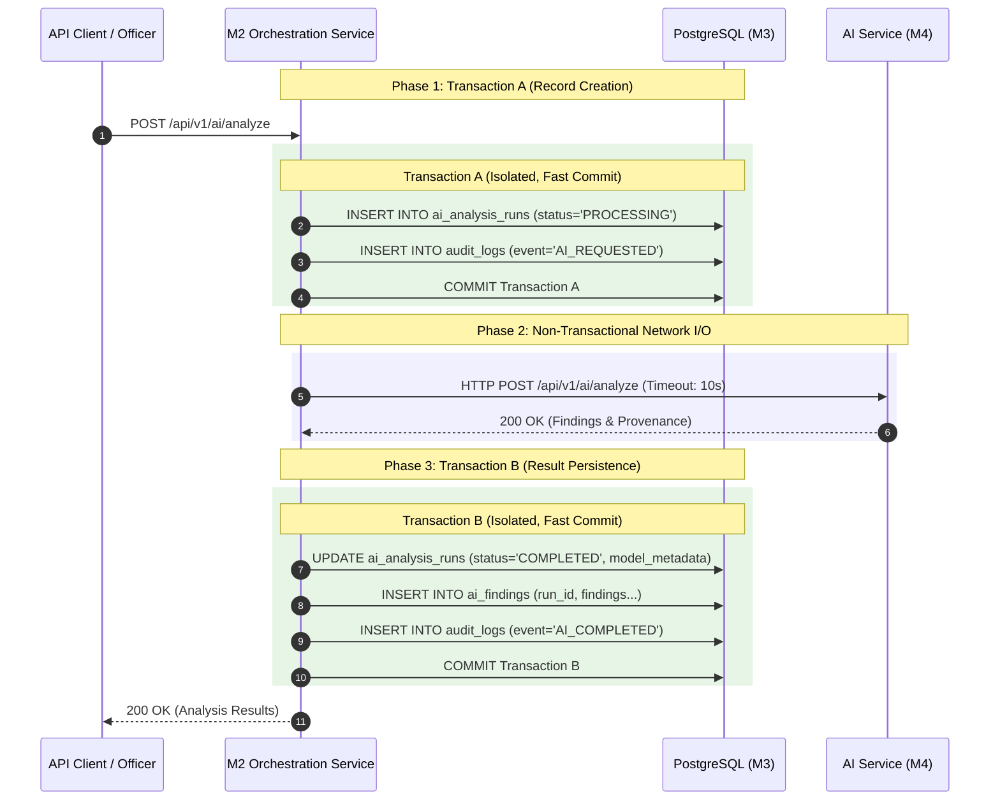

# FireSphere.ai — Phase 3A: Transaction, Failure, and Security Review

**Author**: Senior Database Architect, Spring Boot Persistence Engineer, AI Service Integration Engineer  
**Status**: APPROVED DESIGN / AUDIT REPORT  
**Date**: October 2026  
**Phase**: Phase 3A (Database and Persistence Integration Audit)  

---

## 1. Executive Summary

This report analyzes transaction boundaries, failure modes, concurrency controls, and security isolation across the FireSphere.ai persistence tier. 

A critical finding in the existing M2 implementation (`AiOrchestrationService.java:L57-L125`) is that **outbound synchronous HTTP calls to the AI service are executed inside an active Spring `@Transactional` boundary**. This holds database connections open across network calls, introducing severe risks of HikariCP connection pool starvation, transaction timeouts, and audit record loss upon network interruption.

This report establishes the required transaction redesign, idempotency semantics, failure recovery protocols, and enterprise security guardrails.

---

## 2. Transaction Boundary Analysis & Redesign

### 2.1 The Open Transaction Anti-Pattern in Current M2
```java
// CURRENT VULNERABLE PATTERN in AiOrchestrationService.java
@Transactional // <-- DB connection acquired here
public AiAnalysisResponse requestAnalysis(...) {
    runRepository.save(run); // INSERT run (PROCESSING)
    ExternalAiResponse res = aiClient.analyze(req); // <-- BLOCKING HTTP CALL (5-30 seconds)
    // If HTTP times out or throws: entire transaction rolls back!
    // The PROCESSING record is erased, leaving zero audit evidence.
    runRepository.save(run);
}
```

### 2.2 Recommended Two-Phase Transaction Architecture
Network I/O must NEVER occur within an active relational database transaction. The architecture must adopt a two-phase decoupled transaction model:



**Benefits**:
1. **Zero Connection Holding**: HikariCP connections are checked back into the pool within milliseconds rather than held for 30 seconds.
2. **Crash Resilience**: If M4 fails or times out, the `PROCESSING` run record persists in the database, allowing an error status update or background reconciliation rather than an unrecoverable rollback.

---

## 3. Comprehensive Failure Modes and Mitigation Matrix

| Failure Mode | Root Cause | System Behavior & Mitigation Protocol | Architectural Pattern |
| :--- | :--- | :--- | :--- |
| **1. Database Insertion Fails** | Constraint violation, connection pool exhausted, or DB down. | Return `503 Service Unavailable` or `422 Unprocessable Entity`. Do NOT call M4. Client retries with exponential backoff. | Fail-Fast Validation |
| **2. AI Call Succeeds, Persistence Fails** | Transient DB disconnect when saving findings in Transaction B. | Catch persistence exception. Mark run status as `COMPLETED_PERSISTENCE_FAILED`. Log error with full correlation ID. Return finding payload to client with header warning `X-Persistence-Status: FAILED`. Run scheduled reconciler. | At-least-once Persistence / Compensation |
| **3. AI Analysis Times Out** | Model inference takes > configured timeout (e.g., 30s). | M2 HTTP client throws `SocketTimeoutException`. M2 catches exception in non-transactional block, opens Transaction C, updates `ai_analysis_runs.status = 'FAILED'`, sets `failure_reason = 'AI_SERVICE_TIMEOUT'`, logs audit event. | Explicit Timeout Fallback |
| **4. Duplicate Request Retried** | Client retries due to network hiccup or double-click. | M2 checks for existing run with identical `(inspection_id, evidence_hash_set)`. If existing run is `COMPLETED`, return cached findings. If `PROCESSING`, return `409 Conflict` or in-flight job handle. | Idempotency Key / Request De-duplication |
| **5. Duplicate Evidence Submitted** | Officer uploads the exact same photo twice. | M2 computes SHA-256 upon upload. Unique constraint on `(org_id, sha256_hash)` or business logic detects identical hash within the inspection. Returns existing `evidenceUuid` without re-uploading duplicate bytes to MinIO. | Cryptographic Content-Addressable Deduplication |
| **6. Concurrent Officer Review** | Two officers attempt to verify/override the same finding simultaneously. | Optimistic locking using JPA `@Version` / DB `updated_at`. The second transaction fails with `OptimisticLockingFailureException` (`409 Conflict`), prompting the officer to reload the updated state. | Optimistic Concurrency Control |
| **7. Cross-Tenant Evidence Injection** | Request specifies `evidenceId` belonging to Organization B while logged into Organization A. | M2 queries `inspection_evidence` filtering strictly by `TenantContext.getCurrentOrganizationId()`. If any ID is missing from the tenant query result, request is rejected with `403 Forbidden` (`"Access Denied: Evidence asset belongs to foreign tenant"`). | Defense-in-Depth Multi-Tenancy |
| **8. AI Service Restarts** | M4 container crashes or redeploys while processing jobs. | M4's ephemeral in-memory cache is wiped. M2 detects HTTP connection reset, marks run as `FAILED` (`"AI service restarted/unreachable"`). Client can safely re-trigger analysis because M2 holds durable state. | Stateless Worker Model |

---

## 4. Security Architecture and Data Integrity

### 4.1 Officer Identity and Authorization
> [!IMPORTANT]
> **Zero Trust for Request-Body Identity**: The system MUST NEVER trust an officer ID, tenant ID, or role passed inside the JSON request body.
- Officer identity is resolved strictly via the signed JWT in the `Authorization: Bearer <token>` header:
  ```java
  UUID officerId = TenantContext.getCurrentUserId();
  UUID orgId = TenantContext.getCurrentOrganizationId();
  ```
- Verification operations (`POST /api/v1/ai/findings/{id}/review`) require explicit role authorization:
  ```java
  if (!TenantContext.hasRole("OFFICER") && !TenantContext.hasRole("ADMIN")) {
      throw new ResponseStatusException(HttpStatus.FORBIDDEN, "Only certified officers can verify findings");
  }
  ```

### 4.2 Multi-Tenant Data Isolation (Schema & PostGIS Level)
- **Tenant Keying**: Every table in schema `firesphere.` must contain `org_id BIGINT NOT NULL REFERENCES firesphere.organizations(id)`.
- **Row-Level Security (RLS)**:
  M3 provides a session-variable function:
  ```sql
  CREATE OR REPLACE FUNCTION firesphere.current_org_id() RETURNS BIGINT AS $$
      SELECT NULLIF(current_setting('firesphere.current_org_id', true), '')::BIGINT;
  $$ LANGUAGE SQL STABLE;
  ```
  RLS policies on `inspection_evidence`, `ai_analysis_runs`, and `ai_findings` must enforce:
  ```sql
  ALTER TABLE firesphere.inspection_evidence ENABLE ROW LEVEL SECURITY;
  CREATE POLICY tenant_isolation_policy ON firesphere.inspection_evidence
      USING (org_id = firesphere.current_org_id());
  ```

### 4.3 Mutual Service Authentication & Secret Isolation
- Communications between M2 and M4 utilize the shared HMAC header negotiated in Phase 2:
  `X-Service-Auth: <HMAC-SHA256>`
- Shared secrets (`FIRESPHERE_AI_SHARED_SECRET`) must be supplied via OS environment variables or Kubernetes secrets, never checked into Git or database tables.
- Database credentials (`DB_USER`, `DB_PASSWORD`) must follow least-privilege principles:
  - Spring Boot application user has `SELECT, INSERT, UPDATE` on `firesphere.*`.
  - Application user does NOT have `DROP TABLE`, `ALTER TABLE`, or `TRUNCATE` permissions (reserved for Flyway migration runner).
  - M4 AI service has **NO direct database credentials** to the PostgreSQL instance.

### 4.4 Non-Negotiable Statutory Constraint: Advisory-Only Persistence
Every AI-generated finding stored in the database is strictly advisory. To guarantee statutory compliance at the database constraint level:
```sql
-- Enforce advisory constraint at DB schema level
ALTER TABLE firesphere.ai_findings 
    ADD CONSTRAINT chk_finding_statutory_advisory 
    CHECK (is_advisory = TRUE);

-- Prevent automated certificate issuance
-- NOC certification state transition can ONLY be triggered by authenticated officer action
```

---

## 5. Audit Logging and Forensics Traceability

To satisfy municipal fire department forensic standards, every stage of an AI analysis run must be permanently auditable:

1. **Correlation Trace ID**: A unique `correlationId` (UUID) is generated upon initial API entry, propagated via HTTP headers (`X-Correlation-ID`) across M2, M4, and MinIO, and persisted in `audit_logs`.
2. **Audit Events**:
   - `AI_ANALYSIS_REQUESTED`: Logged when an officer requests AI analysis for an inspection.
   - `AI_ANALYSIS_COMPLETED`: Logged when results are verified and saved.
   - `AI_ANALYSIS_FAILED`: Logged with sanitized error code when inference or persistence fails.
   - `AI_FINDING_REVIEWED`: Logged when an officer accepts, rejects, or modifies a finding.
3. **Immutability**: Audit log records (`firesphere.audit_logs`) permit `INSERT` and `SELECT` only. `UPDATE` and `DELETE` operations are revoked for all service roles.
