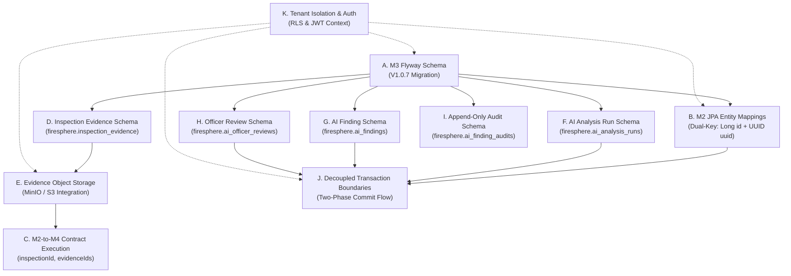

# FireSphere.ai — Phase 3B: Architecture Dependency Map

**Author**: Senior Database Architect, Spring Boot Persistence Engineer, AI Service Integration Engineer  
**Status**: PRE-IMPLEMENTATION DESIGN / APPROVAL GATE  
**Date**: October 2026  
**Phase**: Phase 3B (Controlled Database & Evidence Integration)  

---

## 1. Executive Summary

This architecture dependency map defines the end-to-end relational, service, and security dependencies required to execute Phase 3B. Each architectural subsystem (A through K) is evaluated against its **Current Implementation**, **Proposed Implementation**, **Required Upstream Dependencies**, **Responsible Member**, **Required Approval Gate**, **Verification Test**, and **Identified Failure Risks**.

No application code or database migrations have been modified. This document serves as the formal pre-implementation baseline.

---

## 2. End-to-End Dependency Graph



---

## 3. Detailed Component Dependency Matrix

### A. M3 Flyway Schema
- **Current Implementation**: Seven migrations (`V1.0.0`–`V1.0.6`) defining 44 tables in `firesphere.` schema. Zero AI tables and zero inspection evidence tables. Core domain tables have dual keys (`id BIGSERIAL PK`, `uuid UUID UNIQUE`).
- **Proposed Implementation**: Author `V1.0.7__create_inspection_evidence_and_ai_tables.sql` defining `inspection_evidence`, `ai_analysis_runs`, `ai_findings`, `ai_officer_reviews`, and `ai_finding_audits` in `firesphere.` schema.
- **Required Upstream Dependency**: None (builds strictly on `V1.0.6`).
- **Responsible Member**: Member 3 (Database Lead).
- **Required Approval**: M3 Lead (Author & Schema Owner), M2 Lead (Persistence Consumer), M4 Lead (Data Spec Alignment).
- **Verification Test**: Flyway `validate` and `migrate` on local PostgreSQL; execution of `06_verify_ai_and_evidence_schema.sql`.
- **Failure Risks**: Checksum mismatch with existing migration history; syntax error on PostGIS geometry or JSONB constraints; foreign key type mismatches.

### B. M2 JPA Identifier Mappings
- **Current Implementation**: 13 JPA entities in `com.firesphere.backend.*.entity` using `@Id @GeneratedValue(strategy = GenerationType.UUID) private UUID id`. No `schema = "firesphere"` declared.
- **Proposed Implementation**: Dual-Key JPA pattern. Entities map `@Id @GeneratedValue(strategy = GenerationType.IDENTITY) private Long id` for internal joins + `@Column(name = "uuid", nullable = false, updatable = false) private UUID uuid` as public business key. Add `default_schema = firesphere` in Hibernate config.
- **Required Upstream Dependency**: Subsystem A (M3 Schema applied or validated).
- **Responsible Member**: Member 2 (Backend Lead).
- **Required Approval**: M2 Lead.
- **Verification Test**: Spring Boot context startup with `spring.jpa.hibernate.ddl-auto=validate`; CRUD repository integration tests asserting both `id` (Long) and `uuid` (UUID).
- **Failure Risks**: `SchemaManagementException` if column types or table names differ; regression in existing REST endpoints if public DTOs accidentally expose `Long id`.

### C. M2-to-M4 Analysis Contract
- **Current Implementation**: HTTP client (`HttpAiAnalysisClient.java`) sending `ExternalAiRequest(inspectionId, evidenceIds, ...)` with mutual HMAC authentication (`X-Service-Auth`). Verified in Phase 2 with synthetic UUID stubs.
- **Proposed Implementation**: Supply genuine persistent `evidenceIds` resolved from `firesphere.inspection_evidence` instead of synthetic test UUIDs.
- **Required Upstream Dependency**: Subsystems B, D, E.
- **Responsible Member**: Member 2 & Member 4.
- **Required Approval**: Joint M2 & M4 Leads.
- **Verification Test**: Integration contract tests in `HttpAiAnalysisClientTests.java` and `ai-service/tests/test_m2_m4_contract_specification.py`.
- **Failure Risks**: M4 rejects requests if evidence UUID cannot be found in MinIO; HMAC signature mismatch; socket timeout on large image batches.

### D. Inspection Evidence Metadata
- **Current Implementation**: Completely absent. M2 only has `noc_documents` (citizen PDFs/blueprints). M3 only has `building_documents` and `incident_evidence`.
- **Proposed Implementation**: Entity `NocInspectionEvidence` mapped to `firesphere.inspection_evidence`. Fields: `id Long`, `uuid UUID`, `inspection_id Long`, `org_id Long`, `storage_key`, `sha256_hash`, `file_size_bytes`, `content_type`, `captured_by_user_id`.
- **Required Upstream Dependency**: Subsystem A (Flyway `V1.0.7`).
- **Responsible Member**: Member 2 & Member 3.
- **Required Approval**: M2 Lead & M3 Lead.
- **Verification Test**: `InspectionEvidenceRepositoryTest` verifying insert, query by `inspection_id`, and uniqueness on `storage_key` and `uuid`.
- **Failure Risks**: Uploading unsupported MIME types; duplicate file uploads without hash check; missing foreign key link to `inspections`.

### E. Evidence Object Storage
- **Current Implementation**: M2 uses `DummyDocumentStorageService` returning mock strings. M4 implements `EvidenceClient` and `S3StorageProvider` connecting to MinIO/S3 or falling back to synthetic test generation.
- **Proposed Implementation**: Implement production `S3StorageService` in M2 using AWS S3 / MinIO SDK. Store objects under `tenants/{orgId}/evidence/{evidenceUuid}.jpg` with SHA-256 computation on upload.
- **Required Upstream Dependency**: MinIO container running; Subsystem D metadata model.
- **Responsible Member**: Member 2 & Member 4.
- **Required Approval**: M2 Lead & M4 Lead.
- **Verification Test**: Upload test JPEG to M2 -> verify existence in MinIO bucket `firesphere-evidence` -> verify download by M4 `EvidenceClient` with matching SHA-256 digest.
- **Failure Risks**: S3 connection timeout; bucket does not exist; path traversal attack via malicious filenames; MinIO disk full.

### F. AI Analysis-Run Persistence
- **Current Implementation**: In M2, `AiAnalysisRun` is an in-memory or unmapped JPA entity targeting non-existent `ai_analysis_runs` table in `public` schema. In M4, runs are stored in ephemeral `InMemoryJobRepository`.
- **Proposed Implementation**: Map `AiAnalysisRun.java` to `firesphere.ai_analysis_runs`. M2 acts as authoritative writer. Persist initial record in `PROCESSING` state before invoking M4; update to `COMPLETED` or `FAILED` upon M4 response.
- **Required Upstream Dependency**: Subsystems A, B.
- **Responsible Member**: Member 2.
- **Required Approval**: M2 Lead.
- **Verification Test**: `AiAnalysisRunRepositoryTest` verifying lifecycle transitions `PROCESSING -> COMPLETED` and `PROCESSING -> FAILED`.
- **Failure Risks**: Transient DB disconnect leaves run stuck in `PROCESSING`; long HTTP call holds connection if transaction is not decoupled.

### G. AI Finding Persistence
- **Current Implementation**: `AiAnalysisFinding.java` in M2 is mapped as an `@Embeddable` or loose collection; M4 holds findings in ephemeral `InMemoryFindingRepository`. Zero database tables in M3.
- **Proposed Implementation**: Map `AiFinding.java` to `firesphere.ai_findings`. Link to `ai_analysis_runs(id)` and `inspection_evidence(id)`. Enforce check constraint `is_advisory = TRUE`.
- **Required Upstream Dependency**: Subsystems A, B, F.
- **Responsible Member**: Member 2 & Member 4.
- **Required Approval**: Joint M2, M3, M4 Leads.
- **Verification Test**: Save finding with confidence, severity, and bounding box JSONB -> assert retrieve and assert `is_advisory == true`. Assert DB throws if `is_advisory = false`.
- **Failure Risks**: JSONB serialization mismatch for bounding boxes; confidence values outside [0.0, 1.0]; attempting to write non-advisory findings.

### H. Officer Reviews
- **Current Implementation**: M2 has checklist review endpoints (`NocChecklistService`), but zero entity or service for reviewing AI findings. M4 has verification guidance logic but no durable storage.
- **Proposed Implementation**: Entity `AiOfficerReview.java` mapped to `firesphere.ai_officer_reviews`. Endpoint `POST /api/v1/ai/findings/{id}/review` allowing certified officers to confirm, dismiss, or modify findings.
- **Required Upstream Dependency**: Subsystems A, B, G.
- **Responsible Member**: Member 2.
- **Required Approval**: M2 Lead.
- **Verification Test**: Officer submits review -> assert row in `ai_officer_reviews` with verified officer ID; assert `finding.review_status` updated.
- **Failure Risks**: Non-officer user attempts verification; concurrent review conflict; untrusted officer ID passed in request body.

### I. Append-Only Audit History
- **Current Implementation**: M2 uses `SimpleAuditLogger` which only writes SLF4J log messages (`log.info`). M3 has `firesphere.audit_logs` with PostgreSQL row-level audit triggers.
- **Proposed Implementation**: Map `AiFindingAudit.java` to `firesphere.ai_finding_audits`. Record immutable audit entries upon creation, modification, or officer review of findings. Revoke `UPDATE` and `DELETE` on this table.
- **Required Upstream Dependency**: Subsystem A.
- **Responsible Member**: Member 2 & Member 3.
- **Required Approval**: M2 Lead & M3 Lead.
- **Verification Test**: Attempt `UPDATE` or `DELETE` on `ai_finding_audits` -> assert PostgreSQL permission denied error; assert audit trail records chronological sequence.
- **Failure Risks**: Audit logging failure breaks primary business transaction if not isolated.

### J. Transaction Boundaries
- **Current Implementation**: M2 `AiOrchestrationService.requestAnalysis()` is marked `@Transactional`, causing the database connection to be held during the outbound blocking HTTP call to M4.
- **Proposed Implementation**: Two-Phase Transaction Architecture:
  1. Transaction A (Commit): Insert `ai_analysis_runs` (`status = 'PROCESSING'`) and audit event.
  2. Outside Transaction: HTTP call to M4 (`POST /api/v1/ai/analyze`) with 10s timeout.
  3. Transaction B (Commit): Update `ai_analysis_runs` (`status = 'COMPLETED'` or `'FAILED'`) and insert `ai_findings`.
- **Required Upstream Dependency**: Subsystems B, F, G.
- **Responsible Member**: Member 2.
- **Required Approval**: M2 Lead.
- **Verification Test**: Simulated M4 timeout (15s delay) -> verify DB connection was released during wait, and run record is durably marked `FAILED`.
- **Failure Risks**: System crash between Transaction A and Transaction B leaves run in `PROCESSING` indefinitely (requires background reconciliation worker).

### K. Tenant Isolation and Authorization
- **Current Implementation**: M2 resolves tenant via `TenantContext.getCurrentOrganizationId()` from JWT claims. M3 has RLS policies in `V1.0.5` checking `current_setting('app.current_org_id', TRUE)`. However, M2 does not execute `SET LOCAL app.current_org_id` on DB connections.
- **Proposed Implementation**: 
  1. M2 Spring Data JPA queries must continue explicitly enforcing `organizationId` filters in repository queries.
  2. M2 datasource connection interceptor or multi-tenant transaction hook sets `app.current_org_id` on checkout.
  3. S3 storage keys partition objects strictly under `tenants/{orgId}/evidence/`.
- **Required Upstream Dependency**: Subsystems A, B, E.
- **Responsible Member**: Member 2 & Member 3.
- **Required Approval**: M2 Lead & M3 Lead.
- **Verification Test**: Multi-tenant isolation test: Tenant A attempts to fetch Tenant B's evidence or findings -> assert `403 Forbidden` or empty result.
- **Failure Risks**: Missing tenant header in internal call; RLS policy blocking legitimate queries if `app.current_org_id` session variable is omitted.

---

## 4. Phase 3B Critical Path & Execution Sequence

```
Step 1: M3 Migration Script DDL Authoring (Task A, D, F, G, H, I)
   ↓
Step 2: M3 Migration Verification in Local PostgreSQL
   ↓
Step 3: M2 Spring Boot Schema & JDBC Configuration (Task B, K)
   ↓
Step 4: M2 Dual-Key Entity Refactoring & New AI Entities (Task B, D, F, G, H, I)
   ↓
Step 5: M2 MinIO Object Storage Service Implementation (Task E)
   ↓
Step 6: M2 Evidence Upload Endpoint & Validation (Task D, E)
   ↓
Step 7: M2 Two-Phase Transaction Redesign in AiOrchestrationService (Task J)
   ↓
Step 8: End-to-End Contract & Persistence Integration Testing (Task C, J, K)
```
