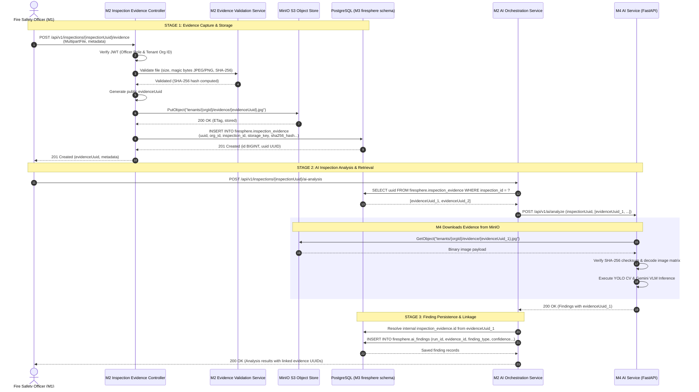

# FireSphere.ai — Phase 3B: Evidence Workflow Design

**Author**: Senior Database Architect, Spring Boot Persistence Engineer, AI Service Integration Engineer  
**Status**: PRE-IMPLEMENTATION DESIGN / APPROVAL GATE  
**Date**: October 2026  
**Phase**: Phase 3B (Controlled Database & Evidence Integration)  

---

## 1. Executive Summary

This document specifies the end-to-end evidence lifecycle for physical on-site fire inspection photographs in FireSphere.ai. It traces the journey of an inspection photo from field capture through MinIO object storage, PostgreSQL persistence, AI inference in Member 4, and statutory linkage to AI findings.

Crucially, this design clearly distinguishes **Actual Existing Functionality** from **Proposed Phase 3B Functionality**.

---

## 2. Actual Existing vs. Proposed Functionality Matrix

| Workflow Stage | Actual Existing Functionality (Verified from Source) | Proposed Phase 3B Functionality |
| :--- | :--- | :--- |
| **1. Evidence Upload API** | None. M2 only supports citizen NOC document uploads (`NocDocumentService.uploadDocument()`). | `InspectionEvidenceController` exposing `POST /api/v1/inspections/{id}/evidence`. |
| **2. Binary Validation** | M4 has `FileValidator` checking JPEG/PNG magic bytes and 10MB limits in Python. M2 has zero binary inspection checks. | M2 Spring Boot `EvidenceValidationService` checking magic bytes, image dimensions, and computing SHA-256. |
| **3. Database Entity** | None. M3 lacks `inspection_evidence`. M2 lacks `NocInspectionEvidence`. | Table `firesphere.inspection_evidence` and JPA entity `NocInspectionEvidence`. |
| **4. Object Storage Client** | M2 has `DummyDocumentStorageService` returning mock strings. M4 has production `S3StorageProvider` connecting to MinIO. | M2 production `S3StorageService` (AWS SDK / MinIO Java client) pushing bytes to `firesphere-evidence` bucket. |
| **5. Evidence Retrieval by M4**| M4 `EvidenceClient` supports downloading from MinIO with SHA-256 verification and tenant keys. Falls back to mock generator. | M4 live downloads genuine evidence photos uploaded by M2 from the shared MinIO bucket. |
| **6. Finding Linkage** | M4 outputs findings referencing request `evidenceId`. M2 receives them but cannot link to database evidence rows. | M2 maps finding's public `evidenceId` UUID to database `inspection_evidence.id` foreign key. |

---

## 3. End-to-End Evidence Workflow (Step-by-Step)



---

## 4. Technical Specification of Workflow Steps

### Step 1: Upload (HTTP Multipart)
- **Endpoint**: `POST /api/v1/inspections/{inspectionUuid}/evidence`
- **Headers**: `Authorization: Bearer <JWT>`, `Content-Type: multipart/form-data`
- **Request Body**:
  - `file`: Binary image data (`image/jpeg`, `image/png`, or `image/webp`).
  - `captureTimestamp`: ISO-8601 timestamp from officer mobile device.
  - `latitude`, `longitude`: Optional PostGIS GPS coordinates of capture site.

### Step 2: Binary Validation & Checksum
- **Size Limit**: Maximum 10,485,760 bytes (10MB). Enforced before reading full payload into memory.
- **Magic Bytes Signature**:
  - JPEG: `FF D8 FF`
  - PNG: `89 50 4E 47 0D 0A 1A 0A`
  - WebP: `52 49 46 46 .... 57 45 42 50`
- **Cryptographic Hash**: Compute SHA-256 digest on binary stream using `MessageDigest.getInstance("SHA-256")`.

### Step 3: Association with Inspection & Tenant
- Verify caller identity: `TenantContext.getCurrentUserId()` must match assigned officer or user must have `ADMIN` role.
- Verify inspection state: Application must be in `INSPECTION_IN_PROGRESS` or `INSPECTION_SCHEDULED`.
- Verify tenant boundary: `inspection.getOrganizationId().equals(TenantContext.getCurrentOrganizationId())`.

### Step 4: Storage in Approved Object Store (MinIO)
- **Bucket**: `firesphere-evidence` (configurable via `STORAGE_BUCKET`).
- **Object Key**:
  $$\text{Key} = \texttt{tenants/\{tenantId\}/evidence/\{evidenceUuid\}.jpg}$$
- **Metadata**: Attach S3 user metadata: `x-amz-meta-sha256`, `x-amz-meta-captured-by`, `x-amz-meta-inspection-id`.

### Step 5: Recording in PostgreSQL (`firesphere.inspection_evidence`)
- Insert database record:
  ```sql
  INSERT INTO firesphere.inspection_evidence (
      uuid, org_id, inspection_id, file_name, content_type,
      file_size_bytes, storage_bucket, storage_key, sha256_hash,
      capture_timestamp, gps_latitude, gps_longitude, captured_by_user_id, status
  ) VALUES (
      :uuid, :orgId, :inspectionId, :fileName, :contentType,
      :fileSizeBytes, 'firesphere-evidence', :storageKey, :sha256Hash,
      :captureTimestamp, :lat, :lon, :userId, 'ACTIVE'
  ) RETURNING id, uuid;
  ```

### Step 6: Assigned Persistent UUID
- The generated `uuid` is returned to the client and indexed in PostgreSQL with a unique constraint.

### Step 7: Retrieval by M4 (`EvidenceClient`)
- M4 receives `evidenceIds: ["<evidenceUuid>"]` in `ExternalAiRequest`.
- M4's [`EvidenceClient`](file:///C:/Users/athar/OneDrive/Desktop/Firesphere.ai/ai-service/app/storage/evidence_client.py) constructs key: `tenants/{tenantId}/evidence/{evidenceUuid}`.
- Issues `s3_client.get_object(Bucket='firesphere-evidence', Key=key)`.
- Re-computes SHA-256 hex digest and verifies integrity using `hmac.compare_digest`.
- Converts image bytes into OpenCV BGR matrix: `cv2.imdecode(np.frombuffer(raw_bytes, np.uint8), cv2.IMREAD_COLOR)`.

### Step 8: Linkage to AI Findings
- M4 returns `ExternalAiFinding` referencing `evidenceId: "<evidenceUuid>"`.
- M2 resolves internal `inspection_evidence.id` via `evidenceRepository.findByUuid(findingDto.evidenceId())`.
- M2 inserts into `firesphere.ai_findings` with foreign key `evidence_id = inspection_evidence.id`.
- The finding is permanently, forensically tied to the exact photograph that generated it.

---

## 5. Failure and Error Handling Protocols

1. **Upload Fails During S3 Write**:
   - If MinIO write fails, database insertion is aborted. No orphan database record is created.
2. **Database Insert Fails After S3 Write**:
   - M2 catches DB exception, issues compensation delete to MinIO (`deleteObject`), and returns `500 Internal Server Error`.
3. **M4 Cannot Fetch Evidence**:
   - M4 raises `EvidenceNotFoundException`. M4 returns structured error response (`status = 'FAILED'`, `errorDetail = 'Evidence not found in storage'`).
   - M2 records the failure reason in `ai_analysis_runs.failure_reason`.
4. **Evidence Tampering Detected**:
   - If M4's SHA-256 verification fails, M4 raises `IntegrityCheckException` (`422 Unprocessable Entity`), terminating inference immediately.
