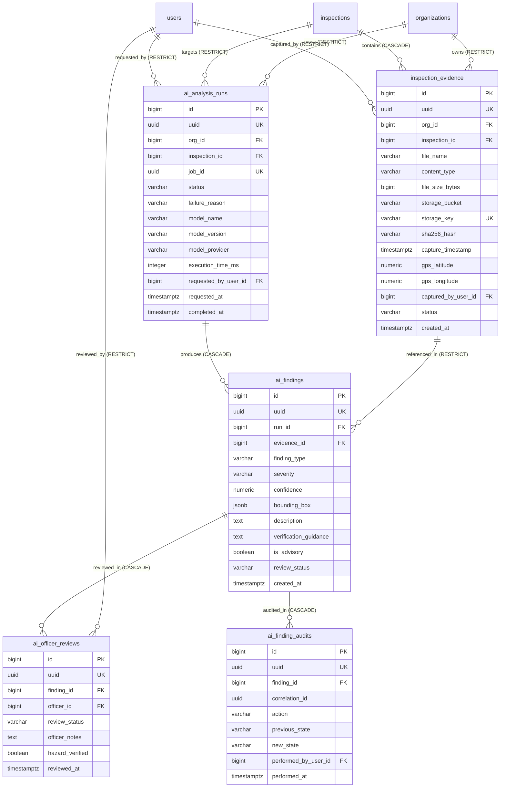

# FireSphere.ai — Phase 3B: Database Schema Review

**Author**: Senior Database Architect, PostgreSQL/PostGIS Engineer, AI Service Integration Engineer  
**Status**: PRE-IMPLEMENTATION DESIGN / APPROVAL GATE  
**Date**: October 2026  
**Phase**: Phase 3B (Controlled Database & Evidence Integration)  

---

## 1. Executive Summary

This document reviews the proposed logical and relational database schema for **Flyway Migration `V1.0.7`** in Member 3's PostgreSQL database (`M3_work/IP_DB`). It evaluates the five proposed tables:
1. `firesphere.inspection_evidence`
2. `firesphere.ai_analysis_runs`
3. `firesphere.ai_findings`
4. `firesphere.ai_officer_reviews`
5. `firesphere.ai_finding_audits`

The proposed design establishes complete provenance tracking, forensically auditable officer review records, and strict statutory check constraints.

> [!NOTE]
> This schema is a **PROPOSAL AWAITING FORMAL APPROVAL** by the Member 3 Database Lead and Member 4 AI Lead. No migrations have been created or executed in the repository.

---

## 2. Entity-Relationship Diagram (Proposed Schema `V1.0.7`)

---

## 3. Logical Table Specifications & Deletion Rules

### 3.1 `firesphere.inspection_evidence`
- **Purpose**: Tracks persistent metadata, storage locations, and cryptographic checksums of on-site inspection photographs.
- **Primary & Unique Keys**:
  - `id BIGSERIAL PRIMARY KEY`: Internal join surrogate key.
  - `uuid UUID NOT NULL DEFAULT gen_random_uuid() UNIQUE`: Canonical public business key.
  - `storage_key VARCHAR(500) NOT NULL UNIQUE`: Prevents colliding object storage keys.
- **Foreign Keys & Deletion Rules**:
  - `org_id REFERENCES firesphere.organizations(id) ON DELETE RESTRICT`: Prevents accidental tenant data loss.
  - `inspection_id REFERENCES firesphere.inspections(id) ON DELETE CASCADE`: If an inspection record is purged, its attached evidence metadata is cleaned up.
  - `captured_by_user_id REFERENCES firesphere.users(id) ON DELETE RESTRICT`: Retains evidence provenance even if a user account is deactivated.
- **Constraints**:
  - `chk_evidence_content_type`: `content_type IN ('image/jpeg', 'image/png', 'image/webp')`
  - `chk_evidence_file_size`: `file_size_bytes > 0 AND file_size_bytes <= 10485760` (10MB limit)
  - `chk_evidence_status`: `status IN ('ACTIVE', 'ARCHIVED', 'CORRUPTED', 'DELETED')`
- **Indexes**:
  - `idx_insp_evidence_org`: `(org_id)` (Multi-tenant filtering)
  - `idx_insp_evidence_insp`: `(inspection_id)` (Fast resolution by inspection)
  - `idx_insp_evidence_uuid`: `(uuid)` (Public API lookups)
  - `idx_insp_evidence_hash`: `(org_id, sha256_hash)` (Deduplication lookup)

### 3.2 `firesphere.ai_analysis_runs`
- **Purpose**: Records the lifecycle, execution parameters, and model provenance of an AI inference batch job.
- **Primary & Unique Keys**:
  - `id BIGSERIAL PRIMARY KEY`
  - `uuid UUID NOT NULL DEFAULT gen_random_uuid() UNIQUE`
  - `job_id UUID UNIQUE`: Maps to M4's async job identifier.
- **Foreign Keys & Deletion Rules**:
  - `org_id REFERENCES firesphere.organizations(id) ON DELETE RESTRICT`
  - `inspection_id REFERENCES firesphere.inspections(id) ON DELETE RESTRICT`: Preserves AI analysis history if inspection status updates.
  - `requested_by_user_id REFERENCES firesphere.users(id) ON DELETE RESTRICT`
- **Constraints**:
  - `chk_run_status`: `status IN ('PROCESSING', 'COMPLETED', 'FAILED', 'TIMED_OUT')`
  - `chk_run_execution_time`: `execution_time_ms >= 0`
- **Indexes**:
  - `idx_ai_runs_org`: `(org_id)`
  - `idx_ai_runs_inspection`: `(inspection_id)`
  - `idx_ai_runs_uuid`: `(uuid)`
  - `idx_ai_runs_status`: `(status)` (Used for reconciliation of stuck jobs)

### 3.3 `firesphere.ai_findings`
- **Purpose**: Stores individual defects, hazards, or equipment verifications detected by AI vision/language models.
- **Primary & Unique Keys**:
  - `id BIGSERIAL PRIMARY KEY`
  - `uuid UUID NOT NULL DEFAULT gen_random_uuid() UNIQUE`
- **Foreign Keys & Deletion Rules**:
  - `run_id REFERENCES firesphere.ai_analysis_runs(id) ON DELETE CASCADE`: Deleting a run deletes its findings.
  - `evidence_id REFERENCES firesphere.inspection_evidence(id) ON DELETE RESTRICT`: An evidence image cannot be deleted if findings currently reference it.
- **Constraints**:
  - `chk_finding_statutory_advisory`: `CHECK (is_advisory = TRUE)` (Non-negotiable legal safeguard: AI cannot issue final statutory rulings).
  - `chk_finding_confidence`: `CHECK (confidence >= 0.0 AND confidence <= 1.0)`
  - `chk_finding_severity`: `CHECK (severity IN ('INFO', 'LOW', 'MEDIUM', 'HIGH', 'CRITICAL'))`
  - `chk_finding_review_status`: `CHECK (review_status IN ('PENDING_REVIEW', 'CONFIRMED', 'DISMISSED', 'MODIFIED'))`
- **Indexes**:
  - `idx_ai_findings_run`: `(run_id)`
  - `idx_ai_findings_evidence`: `(evidence_id)`
  - `idx_ai_findings_severity`: `(severity)`
  - `idx_ai_findings_review_status`: `(review_status)`

### 3.4 `firesphere.ai_officer_reviews`
- **Purpose**: Records statutory determinations made by human fire safety officers upon reviewing AI findings.
- **Primary & Unique Keys**:
  - `id BIGSERIAL PRIMARY KEY`
  - `uuid UUID NOT NULL DEFAULT gen_random_uuid() UNIQUE`
- **Foreign Keys & Deletion Rules**:
  - `finding_id REFERENCES firesphere.ai_findings(id) ON DELETE CASCADE`
  - `officer_id REFERENCES firesphere.users(id) ON DELETE RESTRICT`: Retains legal accountability of the reviewing officer.
- **Constraints**:
  - `chk_officer_review_status`: `CHECK (review_status IN ('CONFIRMED', 'DISMISSED', 'MODIFIED'))`
- **Indexes**:
  - `idx_officer_reviews_finding`: `(finding_id)`
  - `idx_officer_reviews_officer`: `(officer_id)`

### 3.5 `firesphere.ai_finding_audits`
- **Purpose**: Append-only audit trail logging all lifecycle modifications to AI findings for regulatory compliance.
- **Primary & Unique Keys**:
  - `id BIGSERIAL PRIMARY KEY`
  - `uuid UUID NOT NULL DEFAULT gen_random_uuid() UNIQUE`
- **Foreign Keys & Deletion Rules**:
  - `finding_id REFERENCES firesphere.ai_findings(id) ON DELETE CASCADE`
  - `performed_by_user_id REFERENCES firesphere.users(id) ON DELETE RESTRICT`
- **Security Rule**:
  - `REVOKE UPDATE, DELETE ON firesphere.ai_finding_audits FROM public, firesphere_app;` (Tamper-proof ledger).
- **Indexes**:
  - `idx_finding_audits_finding`: `(finding_id)`
  - `idx_finding_audits_corr`: `(correlation_id)`

---

## 4. Preservation of Critical Domain Metadata

The proposed schema ensures complete preservation of all required metadata categories:

| Metadata Category | Table and Column Target | Storage Format | Integrity Enforcement |
| :--- | :--- | :--- | :--- |
| **Model Provenance** | `ai_analysis_runs.model_name`, `.model_version`, `.model_provider` | `VARCHAR(100)` | Recorded from M4 `ExternalAiResponse` |
| **Execution Status** | `ai_analysis_runs.status`, `execution_time_ms` | `VARCHAR(50)`, `INTEGER` | Enforced by `chk_run_status` |
| **Failure Reasons** | `ai_analysis_runs.failure_reason` | `TEXT` | Populated upon timeout, M4 5xx, or parse error |
| **Evidence Reference**| `ai_findings.evidence_id` | `BIGINT FK` -> `inspection_evidence(id)` | Enforced by relational foreign key |
| **Confidence & Severity** | `ai_findings.confidence`, `severity` | `NUMERIC(4,3)`, `VARCHAR(50)` | Checked by range `[0.0, 1.0]` and ENUM check |
| **Bounding Boxes** | `ai_findings.bounding_box` | `JSONB` (`{"x":..., "y":..., "w":..., "h":...}`) | Validated JSON structure |
| **Verification Guidance**| `ai_findings.verification_guidance`, `description` | `TEXT` | Sourced from M4 taxonomy rules |
| **Officer Review Decisions** | `ai_officer_reviews.review_status`, `hazard_verified`, `officer_notes` | `VARCHAR(50)`, `BOOLEAN`, `TEXT` | Linked to authenticated officer ID |
| **Forensic Traceability**| `ai_finding_audits.correlation_id`, `performed_at` | `UUID`, `TIMESTAMPTZ` | Immutable append-only audit trail |

---

## 5. Schema Deployment Pre-Requisites

Before Flyway `V1.0.7` can be executed in Phase 3B:
1. Member 3 must approve table naming and schema namespace conventions.
2. Member 4 must verify that all fields emitted by M4's `JobResult` and `FindingDto` align with the table columns.
3. Member 2 must confirm that JPA entities reflect the exact column names, nullability constraints, and generated identifiers.
