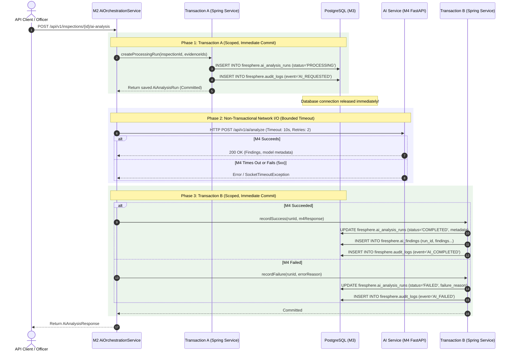

# FireSphere.ai — Phase 3B: Transaction and Security Design

**Author**: Senior Database Architect, Spring Boot Persistence Engineer, Security Architect  
**Status**: PRE-IMPLEMENTATION DESIGN / APPROVAL GATE  
**Date**: October 2026  
**Phase**: Phase 3B (Controlled Database & Evidence Integration)  

---

## 1. Executive Summary

This document validates the transaction management, failure recovery, authentication context, and multi-tenant security architecture for Phase 3B. 

It addresses the identified open transaction anti-pattern in Member 2's AI orchestration layer, details the **Two-Phase Decoupled Transaction Workflow**, provides a concrete analysis of Row-Level Security (RLS) runtime realities, and establishes zero-trust authorization rules.

---

## 2. Two-Phase Transaction Architecture

### 2.1 The Vulnerability in Existing M2 Implementation
In [`AiOrchestrationService.java:L57`](file:///C:/Users/athar/OneDrive/Desktop/Firesphere.ai/M2_work/Firesphere%20m2/backend/src/main/java/com/firesphere/backend/ai/service/AiOrchestrationService.java#L57):
```java
@Transactional // <-- DB connection checked out here
public AiAnalysisResponse requestAnalysis(...) {
    runRepository.save(run); // INSERT run
    ExternalAiResponse externalRes = aiClient.analyze(externalReq); // <-- BLOCKING HTTP CALL (5-30s)
    runRepository.save(run); // UPDATE run
}
```
**Risks**:
1. **Connection Pool Exhaustion**: A 10–30s AI inference call locks a HikariCP pool connection. A burst of 10 concurrent requests starves the entire application.
2. **Loss of Audit Trail**: If M4 times out, Spring rolls back the entire outer transaction, deleting the record of the run having been requested.

### 2.2 The Two-Phase Decoupled Transaction Pattern



---

## 3. Resilience, Idempotency & Failure Recovery

### 3.1 Duplicate Requests & Idempotency
- When an analysis request arrives, M2 checks for an existing active run:
  ```java
  Optional<AiAnalysisRun> activeRun = runRepository
      .findByInspectionIdAndStatusIn(inspectionId, List.of(AiAnalysisStatus.PROCESSING));
  if (activeRun.isPresent()) {
      return mapToResponse(activeRun.get()); // Return in-flight job handle without re-triggering M4
  }
  ```
- If an existing run with identical evidence is `COMPLETED`, M2 returns the cached findings immediately.

### 3.2 Recovery After Application Restarts
- If the M4 service restarts during processing, its ephemeral `InMemoryJobRepository` loses job tracking.
- M2's durable PostgreSQL state retains the `PROCESSING` run record.
- When M2's HTTP client encounters `ConnectException`, Phase 3 marks the run as `FAILED` (`"AI Service unreachable/restarted"`), allowing the officer to safely re-trigger analysis.
- A scheduled background task (`StaleJobReconciler`) periodically queries:
  ```sql
  UPDATE firesphere.ai_analysis_runs 
  SET status = 'TIMED_OUT', failure_reason = 'Orchestration worker heartbeat expired'
  WHERE status = 'PROCESSING' AND requested_at < NOW() - INTERVAL '10 minutes';
  ```

### 3.3 Partial Persistence Failures & Reconciliation
- If M4 analysis succeeds but Transaction B fails due to a database glitch:
  1. M2 catches the persistence exception.
  2. M2 attempts a compensatory write marking status `COMPLETED_PERSISTENCE_FAILED`.
  3. M2 emits an alert log with the full `correlationId` containing serialized findings in log metadata for disaster recovery.

---

## 4. Multi-Tenant Security & Runtime RLS Verification

### 4.1 Strict Reality Check on PostgreSQL Row-Level Security (RLS)
> [!WARNING]
> **RLS is NOT currently providing active runtime protection in M2.**
> 1. **Migration Status**: While `V1.0.5__enable_row_level_security.sql` contains DDL enabling RLS, it depends on session variable:
>    `current_setting('app.current_org_id', TRUE)`.
> 2. **Missing M2 Context Setting**: M2's Spring Boot application **never executes `SET LOCAL app.current_org_id = ...`** on its JDBC connections.
> 3. **Superuser Bypass**: M2's `application.properties` connects using superuser `postgres`. PostgreSQL superusers **bypass RLS policies by default**.
> 4. **Current Protection Level**: Tenant isolation currently relies **exclusively on application-level filtering** (`WHERE organization_id = :orgId` in Spring Data JPA queries).

### 4.2 Phase 3B Multi-Tenant Hardening Requirements
To make database RLS truly operational in Phase 3B:
1. **Dedicated App Role**: Create non-superuser PostgreSQL role `firesphere_app` subject to RLS enforcement.
2. **Connection Hook**: Implement a Spring/Hibernate `StatementInspector` or `ConnectionPrep` hook that runs `SET LOCAL app.current_org_id = '<internalOrgId>'` on every transaction begin.
3. **Defense-in-Depth**: Keep application-level `organizationId` filters in Spring Data JPA queries as primary protection, with RLS acting as the secondary database guardrail.

### 4.3 Evidence Object Isolation (MinIO S3)
- Storage keys MUST strictly namespace objects by tenant:
  $$\text{Key} = \texttt{tenants/\{tenantId\}/evidence/\{evidenceId\}.jpg}$$
- M2 and M4 storage clients validate that `tenantId` does not contain directory traversal characters (`..`, `/`, `\`).

---

## 5. Officer Authentication & Authorization Rules

1. **Zero-Trust for Request-Body Identity**:
   - The system strictly rejects user IDs, officer IDs, or tenant IDs passed inside the JSON request body.
   - Identity is extracted strictly from the verified Spring Security context:
     ```java
     UUID officerUuid = TenantContext.getCurrentUserId();
     UUID tenantUuid = TenantContext.getCurrentOrganizationId();
     ```
2. **Role Verification for Review Operations**:
   - Submitting an officer review (`POST /api/v1/ai/findings/{id}/review`) requires explicit verification:
     ```java
     if (!TenantContext.hasRole("OFFICER") && !TenantContext.hasRole("ADMIN")) {
         throw new ResponseStatusException(HttpStatus.FORBIDDEN, 
             "Statutory review of AI findings requires certified OFFICER credentials.");
     }
     ```
3. **Non-Negotiable Statutory Constraint**:
   - AI findings stored in `firesphere.ai_findings` are locked by database constraint:
     `CHECK (is_advisory = TRUE)`
   - No AI finding can autonomously certify an inspection or approve a Fire NOC certificate. State transitions require authenticated human officer action.
