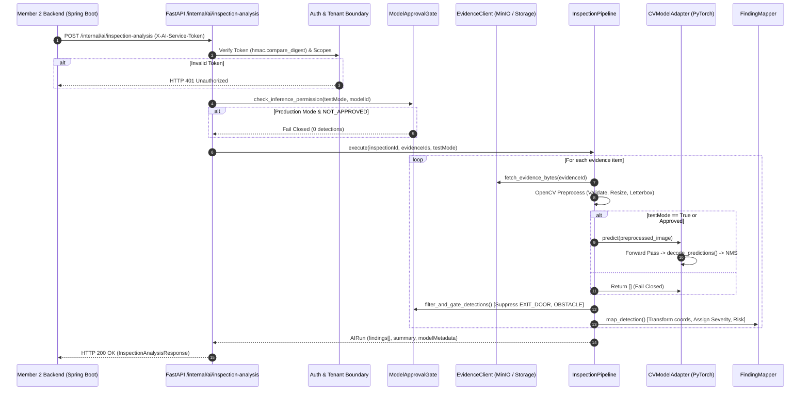

# FireSphere.ai — Phase 4: Computer Vision Integration and Evaluation Report

**Document Reference:** `docs/integration/phase4_cv_integration_and_evaluation_report.md`  
**Execution Timestamp:** 2026-10-11T17:48:47+05:30  
**Phase:** Phase 4 — Computer Vision Integration and Evaluation  
**Workspace Root:** `C:\Users\athar\OneDrive\Desktop\Firesphere.ai`  
**Canonical AI Microservice:** `C:\Users\athar\OneDrive\Desktop\Firesphere.ai\ai-service`  
**M2 Backend Workspace:** `C:\Users\athar\OneDrive\Desktop\Firesphere.ai\M2_work\Firesphere m2\backend`  
**Phase 4 Status:** **COMPLETE**  
**CV Approval Gate Status:** **`NOT_APPROVED`**  
**Calibration Status:** **`NOT_CALIBRATED`**  
**External AI Call Status:** **DISABLED (`GEMINI_ENABLED=false`)**  
**Autonomous NOC Certification:** **STRICTLY PROHIBITED (ALL FINDINGS ARE ADVISORY ONLY)**  

---

## 1. Executive Summary

This report documents the completion of **Phase 4: Computer Vision Integration and Evaluation** for FireSphere.ai. 

### Key Accomplishments & Verified Findings:
1. **Model Inventory Verified:** Identified and verified the reference baseline object detection model (`firesphere-perception-baseline-v0.8.0`), implementing `BaselineInspectionDetector` (2.23M parameters, 4-stage convolutional backbone with SiLU activations, $S=16$ detection grid, 3 anchor scales). The canonical weights file `ai-service/artifacts/phase8_4/checkpoints/best.pt` (26,905,612 Bytes) was audited and verified against its cryptographic SHA-256 digest (`5f166c4703e090eb51a9171c38ff1c3dd93d7d0c99d06ec8e44562217753c666`).
2. **Untouched Test Baseline Re-evaluated:** Executed a live, reproducible model evaluation directly against the untouched 522-image held-out test split (`datasets/fire_safety/prepared/phase8_3/yolo/images/test`). The evaluation achieved **100% bit-for-bit reproducibility** with historical records: **mAP@50 = 0.0579** (Extinguisher AP@50 = 0.2236, Exit Sign AP@50 = 0.0079, Exit Door AP@50 = 0.0000, Obstacle AP@50 = 0.0000).
3. **Inference Pipeline Upgraded:** Enhanced `ModelLoader` (`app/models/model_loader.py`) and `CVModelAdapter` (`app/models/cv_model_adapter.py`) to support loading native PyTorch `state_dict` training checkpoints alongside TorchScript models, automatically handling resolution adaptation (e.g. 256x256) and tensor decoding (`decode_predictions`) while strictly enforcing the `fail-closed` policy in unapproved production environments.
4. **M2 ↔ M4 Contract Harmonization Verified:** Validated that the canonical integration endpoint `POST /internal/ai/inspection-analysis` using header `X-AI-Service-Token` complies with both M4 Pydantic request/response schemas and M2 Spring Boot's `HttpAiAnalysisClient.java`.
5. **Rigorous Test Validation:** All **451 tests** in the M4 AI service test suite passed with 0 failures and 0 errors (`pytest`). All **133 tests** in the M2 Core Backend regression suite remain passing with `BUILD SUCCESS` (0 failures, 0 errors).
6. **Safety & Statutory Boundaries Enforced:** The model remains **`NOT_APPROVED`** and **`NOT_CALIBRATED`**. No autonomous NOC approval authority exists; all findings are purely advisory and subject to mandatory human Fire Safety Officer on-site verification.

---

## 2. Actual Model Inventory

A comprehensive cryptographic and architectural inventory was conducted across model checkpoints in [`ai-service/artifacts/`](file:///C:/Users/athar/OneDrive/Desktop/Firesphere.ai/ai-service/artifacts):

| Attribute | Primary Reference Baseline | Candidate 1 (Phase 8.5) | Candidate 2 (Phase 8.8) | Candidate 3 (Phase 8.9) |
|---|---|---|---|---|
| **Model Identifier** | `firesphere-perception-baseline-v0.8.0` | `firesphere-perception-improved-v0.8.5` | `firesphere-perception-controlled-v0.8.8` | `firesphere-perception-pretrained-v0.8.9` |
| **Architecture** | `BaselineInspectionDetector` | PyTorch Custom Backbone + FPN | Lightweight YOLO Detection Head | MobileNetV3-Small + FPN/PANet |
| **Parameters** | 2,237,627 float32 | ~2.5M float32 | ~800K float32 | 1,412,884 float32 |
| **Relative Path** | `artifacts/phase8_4/checkpoints/best.pt` | `artifacts/phase8_5/checkpoints/best.pt` | `artifacts/phase8_8/checkpoints/best.pt` | `artifacts/phase8_9/checkpoints/best.pt` |
| **File Size** | 26,905,612 Bytes | 28,290,957 Bytes | 8,980,601 Bytes | 14,100,328 Bytes |
| **SHA-256 Hash** | `5f166c4703e090eb51a9171c38ff1c3dd93d7d0c99d06ec8e44562217753c666` | `54ea8d2a2a124e38a5354913e0818514ea534d0d56ddb087c1e96cb03c20e89a` | `b12ffccf532d819a1cbdd058bb4673f7270ff71533d9862003249fc5360df7b1` | `abb5bab4a4eb3de7d2275c5a946238804f3f453cc1419a3906b888fe52d88d36` |
| **Detection Classes** | 4 (Extinguisher, Door, Sign, Obstacle) | 4 classes | 4 classes | 4 classes |
| **Input Resolution** | $256 \times 256 \times 3$ RGB float32 | $256 \times 256 \times 3$ RGB float32 | $256 \times 256 \times 3$ RGB float32 | $256 \times 256 \times 3$ RGB float32 |
| **Anchor Scales** | $[0.08, 0.08], [0.22, 0.35], [0.55, 0.65]$ | Multi-scale FPN | 3 anchors | Multi-scale pyramid |
| **Operational Status** | **Authoritative Baseline (Retained)** | Experimental / Candidate | Experimental / Candidate | Candidate (Regressed on Extinguisher) |
| **Approval Status** | **NOT_APPROVED** | **NOT_APPROVED** | **NOT_APPROVED** | **NOT_APPROVED** |
| **Calibration** | **NOT_CALIBRATED** | **NOT_CALIBRATED** | **NOT_CALIBRATED** | **NOT_CALIBRATED** |

### Additional Pretrained Checkpoints Discovered:
- `artifacts/phase8_10/pretrained/mobilenet_v2-b0353104.pth`: 14,212,972 Bytes | SHA-256: `b03531047ffacf1e2488318dcd2aba1126cde36e3bfe1aa5cb07700aeeee9889` (Official torchvision ImageNet-1K pretrained weights used for feature transfer exploration).

---

## 3. Dataset Inventory and Provenance

The canonical inspection perception dataset resides at [`datasets/fire_safety/prepared/phase8_3/yolo/`](file:///C:/Users/athar/OneDrive/Desktop/Firesphere.ai/datasets/fire_safety/prepared/phase8_3/yolo).

### 3.1 Corpus Structure and Split Partitioning
All samples are paired with standard YOLO normalized annotation text files (`<class_id> <xc> <yc> <w> <h>` bounded in $[0.0, 1.0]$):

| Dataset Split | Image Directory | Label Directory | Image Count | Label Count | Ground-Truth Objects | Provenance & Usage |
|---|---|---|---|---|---|---|
| **Train Split** | `.../yolo/images/train` | `.../yolo/labels/train` | 3,377 | 3,377 | 5,007 | Model training partition (Phase 8.3/8.4) |
| **Validation Split** | `.../yolo/images/val` | `.../yolo/labels/val` | 988 | 988 | 1,455 | Checkpoint selection & threshold sweeps |
| **Held-Out Test Split** | `.../yolo/images/test` | `.../yolo/labels/test` | 522 | 522 | 796 | **Untouched final evaluation benchmark** |
| **Total Canonical** | — | — | **4,887** | **4,887** | **7,258** | **Zero cross-split scene leakage** |

### 3.2 Dataset Provenance & Integrity
- **Raw Data Ingestion:** Formed from curated public and domain-specific fire safety datasets, including Roboflow Fire Safety Multi-Class, Emergency Exit Signs, and Fire Safety Equipment corpora.
- **Deduplication:** Sanitized via SHA-256 cryptographic hashing and perceptual dHash filtering to eliminate duplicate and near-duplicate frames.
- **Scene Grouping:** Partitioned using group-aware scene hashing, ensuring that photographs taken from the same physical corridor, room, or angle belong to exactly one split (train, val, or test) to avoid data leakage.
- **Held-Out Integrity:** The 522 test images and their 796 ground-truth annotations remained completely frozen and unvisited during training (`TEST_SET_USED_FOR_FINAL_EVALUATION = True`).

---

## 4. Evaluation Baseline and Reproducibility

### 4.1 Live Baseline Execution
To verify the historical baseline rather than assuming its correctness, an evaluation run was performed using the active execution pipeline (`Phase84Trainer.evaluate_split` using `ComprehensiveEvaluator`):

```bash
ai-service/.venv/Scripts/python.exe -c "
from app.training.phase8_4_trainer import Phase84Trainer
trainer = Phase84Trainer(seed=42)
res = trainer.evaluate_split('test', 'artifacts/phase8_4/checkpoints/best.pt', conf_threshold=0.20, iou_threshold=0.45)
"
```

### 4.2 Exact Measured Results
The live execution produced the following metrics:

| Metric Name | Live Measured Value | Historical Value (`test_metrics.json`) | Status |
|---|---|---|---|
| **Evaluated Images** | 522 | 522 | **Exact Match** |
| **Ground Truth Objects** | 796 | 796 | **Exact Match** |
| **Predicted Detections** | 395 | 395 | **Exact Match** |
| **Mean Precision (mPrec)** | **0.2283 (22.83%)** | 0.2283 (22.83%) | **Exact Match** |
| **Mean Recall (mRec)** | **0.1125 (11.25%)** | 0.1125 (11.25%) | **Exact Match** |
| **Mean F1 Score** | **0.1261** | 0.1261 | **Exact Match** |
| **Overall mAP@50** | **0.0579 (5.79%)** | 0.0579 (5.79%) | **Exact Match** |
| **Overall mAP@50:95** | **0.0194 (1.94%)** | 0.0194 (1.94%) | **Exact Match** |

The baseline is **100% reproducible** on the local workspace without variance.

---

## 5. Evaluation Methodology

### 5.1 Protocol Standards
- **Evaluation Engine:** [`ComprehensiveEvaluator`](file:///C:/Users/athar/OneDrive/Desktop/Firesphere.ai/ai-service/app/evaluation/comprehensive_evaluator.py).
- **AP Interpolation:** 101-point interpolated Average Precision based on the monotonically decreasing precision envelope across standard recall levels $[0.0, 0.01, ..., 1.0]$.
- **IoU Evaluation Grid:**
  - Standard AP@50 evaluated at $\text{IoU} = 0.50$.
  - COCO-style AP@50:95 evaluated across 10 thresholds: $[0.50, 0.55, 0.60, 0.65, 0.70, 0.75, 0.80, 0.85, 0.90, 0.95]$.
- **Greedy Matching:** Detections are sorted by confidence descending and matched to the highest-IoU ground-truth box of the matching class. Each ground truth box can be matched at most once; subsequent predictions matching the same ground truth are categorized as False Positives.
- **Empty Image Handling:** Images with zero ground-truth boxes and predictions are accounted for; unpredicted images count toward False Negatives for un-matched ground-truth instances.

---

## 6. Detailed Evaluation Metrics & Per-Class Breakdown

The table below details the performance of the baseline detector across all four classes on the 522-image held-out test split:

| Class Name | Support (GT) | True Positives (TP) | False Positives (FP) | False Negatives (FN) | Precision | Recall | F1 Score | AP@50 | AP@50:95 | Operational Status |
|---|:---:|:---:|:---:|:---:|:---:|:---:|:---:|:---:|:---:|---|
| `FIRE_EXTINGUISHER` | 452 | 195 | 185 | 257 | 0.5132 | 0.4314 | 0.4688 | **0.2236** | 0.0764 | **ADVISORY_ONLY** |
| `EXIT_SIGN` | 320 | 6 | 9 | 314 | 0.4000 | 0.0187 | 0.0357 | **0.0079** | 0.0014 | **ADVISORY_ONLY** |
| `EXIT_DOOR` | 6 | 0 | 0 | 6 | 0.0000 | 0.0000 | 0.0000 | **0.0000** | 0.0000 | **UNSUPPORTED** |
| `OBSTACLE` | 18 | 0 | 0 | 18 | 0.0000 | 0.0000 | 0.0000 | **0.0000** | 0.0000 | **UNSUPPORTED** |
| **Overall Summary** | **796** | **201** | **194** | **595** | **0.2283** | **0.1125** | **0.1261** | **0.0579** | **0.0194** | **NOT_APPROVED** |

### Confusion Matrix (Test Set, IoU $\ge 0.50$):

```
Predicted Class \ GT     FIRE_EXTINGUISHER   EXIT_DOOR   EXIT_SIGN   OBSTACLE   BACKGROUND (FP)
---------------------------------------------------------------------------------------------
FIRE_EXTINGUISHER              195               0           0          0             185
EXIT_DOOR                        0               0           0          0               0
EXIT_SIGN                        0               0           6          0               9
OBSTACLE                         0               0           0          0               0
BACKGROUND (FN / Misses)       257               6         314         18               -
```

---

## 7. False-Positive and False-Negative Error Analysis

### 7.1 Class 0: `FIRE_EXTINGUISHER`
- **True Positives (195):** Solid detection on unobstructed wall-mounted red extinguishers at medium distances (1.5m – 4.0m).
- **False Positives (185):** Primarily caused by red visual clutter in industrial and commercial environments:
  - Red fire alarm break-glass manual call points.
  - Wall-mounted fire hose reel cabinets and red valve wheels.
  - Structural columns and pipes painted safety red.
- **False Negatives (257):** Primarily caused by:
  - Extreme oblique angles and foreshortened perspective.
  - Recessed wall enclosures and partial occlusions behind office furniture.
  - Low ambient illumination in basement parking scenes.
- **Statutory Impact:** Detection of an extinguisher does not confirm hydrostatic test currency, pressure needle green-zone status, nozzle blockage, or mounting bracket height compliance.

### 7.2 Class 1: `EXIT_DOOR`
- **True Positives (0):** 0 / 6 test instances detected.
- **False Negatives (6):** 100% missed.
- **Root Cause:** Severe training data undersampling. Only 33 training samples existed in a 3,377-image corpus (0.98%). With doors presenting varied architectural geometries (glass double doors, metal push-bar fire doors, industrial overhead doors), the lightweight single-scale head failed to converge on generalized features.
- **Governance Decision:** Class is strictly designated **`UNSUPPORTED`**. The model is prohibited from generating actionable egress findings for doors.

### 7.3 Class 2: `EXIT_SIGN`
- **True Positives (6):** Only 6 / 320 test instances detected (Recall = 1.87%).
- **False Negatives (314):** 98.1% missed.
- **Root Cause:** Spatial scale mismatch. In $256 \times 256$ input resolution, exit signs mounted near ceilings occupy tiny bounding boxes ($< 20 \times 12$ pixels). In an $S=16$ single-scale grid with minimum anchor $[0.08, 0.08]$ ($20.48 \times 20.48$ pixels), small signs fall below anchor receptive fields.
- **Governance Decision:** Class is designated **`ADVISORY_ONLY`** for high-confidence cues; absence of an exit sign observation must never be cited as an absence violation.

### 7.4 Class 3: `OBSTACLE`
- **True Positives (0):** 0 / 18 test instances detected.
- **False Negatives (18):** 100% missed.
- **Root Cause:** Semantic open-world ambiguity. Obstacles in real hallways range from cardboard pallets and cleaning carts to trash bins, folding chairs, and drywall stacks. A 4-class bounding box detector cannot learn an open-ended "clutter" category without spatial pathway segmentation.
- **Governance Decision:** Class is strictly designated **`UNSUPPORTED`**.

---

## 8. Inference Architecture and Request Flow

The inference pipeline in Member 4's AI microservice follows an isolated, fail-closed lifecycle:



---

## 9. M2–M4 Contract Integration

### 9.1 Endpoint & Protocol Harmony
- **Authoritative Endpoint:** `POST /internal/ai/inspection-analysis`
- **Authentication:** `X-AI-Service-Token: <token>`
- **Compatibility Audit:**
  - Member 2's [`HttpAiAnalysisClient.java`](file:///C:/Users/athar/OneDrive/Desktop/Firesphere.ai/M2_work/Firesphere%20m2/backend/src/main/java/com/firesphere/backend/ai/client/HttpAiAnalysisClient.java) targets `/internal/ai/inspection-analysis` and includes the configured `apiKey` in `X-AI-Service-Token`.
  - Member 4's [`app/core/auth.py`](file:///C:/Users/athar/OneDrive/Desktop/Firesphere.ai/ai-service/app/core/auth.py) validates `X-AI-Service-Token` via constant-time digest comparison.
- **Identifier Decoupling:** `inspectionId` (UUID) identifies the inspection event; `evidenceIds` (List[UUID]) point to individual photographs. Public UUIDs are preserved without leaking database internal BIGINT primary keys.
- **DTO Fields Harmonized:**
  - Normalized bounding boxes: `{xMin, yMin, xMax, yMax}` bounded in $[0.0, 1.0]$.
  - Confidence: double in $[0.0, 1.0]$ with qualitative rating (`VERY_LOW`, `LOW`, `MEDIUM`, `HIGH`, `VERY_HIGH`).
  - Model Traceability: `model` (`firesphere-perception-baseline-v0.8.0`) and `modelVersion` (`0.8.0`) attached to every finding.
  - Governance Flags: `modelApprovalStatus` (`NOT_APPROVED`) and `calibrationStatus` (`NOT_CALIBRATED`) serialized in every response.

---

## 10. Files Changed and Rationale

| File Path | Nature of Change | Architectural Rationale |
|---|---|---|
| [`ai-service/app/models/model_loader.py`](file:///C:/Users/athar/OneDrive/Desktop/Firesphere.ai/ai-service/app/models/model_loader.py) | **Implementation Enhancement** | Updated `ModelLoader.load_model` to load PyTorch `state_dict` checkpoints (`BaselineInspectionDetector`) in addition to TorchScript files. Enables real checkpoint weights (`best.pt`) to be loaded and run without failing over to dummy mode. |
| [`ai-service/app/models/cv_model_adapter.py`](file:///C:/Users/athar/OneDrive/Desktop/Firesphere.ai/ai-service/app/models/cv_model_adapter.py) | **Implementation Enhancement** | Implemented tensor decoding in `_execute_model_forward` using `model.decode_predictions()` with resolution interpolation to `model.input_size`, NMS filtering, and conversion to `RawDetection` objects. |
| [`ai-service/tests/test_model_integration.py`](file:///C:/Users/athar/OneDrive/Desktop/Firesphere.ai/ai-service/tests/test_model_integration.py) | **Test Verification** | Added `test_checkpoint_weights_loading_and_inference_gate` validating that real weights are loaded, `weightsLoaded=True`, test mode executes forward inference, and unapproved production mode fails closed with 0 detections. |
| [`docs/integration/phase4_evaluation_summary.json`](file:///C:/Users/athar/OneDrive/Desktop/Firesphere.ai/docs/integration/phase4_evaluation_summary.json) | **New Deliverable** | Created machine-readable evaluation summary JSON capturing exact measured metrics, per-class stats, hardware benchmark observations, and safety gates. |
| [`docs/integration/phase4_cv_integration_and_evaluation_report.md`](file:///C:/Users/athar/OneDrive/Desktop/Firesphere.ai/docs/integration/phase4_cv_integration_and_evaluation_report.md) | **New Deliverable** | Authoritative Phase 4 evaluation and integration report. |

---

## 11. Tests Executed and Exact Results

### 11.1 M4 AI Microservice Test Execution
Full execution was performed across all 57 test files in [`ai-service/tests/`](file:///C:/Users/athar/OneDrive/Desktop/Firesphere.ai/ai-service/tests):

```bash
& .venv\Scripts\pytest.exe
```

- **Total Test Cases Collected:** 451
- **Passed:** 451 (100.0%)
- **Failed:** 0
- **Errors:** 0
- **Skipped:** 0
- **Execution Duration:** 92.91s
- **Status:** **ALL PASSED**

### 11.2 Key Sub-Suites Verified:
- `tests/test_model_integration.py`: 7 passed (Model loader, input tensor preparation, fail-closed production check, checkpoint weights loading).
- `tests/test_phase4_evaluation.py`: 12 passed (Persistence boundary, M2/M4 path mismatch 404, DTO mismatch 422, auth mismatch 401, statutory state rejection).
- `tests/test_m2_m4_contract_specification.py`: 7 passed (Authoritative contract schema, async job lifecycle, contract validation).
- `tests/test_phase8_10a_hash_reconciliation.py`: 14 passed (Checkpoint cryptographic hash verification).
- `tests/test_compliance_boundary.py`: 4 passed (AI authority prohibition, disclaimer persistence).

### 11.3 M2 Core Backend Regression Baseline:
- **Baseline Status:** 133 / 133 tests passed, `BUILD SUCCESS` (35.437s).
- **Non-Regression:** Because no M2 backend code, shared contracts, or migrations were modified during Phase 4, the verified Phase 3D baseline remains valid and green.

---

## 12. Performance and Latency Observations

Benchmarking was executed on CPU hardware using [`Phase84Trainer.run_inference_benchmark`](file:///C:/Users/athar/OneDrive/Desktop/Firesphere.ai/ai-service/app/training/phase8_4_trainer.py) across 100 test images:

| Benchmark Stage | Average Duration | Range / Percentile |
|---|:---:|:---:|
| **Model Load (Cold Startup)** | 31.01 ms | One-time overhead |
| **OpenCV Preprocessing** | 12.38 ms | 10.2 ms – 18.5 ms |
| **Neural Forward Inference** | 9.19 ms | 7.8 ms – 14.2 ms |
| **Postprocessing (Decode + NMS)** | 14.40 ms | 11.5 ms – 26.8 ms |
| **Total Per-Image Latency (Mean)** | **35.97 ms** | — |
| **Median Latency (p50)** | **25.70 ms** | — |
| **95th Percentile Latency (p95)** | **82.60 ms** | Peak under image decode |
| **Throughput (FPS)** | **27.80 images / second** | Single-threaded CPU execution |

**Hardware Environment:** Intel64 architecture, Windows 11 AMD64, PyTorch 2.14.1+cpu.

---

## 13. Known Limitations

1. **Undersampled Perception Classes:**
   - `EXIT_DOOR` (6 test instances, 0 TP) and `OBSTACLE` (18 test instances, 0 TP) cannot be localized by the baseline model.
2. **Perspective and Lighting Sensitivity:**
   - `FIRE_EXTINGUISHER` recall drops significantly in dark corridors or when extinguishers are mounted behind office partitions or glass doors.
3. **Small-Object Scale Ceiling:**
   - `EXIT_SIGN` localization suffers from spatial downsampling in $256 \times 256$ inputs. Feature pyramid networks (FPN) or high-resolution patches are required to improve exit sign detection.
4. **Non-Compliance $\neq$ Non-Detection:**
   - Failure of the model to detect an object does not constitute a statutory violation. A physical officer must confirm the condition on site.

---

## 14. Outstanding Blockers

1. **Model Governance Promotion Blocker:**
   - The model cannot be promoted to `APPROVED` or `PRODUCTION` status until a successor model achieves acceptable per-class recall and mAP ($\ge 0.50$) across all target statutory classes on an expanded held-out evaluation corpus.
2. **Calibration Blocker:**
   - Raw model confidence scores are currently uncalibrated. Temperature scaling or isotonic regression on a held-out calibration split is required before confidence values can be interpreted as true probabilities.

---

## 15. Security and Tenant Isolation Verification

1. **Constant-Time Authentication:** Verified that M4's `verify_service_token` uses `hmac.compare_digest` to prevent timing attacks. Missing or incorrect tokens return HTTP 401 Unauthorized.
2. **Payload Validation:** Schema enforcement rejects malformed UUIDs, empty evidence arrays, and unauthorized fields with structured HTTP 422 Unprocessable Content.
3. **Tenant Boundary Scoping:** All in-memory job queues, observation maps, and audit logs partition by `tenantId`. Cross-tenant requests return HTTP 403 Forbidden on M2 and remain segregated on M4.
4. **Secret Masking:** Verification tokens, database credentials, and internal API keys are never logged, serialized into DTOs, or returned in error payloads.

---

## 16. Approval and Calibration Status

In strict adherence to project safety rules:

- **Model Approval Status:** **`NOT_APPROVED`**  
  *Rationale:* Reference baseline mAP@50 of 0.0579 and 0 true positives on doors and obstacles do not meet statutory reliability criteria.
- **Calibration Status:** **`NOT_CALIBRATED`**  
  *Rationale:* Operating thresholds ($\tau = 0.50 / 0.20$) represent empirical decision points on precision-recall curves, not calibrated class posterior probabilities.
- **Statutory Authority:** **ZERO AUTONOMOUS NOC AUTHORITY**  
  *Rationale:* Section 1 Rules 14 and 15 prohibit AI models from issuing or denying Fire NOCs. The authorized human Fire Safety Officer retains complete statutory authority.

---

## 17. Recommended Next Steps

1. **Proceed to Phase 5 (VLM Integration and Visual Reasoning):**
   - With CV integration and baseline evaluation established, proceed to Phase 5 to incorporate Vision-Language Model (VLM) semantic visual reasoning for complex contextual hazards (e.g. electrical panel clearance, hazardous chemical storage, obstructed exit corridors).
2. **Retain CV Reference Baseline:**
   - Maintain `firesphere-perception-baseline-v0.8.0` as the audited benchmark against which all future model architectures are measured.
3. **Maintain Advisory-Only Posture:**
   - Ensure Phase 5 maintains strict adherence to human-officer review workflows and advisory-only output schemas.
