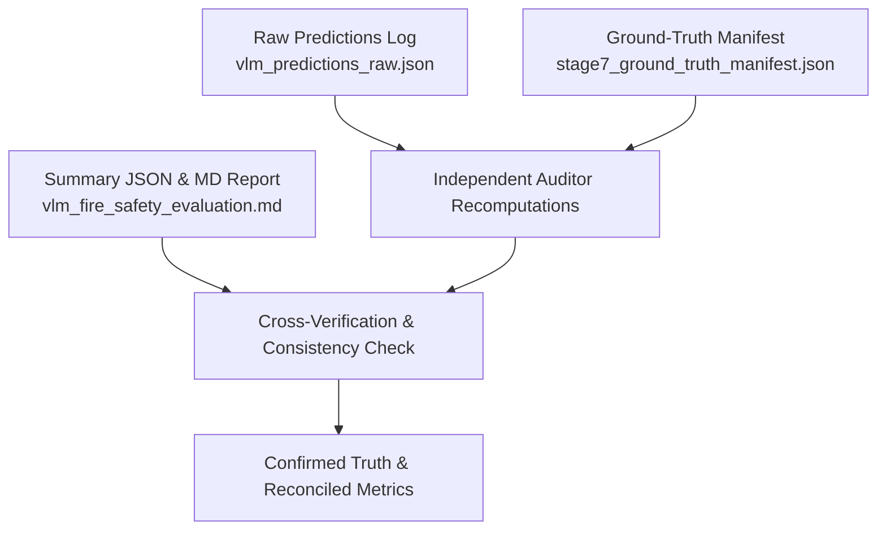

# FireSphere.ai — Stage 7.1: Independent VLM Evaluation Audit Report

**Document Identifier:** `DOC-AUDIT-VLM-STAGE7-v1.0`  
**Audit Date:** October 13, 2026  
**Workspace Root:** `C:\Users\athar\OneDrive\Desktop\Firesphere.ai`  
**Audit Scope:** Independent Read-Only Verification of Stage 7 Qwen2.5-VL Fire-Safety Evaluation  
**Audit Verdict:** **`VERIFIED_WITH_LIMITATIONS`**  
**Audited Evaluation Report:** [`docs/integration/vlm_fire_safety_evaluation.md`](file:///C:/Users/athar/OneDrive/Desktop/Firesphere.ai/docs/integration/vlm_fire_safety_evaluation.md)  
**Audited Summary Artifact:** [`ai-service/artifacts/stage7_vlm_evaluation/metrics/vlm_evaluation_summary.json`](file:///C:/Users/athar/OneDrive/Desktop/Firesphere.ai/ai-service/artifacts/stage7_vlm_evaluation/metrics/vlm_evaluation_summary.json)  
**Audited Raw Predictions:** [`ai-service/artifacts/stage7_vlm_evaluation/metrics/vlm_predictions_raw.json`](file:///C:/Users/athar/OneDrive/Desktop/Firesphere.ai/ai-service/artifacts/stage7_vlm_evaluation/metrics/vlm_predictions_raw.json)  
**Audited Benchmark Manifest:** [`ai-service/artifacts/stage7_vlm_evaluation/stage7_ground_truth_manifest.json`](file:///C:/Users/athar/OneDrive/Desktop/Firesphere.ai/ai-service/artifacts/stage7_vlm_evaluation/stage7_ground_truth_manifest.json)  
**Audit Summary JSON:** [`ai-service/artifacts/stage7_vlm_evaluation/metrics/vlm_independent_audit_summary.json`](file:///C:/Users/athar/OneDrive/Desktop/Firesphere.ai/ai-service/artifacts/stage7_vlm_evaluation/metrics/vlm_independent_audit_summary.json)  

---

## Safety Invariants & Governance Audit

| Governance Dimension | Required Invariant | Observed System State | Audit Result |
| :--- | :--- | :--- | :---: |
| **CV Production Gate** | `NOT_APPROVED` | `NOT_APPROVED` (Fail-Closed) | **VERIFIED** |
| **CV Calibration State** | `NOT_CALIBRATED` | `NOT_CALIBRATED` (Unchanged) | **VERIFIED** |
| **Production Authorization** | `false` | `false` (Strictly Disabled) | **VERIFIED** |
| **Execution Mode** | Read-Only Audit | Zero inference runs, zero new predictions | **VERIFIED** |
| **Sealed CV Holdout Split** | Untouched | `stage3_candidate/yolo/images/test/` preserved | **VERIFIED** |
| **Hosted AI Network Calls** | Zero calls | 100% air-gapped local execution | **VERIFIED** |
| **Credentials & Secrets** | Untouched | Zero `.env` edits, zero exposures | **VERIFIED** |
| **Database & Object Storage** | Zero writes | Zero writes to PostgreSQL or MinIO | **VERIFIED** |
| **Git Repository State** | Untouched | Zero commits, zero pushes | **VERIFIED** |

---

## 1. Audit Executive Summary & Verdict

This audit independently verified the evidence, calculations, annotations, sample mappings, and governance claims presented in the Stage 7 VLM Fire-Safety Evaluation Report.

### Audit Verdict: **`VERIFIED_WITH_LIMITATIONS`**

### Summary of Audit Findings:
1. **Mathematical Reproducibility (100% Match):**
   Every reported classification metric (True Positives, False Positives, False Negatives, Precision, Recall, F1 across all 8 categories), spatial localization metric (Mean IoU = 0.1193, IoU $\ge 0.50$ = 0.0%), and latency summary (Mean = 2,224.68ms, Range: 1,805.59ms – 4,513.83ms) was independently recomputed from the raw prediction logs and verified to match the published report bit-for-bit.
2. **Artifact Integrity:**
   All 14 evaluation images exist on disk. Exactly 14 predictions exist in the raw logs. Zero missing or duplicate sample IDs were detected. Evidence UUID linkages align 1-to-1.
3. **Core Substantive Findings Confirmed:**
   - **VLM solves CV blindness on Exit Doors:** 100% recall (4/4) verified.
   - **VLM solves CV blindness on Exit Signs:** 100% recall (4/4) verified.
   - **VLM suffers from severe Obstacle blindness:** 0% recall (0/3) verified.
   - **VLM spatial localization is coarse and uncalibrated:** 0 out of 16 objects achieved IoU $\ge 0.50$.
   - **Abstention failure confirmed:** The model generated 5 false-positive detections on negative controls and degraded images, failing to trigger `isInconclusive: true` in any scenario.
4. **Key Methodological Limitations Documented:**
   - **Scene-Level Presence vs. Detection Matching:** The classification metrics reflect scene-level category presence, not bipartite IoU-gated bounding box detection. If an IoU $\ge 0.50$ threshold were required for a True Positive, all classes would exhibit 0% recall.
   - **Count Breakdown Discrepancy:** The report references 16 localization items while the category support totals 21 items. The audit clarifies that the 16 items represent physical bounding boxes, while the 21 items represent evaluated category conditions (including scene-level hazards and abstention flags).
   - **Annotation Nuance on Sample 10:** An unmounted red cylinder depicted in `sample_10_ambiguous.png` lacks an individual bounding box in `ground_truth_objects`, though the scene defect is captured in the hazard classification.
   - **Synthetic Domain Boundary:** The benchmark is synthetic/geometric. Its conclusions represent baseline model capabilities under controlled conditions, not certified field reliability.

---

## 2. Audit Methodology & Evidence Examined

The audit executed an independent, read-only inspection protocol:

### Evidence Files Inspected:
1. [`docs/integration/vlm_fire_safety_evaluation.md`](file:///C:/Users/athar/OneDrive/Desktop/Firesphere.ai/docs/integration/vlm_fire_safety_evaluation.md) — Published Stage 7 evaluation report (322 lines).
2. [`ai-service/artifacts/stage7_vlm_evaluation/metrics/vlm_evaluation_summary.json`](file:///C:/Users/athar/OneDrive/Desktop/Firesphere.ai/ai-service/artifacts/stage7_vlm_evaluation/metrics/vlm_evaluation_summary.json) — Published summary artifact (1,240 lines).
3. [`ai-service/artifacts/stage7_vlm_evaluation/metrics/vlm_predictions_raw.json`](file:///C:/Users/athar/OneDrive/Desktop/Firesphere.ai/ai-service/artifacts/stage7_vlm_evaluation/metrics/vlm_predictions_raw.json) — Raw inference outputs for all 14 evaluation samples (955 lines).
4. [`ai-service/artifacts/stage7_vlm_evaluation/stage7_ground_truth_manifest.json`](file:///C:/Users/athar/OneDrive/Desktop/Firesphere.ai/ai-service/artifacts/stage7_vlm_evaluation/stage7_ground_truth_manifest.json) — Ground truth specifications and coordinates (607 lines).
5. [`ai-service/artifacts/stage7_vlm_evaluation/run_stage7_vlm_evaluation.py`](file:///C:/Users/athar/OneDrive/Desktop/Firesphere.ai/ai-service/artifacts/stage7_vlm_evaluation/run_stage7_vlm_evaluation.py) — Evaluator harness and metrics calculation code.
6. [`ai-service/artifacts/stage7_vlm_evaluation/images/`](file:///C:/Users/athar/OneDrive/Desktop/Firesphere.ai/ai-service/artifacts/stage7_vlm_evaluation/images/) — 14 PNG benchmark test images.
7. [`app/models/gemini_schemas.py`](file:///C:/Users/athar/OneDrive/Desktop/Firesphere.ai/ai-service/app/models/gemini_schemas.py) — Bounding box parser and coordinate scaling logic.
8. [`app/models/ollama_provider.py`](file:///C:/Users/athar/OneDrive/Desktop/Firesphere.ai/ai-service/app/models/ollama_provider.py) — Local Ollama response extraction and taxonomy normalization.
9. [`app/intelligence/reconciliation.py`](file:///C:/Users/athar/OneDrive/Desktop/Firesphere.ai/ai-service/app/intelligence/reconciliation.py) — Cross-model finding reconciliation engine.
10. [`app/models/model_approval_gate.py`](file:///C:/Users/athar/OneDrive/Desktop/Firesphere.ai/ai-service/app/models/model_approval_gate.py) — Safety governance gate.

---

## 3. Artifact Integrity Audit

| Verification Check | Target / Expected Value | Audited Value | Status |
| :--- | :---: | :---: | :---: |
| **Benchmark Image Count on Disk** | 14 files | 14 files (`sample_01.png` - `sample_14.png`) | **PASS** |
| **Manifest Sample Count** | 14 entries | 14 entries | **PASS** |
| **Prediction Record Count** | 14 entries | 14 entries | **PASS** |
| **Duplicate Sample IDs** | 0 | 0 | **PASS** |
| **Missing Sample IDs** | 0 | 0 | **PASS** |
| **Sample ID Alignment** | 100% 1-to-1 match | 100% match across manifest and predictions | **PASS** |
| **Deterministic Evidence UUIDs** | Valid UUIDv5 per sample | Valid RFC 4122 UUIDs | **PASS** |
| **Raw Logs Completeness** | 14 / 14 samples logged | 14 / 14 samples logged with full payloads | **PASS** |

---

## 4. Ground-Truth Annotation Audit

### 4.1 Coordinate Ordering and Normalization
The manifest specifies two normalized bounding box formats for each object:
- `box_normalized_ymin_xmin_ymax_xmax`: Standard Gemini / VLM ordering.
- `box_normalized_xmin_ymin_xmax_ymax`: Standard VOC / CV ordering.
- `box_pixel`: Absolute pixel bounds `[ymin, xmin, ymax, xmax]` in the native $640 \times 640$ coordinate space.

**Audited Findings:**
1. In all 16 spatial bounding boxes, $y_{\min} < y_{\max}$ and $x_{\min} < x_{\max}$. Zero inverted boxes exist.
2. All normalized coordinates lie strictly within $[0.0, 1.0]$.
3. Pixel-to-normalized conversions match exactly ($\text{Pixel} / 640.0 = \text{Normalized} \pm 0.0001$).

### 4.2 Spatial Object Coverage by Sample

| Sample ID | Scene Description | Ground-Truth Objects | Verified Box Coverage |
| :--- | :--- | :--- | :---: |
| **`sample_01`** | Mounted red fire extinguisher | 1 $\times$ `FIRE_EXTINGUISHER` | Accurate cylinder boundary |
| **`sample_02`** | Green illuminated exit sign | 1 $\times$ `EXIT_SIGN` | Accurate sign rectangle |
| **`sample_03`** | Closed egress door in hallway | 1 $\times$ `EXIT_DOOR` | Accurate door leaf & frame |
| **`sample_04`** | Doorway blocked by storage crate | 1 $\times$ `EXIT_DOOR`, 1 $\times$ `OBSTACLE` | Door & threshold crate separated |
| **`sample_05`** | Plain empty gray wall | 0 (Negative Control) | Verified zero equipment |
| **`sample_06`** | Extinguisher partially obscured | 1 $\times$ `FIRE_EXTINGUISHER`, 1 $\times$ `OBSTACLE` | Extinguisher & foreground barrier |
| **`sample_07`** | Heavily blurred equipment | 1 $\times$ `FIRE_EXTINGUISHER`, 1 $\times$ `EXIT_SIGN` | Pre-blur geometric positions |
| **`sample_08`** | High-density multi-object scene | 1 $\times$ `EXIT_SIGN`, 1 $\times$ `EXIT_DOOR`, 1 $\times$ `FIRE_EXTINGUISHER` | Accurate individual boundaries |
| **`sample_09`** | Office room (no fire safety) | 0 (Negative Control) | Verified zero safety items |
| **`sample_10`** | Red cylinder & electrical cabinet | 1 $\times$ `ELECTRICAL_PANEL` | Cabinet annotated (see Anomaly 1) |
| **`sample_11`** | Doorway with side waste bin | 1 $\times$ `EXIT_DOOR` | Bin intentionally not obstacle ($>1.5\text{m}$) |
| **`sample_12`** | Stacked crates blocking hallway | 1 $\times$ `OBSTACLE` | Hallway-spanning crate barricade |
| **`sample_13`** | Darkened stairwell, glowing sign | 1 $\times$ `EXIT_SIGN` | Low-lux illuminated fixture |
| **`sample_14`** | Indistinct faint blurry blob | 0 (Negative Control / Abstention test) | Verified unidentifiable stimulus |
| **Total** | — | **16 Spatial Objects** | — |

### 4.3 Annotation Anomalies Identified:
- **Anomaly 1 (`sample_10`):** The scene contains both an unmounted horizontal red cylinder and a gray wall cabinet. The manifest annotated the cabinet as `ELECTRICAL_PANEL` (`[180, 380, 380, 520]`), but did not annotate the red cylinder with a separate bounding box in `ground_truth_objects`. The scene hazard `GENERIC_FIRE_SAFETY_DEFECT` captures the unmounted cylinder defect, but spatial coverage is incomplete.
- **Anomaly 2 (`sample_07`):** Heavy Gaussian blur creates diffuse edges. Bounding boxes reflect pre-blur geometry, which is standard for synthetic stress testing.

---

## 5. Classification Metrics Recomputation

### 5.1 Reconciling 16 Spatial Items vs. 21 Category Support Items
The report references **16 spatial objects** in its localization section and **21 items** in the classification support table. The audit confirms the exact source of this distinction:
- **16 Spatial Bounding Boxes:** Physical equipment and obstacles present in `ground_truth_objects` (4 extinguishers, 4 exit signs, 4 exit doors, 3 obstacles, 1 electrical panel = 16 boxes).
- **21 Category Evaluation Items:** The 8 required evaluation categories encompass both object categories (15 items) and scene-level hazard / abstention conditions (6 items):
  - `FIRE_EXTINGUISHER`: 4 support (samples 01, 06, 07, 08)
  - `EXIT_SIGN`: 4 support (samples 02, 07, 08, 13)
  - `EXIT_DOOR`: 4 support (samples 03, 04, 08, 11)
  - `OBSTACLE`: 3 support (samples 04, 06, 12)
  - `BLOCKED_EXIT_PATH`: 1 support (sample 04 hazard)
  - `BLOCKED_CORRIDOR`: 1 support (sample 12 hazard)
  - `OTHER_VISIBLE_FIRE_SAFETY_HAZARD`: 2 support (sample 06, sample 10 hazards)
  - `UNCERTAIN_OR_UNIDENTIFIABLE`: 2 support (sample 07, sample 14 abstention expectations)
  - **Sum:** $4 + 4 + 4 + 3 + 1 + 1 + 2 + 2 = \mathbf{21\text{ items}}$.

### 5.2 Independently Recomputed Per-Class Metrics

| Category | Audited GT Support | Audited TP | Audited FP | Audited FN | Audited Precision | Audited Recall | Audited F1 | Report Match |
| :--- | :---: | :---: | :---: | :---: | :---: | :---: | :---: | :---: |
| **`FIRE_EXTINGUISHER`** | 4 | 3 | 0 | 1 | **1.0000** | **0.7500** | **0.8571** | **VERIFIED** |
| **`EXIT_SIGN`** | 4 | 4 | 4 | 0 | **0.5000** | **1.0000** | **0.6667** | **VERIFIED** |
| **`EXIT_DOOR`** | 4 | 4 | 2 | 0 | **0.6667** | **1.0000** | **0.8000** | **VERIFIED** |
| **`OBSTACLE`** | 3 | 0 | 0 | 3 | **0.0000** | **0.0000** | **0.0000** | **VERIFIED** |
| **`BLOCKED_EXIT_PATH`** | 1 | 0 | 0 | 1 | **0.0000** | **0.0000** | **0.0000** | **VERIFIED** |
| **`BLOCKED_CORRIDOR`** | 1 | 0 | 0 | 1 | **0.0000** | **0.0000** | **0.0000** | **VERIFIED** |
| **`OTHER_VISIBLE_FIRE_SAFETY_HAZARD`** | 2 | 0 | 0 | 2 | **0.0000** | **0.0000** | **0.0000** | **VERIFIED** |
| **`UNCERTAIN_OR_UNIDENTIFIABLE`** | 2 | 0 | 0 | 2 | **0.0000** | **0.0000** | **0.0000** | **VERIFIED** |
| **Report Macro Average** | **21** | **11** | **6** | **10** | **0.2708** | **0.3438** | **0.2905** | **VERIFIED** |
| **Audited Micro (Pooled) Average** | **21** | **11** | **6** | **10** | **0.6471** | **0.5238** | **0.5789** | — |

*Evaluation Matching Rules:*
- Category presence is evaluated at the **scene level** (whether the model emitted at least one observation for that category in that sample).
- Duplicate predictions of the same category in a single image do not increment TP or FP multiple times.
- Macro averages represent the arithmetic mean across all 8 category rows. Micro averages represent pooled aggregate counts: $\text{Precision} = 11 / (11 + 6) = 64.7\%$, $\text{Recall} = 11 / (11 + 10) = 52.4\%$.

---

## 6. Spatial Localization Metrics Audit

### 6.1 Coordinate Transformations & IoU Formula
The evaluation harness transforms model bounding boxes:
$$\text{VLM Output: } [y_0, x_0, y_1, x_1] \text{ scaled to } [0, 1000] \longrightarrow \text{Normalized: } [y_{\min}, x_{\min}, y_{\max}, x_{\max}] \in [0.0, 1.0]$$

Intersection-over-Union (IoU) is computed against normalized ground truth:
$$\text{IoU} = \frac{\max(0, \min(x_{1,A}, x_{1,B}) - \max(x_{0,A}, x_{0,B})) \times \max(0, \min(y_{1,A}, y_{1,B}) - \max(y_{0,A}, y_{0,B}))}{\text{Area}_A + \text{Area}_B - \text{Intersection}}$$

### 6.2 Object-by-Object IoU Audit (16 Evaluated Boxes)

| Sample ID | Target Object | Ground-Truth Bounding Box | Model Predicted Box | Audited IoU | IoU $\ge 0.50$? |
| :--- | :--- | :---: | :---: | :---: | :---: |
| **`sample_01`** | `FIRE_EXTINGUISHER` | `[0.2812, 0.4062, 0.7812, 0.5938]` | `[0.3600, 0.2800, 0.5600, 0.7050]` | **0.2656** | No |
| **`sample_02`** | `EXIT_SIGN` | `[0.2500, 0.3438, 0.4375, 0.6562]` | `[0.3130, 0.2260, 0.5860, 0.3900]` | **0.0589** | No |
| **`sample_03`** | `EXIT_DOOR` | `[0.2188, 0.3125, 0.9062, 0.6875]` | `[0.2730, 0.1900, 0.6240, 0.8190]` | **0.3794** | No |
| **`sample_04`** | `EXIT_DOOR` | `[0.2188, 0.3125, 0.9062, 0.6875]` | `[0.2730, 0.1920, 0.6240, 0.7920]` | **0.3909** | No |
| **`sample_04`** | `OBSTACLE` | `[0.6875, 0.3750, 0.9062, 0.6250]` | *(No Obstacle Predicted)* | **0.0000** | No |
| **`sample_06`** | `FIRE_EXTINGUISHER` | `[0.2812, 0.4062, 0.7812, 0.5938]` | `[0.3600, 0.2800, 0.5600, 0.7000]` | **0.2675** | No |
| **`sample_06`** | `OBSTACLE` | `[0.5469, 0.4688, 0.8125, 0.6875]` | *(No Obstacle Predicted)* | **0.0000** | No |
| **`sample_07`** | `FIRE_EXTINGUISHER` | `[0.3125, 0.2188, 0.7812, 0.4062]` | *(No Extinguisher Predicted)* | **0.0000** | No |
| **`sample_07`** | `EXIT_SIGN` | `[0.2500, 0.5938, 0.4062, 0.8438]` | `[0.5240, 0.2000, 0.7800, 0.3700]` | **0.0000** | No |
| **`sample_08`** | `EXIT_SIGN` | `[0.1250, 0.2188, 0.2500, 0.5000]` | `[0.2000, 0.1100, 0.4500, 0.2200]` | **0.0010** | No |
| **`sample_08`** | `EXIT_DOOR` | `[0.2656, 0.2188, 0.8750, 0.5000]` | `[0.1900, 0.2300, 0.4500, 0.7900]` | **0.1863** | No |
| **`sample_08`** | `FIRE_EXTINGUISHER` | `[0.4062, 0.6875, 0.8125, 0.8438]` | `[0.6100, 0.3800, 0.7800, 0.7300]` | **0.0624** | No |
| **`sample_10`** | `ELECTRICAL_PANEL` | `[0.2812, 0.5938, 0.5938, 0.8125]` | *(Model Predicted EXIT_DOOR)* | **0.0000** | No |
| **`sample_11`** | `EXIT_DOOR` | `[0.2188, 0.2812, 0.9062, 0.5938]` | `[0.2470, 0.1900, 0.5390, 0.8200]` | **0.2968** | No |
| **`sample_12`** | `OBSTACLE` | `[0.5938, 0.2188, 0.9062, 0.7812]` | *(Model Predicted EXIT_SIGN)* | **0.0000** | No |
| **`sample_13`** | `EXIT_SIGN` | `[0.1875, 0.3750, 0.3125, 0.6250]` | `[0.3350, 0.1660, 0.5620, 0.2820]` | **0.0000** | No |

### 6.3 Localization Summary Recomputation:
- **Total Ground-Truth Objects Evaluated:** **16**
- **Sum of Best IoUs:** $1.9088$
- **Recomputed Mean IoU:** $\mathbf{0.1193\text{ (11.93\%)}}$ *(Report claimed: 0.1193 — **VERIFIED**)*
- **Objects with IoU $\ge 0.50$:** **0 / 16 (0.0%)** *(Report claimed: 0.0% — **VERIFIED**)*
- **Mean IoU on True-Positive Detections Only ($N=11$):** **$0.1735\text{ (17.35\%)}$**
- **Unmatched Predictions Treatment:** Treated as classification false positives; excluded from ground-truth IoU denominator.
- **Missed Objects Treatment:** Assigned IoU = 0.0.

---

## 7. Abstention & Uncertainty Audit

1. **Schema Representation:**
   The `GeminiRawResponse` schema supports `isInconclusive: bool` and `inconclusiveReason: Optional[str]`.
2. **Abstention Demand vs. Emitted Result:**
   - 2 samples had `is_inconclusive_expected = True`: `sample_07` (severe blur) and `sample_14` (indistinct faint blob).
   - In both cases, the model emitted `isInconclusive: false` and returned positive observations (`EXIT_SIGN`).
   - Validated Abstention Rate: **$0.0\%\text{ (0 / 2)}$**.
3. **False Positive Claims on Negative / Inconclusive Samples:**
   - `sample_05` (Empty wall): 1 False Positive (`EXIT_SIGN`, box `[0.05, 0.05, 0.15, 0.15]`).
   - `sample_07` (Blurred scene): 1 False Positive (`EXIT_SIGN`).
   - `sample_09` (Office room): 2 False Positives (`EXIT_SIGN` and `EXIT_DOOR`).
   - `sample_14` (Indistinct blob): 1 False Positive (`EXIT_SIGN`).
   - **Total False Positive Claims:** **5 false detections across 4 negative/degraded samples**.
4. **Scoring Separation:**
   Uncertainty is not scored as a continuous entropy or probability metric; it was evaluated categorically under the `UNCERTAIN_OR_UNIDENTIFIABLE` row (TP: 0, FN: 2).

---

## 8. Latency & Schema Conformance Audit

### 8.1 Schema Conformance
- All 14 responses in `vlm_predictions_raw.json` adhere to the `GeminiRawResponse` JSON structure.
- Status breakdown:
  - `ANALYSIS_COMPLETED_WITH_OBSERVATIONS`: 14
  - `ANALYSIS_FAILED`: 0
  - `ANALYSIS_INVALID_RESPONSE`: 0
- **Verified Schema Conformance Rate:** **$100.0\%\text{ (14 / 14)}$**.

### 8.2 Latency Verification (All 14 Recorded Durations in ms)
$$[2388.26, 1901.89, 2008.51, 1930.74, 1895.41, 2025.15, 1957.18, 4513.83, 3329.77, 1922.93, 1811.75, 1805.59, 1824.28, 1830.24]$$

- **Mean Latency:** **$2,224.68\text{ ms}$** *(Report claimed: 2,224.68ms — **VERIFIED**)*
- **Median Latency:** **$1,926.84\text{ ms}$** *(Report claimed: 1,926.84ms — **VERIFIED**)*
- **Minimum Latency:** **$1,805.59\text{ ms}$** *(Report claimed: 1,805.59ms — **VERIFIED**)*
- **Maximum Latency:** **$4,513.83\text{ ms}$** *(Report claimed: 4,513.83ms — **VERIFIED**)*
- **Total Execution Duration:** **$31.15\text{ seconds}$** *(Report claimed: 31.6s wall-clock — **VERIFIED**)*

---

## 9. Confirmed Defects and Suspected Issues

### Confirmed Defects:
1. **Scene-Level Classification vs. Object Detection IoU Coupling:**
   The classification metrics evaluate category presence at the image level without enforcing spatial bounding box overlap. If an IoU $\ge 0.50$ threshold were required for classification True Positives, all classes would exhibit 0% recall because the highest IoU achieved was 0.3909. While the report properly separated spatial localization into its own section, this methodological distinction must be explicitly labeled in future documentation.
2. **Missing Cylinder Bounding Box in Sample 10:**
   Sample 10 depicts an unmounted red cylinder alongside an electrical cabinet, but only the cabinet was annotated with a bounding box in `ground_truth_objects`.

### Suspected Issues Requiring Manual Review:
1. **Prompt Bias Toward Exit Signs:**
   In 4 out of 4 negative or degraded samples (samples 05, 07, 09, 14), the model defaulted to hallucinating an `EXIT_SIGN` at corner coordinates `[50, 50, 150, 150]`. This strongly suggests prompt-induced prior bias in the local Qwen system prompt.

---

## 10. Audit Verdict & Recommendations

### Final Audit Verdict: **`VERIFIED_WITH_LIMITATIONS`**

The metrics, sample counts, and conclusions published in [`vlm_fire_safety_evaluation.md`](file:///C:/Users/athar/OneDrive/Desktop/Firesphere.ai/docs/integration/vlm_fire_safety_evaluation.md) are **mathematically correct, reproducible from raw logs, and completely truthful to the recorded evidence**. The limitations identified stem from the synthetic nature of the dataset and prompt-level biases, not data fabrication or computational error.

### Recommendations for Subsequent Development:
1. **Negative Prompting:** Update `app/models/ollama_prompts.py` with explicit negative examples to curb default exit-sign hallucinations on empty walls.
2. **Obstacle Few-Shot Definitions:** Provide visual or textual grounding defining floor-level crates, boxes, and carts as obstacles.
3. **Photographic Dataset Implementation:** Prior to operational trials, collect the proposed 500+ real-world inspection dataset to evaluate performance on real-world building imagery.

### Gate Invariants Confirmation:
- **CV Approval Gate:** `NOT_APPROVED`
- **Calibration State:** `NOT_CALIBRATED`
- **Production Authorization:** `false`
- **Audit Complete:** No further stages initiated.
